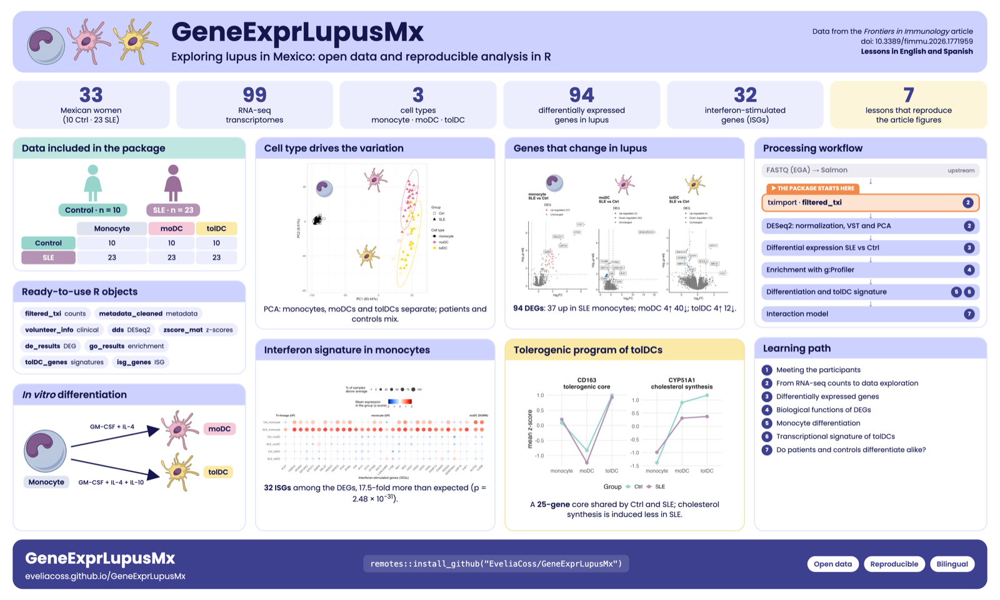
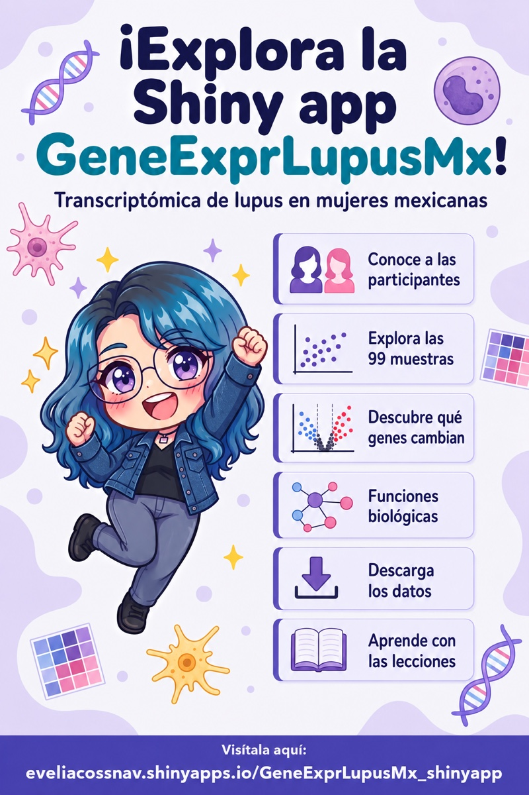

<!-- README.md se genera a partir de README.Rmd. Edita este archivo. -->
<!-- README.md is generated from README.Rmd. Please edit this file. -->

```{r, include = FALSE}
knitr::opts_chunk$set(collapse = TRUE, comment = "#>", fig.path = "man/figures/README-", out.width = "100%")
```

# GeneExprLupusMx

<!-- badges: start -->
[](https://github.com/EveliaCoss/GeneExprLupusMx/actions/workflows/R-CMD-check.yaml)
[](https://app.codecov.io/gh/EveliaCoss/GeneExprLupusMx)
[](https://doi.org/10.5281/zenodo.23751369)
[](LICENSE.md)
<!-- badges: end -->

**[Español](#español) | [English](#english)**

Sitio web / Website: <https://eveliacoss.github.io/GeneExprLupusMx/>



------------------------------------------------------------------------

## Español

### Explorando el lupus en México: datos abiertos y análisis reproducibles en R

`GeneExprLupusMx` es un paquete de datos en R, bilingüe y reproducible, que integra perfiles transcriptómicos y metadatos clínicos de mujeres mexicanas con **lupus eritematoso sistémico (SLE)** y controles sanas. Incluye la expresión génica de *monocitos, células dendríticas derivadas de monocitos (moDC) y células dendríticas tolerogénicas (tolDC)* de 33 voluntarias (10 controles y 23 pacientes; 99 muestras), junto con lecciones que reproducen, paso a paso, las figuras del artículo original.

- **Uso educativo:** recurso didáctico en bioinformática, inmunología y ciencias biomédicas.
- **Análisis reproducibles:** datos, *checkpoints* y scripts (`data-raw/`) para replicar las figuras y análisis del estudio.
- **Ciencia abierta:** hace visibles y reutilizables datos biomédicos generados en América Latina.

### Instalación

```r
# install.packages("remotes")
remotes::install_github("EveliaCoss/GeneExprLupusMx")
```

Algunas lecciones usan paquetes de Bioconductor:

```r
BiocManager::install(c("DESeq2", "ComplexHeatmap"))
```

### Lecciones

- [Primeros pasos con el paquete GeneExprLupusMx](https://eveliacoss.github.io/GeneExprLupusMx/articles/intro_es.html)
- [1. Conociendo a las participantes](https://eveliacoss.github.io/GeneExprLupusMx/articles/clinical_es.html)
- [2. De las cuentas de RNA-seq a la exploración de datos](https://eveliacoss.github.io/GeneExprLupusMx/articles/intro_RNAseq_es.html)
- [3. Genes diferencialmente expresados entre pacientes y controles](https://eveliacoss.github.io/GeneExprLupusMx/articles/l3_DEGs_es.html)
- [4. Funciones biológicas de los genes diferencialmente expresados](https://eveliacoss.github.io/GeneExprLupusMx/articles/l4_GOterms_es.html)
- [5. Diferenciación de monocitos a células dendríticas](https://eveliacoss.github.io/GeneExprLupusMx/articles/l5_DEGs_monocytes_diff_es.html)
- [6. La firma transcripcional de las células dendríticas tolerogénicas](https://eveliacoss.github.io/GeneExprLupusMx/articles/l6_DEGs_tolDcs_es.html)
- [7. ¿Se diferencian igual las células de pacientes y controles?](https://eveliacoss.github.io/GeneExprLupusMx/articles/l7_DEGs_between_groups_es.html)
- [Cómo usar las funciones del paquete](https://eveliacoss.github.io/GeneExprLupusMx/articles/functions_es.html)
- [Descarga de datos](https://eveliacoss.github.io/GeneExprLupusMx/articles/download_es.html)
- [Registro de cambios](https://eveliacoss.github.io/GeneExprLupusMx/articles/news_es.html)

### Shinyapp

Explora los resultados de forma interactiva en la [Shinyapp de GeneExprLupusMx](https://github.com/EveliaCoss/GeneExprLupusMx_shinyapp). Por ahora solo está disponible en español.

<p align="center"><a href="https://github.com/EveliaCoss/GeneExprLupusMx_shinyapp"></a></p>

### Datos

```{r ejemplo}
library(GeneExprLupusMx)
dim(filtered_txi$counts) # genes x muestras
table(metadata_cleaned$Group, metadata_cleaned$Cell_type)
```

Los datos crudos de secuenciación (FASTQ) están en el [European Genome-phenome Archive (EGA)](https://ega-archive.org/) con acceso controlado; los identificadores se encuentran en la Tabla suplementaria 2 del artículo.

### Origen de los datos

Los datos de este paquete provienen del [artículo original](https://www.frontiersin.org/journals/immunology/articles/10.3389/fimmu.2026.1771959/full), del análisis depositado en [Zenodo](https://doi.org/10.5281/zenodo.17742206) y del repositorio de código [NeuroGenomicsMX/SLE_Transcriptomic_analysis_tolerogenic](https://github.com/NeuroGenomicsMX/SLE_Transcriptomic_analysis_tolerogenic) (por ejemplo, las figuras de la [Figura 2](https://github.com/NeuroGenomicsMX/SLE_Transcriptomic_analysis_tolerogenic/tree/main/figures/fig2)). Aquí se reorganizaron en objetos de R listos para usar; los scripts de `data-raw/` documentan cada paso.

### Cómo citar

Hay dos citas: una para el **paquete** y otra para los **datos**. Si usas este recurso, por favor incluye ambas.

#### 1) Cómo citar el paquete

Si usas las lecciones, las funciones o los objetos de R del paquete:

> Coss E (2026) *GeneExprLupusMx: Datos transcriptómicos de lupus en mujeres mexicanas con lecciones de aprendizaje*. Paquete de R. <https://github.com/EveliaCoss/GeneExprLupusMx> [doi: 10.5281/zenodo.23751369](https://doi.org/10.5281/zenodo.23751369).

Este DOI siempre apunta a la versión más reciente; en [Zenodo](https://doi.org/10.5281/zenodo.23751369) encontrarás el DOI de cada versión.

En R:

```r
citation("GeneExprLupusMx")
```

#### 2) Cómo citar los datos

Los datos provienen del artículo original y del análisis depositado en Zenodo:

> Hernández-Ledesma AL, Coss-Navarrete EL, *et al* (2026) [Gene expression profiling of dendritic cell tolerance dysfunction in women with systemic lupus erythematosus](https://www.frontiersin.org/journals/immunology/articles/10.3389/fimmu.2026.1771959/full). *Front. Immunol.* 17:1771959. [doi: 10.3389/fimmu.2026.1771959](https://doi.org/10.3389/fimmu.2026.1771959).

> Coss-Navarrete EL, Hernández-Ledesma AL, *et al* (2025) [Analysis of gene expression profiles during tolerance induction in dendritic cells from women with Systemic Lupus Erythematosus](https://doi.org/10.5281/zenodo.17742206) [Data set]. *Zenodo*. [doi: 10.5281/zenodo.17742206](https://doi.org/10.5281/zenodo.17742206).

### Agradecimientos

**Inspiración.** Este paquete se inspira en [palmerpenguins](https://allisonhorst.github.io/palmerpenguins/) (Allison Horst, Alison Hill y Kristen Gorman), que mostró cómo un paquete de datos abiertos puede convertirse en un recurso educativo para aprender R, y en [karel](https://docs.ropensci.org/karel/) (Marcos Prunello), que demuestra el valor de una documentación bilingüe, en español e inglés, para acercar la programación a más personas.

**rOpenSci.** Agradezco a [rOpenSci](https://ropensci.org/) por seleccionarme como campeona de su [programa Champions](https://ropensci.org/champions/) y por acompañarme en la creación de herramientas abiertas, interactivas y bilingües como esta, pensadas para compartirse con todo el mundo.

**Software libre.** Gracias a las autoras, autores y comunidades que desarrollan y mantienen los paquetes de libre uso que hacen posibles las lecciones:

- **Bioconductor:** [DESeq2](https://bioconductor.org/packages/DESeq2), [tximport](https://bioconductor.org/packages/tximport), [SummarizedExperiment](https://bioconductor.org/packages/SummarizedExperiment), [ComplexHeatmap](https://bioconductor.org/packages/ComplexHeatmap), [rrvgo](https://bioconductor.org/packages/rrvgo) y [org.Hs.eg.db](https://bioconductor.org/packages/org.Hs.eg.db).
- **Análisis y visualización:** [tidyverse](https://CRAN.R-project.org/package=tidyverse) ([dplyr](https://CRAN.R-project.org/package=dplyr), [ggplot2](https://CRAN.R-project.org/package=ggplot2), [tidyr](https://CRAN.R-project.org/package=tidyr), [purrr](https://CRAN.R-project.org/package=purrr)…), [gprofiler2](https://CRAN.R-project.org/package=gprofiler2), [circlize](https://CRAN.R-project.org/package=circlize), [cowplot](https://CRAN.R-project.org/package=cowplot), [ggrepel](https://CRAN.R-project.org/package=ggrepel), [ggh4x](https://CRAN.R-project.org/package=ggh4x), [scales](https://CRAN.R-project.org/package=scales), [readxl](https://CRAN.R-project.org/package=readxl) y [stringi](https://CRAN.R-project.org/package=stringi).
- **Desarrollo y documentación:** [knitr](https://CRAN.R-project.org/package=knitr), [rmarkdown](https://CRAN.R-project.org/package=rmarkdown), [pkgdown](https://CRAN.R-project.org/package=pkgdown), [roxygen2](https://CRAN.R-project.org/package=roxygen2), [usethis](https://CRAN.R-project.org/package=usethis), [testthat](https://CRAN.R-project.org/package=testthat), [remotes](https://CRAN.R-project.org/package=remotes) y [BiocManager](https://CRAN.R-project.org/package=BiocManager).

También agradecemos a los recursos abiertos [g:Profiler](https://biit.cs.ut.ee/gprofiler/), [Gene Ontology](https://geneontology.org/) y [Reactome](https://reactome.org/), y a las voluntarias que participaron en el estudio.

### Licencia

El código del paquete se distribuye bajo la [licencia MIT](LICENSE.md). Los datos originales provienen de las fuentes indicadas en [Origen de los datos](#origen-de-los-datos) (el registro de Zenodo usa la licencia [CC BY 4.0](https://creativecommons.org/licenses/by/4.0/)); si los usas, cita el artículo y el registro de Zenodo.

------------------------------------------------------------------------

## English

### Exploring lupus in Mexico: open data and reproducible analysis in R

`GeneExprLupusMx` is a bilingual, reproducible R data package that integrates transcriptomic profiles and clinical metadata from Mexican women with **systemic lupus erythematosus (SLE)** and healthy controls. It includes gene expression from *monocytes, monocyte-derived dendritic cells (moDCs) and tolerogenic dendritic cells (tolDCs)* of 33 volunteers (10 controls and 23 patients; 99 samples), together with lessons that reproduce, step by step, the figures of the original article.

- **Educational use:** a teaching resource in bioinformatics, immunology and biomedical sciences.
- **Reproducible analyses:** data, checkpoints and scripts (`data-raw/`) to replicate the figures and analyses of the study.
- **Open science:** makes biomedical data generated in Latin America visible and reusable.

### Installation

```r
# install.packages("remotes")
remotes::install_github("EveliaCoss/GeneExprLupusMx")
```

Some lessons use Bioconductor packages:

```r
BiocManager::install(c("DESeq2", "ComplexHeatmap"))
```

### Lessons

- [Get started with GeneExprLupusMx](https://eveliacoss.github.io/GeneExprLupusMx/articles/intro_en.html)
- [1. Meeting the participants](https://eveliacoss.github.io/GeneExprLupusMx/articles/clinical_en.html)
- [2. From RNA-seq counts to data exploration](https://eveliacoss.github.io/GeneExprLupusMx/articles/intro_RNAseq_en.html)
- [3. Differentially expressed genes between patients and controls](https://eveliacoss.github.io/GeneExprLupusMx/articles/l3_DEGs_en.html)
- [4. Biological functions of differentially expressed genes](https://eveliacoss.github.io/GeneExprLupusMx/articles/l4_GOterms_en.html)
- [5. Differentiation of monocytes into dendritic cells](https://eveliacoss.github.io/GeneExprLupusMx/articles/l5_DEGs_monocytes_diff_en.html)
- [6. The transcriptional signature of tolerogenic dendritic cells](https://eveliacoss.github.io/GeneExprLupusMx/articles/l6_DEGs_tolDcs_en.html)
- [7. Do patient and control cells differentiate in the same way?](https://eveliacoss.github.io/GeneExprLupusMx/articles/l7_DEGs_between_groups_en.html)
- [How to use the package functions](https://eveliacoss.github.io/GeneExprLupusMx/articles/functions_en.html)
- [Data download](https://eveliacoss.github.io/GeneExprLupusMx/articles/download_en.html)
- [Changelog](https://eveliacoss.github.io/GeneExprLupusMx/news/index.html)

### Shinyapp

Explore the results interactively in the [GeneExprLupusMx Shinyapp](https://github.com/EveliaCoss/GeneExprLupusMx_shinyapp). For now, it is only available in Spanish.

<p align="center"><a href="https://github.com/EveliaCoss/GeneExprLupusMx_shinyapp"></a></p>

### Data

```{r example}
library(GeneExprLupusMx)
dim(filtered_txi$counts) # genes x samples
table(metadata_cleaned$Group, metadata_cleaned$Cell_type)
```

The raw sequencing data (FASTQ) are deposited in the [European Genome-phenome Archive (EGA)](https://ega-archive.org/) under controlled access; the identifiers are listed in Supplementary Table 2 of the article.

### Data sources

The data in this package come from the [original article](https://www.frontiersin.org/journals/immunology/articles/10.3389/fimmu.2026.1771959/full), the analysis deposited in [Zenodo](https://doi.org/10.5281/zenodo.17742206) and the code repository [NeuroGenomicsMX/SLE_Transcriptomic_analysis_tolerogenic](https://github.com/NeuroGenomicsMX/SLE_Transcriptomic_analysis_tolerogenic) (for example, the [Figure 2](https://github.com/NeuroGenomicsMX/SLE_Transcriptomic_analysis_tolerogenic/tree/main/figures/fig2) figures). Here they were reorganized into ready-to-use R objects; the `data-raw/` scripts document each step.

### How to cite

There are two citations: one for the **package** and one for the **data**. If you use this resource, please include both.

#### 1) How to cite the package

If you use the lessons, functions or R objects of the package:

> Coss E (2026) *GeneExprLupusMx: Transcriptomic data of lupus in Mexican women with learning lessons*. R package. <https://github.com/EveliaCoss/GeneExprLupusMx> [doi: 10.5281/zenodo.23751369](https://doi.org/10.5281/zenodo.23751369).

This DOI always points to the latest version; on [Zenodo](https://doi.org/10.5281/zenodo.23751369) you can find the DOI of each version.

In R:

```r
citation("GeneExprLupusMx")
```

#### 2) How to cite the data

The data come from the original article and the analysis deposited in Zenodo:

> Hernández-Ledesma AL, Coss-Navarrete EL, *et al* (2026) [Gene expression profiling of dendritic cell tolerance dysfunction in women with systemic lupus erythematosus](https://www.frontiersin.org/journals/immunology/articles/10.3389/fimmu.2026.1771959/full). *Front. Immunol.* 17:1771959. [doi: 10.3389/fimmu.2026.1771959](https://doi.org/10.3389/fimmu.2026.1771959).

> Coss-Navarrete EL, Hernández-Ledesma AL, *et al* (2025) [Analysis of gene expression profiles during tolerance induction in dendritic cells from women with Systemic Lupus Erythematosus](https://doi.org/10.5281/zenodo.17742206) [Data set]. *Zenodo*. [doi: 10.5281/zenodo.17742206](https://doi.org/10.5281/zenodo.17742206).

### Acknowledgements

**Inspiration.** This package is inspired by [palmerpenguins](https://allisonhorst.github.io/palmerpenguins/) (Allison Horst, Alison Hill and Kristen Gorman), which showed how an open data package can become an educational resource for learning R, and by [karel](https://docs.ropensci.org/karel/) (Marcos Prunello), which demonstrates the value of bilingual documentation, in Spanish and English, to bring programming to more people.

**rOpenSci.** I thank [rOpenSci](https://ropensci.org/) for selecting me as a champion of its [Champions Program](https://ropensci.org/champions/) and for supporting me in creating open, interactive and bilingual tools like this one, meant to be shared with the world.

**Open-source software.** Thanks to the authors and communities who develop and maintain the free and open-source packages that make the lessons possible:

- **Bioconductor:** [DESeq2](https://bioconductor.org/packages/DESeq2), [tximport](https://bioconductor.org/packages/tximport), [SummarizedExperiment](https://bioconductor.org/packages/SummarizedExperiment), [ComplexHeatmap](https://bioconductor.org/packages/ComplexHeatmap), [rrvgo](https://bioconductor.org/packages/rrvgo) and [org.Hs.eg.db](https://bioconductor.org/packages/org.Hs.eg.db).
- **Analysis and visualization:** [tidyverse](https://CRAN.R-project.org/package=tidyverse) ([dplyr](https://CRAN.R-project.org/package=dplyr), [ggplot2](https://CRAN.R-project.org/package=ggplot2), [tidyr](https://CRAN.R-project.org/package=tidyr), [purrr](https://CRAN.R-project.org/package=purrr)…), [gprofiler2](https://CRAN.R-project.org/package=gprofiler2), [circlize](https://CRAN.R-project.org/package=circlize), [cowplot](https://CRAN.R-project.org/package=cowplot), [ggrepel](https://CRAN.R-project.org/package=ggrepel), [ggh4x](https://CRAN.R-project.org/package=ggh4x), [scales](https://CRAN.R-project.org/package=scales), [readxl](https://CRAN.R-project.org/package=readxl) and [stringi](https://CRAN.R-project.org/package=stringi).
- **Development and documentation:** [knitr](https://CRAN.R-project.org/package=knitr), [rmarkdown](https://CRAN.R-project.org/package=rmarkdown), [pkgdown](https://CRAN.R-project.org/package=pkgdown), [roxygen2](https://CRAN.R-project.org/package=roxygen2), [usethis](https://CRAN.R-project.org/package=usethis), [testthat](https://CRAN.R-project.org/package=testthat), [remotes](https://CRAN.R-project.org/package=remotes) and [BiocManager](https://CRAN.R-project.org/package=BiocManager).

We also thank the open resources [g:Profiler](https://biit.cs.ut.ee/gprofiler/), [Gene Ontology](https://geneontology.org/) and [Reactome](https://reactome.org/), and the volunteers who took part in the study.

### License

The package code is released under the [MIT license](LICENSE.md). The original data come from the sources listed in [Data sources](#data-sources) (the Zenodo record uses the [CC BY 4.0](https://creativecommons.org/licenses/by/4.0/) license); if you use them, please cite the article and the Zenodo record.
