# Lesson 2: From RNA-seq counts to data exploration

## Welcome

This lesson is for you if you are **just starting to analyze
transcriptomics data** (RNA-seq). We will use real data from Mexican
women with lupus and healthy controls to walk, step by step, the path
from a table of numbers to a biological interpretation.

**What you need to know beforehand:** the basics of R (creating objects,
using functions) and, if possible, a little `dplyr` and `ggplot2`. You
do not need to know about RNA-seq: we explain it as we go.

**By the end you will be able to:**

1.  Explain what a **count matrix** and a **metadata** table are.
2.  Build a `DESeqDataSet` object, which is the structure used by
    `DESeq2`.
3.  Explain **why** we need to normalize and **how** `DESeq2` does it.
4.  Transform the data (VST) and explore it with gene plots, *heatmaps*,
    and PCA.
5.  Relate what you see in the plots to the biology of lupus.

**Estimated time:** 1 to 1.5 hours.

### Lesson map

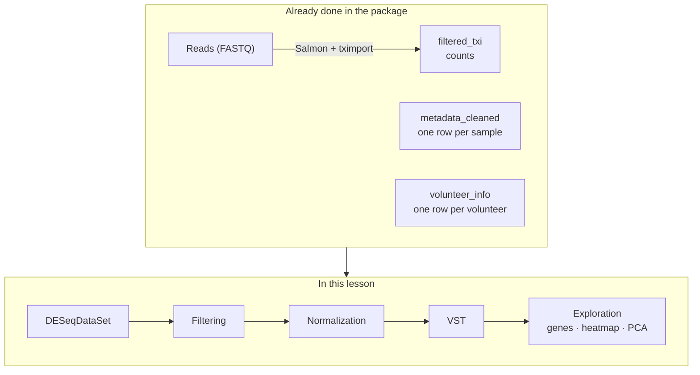

## Glossary

These are the terms we will use. Come back here whenever you need to.

- **Read**: a sequenced fragment of RNA.
- **Count**: number of reads assigned to a gene in a sample.
- **Count matrix**: table of genes (rows) × samples (columns).
- **Metadata**: information that describes each sample.
- **Library size**: total number of reads in a sample (sequencing
  depth).
- **Normalization**: correction that makes samples comparable to each
  other.
- **VST**: logarithm-like transformation that stabilizes the variance.
- **z-score**: standardized value of a gene (in standard deviations from
  its mean).
- **PCA**: technique that summarizes many variables into a few axes.
- **Batch effect**: differences between samples caused by *when* or
  *how* they were processed, not by biology.
- **Key column**: column shared by two tables that is used to join them
  (here, `Volunteer_ID`).
- **ISG**: interferon-stimulated gene.
- **SLEDAI**: clinical index of lupus disease activity.

## 1. Biological context: what are we studying?

**Systemic lupus erythematosus** (SLE) is an **autoimmune** disease: the
immune system mistakenly attacks the body’s own tissues. It mostly
affects women (about 9 out of 10 cases). One of its best-known molecular
features is the **interferon signature**: in patients, many genes that
normally respond to viral infections, called *interferon-stimulated
genes* (ISGs), are switched on.

In this study, three types of immune cells were analyzed:

- **Monocytes** (`monocyte`): cells that circulate in the blood. They
  were obtained directly from each participant.
- **Monocyte-derived dendritic cells** (`moDC`): obtained by culturing
  monocytes with GM-CSF and IL-4. They are “activating”, because they
  present antigens and switch on the immune response.
- **Tolerogenic dendritic cells** (`tolDC`): obtained by culturing
  monocytes with GM-CSF and IL-10. Their role is to “calm down” the
  immune response and promote tolerance.


Overview of the study and of the package contents.

**Study design:** 33 Mexican women took part, 10 healthy controls
(`Ctrl`) and 23 patients with lupus (`SLE`). All three cell types were
obtained from each one, giving **33 × 3 = 99 samples**. The volunteers
were recruited between June 2022 and February 2023. The data come from
the article:

> Hernández-Ledesma AL, Coss-Navarrete EL, *et al* (2026) [Gene
> expression profiling of dendritic cell tolerance dysfunction in women
> with systemic lupus
> erythematosus](https://www.frontiersin.org/journals/immunology/articles/10.3389/fimmu.2026.1771959/full).
> *Front. Immunol.* 17:1771959. [doi:
> 10.3389/fimmu.2026.1771959](https://doi.org/10.3389/fimmu.2026.1771959).

> **Our guiding question:** does gene expression change in these cells
> when a person has lupus?

## 2. RNA-seq in two minutes

1.  **RNA** is extracted from the cells. Each active gene produces
    copies of RNA: the more active, the more copies.
2.  The RNA is fragmented and **sequenced**. Each fragment that is read
    is called a **read**.
3.  A program (here, **Salmon**) identifies which gene each read belongs
    to and **counts** them.

The result is a table: how many reads each gene has in each sample. We
call this table a **count matrix**. More reads means more expression,
but only in *relative* terms, as we will see in the normalization
section.

**Good news:** the heaviest steps (aligning the reads with Salmon and
importing them with `tximport`) are already done. The package includes
the result, ready to analyze.

## 3. Setup

### Installation

Install the package from
[GitHub](https://github.com/EveliaCoss/GeneExprLupusMx) and `DESeq2`
from [Bioconductor](https://bioconductor.org/packages/DESeq2). You only
need to do this once.

``` r

install.packages(c("remotes", "BiocManager", "tidyverse"))
remotes::install_github("EveliaCoss/GeneExprLupusMx")
BiocManager::install("DESeq2")
```

### Load the packages

``` r

library(GeneExprLupusMx) # our data
library(DESeq2)          # RNA-seq normalization and analysis
library(tidyverse)       # table manipulation (dplyr) and plots (ggplot2)
library(ggrepel)         # non-overlapping labels in ggplot2
library(cowplot)         # combine several plots into a panel
```

**Order matters.** `DESeq2` and `dplyr` have functions with the same
name (for example,
[`count()`](https://dplyr.tidyverse.org/reference/count.html) and
[`select()`](https://dplyr.tidyverse.org/reference/select.html)). R uses
the one from the last package loaded; that is why we load `tidyverse`
last. If in doubt, write the package explicitly:
[`dplyr::count()`](https://dplyr.tidyverse.org/reference/count.html).

We define the colors we will use in all the plots, so that each cell
type and each group always have the same color:

``` r

cell_color  <- c(monocyte = "black", moDC = "palevioletred", tolDC = "gold1")
group_color <- c(Ctrl = "#96d4ccff", SLE = "#b493b4ff")
```

## 4. **Step 1:** get to know the data

Before analyzing anything, you have to **look at the data**. This step
prevents most errors.

### 4.1 The count matrix: `filtered_txi`

`filtered_txi` is a list with several matrices. The most important one
is `counts`:

``` r

names(filtered_txi)
#> [1] "abundance"           "counts"              "length"             
#> [4] "countsFromAbundance"
dim(filtered_txi$counts) # genes x samples
#> [1] 21718    99
filtered_txi$counts[1:5, 1:4]
#>          QR011_0   QR011_1  QR011_3 QR013_0
#> A1BG     179.000   134.000  401.000 163.000
#> A1BG-AS1  69.977    76.949  205.607  76.942
#> A1CF       0.000     0.000    0.000   0.000
#> A2M       16.000 27777.937 3700.000  29.584
#> A2M-AS1   11.000    14.063   12.000  24.416
```

- **Rows = genes** (21,718 genes, identified by their symbol, for
  example `A2M`).
- **Columns = samples** (99). Each sample name has two parts: `QR011_1`
  = patient `QR011`, cell type `1` (`_0` = monocyte, `_1` = moDC, `_3` =
  tolDC).

Notice two details:

1.  **Some numbers have decimals.** Salmon *estimates* the counts,
    because some reads could come from more than one gene. There is no
    need to round them by hand: `DESeq2` will do it for us.
2.  **There are many zeros.** What proportion of the table is zero?

``` r

mean(filtered_txi$counts == 0)
#> [1] 0.3492151
```

And the values are very uneven. Let us look at the first sample:

``` r

summary(filtered_txi$counts[, 1])
#>     Min.  1st Qu.   Median     Mean  3rd Qu.     Max. 
#>      0.0      0.0     30.0    873.3    514.8 432335.0
```

Half of the genes have few reads and a few have hundreds of thousands.
This unevenness will matter later.

### 4.2 The metadata: `metadata_cleaned`

The metadata describe **who each sample is**: its group, cell type, age,
treatment, disease activity, etc.

``` r

metadata_cleaned %>%
  dplyr::select(sample_ID, Group, Cell_type, Age, GC, SLEDAI_category) %>%
  head()
#>         sample_ID Group Cell_type Age GC SLEDAI_category
#> QR011_0   QR011_0  Ctrl  monocyte  25 No            Zero
#> QR011_1   QR011_1  Ctrl      moDC  25 No            Zero
#> QR011_3   QR011_3  Ctrl     tolDC  25 No            Zero
#> QR013_0   QR013_0  Ctrl  monocyte  23 No            Zero
#> QR013_1   QR013_1  Ctrl      moDC  23 No            Zero
#> QR013_3   QR013_3  Ctrl     tolDC  23 No            Zero
```

How many samples are there of each combination?

``` r

metadata_cleaned %>%
  dplyr::count(Group, Cell_type)
#>   Group Cell_type  n
#> 1  Ctrl      moDC 10
#> 2  Ctrl  monocyte 10
#> 3  Ctrl     tolDC 10
#> 4   SLE      moDC 23
#> 5   SLE  monocyte 23
#> 6   SLE     tolDC 23
```

The three samples from the same patient are **not independent**: they
share her genetics, age, and clinical history. Let us store the
identifier of each volunteer in a `Volunteer_ID` column:

``` r

metadata_cleaned$Volunteer_ID <- factor(sub("_.*", "", metadata_cleaned$sample_ID))
nlevels(metadata_cleaned$Volunteer_ID) # number of participants
#> [1] 33
```

### 4.3 Do the counts and the metadata match?

This is the **most important** check of the whole analysis: column 1 of
the count matrix must correspond to row 1 of the metadata, column 2 to
row 2, and so on. If the order does not match, all conclusions will be
wrong and R **will not warn you**.

``` r

all(colnames(filtered_txi$counts) == metadata_cleaned$sample_ID)
#> [1] TRUE
```

`TRUE`: we can continue.

**Challenge 1.** How many patients with lupus have nephritis (kidney
damage)? *Hint:* each patient appears three times; filter a single cell
type before counting.

Show solution

``` r

metadata_cleaned %>%
  filter(Cell_type == "monocyte", Group == "SLE") %>%
  dplyr::count(Nephritis)
#>   Nephritis  n
#> 1        No 20
#> 2        Si  3
```

### 4.4 Each volunteer’s information: `volunteer_info`

`metadata_cleaned` has **one row per sample**. But some data belong to
the **person**, not to the sample: when she was recruited, how many
years she has had the diagnosis, or which treatments she receives. If we
put them in `metadata_cleaned`, each value would be repeated three
times. That is why they live in another table, `volunteer_info`, with
**one row per volunteer**. If you did the lesson [Meeting the
participants](https://eveliacoss.github.io/GeneExprLupusMx/articles/clinical_en.md),
you already know it:

``` r

dim(volunteer_info) # 33 volunteers
#> [1] 33 16
head(volunteer_info)
#>   Volunteer_ID Volunteer Group Age_years Years_with_diagnosis
#> 1        QR011         1  Ctrl        25                   NA
#> 2        QR013         2  Ctrl        23                   NA
#> 3        QR014         3   SLE        32                    5
#> 4        QR017         4   SLE        22                    4
#> 5        QR020         5   SLE        42                    5
#> 6        QR021         6   SLE        23                    4
#>   Age_at_diagnosis_years SLEDAI Nephritis Treatment_GCC GCC_drug GCC_dose_mg
#> 1                     NA     NA      <NA>            NA     <NA>          NA
#> 2                     NA     NA      <NA>            NA     <NA>          NA
#> 3                     27      1       Yes          TRUE      PDN           5
#> 4                     18      1        No          TRUE      PDN           8
#> 5                     37      0        No         FALSE     <NA>          NA
#> 6                     19      0        No         FALSE     <NA>          NA
#>   Treatment_AM Treatment_MMF Treatment_AZT Treatment_MTT Time_of_recruitment
#> 1           NA            NA            NA            NA          2022-06-01
#> 2           NA            NA            NA            NA          2022-06-01
#> 3         TRUE          TRUE         FALSE         FALSE          2022-06-01
#> 4        FALSE         FALSE         FALSE         FALSE          2022-06-01
#> 5         TRUE         FALSE          TRUE         FALSE          2022-06-01
#> 6        FALSE         FALSE         FALSE         FALSE          2022-06-01
```

The two tables share the `Volunteer_ID` column. It is the **key
column**: it will let us join them when we need to (you will do this in
Challenge 4).

With this table, Challenge 1 is solved in one line, because each person
appears only once:

``` r

volunteer_info %>%
  dplyr::count(Group, Nephritis)
#>   Group Nephritis  n
#> 1  Ctrl      <NA> 10
#> 2   SLE        No 20
#> 3   SLE       Yes  3
```

How many volunteers were recruited each month?

``` r

volunteer_info %>%
  mutate(Recruitment = format(Time_of_recruitment, "%Y-%m")) %>% # "2022-06", "2022-07", ...
  dplyr::count(Recruitment, Group) %>%
  pivot_wider(names_from = Group, values_from = n, values_fill = 0)
#> # A tibble: 8 × 3
#>   Recruitment  Ctrl   SLE
#>   <chr>       <int> <int>
#> 1 2022-06         2     4
#> 2 2022-07         0     1
#> 3 2022-08         3     1
#> 4 2022-09         0     1
#> 5 2022-10         1     4
#> 6 2022-12         1     1
#> 7 2023-01         2    10
#> 8 2023-02         1     1
```

Notice January 2023: 10 patients and only 2 controls were recruited.
Remember this detail; we will come back to it in the PCA.

## 5. **Step 2:** create the `DESeqDataSet` object

`DESeq2` stores everything in a single object, like a **file folder**
with three parts:

| Part     | What it contains                        | How to see it  |
|----------|-----------------------------------------|----------------|
| Counts   | The genes × samples matrix              | `counts(dds)`  |
| Metadata | The information on each sample          | `colData(dds)` |
| Design   | Which variables explain the differences | `design(dds)`  |

Before creating it we choose the **reference levels**, that is, what we
compare against. The natural choice is to compare against healthy
controls (`Ctrl`) and against monocytes, the cell of origin.

``` r

metadata_cleaned$Group     <- relevel(metadata_cleaned$Group, ref = "Ctrl")
metadata_cleaned$Cell_type <- relevel(metadata_cleaned$Cell_type, ref = "monocyte")

dds <- DESeqDataSetFromTximport(txi     = filtered_txi,
                                colData = metadata_cleaned,
                                design  = ~ Cell_type + Group)
dds
#> class: DESeqDataSet 
#> dim: 21718 99 
#> metadata(1): version
#> assays(2): counts avgTxLength
#> rownames(21718): A1BG A1BG-AS1 ... ZZEF1 ZZZ3
#> rowData names(0):
#> colnames(99): QR011_0 QR011_1 ... QR108_1 QR108_3
#> colData names(15): sample_ID Group ... SLEDAI_category Volunteer_ID
```

The formula `~ Cell_type + Group` reads: *“the expression of each gene
depends on the cell type and the group (lupus or control)”*.

When using
[`DESeqDataSetFromTximport()`](https://rdrr.io/pkg/DESeq2/man/DESeqDataSet.html),
the message `using counts and average transcript lengths from tximport`
appears. It means that `DESeq2` also stored the **transcript length** of
each gene in each sample and will use it when normalizing.

## 6. **Step 3:** filter lowly expressed genes

A gene with 0 or 2 reads in almost all samples provides no information:
it is noise. We remove it.

**Rule:** we keep genes with **at least 10 reads in at least 10
samples**. We chose 10 samples because that is the size of the smallest
group (10 controls per cell type). This way we do not discard a gene
that is only expressed in that group.

``` r

keep <- rowSums(counts(dds) >= 10) >= 10
table(keep) # FALSE = removed, TRUE = kept
#> keep
#> FALSE  TRUE 
#>  8122 13596
dds <- dds[keep, ]
dim(dds)
#> [1] 13596    99
```

## 7. **Step 4:** normalization

### 7.1 Why do we need to normalize?

Imagine two samples with the same gene X:

``` r

tibble(sample      = c("A", "B"),
       total_reads = c(10e6, 20e6),
       geneX_reads = c(100, 200)) %>%
  mutate(geneX_per_million = geneX_reads / total_reads * 1e6)
#> # A tibble: 2 × 4
#>   sample total_reads geneX_reads geneX_per_million
#>   <chr>        <dbl>       <dbl>             <dbl>
#> 1 A         10000000         100                10
#> 2 B         20000000         200                10
```

Sample B has twice as many reads of gene X, but it **was also sequenced
twice as deeply**. Once corrected, gene X is expressed equally in both.
That correction is **normalization**.

Does sequencing depth vary much in our data?

``` r

tibble(sample_ID = colnames(dds),
       million_reads  = colSums(counts(dds)) / 1e6,
       Cell_type = dds$Cell_type) %>%
  ggplot(aes(x = reorder(sample_ID, million_reads), y = million_reads, fill = Cell_type)) +
  geom_col() +
  scale_fill_manual(values = cell_color) +
  labs(x = "Samples (sorted)", y = "Millions of reads", fill = "Cell type",
       title = "Library size per sample") +
  theme_minimal() +
  theme(axis.text.x = element_blank())
```

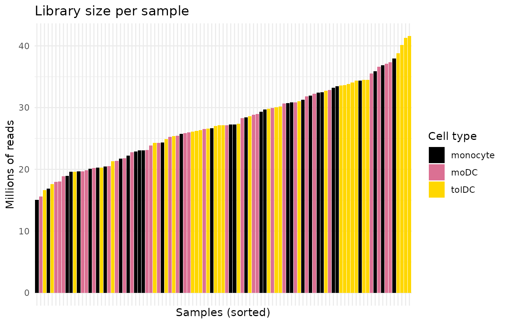

Yes: some samples have several times more reads than others. **Without
normalizing, we would be comparing sequencing depth, not biology.**

### 7.2 How does DESeq2 normalize?

`DESeq2` uses the **median of ratios** method. In simple terms:

1.  For each gene it calculates a reference “average” sample (the
    geometric mean across all samples).
2.  It divides each sample by that reference, gene by gene.
3.  The **median** of those ratios is the sample’s **normalization
    factor**. Using the median prevents a few highly expressed genes
    from distorting the result.

With `tximport` data there is an extra detail: besides depth, the
**transcript length**, which can vary between samples, is also
corrected. That is why, instead of a single number per sample
(`sizeFactors`), `DESeq2` stores a table of gene × sample factors
(`normalizationFactors`).

``` r

dds <- estimateSizeFactors(dds)
sizeFactors(dds)                    # NULL: not used with tximport
#> NULL
normalizationFactors(dds)[1:4, 1:4] # gene x sample factors
#>            QR011_0   QR011_1   QR011_3   QR013_0
#> A1BG     0.7292214 0.7590954 0.9675822 0.8422480
#> A1BG-AS1 0.7301966 0.7591523 0.9701181 0.8427474
#> A2M      0.7285477 0.7554575 0.9710304 0.9000925
#> A2M-AS1  0.7302545 0.7590955 0.9703467 0.8427377
```

With the factors calculated, we can now obtain the **normalized
counts**:

``` r

norm_counts <- counts(dds, normalized = TRUE)
norm_counts[1:4, 1:4]
#>            QR011_0    QR011_1    QR011_3   QR013_0
#> A1BG     245.46729   176.5259  414.43509 193.52969
#> A1BG-AS1  95.86459   101.4289  212.34528  91.36783
#> A2M       21.96150 36769.7731 3810.38550  33.32991
#> A2M-AS1   15.06324    18.4430   12.36671  28.47861
```

**Important:** normalized counts are for **comparing and plotting**. For
the differential expression analysis
([`DESeq()`](https://rdrr.io/pkg/DESeq2/man/DESeq.html)), the **raw
counts** are always used, because `DESeq2` applies the normalization
internally. Never pass it already normalized counts.

## 8. **Step 5:** variance stabilizing transformation (VST)

### 8.1 Why another transformation?

Normalized counts still have a problem: **highly expressed genes vary
much more than lowly expressed ones**, just because of their scale. If
we ran a PCA or a *heatmap* with them, a few very abundant genes would
dominate the result.

The solution is to use a logarithmic scale. But `log2(x + 1)`
exaggerates the noise of genes with few counts. The **VST** (*variance
stabilizing transformation*) is a “smart” logarithm that fixes this.

``` r

vsd <- vst(dds, blind = FALSE)
assay(vsd)[1:4, 1:4] # values on an approximately log2 scale
#>           QR011_0   QR011_1   QR011_3  QR013_0
#> A1BG     8.335329  7.980506  8.947756 8.076851
#> A1BG-AS1 7.396740  7.446462  8.176147 7.355095
#> A2M      6.400719 15.169477 11.926583 6.626424
#> A2M-AS1  6.229470  6.317794  6.150936 6.536546
```

**`blind = TRUE` or `blind = FALSE`?** With `blind = FALSE`, the
transformation knows the design (`~ Cell_type + Group`) and does not
confuse expected biological differences with noise. This is recommended
for plots and downstream analyses. Use `blind = TRUE` if you want an
exploration that knows nothing about the design, for example, for
quality control.

Let us check it: the plot shows, for each gene, its mean expression (x
axis) against its standard deviation (y axis). Ideally the line is
**flat**: variability should not depend on how much the gene is
expressed.

``` r

mean_vs_sd <- function(mat, label) {
  tibble(mean = rowMeans(mat), sd = apply(mat, 1, sd), scale = label)
}

bind_rows(mean_vs_sd(log2(norm_counts + 1), "log2(normalized counts + 1)"),
          mean_vs_sd(assay(vsd), "VST")) %>%
  ggplot(aes(x = mean, y = sd)) +
  geom_point(alpha = 0.05, size = 0.4) +
  geom_smooth(color = "red", se = FALSE) +
  facet_wrap(~ scale) +
  labs(x = "Mean gene expression", y = "Standard deviation") +
  theme_minimal()
```

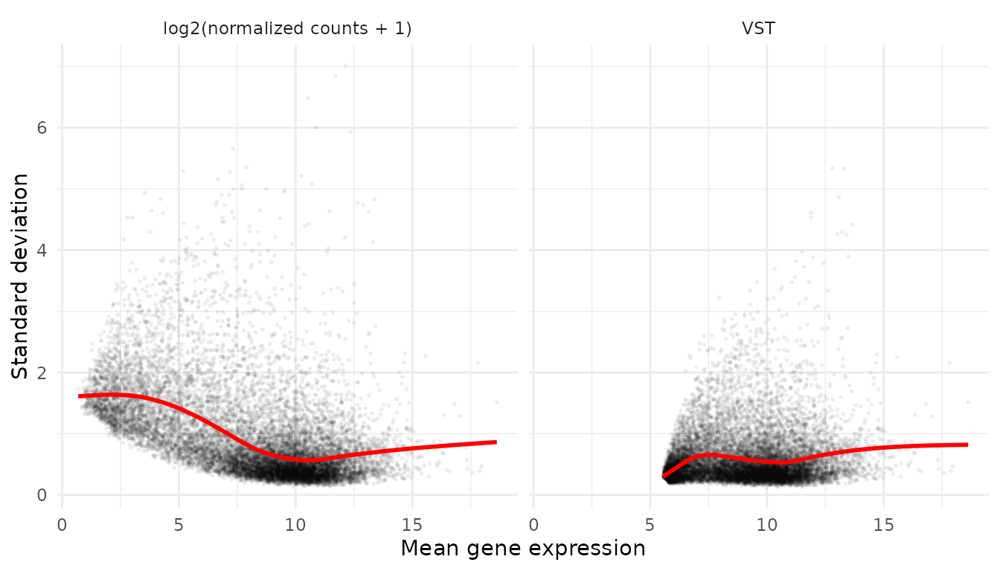

With `log2(x + 1)`, lowly expressed genes (left) have inflated
variability. With VST the red line is flatter.

### 8.2 Did the normalization work?

If everything went well, the distributions of all samples should be
**aligned**. Each box is a sample:

``` r

to_long <- function(mat, stage) {
  as.data.frame(mat) %>%
    rownames_to_column("gene") %>%
    pivot_longer(-gene, names_to = "sample_ID", values_to = "value") %>%
    mutate(stage = stage)
}

bind_rows(to_long(log2(counts(dds) + 1), "1. log2(raw counts + 1)"),
          to_long(log2(norm_counts + 1), "2. log2(normalized counts + 1)"),
          to_long(assay(vsd), "3. VST")) %>%
  left_join(metadata_cleaned, by = "sample_ID") %>%
  ggplot(aes(x = sample_ID, y = value, fill = Cell_type)) +
  geom_boxplot(outlier.shape = NA, linewidth = 0.2, color = "grey50") + # grey outline: visible on black
  facet_wrap(~ stage, ncol = 1, scales = "free_y") +
  scale_fill_manual(values = cell_color) +
  labs(x = "Samples", y = "Expression", fill = "Cell type") +
  theme_minimal() +
  theme(axis.text.x = element_blank())
```

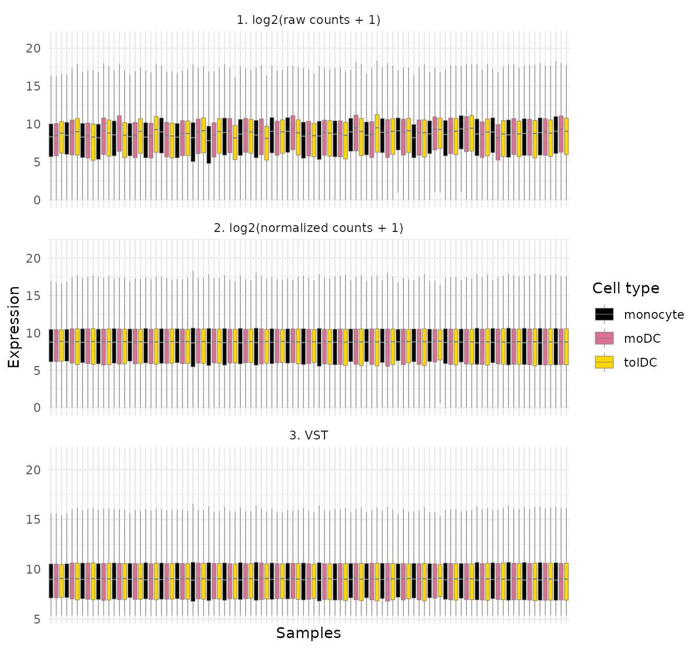

In panel 1 the boxes go up and down from one sample to the next; in
panels 2 and 3 they are at the same height. The normalization worked.

## 9. **Step 6:** explore individual genes

### 9.1 Do the data make biological sense?

Before looking for something new, check something you **already know**.
If the data are good, the marker genes of each cell type should behave
as expected:

- **CD14**: classic monocyte marker.
- **CD1A** and **CD209** (DC-SIGN): dendritic cell markers.

First we prepare a long-format table with the VST expression and the
metadata. This is the format that `ggplot2` prefers:

``` r

expr_long <- to_long(assay(vsd), "VST") %>%
  dplyr::select(gene, sample_ID, expression = value) %>%
  left_join(metadata_cleaned, by = "sample_ID")
head(expr_long)
#> # A tibble: 6 × 17
#>   gene  sample_ID expression Group GC    Dose  Dose_category Age   Cell_type
#>   <chr> <chr>          <dbl> <fct> <fct> <fct> <fct>         <fct> <fct>    
#> 1 A1BG  QR011_0         8.34 Ctrl  No    0     0             25    monocyte 
#> 2 A1BG  QR011_1         7.98 Ctrl  No    0     0             25    moDC     
#> 3 A1BG  QR011_3         8.95 Ctrl  No    0     0             25    tolDC    
#> 4 A1BG  QR013_0         8.08 Ctrl  No    0     0             23    monocyte 
#> 5 A1BG  QR013_1         8.25 Ctrl  No    0     0             23    moDC     
#> 6 A1BG  QR013_3         8.18 Ctrl  No    0     0             23    tolDC    
#> # ℹ 8 more variables: Group_age <fct>, Nephritis <fct>, Other_tx <fct>,
#> #   Sledai_score <fct>, Sledai_group <fct>, SLEDAI_Md <fct>,
#> #   SLEDAI_category <fct>, Volunteer_ID <fct>
```

``` r

expr_long %>%
  filter(gene %in% c("CD14", "CD1A", "CD209")) %>%
  ggplot(aes(x = Cell_type, y = expression, fill = Cell_type)) +
  geom_boxplot(outlier.shape = NA, alpha = 0.8, color = "grey50") +
  geom_jitter(width = 0.15, size = 0.8, alpha = 0.6, color = "grey50") +
  facet_wrap(~ gene, scales = "free_y") +
  scale_fill_manual(values = cell_color) +
  labs(x = NULL, y = "Expression (VST)", title = "Cell type marker genes") +
  theme_minimal() +
  theme(legend.position = "none")
```

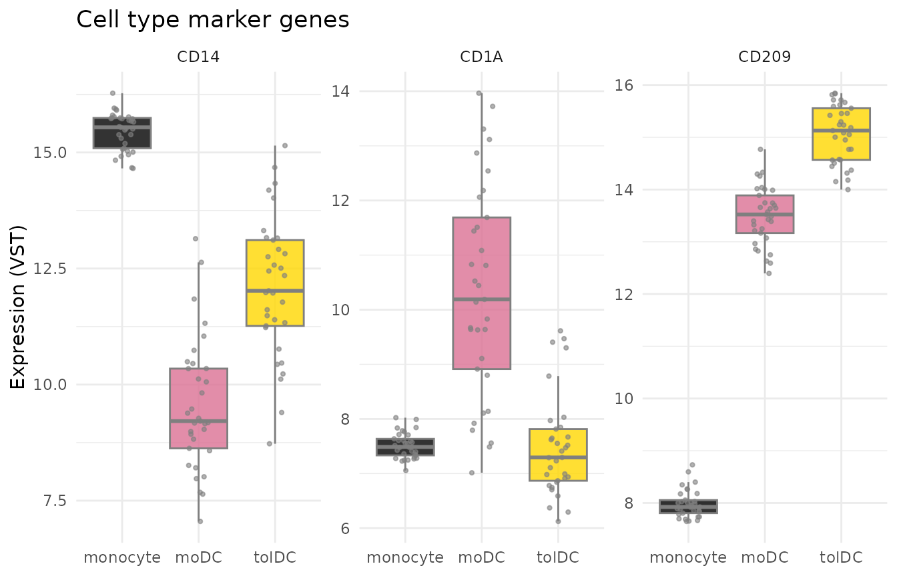

`CD14` is high in monocytes and `CD1A` in moDC, just as we expected. The
data make sense.

### 9.2 The interferon signature in lupus

Now for the question of the study. Let us look at four
interferon-stimulated genes (ISGs) reported in the article: **IFI27,
IFI44L, USP18, and IFI6**.

``` r

isg <- c("IFI27", "IFI44L", "USP18", "IFI6")

expr_long %>%
  filter(gene %in% isg) %>%
  ggplot(aes(x = Cell_type, y = expression, fill = Group)) +
  geom_boxplot(outlier.shape = NA, alpha = 0.8) +
  geom_point(position = position_jitterdodge(jitter.width = 0.15), size = 0.7, alpha = 0.6) +
  facet_wrap(~ gene, scales = "free_y") +
  scale_fill_manual(values = group_color) +
  labs(x = NULL, y = "Expression (VST)", fill = "Group",
       title = "Interferon-stimulated genes") +
  theme_minimal()
```

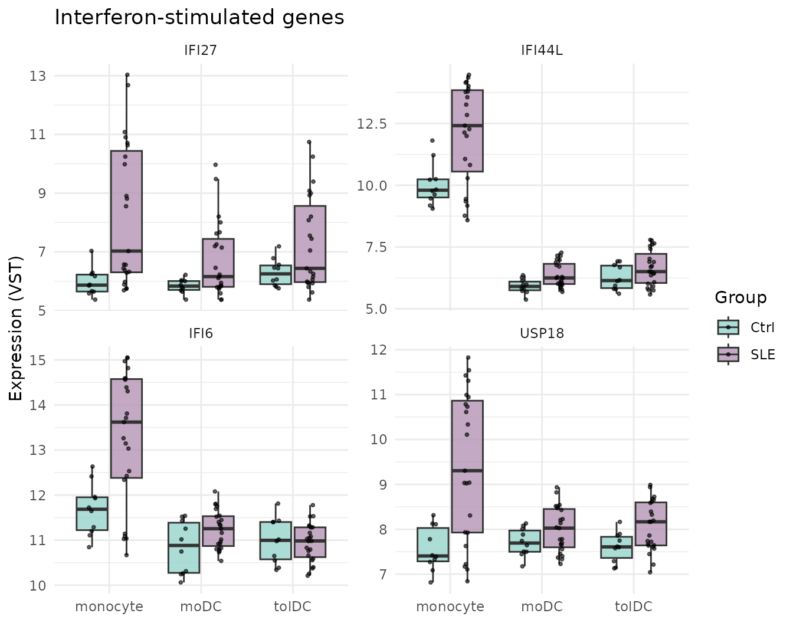

**What do you observe?** In **monocytes**, patients with lupus (lilac)
express these genes more than controls (teal). Notice also that the
patients’ points are widely spread: some patients have very high values
and others have values similar to controls. In moDC and tolDC the
difference is much smaller: when differentiating *in vitro*, away from
the inflammatory environment of the body, the cells partly “forget” the
interferon signal.

**This is not yet a statistical test.** A plot suggests differences; to
assert them, a differential expression analysis (for example, with
[`DESeq()`](https://rdrr.io/pkg/DESeq2/man/DESeq.html)) is needed, which
takes into account variability and multiple comparisons.

**Challenge 2.** The article reports that in tolDC from patients with
lupus, **IL10RA**, the receptor of the anti-inflammatory signal IL-10,
decreases. Plot `IL10RA` and `IRF4` by cell type and group. Do you see
any difference?

Show solution

``` r

expr_long %>%
  filter(gene %in% c("IL10RA", "IRF4")) %>%
  ggplot(aes(x = Cell_type, y = expression, fill = Group)) +
  geom_boxplot(outlier.shape = NA) +
  facet_wrap(~ gene, scales = "free_y") +
  scale_fill_manual(values = group_color) +
  theme_minimal()
```


## 10. **Step 7:** *heatmap* with z-scores

A *heatmap* shows many genes and samples at once using colors. But each
gene has its own scale (one may hover around 6 and another around 15),
so we first **standardize** them with the **z-score**:

``` math
z = \frac{\text{expression} - \text{gene mean}}{\text{gene standard deviation}}
```

A z-score of `+2` means *“this gene is 2 standard deviations above its
own average in this sample”*. This way all genes end up on the same
scale.

Calculate the z-scores on the **transformed (VST) data**, never on the
raw counts. Raw counts are not corrected for sequencing depth, so the
*heatmap* would show library size instead of biology.

``` r

vsd_mat <- assay(vsd)
vsd_mat <- vsd_mat[apply(vsd_mat, 1, var) > 0, ] # remove genes with no variation
zscore_mat <- t(scale(t(vsd_mat)))               # scale() works by columns: we transpose
dim(zscore_mat)
#> [1] 13596    99
round(zscore_mat[1:4, 1:4], 2)
#>          QR011_0 QR011_1 QR011_3 QR013_0
#> A1BG        1.02    0.15    2.51    0.39
#> A1BG-AS1   -0.38   -0.26    1.48   -0.48
#> A2M        -1.35    1.12    0.20   -1.28
#> A2M-AS1    -0.28    0.01   -0.54    0.72
```

We draw the *heatmap* of a set of ISGs, with the samples grouped by cell
type and group:

``` r

isg_extended <- c("IFI27", "IFI44L", "IFI44", "USP18", "IFI6", "ISG15", "MX1", "RSAD2", "IFIT1", "OAS1")

as.data.frame(zscore_mat[isg_extended, ]) %>%
  rownames_to_column("gene") %>%
  pivot_longer(-gene, names_to = "sample_ID", values_to = "z") %>%
  left_join(metadata_cleaned, by = "sample_ID") %>%
  mutate(z = pmin(pmax(z, -2), 2)) %>% # limit to [-2, 2] so extremes do not dominate the color
  ggplot(aes(x = sample_ID, y = gene, fill = z)) +
  geom_tile() +
  facet_grid(~ Cell_type + Group, scales = "free_x", space = "free_x") +
  scale_fill_gradient2(low = "steelblue", mid = "white", high = "firebrick") +
  labs(x = "Samples", y = NULL, fill = "z-score") +
  theme_minimal() +
  theme(axis.text.x = element_blank(), panel.grid = element_blank(),
        strip.text = element_text(size = 7))
```

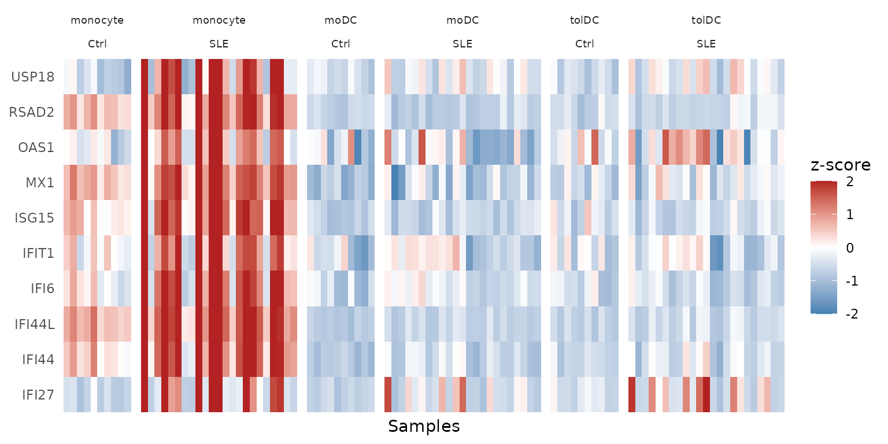

The red columns in `monocyte / SLE` are the **interferon signature**:
the 10 genes go up **together** in the same patients. It is also clear
that not all patients have it; we will return to this in the PCA.

## 11. **Step 8:** principal component analysis (PCA)

### 11.1 What is a PCA?

Each sample is described by thousands of genes, and we cannot plot
thousands of dimensions. PCA looks for the **directions in which the
samples differ the most** and summarizes them into a few axes:

- **PC1** is the axis that captures most of the variation.
- **PC2** captures most of the remaining variation, and so on.

It is like taking a photo of a 3D object from the angle that best shows
its shape. If two samples are close together in the PCA, their
expression profiles are similar.

### 11.2 Compute the PCA

We use **all the genes** that passed the filter. Since we will repeat
the calculation, we store it in a function:

``` r

calc_pca <- function(vsd_obj) {
  pca <- prcomp(t(assay(vsd_obj))) # prcomp() wants samples in rows, genes in columns
  list(
    data     = cbind(as.data.frame(pca$x[, 1:2]), as.data.frame(colData(vsd_obj))),
    variance = round(100 * pca$sdev^2 / sum(pca$sdev^2), 2) # % of variance per PC
  )
}

pca_all <- calc_pca(vsd)
head(pca_all$variance)
#> [1] 63.44  9.51  3.71  2.62  2.05  1.94
```

How much information does each component hold? We see it in a *scree
plot*:

``` r

scree_df <- data.frame(
  component = seq_along(pca_all$variance),
  variance  = pca_all$variance,
  label     = paste0("PC", seq_along(pca_all$variance), ": ", pca_all$variance, "%")
)

ggplot(scree_df, aes(x = component, y = variance)) +
  geom_point(color = "steelblue", size = 3) +
  geom_line(color = "steelblue") +
  geom_text_repel(data = scree_df[1:4, ], aes(label = label), # labels only for PC1-PC4
                  size = 5, box.padding = unit(0.35, "lines"),
                  point.padding = unit(0.3, "lines"),
                  color = "darkred", fontface = "bold") +
  labs(title = "Scree plot: variance explained by PCA",
       x = "Principal component",
       y = "Percentage of variance explained") +
  theme_minimal()
```

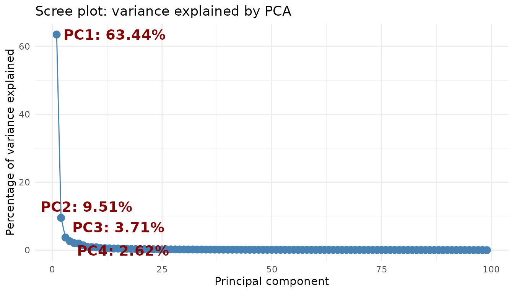

PC1 and PC2 together explain almost three quarters of the variation;
from PC3 on, each component contributes very little. Plotting the first
two will be enough.

### 11.3 Plot the PCA

``` r

ggplot(pca_all$data, aes(x = PC1, y = PC2, color = Cell_type)) +
  stat_ellipse() +
  geom_point(aes(shape = Group), size = 3) +
  scale_color_manual(values = cell_color) +
  scale_shape_manual(values = c(Ctrl = 1, SLE = 17)) +
  labs(x = paste0("PC1 (", pca_all$variance[1], "%)"),
       y = paste0("PC2 (", pca_all$variance[2], "%)"),
       color = "Cell type", shape = "Group") +
  theme_light()
```

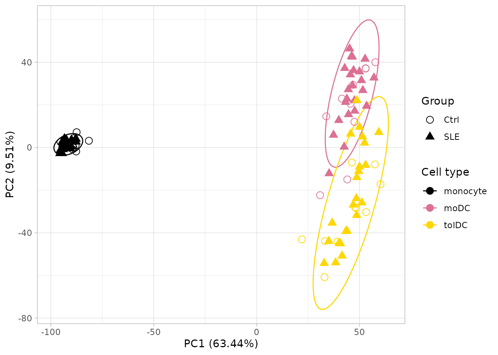

**What does it tell us?**

- **PC1** separates monocytes from dendritic cells: differentiation
  completely changes the expression profile.
- **PC2** separates moDC from tolDC.
- Controls and patients **mix together** within each cell type.

Conclusion: **cell type is, by far, the largest source of variation.**
The effect of lupus is more subtle and gets “masked”.

**All genes or only the most variable ones?** Many tutorials compute the
PCA with only the 500 most variable genes. That choice changes the
result: with 500 genes, PC1 explains about 80% of the variation; with
all of them, about 63%. Here we use all genes. **Always report how many
genes you used.**

### 11.4 Looking within a single cell type

To see the effect of lupus we have to **remove the variation due to cell
type**. Let us repeat the PCA with monocytes only, which is where we saw
the interferon signature:

``` r

pca_mono <- calc_pca(vsd[, vsd$Cell_type == "monocyte"])

ggplot(pca_mono$data, aes(x = PC1, y = PC2, color = Group)) +
  stat_ellipse() +
  geom_point(size = 3) +
  scale_color_manual(values = group_color) +
  labs(x = paste0("PC1 (", pca_mono$variance[1], "%)"),
       y = paste0("PC2 (", pca_mono$variance[2], "%)"),
       color = "Group", title = "PCA: monocytes only") +
  theme_light()
```

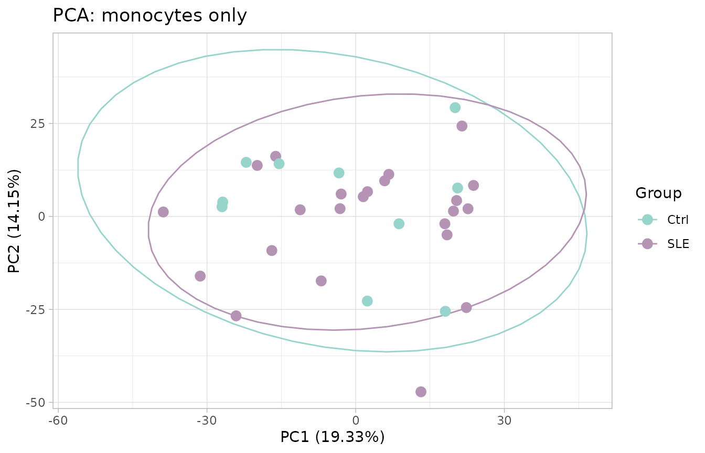

Surprise: **even so, controls and patients mix together.** Does that
mean there are no differences? No. Remember that in section 9.2 only
*some* of the patients had an elevated interferon signature. Let us
check it by summarizing the 10 ISGs from the *heatmap* into a single
number per sample, the **interferon signature score** (the average of
their z-scores):

``` r

pca_mono$data$ifn_score <- colMeans(zscore_mat[isg_extended, rownames(pca_mono$data)])

ggplot(pca_mono$data, aes(x = PC1, y = PC2, color = ifn_score, shape = Group)) +
  geom_point(size = 3) +
  scale_color_gradient2(low = "steelblue", mid = "grey85", high = "firebrick") +
  scale_shape_manual(values = c(Ctrl = 1, SLE = 17)) +
  labs(x = paste0("PC1 (", pca_mono$variance[1], "%)"),
       y = paste0("PC2 (", pca_mono$variance[2], "%)"),
       color = "Interferon\nsignature", shape = "Group", title = "PCA: monocytes only") +
  theme_light()
```

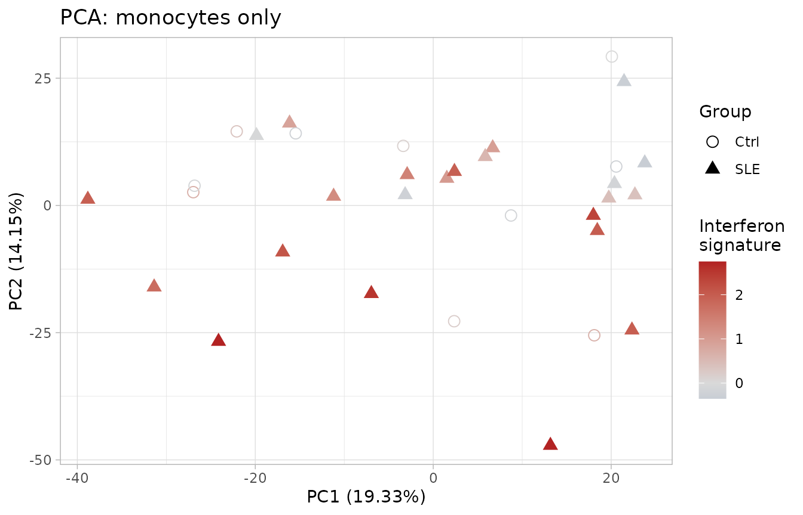

Now a pattern does appear! **PC2 is related to the interferon
signature**: patients with the highest signature (red) tend to sit at
the bottom. We learned three things:

- PCA shows the **largest** sources of variation, which do not always
  coincide with the groups we are interested in.
- Lupus is **heterogeneous**: some patients have a strong interferon
  signature and others look like controls.
- That two groups do not separate in a PCA does **not mean** they have
  no different genes.

### 11.5 Challenges: what other variables explain the variation?

PCA lets you ask the data **which variables are associated with
differences between samples**. Coloring the points by different
variables is the fastest way to do it. Now it is your turn.

**Challenge 3. Disease activity.** Color the PCA of all samples
(`pca_all`) by `SLEDAI_category` (lupus activity according to the SLEDAI
index) and draw an ellipse for each cell type. Do samples from patients
with active disease separate from the others?

*Hints:*

1.  `SLEDAI_category` is already in `pca_all$data`, because it comes
    from the metadata.
2.  Color the points with `aes(color = SLEDAI_category)` and add the
    ellipses with `stat_ellipse(aes(color = Cell_type))`.

Show solution

``` r

# Colors: cell types (ellipses) and activity (points)
sledai_colors <- c(
  cell_color,
  "Activity"    = "#FC8D62",
  "No_activity" = "#8DA0CB",
  "Zero"        = "#66C2A5"
)

ggplot(pca_all$data, aes(x = PC1, y = PC2, color = SLEDAI_category)) +
  geom_point(aes(shape = Group), size = 3.5) +
  stat_ellipse(aes(color = Cell_type)) +
  scale_shape_manual(values = c(Ctrl = 0, SLE = 17)) +
  scale_color_manual(values = sledai_colors, breaks = names(sledai_colors)) +
  labs(x = sprintf("PC1 (%.2f%%)", pca_all$variance[1]),
       y = sprintf("PC2 (%.2f%%)", pca_all$variance[2]),
       color = "SLEDAI",
       shape = "Group") +
  theme_light() +
  theme(plot.background = element_rect(fill = "white"),
        text = element_text(size = 12),
        axis.title = element_text(size = 12),
        legend.title = element_text(size = 12),
        legend.text = element_text(size = 12),
        legend.key.size = unit(1.5, "lines"))
```

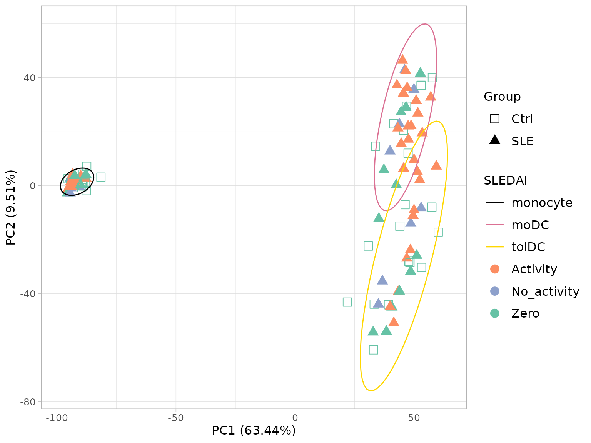

Within each cell type, the colors appear mixed: disease activity does
not separate the samples as much as cell type does. Notice also that
controls appear as `Zero`, because they do not have lupus.

**Challenge 4. Sample collection date (batch effect).** The volunteers
were recruited over nine months. If something technical changed on each
date (the reagent batch, the person who processed the cells, the
sequencing run), samples may resemble each other **because of the date
they were collected** rather than because of their biology. This is
called a **batch effect**.

Color the PCA of all samples (`pca_all`) by sample collection date
(`Time_of_recruitment`) and draw an ellipse for each cell type.

*Hints:*

1.  The date is in `volunteer_info` (one row per volunteer) and the PCA
    has one row per sample. Join them with
    [`left_join()`](https://dplyr.tidyverse.org/reference/mutate-joins.html)
    using the key column `Volunteer_ID`.
2.  Color the points by date with `aes(color = ...)` and add the
    ellipses with `stat_ellipse(aes(color = Cell_type))`.

Show solution

``` r

# 1. Sample collection date for each volunteer, as text ("June 2022")
recruitment <- volunteer_info %>%
  dplyr::select(Volunteer_ID, Time_of_recruitment) %>%
  mutate(Date_sample = paste(month.name[as.integer(format(Time_of_recruitment, "%m"))],
                             format(Time_of_recruitment, "%Y")))

# 2. Join the date to each PCA sample
pca_all_date <- left_join(pca_all$data, recruitment, by = "Volunteer_ID")

# 3. Colors: cell types (ellipses) and dates (points)
date_colors <- c(
  cell_color,
  "June 2022"      = "#66C2A5",
  "July 2022"      = "#8DA0CB",
  "August 2022"    = "#FC8D62",
  "September 2022" = "#E78AC3",
  "October 2022"   = "#A6D854",
  "December 2022"  = "#FFD92F",
  "January 2023"   = "#E5C494",
  "February 2023"  = "#B3B3B3"
)

# 4. Plot
p_date <- ggplot(pca_all_date, aes(x = PC1, y = PC2, color = Date_sample)) +
  geom_point(aes(shape = Group), size = 3.5) +
  stat_ellipse(aes(color = Cell_type)) +
  scale_shape_manual(values = c(Ctrl = 0, SLE = 17)) +
  scale_color_manual(values = date_colors, breaks = names(date_colors)) +
  labs(x = sprintf("PC1 (%.2f%%)", pca_all$variance[1]),
       y = sprintf("PC2 (%.2f%%)", pca_all$variance[2]),
       color = "Sample date",
       shape = "Group") +
  theme_light() +
  theme(plot.background = element_rect(fill = "white"),
        text = element_text(size = 12),
        axis.title = element_text(size = 12),
        legend.title = element_text(size = 12),
        legend.text = element_text(size = 12),
        legend.key.size = unit(1.5, "lines"))
p_date
```

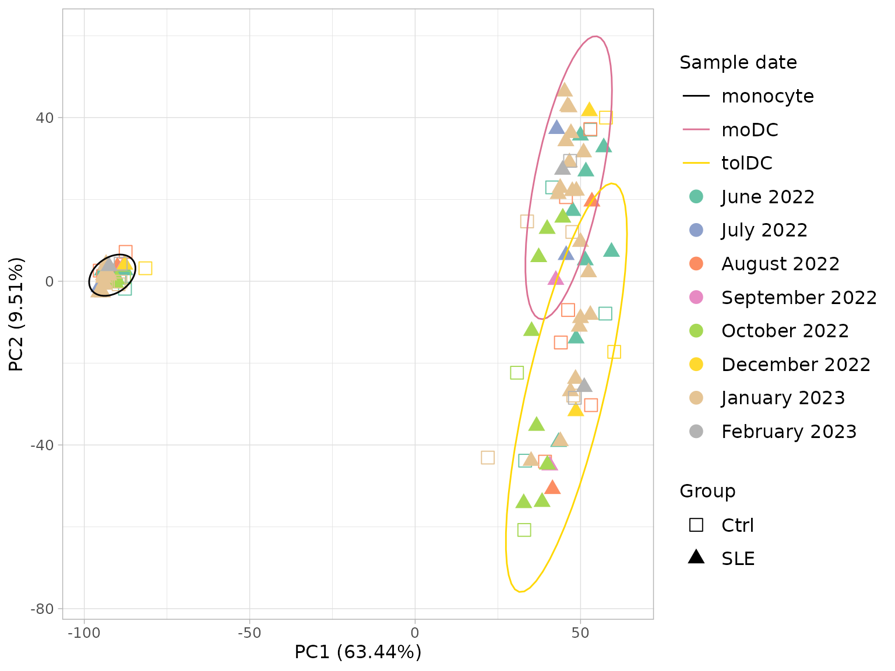

**When planning a study**, try to recruit controls and patients on the
same dates. That way batch and group are not confounded.

### 11.6 To finish: the article figure

Let us bring the three PCAs together in a single panel, as they appear
in the original article. We already have the date one (`p_date`, from
Challenge 4); we build the other two in the same style:

- **A.** Cell type, the PCA from section 11.3.
- **C.** Disease activity. We use the `SLEDAI` column of
  `volunteer_info`, coded as follows: `1` = active (SLEDAI ≥ 6 points),
  `0` = no activity or low activity (0–5 points), and `NA` = controls.

``` r

# Common style for the panels
pca_theme <- theme_light() +
  theme(plot.background = element_rect(fill = "white"),
        text = element_text(size = 12),
        axis.title = element_text(size = 12),
        legend.title = element_text(size = 12),
        legend.text = element_text(size = 12),
        legend.key.size = unit(1.5, "lines"))

pca_labels <- labs(x = sprintf("PC1 (%.2f%%)", pca_all$variance[1]),
                   y = sprintf("PC2 (%.2f%%)", pca_all$variance[2]))

# A. Cell type
p_cell <- ggplot(pca_all$data, aes(x = PC1, y = PC2, color = Cell_type)) +
  geom_point(aes(shape = Group), size = 3.5) +
  stat_ellipse() +
  scale_shape_manual(values = c(Ctrl = 0, SLE = 17)) +
  scale_color_manual(values = cell_color) +
  pca_labels +
  labs(color = "Cell type", shape = "Group") +
  pca_theme

# C. SLEDAI activity (1 / 0 / NA), joined from volunteer_info
pca_all_sledai <- pca_all$data %>%
  left_join(dplyr::select(volunteer_info, Volunteer_ID, SLEDAI), by = "Volunteer_ID") %>%
  mutate(SLEDAI = ifelse(is.na(SLEDAI), "NA", as.character(SLEDAI)))

sledai_article_colors <- c(cell_color, "1" = "#FC8D62", "0" = "#8DA0CB", "NA" = "#66C2A5")

p_sledai <- ggplot(pca_all_sledai, aes(x = PC1, y = PC2, color = SLEDAI)) +
  geom_point(aes(shape = Group), size = 3.5) +
  stat_ellipse(aes(color = Cell_type)) +
  scale_shape_manual(values = c(Ctrl = 0, SLE = 17)) +
  scale_color_manual(values = sledai_article_colors, breaks = names(sledai_article_colors)) +
  pca_labels +
  labs(color = "SLEDAI", shape = "Group") +
  guides(shape = guide_legend(order = 1)) + # "Group" first, as in A and B
  pca_theme

# Panel A, B, C
figure_s2 <- plot_grid(p_cell, p_date, p_sledai,
                       labels = c("A", "B", "C"), label_size = 18,
                       nrow = 1, align = "h", axis = "tb")
figure_s2
```

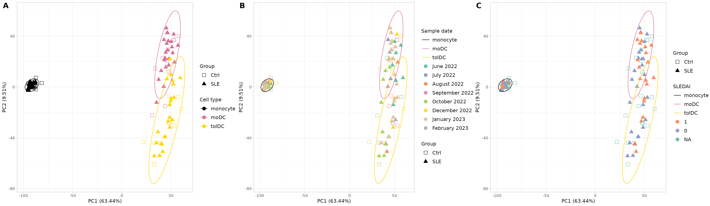

**Supplementary Figure S2.** Principal component analysis (PCA) of the
normalized RNA-seq counts. **(A)** PCA colored by cell type (monocytes,
moDC, and tolDC) and with shape according to group (SLE and Ctrl); it
shows a clear separation, driven mainly by cell identity. **(B)** PCA
with the sample collection dates, to assess possible batch effects
between collections; no major clustering by date is observed. **(C)**
PCA colored by disease activity (SLEDAI): 1 indicates activity (SLEDAI
score ≥ 6), 0 indicates no activity or low activity (0–5 points), and
controls are marked as NA. PC1 and PC2 explain 63.44% and 9.51% of the
total variance, respectively. Each point represents a sample.
Abbreviations: SLE, systemic lupus erythematosus; Ctrl, healthy control;
mo, monocytes; moDC, monocyte-derived dendritic cells; tolDC,
tolerogenic dendritic cells. The data for this figure can be found in
Supplementary Table S1 and Dataset S2.

The original supplementary figure can be found in the file *Data Sheet
1.docx* of the [supplementary material of the
article](https://www.frontiersin.org/journals/immunology/articles/10.3389/fimmu.2026.1771959/full#supplementaryMaterial).

To save the figure in high resolution:

``` r

ggsave("Figure_S2_PCA.png", figure_s2, width = 24, height = 7, dpi = 300)
```

## 12. Save your results (optional)

``` r

saveRDS(dds, "dds.rds")             # DESeq2 object with filtered counts
saveRDS(vsd, "vsd.rds")             # transformed data (VST)
write.csv(zscore_mat, "zscore.csv") # z-scores for heatmaps in other programs
```

To load them again: `dds <- readRDS("dds.rds")`.

**Checkpoint.** You do not need to save anything to continue: the
package already includes the two main objects from this lesson, with the
same names. In the following lessons it will be enough to load the
package:

- `dds`: the filtered and normalized `DESeqDataSet` (section 7).
- `zscore_mat`: the z-score matrix (section 10).

## 13. Summary

| Step | Key function | What for? |
|----|----|----|
| Get to know the data | [`dim()`](https://rdrr.io/r/base/dim.html), [`dplyr::count()`](https://dplyr.tidyverse.org/reference/count.html) | Understand what we have before analyzing |
| Check the order | `all(colnames(...) == ...)` | Avoid the most dangerous error |
| Create the object | [`DESeqDataSetFromTximport()`](https://rdrr.io/pkg/DESeq2/man/DESeqDataSet.html) | Bring together counts, metadata, and design |
| Filter | `rowSums(counts(dds) >= 10) >= 10` | Remove genes with little information |
| Normalize | `estimateSizeFactors()` | Correct for depth and length |
| Transform | [`vst()`](https://rdrr.io/pkg/DESeq2/man/vst.html) | Stabilize the variance for visualization |
| Explore genes | [`ggplot()`](https://ggplot2.tidyverse.org/reference/ggplot.html) + [`facet_wrap()`](https://ggplot2.tidyverse.org/reference/facet_wrap.html) | Verify the biology and generate hypotheses |
| *Heatmap* | [`scale()`](https://rdrr.io/r/base/scale.html) (z-score) | See patterns of many genes at once |
| PCA | [`prcomp()`](https://rdrr.io/r/stats/prcomp.html) + [`ggplot()`](https://ggplot2.tidyverse.org/reference/ggplot.html) | See the global structure of the data |
| Figure panel | [`cowplot::plot_grid()`](https://wilkelab.org/cowplot/reference/plot_grid.html) | Combine several plots into one figure |
| Join tables | [`left_join()`](https://dplyr.tidyverse.org/reference/mutate-joins.html) | Add each volunteer’s information to each sample |
| Check batches | PCA colored by date (Challenge 4) | Detect technical variation before comparing groups |

### Common beginner mistakes

- **Not checking that the samples match** between counts and metadata.
- **Passing normalized counts to
  [`DESeq()`](https://rdrr.io/pkg/DESeq2/man/DESeq.html)**: always use
  the raw ones.
- **Computing z-scores or PCA with raw counts**: use VST.
- **Treating the samples from the same patient as independent**.
- **Confusing “it looks different in the plot” with “it is
  significant”**.
- **Not checking for batch effects** before comparing groups.

## 14. Next steps

The next step is the **differential expression analysis**: identifying,
with a statistical model, which genes change between patients and
controls within each cell type. We cover it in the lesson
[Differentially expressed genes between patients and
controls](https://eveliacoss.github.io/GeneExprLupusMx/articles/l3_DEGs_en.md)
with the [`DESeq()`](https://rdrr.io/pkg/DESeq2/man/DESeq.html) and
[`results()`](https://rdrr.io/pkg/DESeq2/man/results.html) functions of
`DESeq2`. A good design should take into account the cell type, the
sample collection batch, and the pairing of samples from the same
volunteer.

To continue, click the **Next lesson: Differentially expressed genes**
button at the bottom of this page.

Additional resources:

- The [official DESeq2
  vignette](https://bioconductor.org/packages/release/bioc/vignettes/DESeq2/inst/doc/DESeq2.html).
- The Bioconductor [*RNA-seq
  workflow*](https://bioconductor.org/packages/release/workflows/vignettes/rnaseqGene/inst/doc/rnaseqGene.html).

## References

- Love MI, Huber W, Anders S (2014). Moderated estimation of fold change
  and dispersion for RNA-seq data with DESeq2. *Genome Biology* 15:550.
  [doi:10.1186/s13059-014-0550-8](https://doi.org/10.1186/s13059-014-0550-8)
- Soneson C, Love MI, Robinson MD (2015). Differential analyses for
  RNA-seq: transcript-level estimates improve gene-level inferences.
  *F1000Research* 4:1521.
  [doi:10.12688/f1000research.7563.2](https://doi.org/10.12688/f1000research.7563.2)
- Patro R, *et al.* (2017). Salmon provides fast and bias-aware
  quantification of transcript expression. *Nature Methods* 14:417–419.
  [doi:10.1038/nmeth.4197](https://doi.org/10.1038/nmeth.4197)
- Hernández-Ledesma AL, Coss-Navarrete EL, *et al* (2026) [Gene
  expression profiling of dendritic cell tolerance dysfunction in women
  with systemic lupus
  erythematosus](https://www.frontiersin.org/journals/immunology/articles/10.3389/fimmu.2026.1771959/full).
  *Front. Immunol.* 17:1771959. [doi:
  10.3389/fimmu.2026.1771959](https://doi.org/10.3389/fimmu.2026.1771959).

[← Previous lesson: Meeting the
participants](https://eveliacoss.github.io/GeneExprLupusMx/articles/clinical_en.md)
[Next lesson: Differentially expressed genes
→](https://eveliacoss.github.io/GeneExprLupusMx/articles/l3_DEGs_en.md)

[↑ Back to top](#top "Back to the top of the page")

## Session information

``` r

sessionInfo()
#> R version 4.6.1 (2026-06-24)
#> Platform: x86_64-pc-linux-gnu
#> Running under: Ubuntu 24.04.5 LTS
#> 
#> Matrix products: default
#> BLAS:   /usr/lib/x86_64-linux-gnu/openblas-pthread/libblas.so.3 
#> LAPACK: /usr/lib/x86_64-linux-gnu/openblas-pthread/libopenblasp-r0.3.26.so;  LAPACK version 3.12.0
#> 
#> locale:
#>  [1] LC_CTYPE=C.UTF-8       LC_NUMERIC=C           LC_TIME=C.UTF-8       
#>  [4] LC_COLLATE=C.UTF-8     LC_MONETARY=C.UTF-8    LC_MESSAGES=C.UTF-8   
#>  [7] LC_PAPER=C.UTF-8       LC_NAME=C              LC_ADDRESS=C          
#> [10] LC_TELEPHONE=C         LC_MEASUREMENT=C.UTF-8 LC_IDENTIFICATION=C   
#> 
#> time zone: UTC
#> tzcode source: system (glibc)
#> 
#> attached base packages:
#> [1] stats4    stats     graphics  grDevices utils     datasets  methods  
#> [8] base     
#> 
#> other attached packages:
#>  [1] cowplot_1.2.0               ggrepel_0.9.8              
#>  [3] lubridate_1.9.5             forcats_1.0.1              
#>  [5] stringr_1.6.0               dplyr_1.2.1                
#>  [7] purrr_1.2.2                 readr_2.2.0                
#>  [9] tidyr_1.3.2                 tibble_3.3.1               
#> [11] ggplot2_4.0.3               tidyverse_2.0.0            
#> [13] DESeq2_1.52.0               SummarizedExperiment_1.42.0
#> [15] Biobase_2.72.0              MatrixGenerics_1.24.0      
#> [17] matrixStats_1.5.0           GenomicRanges_1.64.0       
#> [19] Seqinfo_1.2.0               IRanges_2.46.0             
#> [21] S4Vectors_0.50.3            BiocGenerics_0.58.1        
#> [23] generics_0.1.4              GeneExprLupusMx_0.0.0.9000 
#> 
#> loaded via a namespace (and not attached):
#>  [1] gtable_0.3.6        xfun_0.62           bslib_0.12.0       
#>  [4] lattice_0.22-9      tzdb_0.5.0          vctrs_0.7.3        
#>  [7] tools_4.6.1         parallel_4.6.1      pkgconfig_2.0.3    
#> [10] Matrix_1.7-5        RColorBrewer_1.1-3  S7_0.2.2           
#> [13] desc_1.4.3          lifecycle_1.0.5     compiler_4.6.1     
#> [16] farver_2.1.2        textshaping_1.0.5   codetools_0.2-20   
#> [19] htmltools_0.5.9     sass_0.4.10         yaml_2.3.12        
#> [22] pkgdown_2.2.1       pillar_1.11.1       jquerylib_0.1.4    
#> [25] MASS_7.3-65         BiocParallel_1.46.0 DelayedArray_0.38.2
#> [28] cachem_1.1.0        abind_1.4-8         nlme_3.1-169       
#> [31] tidyselect_1.2.1    locfit_1.5-9.12     digest_0.6.39      
#> [34] stringi_1.8.9       splines_4.6.1       labeling_0.4.3     
#> [37] fastmap_1.2.0       grid_4.6.1          cli_3.6.6          
#> [40] SparseArray_1.12.3  magrittr_2.0.5      S4Arrays_1.12.1    
#> [43] utf8_1.2.6          withr_3.0.3         scales_1.4.0       
#> [46] timechange_0.4.0    rmarkdown_2.32      XVector_0.52.0     
#> [49] otel_0.2.0          hms_1.1.4           ragg_1.5.2         
#> [52] evaluate_1.0.5      knitr_1.52          mgcv_1.9-4         
#> [55] rlang_1.3.0         Rcpp_1.1.2          glue_1.8.1         
#> [58] jsonlite_2.0.0      R6_2.6.1            systemfonts_1.3.2  
#> [61] fs_2.1.0
```
