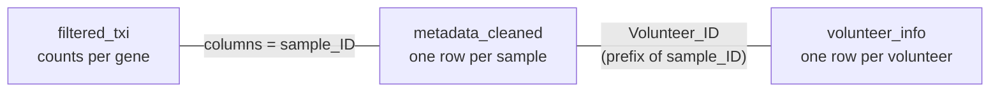

# Get started with GeneExprLupusMx

## What is GeneExprLupusMx?

`GeneExprLupusMx` is an R package with **transcriptomic (RNA-seq) data
from Mexican women with systemic lupus erythematosus (SLE) and from
healthy controls**. It is designed for research and teaching: besides
the data, it includes step-by-step lessons to learn how to analyze them.

- **33 participants:** 10 healthy controls (`Ctrl`) and 23 patients with
  lupus (`SLE`).
- **3 cell types per participant:** monocytes, monocyte-derived
  dendritic cells (moDC), and tolerogenic dendritic cells (tolDC).
- **99 samples** in total (33 × 3).

The data come from the article:

> Hernández-Ledesma AL, Coss-Navarrete EL, *et al* (2026) [Gene
> expression profiling of dendritic cell tolerance dysfunction in women
> with systemic lupus
> erythematosus](https://www.frontiersin.org/journals/immunology/articles/10.3389/fimmu.2026.1771959/full).
> *Front. Immunol.* 17:1771959. [doi:
> 10.3389/fimmu.2026.1771959](https://doi.org/10.3389/fimmu.2026.1771959).


Overview of the study and of the package contents.

## Installation

Install the package from
[GitHub](https://github.com/EveliaCoss/GeneExprLupusMx). Some lessons
also use `DESeq2`, available on
[Bioconductor](https://bioconductor.org/packages/DESeq2):

``` r

install.packages(c("remotes", "BiocManager", "tidyverse"))
remotes::install_github("EveliaCoss/GeneExprLupusMx")
BiocManager::install("DESeq2")
```

Once installed, load it:

``` r

library(GeneExprLupusMx)
```

## What data does it contain?

The package includes three main datasets. They are available as soon as
you load the package; there is nothing else to download.

| Object | What it contains | One row per | Size |
|----|----|----|----|
| `filtered_txi` | RNA-seq counts quantified with Salmon and imported with `tximport` | gene | 21,718 genes × 99 samples |
| `metadata_cleaned` | Group, cell type, and clinical data for each sample | sample | 99 samples |
| `volunteer_info` | Age, diagnosis, treatments, and recruitment date | volunteer | 33 volunteers |

It also includes **reference gene lists** used by some lessons:

| Object | What it contains | Used in |
|----|----|----|
| `biotype_summary` | Biotype of each gene (protein-coding, lncRNA…) | Lesson 4 |
| `sle_genes` | Genes associated with lupus in the literature | Lesson 4 |
| `isg_genes` | Interferon-stimulated genes (Yu et al., 2025) | Lesson 4 |
| `moDC_genes` | Genes described in the differentiation from monocyte to moDC | Lesson 5 |
| `dc_genes` | Genes associated with dendritic cell differentiation | Lesson 5 |
| `tolDC_genes` | Transcriptional signature of tolerogenic dendritic cells (Robertson et al., 2021) | Lesson 6 |

It also includes **checkpoints**: objects that are built in one lesson
and saved in the package so that the next lesson can start from there,
without repeating the steps.

| Object | What it contains | Built in |
|----|----|----|
| `dds` | Filtered and normalized `DESeqDataSet` (13,596 genes × 99 samples); requires `DESeq2` | Lesson 2 |
| `zscore_mat` | Matrix of z-scores of VST expression, for *heatmaps* (13,596 genes × 99 samples) | Lesson 2 |
| `de_results` | SLE vs Ctrl differential expression results for each cell type (`DESeq2`) | Lesson 3 |
| `go_results` | Enriched functional terms of the DEGs (g:Profiler, version e113) | Lesson 4 |
| `de_celltype_results` | Differential expression of moDC and tolDC against monocytes, in controls and patients (`DESeq2`) | Lesson 5 |
| `go_celltype_results` | Enriched functional terms of those DEGs (g:Profiler) | Lesson 5 |
| `de_interaction_results` | `Group:Cell_type` interaction: genes whose change from monocyte to dendritic cell is different in patients (`DESeq2`) | Lesson 7 |
| `go_interaction_results` | Enriched functional terms of those genes (g:Profiler) | Lesson 7 |

A quick look at each one:

``` r

dim(filtered_txi$counts)       # genes x samples
#> [1] 21718    99
head(metadata_cleaned[, c("sample_ID", "Group", "Cell_type")], 3)
#>         sample_ID Group Cell_type
#> QR011_0   QR011_0  Ctrl  monocyte
#> QR011_1   QR011_1  Ctrl      moDC
#> QR011_3   QR011_3  Ctrl     tolDC
head(volunteer_info[, c("Volunteer_ID", "Group", "Age_years", "Time_of_recruitment")], 3)
#>   Volunteer_ID Group Age_years Time_of_recruitment
#> 1        QR011  Ctrl        25          2022-06-01
#> 2        QR013  Ctrl        23          2022-06-01
#> 3        QR014   SLE        32          2022-06-01
```

### How are they related?

The three tables are connected through their identifiers. Each sample
has a name such as `QR011_1`: the first part (`QR011`) identifies the
volunteer and the final number identifies the cell type (`_0` =
monocyte, `_1` = moDC, `_3` = tolDC).



``` r

# The count columns are in the same order as the metadata rows
all(colnames(filtered_txi$counts) == metadata_cleaned$sample_ID)
#> [1] TRUE

# From sample to volunteer
sub("_.*", "", "QR011_1")
#> [1] "QR011"
```

To learn about each column in detail, see the help pages:
[`?filtered_txi`](https://eveliacoss.github.io/GeneExprLupusMx/reference/filtered_txi.md),
[`?metadata_cleaned`](https://eveliacoss.github.io/GeneExprLupusMx/reference/metadata_cleaned.md),
and
[`?volunteer_info`](https://eveliacoss.github.io/GeneExprLupusMx/reference/volunteer_info.md).

## Learning path

The lessons are designed to be followed in order, but each one can be
read on its own.


| Lesson | You will learn to… | Data | Time |
|----|----|----|----|
| [1. Meeting the participants](https://eveliacoss.github.io/GeneExprLupusMx/articles/clinical_en.md) | Describe the cohort with descriptive statistics, tables, normality tests, and comparisons between groups | `volunteer_info` | 45 to 60 min |
| [2. From RNA-seq counts to data exploration](https://eveliacoss.github.io/GeneExprLupusMx/articles/intro_RNAseq_en.md) | Import the counts, normalize them with `DESeq2`, explore genes, and make *heatmaps* and PCA | `filtered_txi`, `metadata_cleaned`, `volunteer_info` | 1 to 1.5 h |
| [3. Differentially expressed genes between patients and controls](https://eveliacoss.github.io/GeneExprLupusMx/articles/l3_DEGs_en.md) | Validate cell types with biomarkers, run differential expression with `DESeq2`, and interpret volcano plots | `filtered_txi`, `metadata_cleaned`, `zscore_mat` | 1.5 h |
| [4. Biological functions of differentially expressed genes](https://eveliacoss.github.io/GeneExprLupusMx/articles/l4_GOterms_en.md) | Run a functional enrichment analysis with g:Profiler, identify SLE and ISG genes, test their enrichment (hypergeometric and Fisher), and correlate ISGs with disease activity | `de_results`, `go_results`, `sle_genes`, `isg_genes`, `biotype_summary`, `zscore_mat`, `metadata_cleaned`, `volunteer_info` | 1.5 h |
| [5. Differentiation of monocytes into dendritic cells](https://eveliacoss.github.io/GeneExprLupusMx/articles/l5_DEGs_monocytes_diff_en.md) | Compare dendritic cells against monocytes, validate differentiation with known genes, and explore pathways and lipid metabolism | `de_celltype_results`, `go_celltype_results`, `moDC_genes`, `dc_genes` | 1.5 h |
| [6. The transcriptional signature of tolerogenic dendritic cells](https://eveliacoss.github.io/GeneExprLupusMx/articles/l6_DEGs_tolDcs_en.md) | Evaluate tolDC with a published signature, combine z-scores and LFC, choose the right reference for comparison, and identify the genes that agree with the signature | `tolDC_genes`, `de_celltype_results`, `zscore_mat` | 1 h |
| [7. Do patient and control cells differentiate in the same way?](https://eveliacoss.github.io/GeneExprLupusMx/articles/l7_DEGs_between_groups_en.md) | Fit a model with an interaction, interpret a “difference of differences”, summarize the genes with Reactome processes, and plot expression trajectories | `de_interaction_results`, `go_interaction_results`, `zscore_mat`, `isg_genes` | 1.5 h |

Each lesson includes **challenges** with their solutions for practice,
and ends by reproducing a figure or table from the article.

## How to cite

If you use these data, cite the original article:

> Hernández-Ledesma AL, Coss-Navarrete EL, *et al* (2026) [Gene
> expression profiling of dendritic cell tolerance dysfunction in women
> with systemic lupus
> erythematosus](https://www.frontiersin.org/journals/immunology/articles/10.3389/fimmu.2026.1771959/full).
> *Front. Immunol.* 17:1771959. [doi:
> 10.3389/fimmu.2026.1771959](https://doi.org/10.3389/fimmu.2026.1771959).

[Next lesson: Meeting the participants
→](https://eveliacoss.github.io/GeneExprLupusMx/articles/clinical_en.md)

[↑ Back to top](#top "Back to the top of the page")
