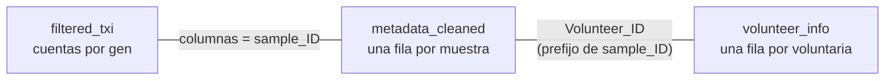
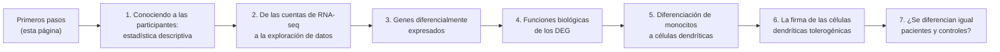

# Primeros pasos con el paquete GeneExprLupusMx

## ¿Qué es GeneExprLupusMx?

`GeneExprLupusMx` es un paquete de R con **datos transcriptómicos
(RNA-seq) de mujeres mexicanas con lupus eritematoso sistémico (LES, o
*SLE* en inglés) y de controles sanas**. Está pensado para investigación
y para enseñanza: además de los datos, incluye lecciones paso a paso
para aprender a analizarlos.

- **33 participantes:** 10 controles sanas (`Ctrl`) y 23 pacientes con
  lupus (`SLE`).
- **3 tipos celulares por participante:** monocitos, células dendríticas
  derivadas de monocitos (moDC) y células dendríticas tolerogénicas
  (tolDC).
- **99 muestras** en total (33 × 3).

Los datos provienen del artículo:

> Hernández-Ledesma AL, Coss-Navarrete EL, *et al* (2026) [Gene
> expression profiling of dendritic cell tolerance dysfunction in women
> with systemic lupus
> erythematosus](https://www.frontiersin.org/journals/immunology/articles/10.3389/fimmu.2026.1771959/full).
> *Front. Immunol.* 17:1771959. [doi:
> 10.3389/fimmu.2026.1771959](https://doi.org/10.3389/fimmu.2026.1771959).


Resumen del estudio y del contenido del paquete.

## Instalación

Instala el paquete desde
[GitHub](https://github.com/EveliaCoss/GeneExprLupusMx). Algunas
lecciones usan además `DESeq2`, disponible en
[Bioconductor](https://bioconductor.org/packages/DESeq2):

``` r

install.packages(c("remotes", "BiocManager", "tidyverse"))
remotes::install_github("EveliaCoss/GeneExprLupusMx")
BiocManager::install("DESeq2")
```

Una vez instalado, cárgalo:

``` r

library(GeneExprLupusMx)
```

## ¿Qué datos contiene?

El paquete incluye tres conjuntos de datos principales. Están
disponibles en cuanto cargas el paquete; no hay que descargar nada más.

| Objeto | Qué contiene | Una fila por | Tamaño |
|----|----|----|----|
| `filtered_txi` | Cuentas de RNA-seq cuantificadas con Salmon e importadas con `tximport` | gen | 21,718 genes × 99 muestras |
| `metadata_cleaned` | Grupo, tipo celular y datos clínicos de cada muestra | muestra | 99 muestras |
| `volunteer_info` | Edad, diagnóstico, tratamientos y fecha de reclutamiento | voluntaria | 33 voluntarias |

También incluye **listas de genes de referencia** que usan algunas
lecciones:

| Objeto | Qué contiene | Se usa en |
|----|----|----|
| `biotype_summary` | Biotipo de cada gen (codificante, lncRNA…) | Lección 4 |
| `sle_genes` | Genes asociados al lupus en la literatura | Lección 4 |
| `isg_genes` | Genes estimulados por interferón (Yu et al., 2025) | Lección 4 |
| `moDC_genes` | Genes descritos en la diferenciación de monocito a moDC | Lección 5 |
| `dc_genes` | Genes asociados a la diferenciación de células dendríticas | Lección 5 |
| `tolDC_genes` | Firma transcripcional de las células dendríticas tolerogénicas (Robertson et al., 2021) | Lección 6 |

Además, incluye **checkpoints**: objetos que se construyen en una
lección y se guardan en el paquete para que la siguiente pueda empezar
desde ahí, sin repetir los pasos.

| Objeto | Qué contiene | Se construye en |
|----|----|----|
| `dds` | `DESeqDataSet` filtrado y normalizado (13,596 genes × 99 muestras); requiere `DESeq2` | Lección 2 |
| `zscore_mat` | Matriz de z-scores de la expresión VST, para *heatmaps* (13,596 genes × 99 muestras) | Lección 2 |
| `de_results` | Resultados de expresión diferencial SLE vs Ctrl de cada tipo celular (`DESeq2`) | Lección 3 |
| `go_results` | Términos funcionales enriquecidos de los DEG (g:Profiler, versión e113) | Lección 4 |
| `de_celltype_results` | Expresión diferencial de moDC y tolDC contra monocitos, en controles y pacientes (`DESeq2`) | Lección 5 |
| `go_celltype_results` | Términos funcionales enriquecidos de esos DEG (g:Profiler) | Lección 5 |
| `de_interaction_results` | Interacción `Group:Cell_type`: genes cuyo cambio de monocito a célula dendrítica es distinto en las pacientes (`DESeq2`) | Lección 7 |
| `go_interaction_results` | Términos funcionales enriquecidos de esos genes (g:Profiler) | Lección 7 |

Un vistazo rápido a cada uno:

``` r

dim(filtered_txi$counts)       # genes x muestras
#> [1] 21718    99
head(metadata_cleaned[, c("sample_ID", "Group", "Cell_type")], 3)
#>         sample_ID Group Cell_type
#> QR011_0   QR011_0  Ctrl  monocyte
#> QR011_1   QR011_1  Ctrl      moDC
#> QR011_3   QR011_3  Ctrl     tolDC
head(volunteer_info[, c("Volunteer_ID", "Group", "Age_years", "Time_of_recruitment")], 3)
#>   Volunteer_ID Group Age_years Time_of_recruitment
#> 1        QR011  Ctrl        25          2022-06-01
#> 2        QR013  Ctrl        23          2022-06-01
#> 3        QR014   SLE        32          2022-06-01
```

### ¿Cómo se relacionan?

Las tres tablas se conectan por sus identificadores. Cada muestra tiene
un nombre como `QR011_1`: la primera parte (`QR011`) identifica a la
voluntaria y el número final, al tipo celular (`_0` = monocito, `_1` =
moDC, `_3` = tolDC).



``` r

# Las columnas de las cuentas están en el mismo orden que las filas de los metadatos
all(colnames(filtered_txi$counts) == metadata_cleaned$sample_ID)
#> [1] TRUE

# De muestra a voluntaria
sub("_.*", "", "QR011_1")
#> [1] "QR011"
```

Para conocer cada columna en detalle, consulta la ayuda:
[`?filtered_txi`](https://eveliacoss.github.io/GeneExprLupusMx/reference/filtered_txi.md),
[`?metadata_cleaned`](https://eveliacoss.github.io/GeneExprLupusMx/reference/metadata_cleaned.md)
y
[`?volunteer_info`](https://eveliacoss.github.io/GeneExprLupusMx/reference/volunteer_info.md).

## Ruta de aprendizaje

Las lecciones están pensadas para seguirse en orden, pero cada una puede
leerse por separado.



| Lección | Aprenderás a… | Datos | Tiempo |
|----|----|----|----|
| [1. Conociendo a las participantes](https://eveliacoss.github.io/GeneExprLupusMx/articles/clinical_es.md) | Describir a la cohorte con estadística descriptiva, tablas, pruebas de normalidad y comparaciones entre grupos | `volunteer_info` | 45 a 60 min |
| [2. De las cuentas de RNA-seq a la exploración de datos](https://eveliacoss.github.io/GeneExprLupusMx/articles/intro_RNAseq_es.md) | Importar las cuentas, normalizarlas con `DESeq2`, explorar genes y hacer *heatmaps* y PCA | `filtered_txi`, `metadata_cleaned`, `volunteer_info` | 1 a 1.5 h |
| [3. Genes diferencialmente expresados](https://eveliacoss.github.io/GeneExprLupusMx/articles/l3_DEGs_es.md) | Validar tipos celulares con biomarcadores, hacer expresión diferencial con `DESeq2` e interpretar volcano plots | `filtered_txi`, `metadata_cleaned`, `zscore_mat` | 1.5 h |
| [4. Funciones biológicas de los DEG](https://eveliacoss.github.io/GeneExprLupusMx/articles/l4_GOterms_es.md) | Hacer un análisis de enriquecimiento funcional con g:Profiler, identificar genes de SLE e ISG e interpretar procesos biológicos | `de_results`, `go_results`, `sle_genes`, `isg_genes`, `biotype_summary` | 1.5 h |
| [5. Diferenciación de monocitos a células dendríticas](https://eveliacoss.github.io/GeneExprLupusMx/articles/l5_DEGs_monocytes_diff_es.md) | Comparar células dendríticas contra monocitos, validar la diferenciación con genes conocidos y explorar rutas y metabolismo de lípidos | `de_celltype_results`, `go_celltype_results`, `moDC_genes`, `dc_genes` | 1.5 h |
| [6. La firma transcripcional de las células dendríticas tolerogénicas](https://eveliacoss.github.io/GeneExprLupusMx/articles/l6_DEGs_tolDcs_es.md) | Evaluar las tolDC con una firma publicada, combinar z-scores y LFC, y elegir la referencia correcta para comparar | `tolDC_genes`, `de_celltype_results`, `zscore_mat` | 1 h |
| [7. ¿Se diferencian igual las células de pacientes y controles?](https://eveliacoss.github.io/GeneExprLupusMx/articles/l7_DEGs_between_groups_es.md) | Ajustar un modelo con interacción, interpretar una “diferencia de diferencias” y resumir los genes con procesos de Reactome | `de_interaction_results`, `go_interaction_results`, `zscore_mat`, `isg_genes` | 1.5 h |

Cada lección incluye **retos** con su solución para practicar, y termina
reproduciendo una figura suplementaria del artículo.

## ¿Cómo citar?

Si usas estos datos, cita el artículo original:

> Hernández-Ledesma AL, Coss-Navarrete EL, *et al* (2026) [Gene
> expression profiling of dendritic cell tolerance dysfunction in women
> with systemic lupus
> erythematosus](https://www.frontiersin.org/journals/immunology/articles/10.3389/fimmu.2026.1771959/full).
> *Front. Immunol.* 17:1771959. [doi:
> 10.3389/fimmu.2026.1771959](https://doi.org/10.3389/fimmu.2026.1771959).

[Siguiente lección: Conociendo a las participantes
→](https://eveliacoss.github.io/GeneExprLupusMx/articles/clinical_es.md)

[↑ Volver a Inicio](#top "Volver al inicio de la página")
