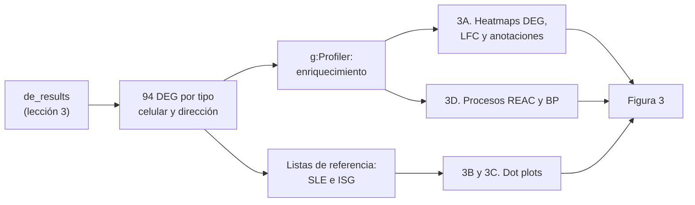
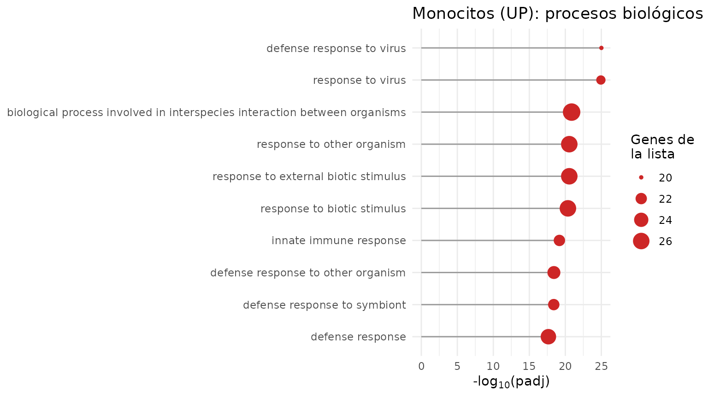
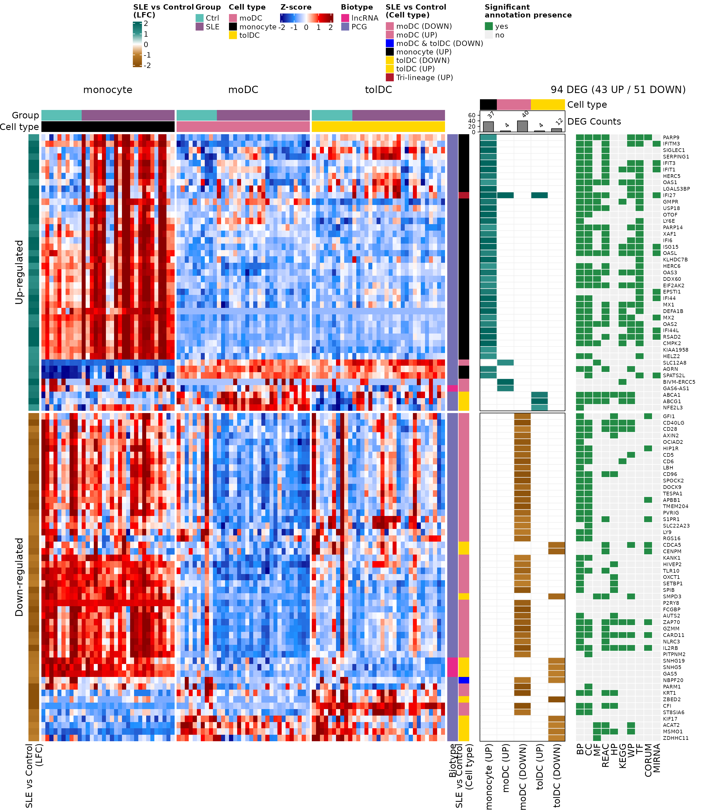
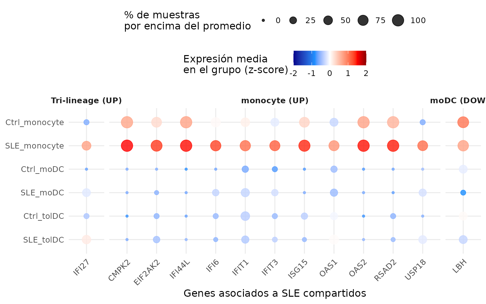
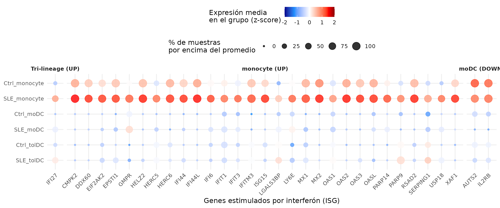
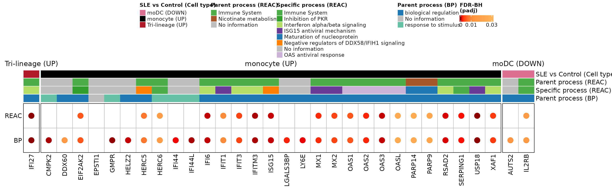
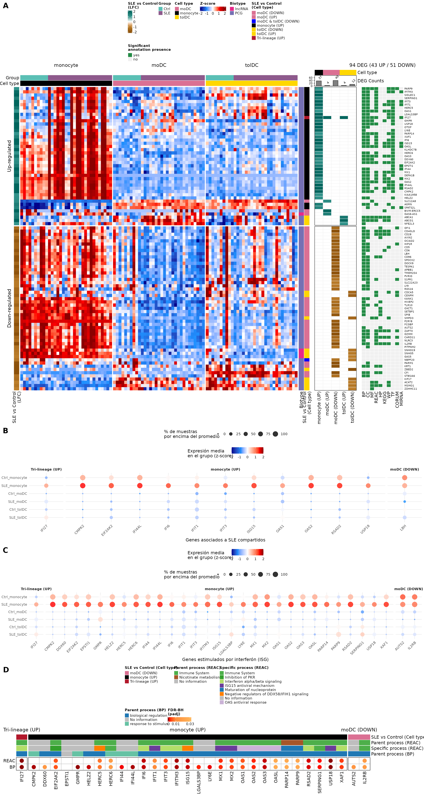

# Funciones biológicas de los genes diferencialmente expresados

## Bienvenida

En la lección anterior encontramos **94 genes diferencialmente
expresados (DEG)** entre pacientes con lupus y controles. Una lista de
genes, por sí sola, dice poco: la pregunta ahora es **¿qué hacen esos
genes?, ¿participan en procesos biológicos comunes?**

**Lo que necesitas saber antes:** haber hecho la lección [Genes
diferencialmente
expresados](https://eveliacoss.github.io/GeneExprLupusMx/articles/l3_DEGs_es.md).

**Al terminar podrás:**

1.  Explicar qué es un **análisis de enriquecimiento funcional** y qué
    pregunta responde.
2.  Hacer un análisis de enriquecimiento con **g:Profiler** e
    interpretar sus resultados.
3.  Reconocer las principales bases de datos funcionales (Gene Ontology,
    Reactome, KEGG…).
4.  Identificar genes asociados al lupus y **genes estimulados por
    interferón** entre los DEG.
5.  Reproducir la **Figura 3** del artículo.

**Tiempo estimado:** 1.5 horas.

### Mapa de la lección



## Glosario

Estos son los términos que usaremos. Vuelve aquí cada vez que lo
necesites.

- **Anotación funcional**: información sobre qué hace un gen (procesos,
  rutas, localización…).
- **Término**: una categoría funcional, por ejemplo “respuesta a virus”,
  con su lista de genes.
- **Enriquecimiento funcional**: prueba si un término aparece en nuestra
  lista de genes **más de lo esperado por azar**.
- **Prueba hipergeométrica**: prueba estadística del enriquecimiento
  (como sacar canicas de una bolsa sin reemplazo).
- **Gene Ontology (GO)**: vocabulario de funciones con tres ramas:
  proceso biológico (**BP**), componente celular (**CC**) y función
  molecular (**MF**).
- **Reactome (REAC)**, **KEGG**, **WikiPathways (WP)**: bases de datos
  de rutas biológicas.
- **TF**: sitios de unión de factores de transcripción. **MIRNA**:
  blancos de microRNAs. **HP**: fenotipos humanos. **CORUM**: complejos
  de proteínas.
- **Término padre / específico**: las bases de datos están organizadas
  en jerarquías; un término general (padre) contiene términos más
  específicos.
- **ISG** (*interferon-stimulated genes*): genes que se encienden en
  respuesta al interferón.

## 1. Preparación

``` r

library(GeneExprLupusMx) # datos del paquete
library(tidyverse)       # manipulación de tablas y gráficas
library(ComplexHeatmap)  # heatmaps
library(circlize)        # escalas de color para ComplexHeatmap
library(grid)            # dibujar formas dentro de los heatmaps
library(cowplot)         # unir gráficas en un panel
```

Colores y umbrales (los mismos de la lección anterior):

``` r

cell_color  <- c(monocyte = "black", moDC = "palevioletred", tolDC = "gold1")
group_color <- c(Ctrl = "#5BBFB5", SLE = "#8E5A8C")

lfc_threshold  <- 1
padj_threshold <- 0.05
```

### Punto de partida: los DEG de la lección anterior

El checkpoint `de_results` contiene los resultados de `DESeq2` de los
tres tipos celulares. Recuperamos los DEG en una sola tabla:

``` r

deg_df <- bind_rows(lapply(names(de_results), function(cell) {
  de_results[[cell]] %>%
    filter(!is.na(padj), padj < padj_threshold, abs(log2FoldChange) >= lfc_threshold) %>%
    mutate(Cell_type  = cell,
           Expression = ifelse(log2FoldChange > 0, "Up-regulated", "Down-regulated"),
           query      = paste("SLE", ifelse(log2FoldChange > 0, "UP", "DOWN"), cell, sep = "_"))
}))

dplyr::count(deg_df, query)
#>             query  n
#> 1   SLE_DOWN_moDC 40
#> 2  SLE_DOWN_tolDC 12
#> 3     SLE_UP_moDC  4
#> 4 SLE_UP_monocyte 37
#> 5    SLE_UP_tolDC  4
```

Cada combinación de tipo celular y dirección es una **lista de genes**
(`query`). Los monocitos no tienen genes que bajen, así que hay cinco
listas.

Un mismo gen puede ser DEG en más de un tipo celular. Para las gráficas
necesitamos **una fila por gen** (94 genes) y una etiqueta que describa
su **patrón**: en qué tipos celulares cambia.

``` r

genes_in <- function(cell, direction) {
  deg_df$gene[deg_df$Cell_type == cell & deg_df$Expression == direction]
}

gene_info <- deg_df %>%
  distinct(gene, .keep_all = TRUE) %>% # una fila por gen
  mutate(pattern = case_when(
    gene %in% Reduce(intersect, list(genes_in("monocyte", "Up-regulated"),
                                     genes_in("moDC", "Up-regulated"),
                                     genes_in("tolDC", "Up-regulated"))) ~ "Tri-lineage (UP)",
    gene %in% intersect(genes_in("moDC", "Down-regulated"),
                        genes_in("tolDC", "Down-regulated")) ~ "moDC & tolDC (DOWN)",
    gene %in% genes_in("monocyte", "Up-regulated") ~ "monocyte (UP)",
    gene %in% genes_in("moDC", "Up-regulated")     ~ "moDC (UP)",
    gene %in% genes_in("moDC", "Down-regulated")   ~ "moDC (DOWN)",
    gene %in% genes_in("tolDC", "Up-regulated")    ~ "tolDC (UP)",
    gene %in% genes_in("tolDC", "Down-regulated")  ~ "tolDC (DOWN)"))

dplyr::count(gene_info, pattern)
#>               pattern  n
#> 1    Tri-lineage (UP)  1
#> 2 moDC & tolDC (DOWN)  1
#> 3         moDC (DOWN) 39
#> 4           moDC (UP)  3
#> 5       monocyte (UP) 36
#> 6        tolDC (DOWN) 11
#> 7          tolDC (UP)  3
```

**Tri-lineage (UP)** son los genes que suben en los tres tipos celulares
(solo `IFI27`) y **moDC & tolDC (DOWN)**, los que bajan en ambas células
dendríticas.

## 2. ¿Qué es un análisis de enriquecimiento?

Imagina una bolsa con 20,000 canicas (todos los genes del genoma). 200
de ellas son rojas: los genes de un término, por ejemplo “respuesta a
virus”. Sacamos al azar 37 canicas (nuestros DEG de monocitos).
Esperaríamos sacar menos de una roja. **Si sacamos 15, algo no es
azar**: nuestros genes están **enriquecidos** en ese término.

La **prueba hipergeométrica** calcula qué tan probable es sacar tantas
canicas rojas por azar. Como se prueban miles de términos a la vez, los
valores p se corrigen (FDR), igual que en la expresión diferencial.

**Enriquecimiento no es causalidad.** Que una lista esté enriquecida en
“respuesta a virus” no significa que haya un virus: significa que los
genes que cambian suelen participar juntos en esa función. Es una pista
para generar hipótesis.

## 3. Paso 1: enriquecimiento con g:Profiler

[g:Profiler](https://biit.cs.ut.ee/gprofiler) consulta al mismo tiempo
varias bases de datos (GO, Reactome, KEGG, WikiPathways, TF, miRNA, HP,
CORUM). En R se usa con la función `gost()` del paquete `gprofiler2`:

``` r

library(gprofiler2)

deg_lists <- split(deg_df$gene, deg_df$query) # una lista de genes por query

# Versión archivada de g:Profiler (junio de 2025), la usada en el artículo
set_base_url("https://biit.cs.ut.ee/gprofiler_archive3/e113_eg59_p19")

gost_res <- gost(deg_lists,
                 organism          = "hsapiens", # humano
                 correction_method = "fdr",      # corrección por comparaciones múltiples
                 user_threshold    = 0.05,       # padj máximo
                 evcodes           = TRUE)       # incluir qué genes tiene cada término
```

**Las bases de datos cambian.** g:Profiler actualiza sus anotaciones
varias veces al año, así que la misma lista de genes puede dar
resultados algo distintos con el tiempo. Para que tus análisis sean
reproducibles, **fija la versión** con `set_base_url()` y repórtala. Con
la versión actual, por ejemplo, los monocitos dan 351 términos en lugar
de 322.

`gost()` necesita conexión a internet. Para que esta lección funcione
sin conexión, el paquete incluye el resultado como checkpoint,
`go_results`:

``` r

attr(go_results, "gprofiler_version")
#> [1] "e113_eg59_p19_903d2221"
glimpse(go_results)
#> Rows: 943
#> Columns: 10
#> $ query             <chr> "SLE_DOWN_moDC", "SLE_DOWN_moDC", "SLE_DOWN_moDC", "…
#> $ source            <chr> "CORUM", "CORUM", "CORUM", "CORUM", "CORUM", "CORUM"…
#> $ term_id           <chr> "CORUM:7577", "CORUM:6805", "CORUM:6799", "CORUM:679…
#> $ term_name         <chr> "APP-APBB1-KAT5 complex", "S1PR1-beta-arrestin 2 com…
#> $ term_size         <int> 3, 2, 3, 2, 3, 2, 3, 3, 2, 3, 2, 3, 3, 3, 4, 4, 560,…
#> $ query_size        <int> 7, 7, 7, 7, 7, 7, 7, 7, 7, 7, 7, 7, 7, 7, 7, 7, 36, …
#> $ intersection_size <int> 1, 1, 1, 1, 1, 1, 1, 1, 1, 1, 1, 1, 1, 1, 1, 1, 10, …
#> $ p_value           <dbl> 7.524322e-03, 7.524322e-03, 7.524322e-03, 7.524322e-…
#> $ parents           <chr> "CORUM:0000000", "CORUM:0000000", "CORUM:0000000", "…
#> $ intersection      <chr> "APBB1", "S1PR1", "S1PR1", "S1PR1", "APBB1", "HIP1R"…
```

Las columnas más importantes son:

| Columna             | Significado                                    |
|---------------------|------------------------------------------------|
| `query`             | Lista de genes (tipo celular y dirección)      |
| `source`            | Base de datos                                  |
| `term_name`         | Nombre del término                             |
| `term_size`         | Genes anotados al término en todo el genoma    |
| `intersection_size` | Genes de **nuestra lista** anotados al término |
| `p_value`           | Valor p ajustado (FDR)                         |
| `intersection`      | Cuáles son esos genes                          |

¿Cuántos términos significativos hay por lista y base de datos?

``` r

go_results %>%
  dplyr::count(query, source) %>%
  pivot_wider(names_from = source, values_from = n, values_fill = 0)
#> # A tibble: 5 × 11
#>   query        CORUM `GO:BP` `GO:CC`    HP  KEGG  REAC    WP `GO:MF` MIRNA    TF
#>   <chr>        <int>   <int>   <int> <int> <int> <int> <int>   <int> <int> <int>
#> 1 SLE_DOWN_mo…    16     201       7    48    10     1     8       0     0     0
#> 2 SLE_DOWN_to…     6       0       0     3     0    10    12       8     0     0
#> 3 SLE_UP_moDC      0       0       0     0     1     1     3       4     0     0
#> 4 SLE_UP_mono…     2     183       2     0    10    19    12      15     1    78
#> 5 SLE_UP_tolDC     0     172       6    14     5    16    16      53     0     0
```

Las listas con más genes (monocitos UP, moDC DOWN) tienen más términos,
y la mayoría vienen de <GO:BP>, la base de datos más grande.

### 3.1 Los términos más significativos

Veamos los 10 procesos biológicos (<GO:BP>) más significativos de los
monocitos:

``` r

go_results %>%
  filter(query == "SLE_UP_monocyte", source == "GO:BP") %>%
  slice_min(p_value, n = 10, with_ties = FALSE) %>%
  ggplot(aes(x = -log10(p_value), y = reorder(term_name, -log10(p_value)))) +
  geom_segment(aes(x = 0, xend = -log10(p_value), yend = term_name), color = "grey60") +
  geom_point(aes(size = intersection_size), color = "firebrick3") +
  labs(x = expression("-log"[10] * "(padj)"), y = NULL, size = "Genes de\nla lista",
       title = "Monocitos (UP): procesos biológicos") +
  theme_minimal()
```



Todos los términos tienen que ver con la **respuesta a virus y al
interferón**: la firma de interferón que vimos en las lecciones
anteriores, ahora respaldada por el análisis de enriquecimiento.

**Reto 1.** ¿Cuáles son los 5 términos de Reactome (`REAC`) más
significativos en las tolDC con genes que suben (`SLE_UP_tolDC`)? ¿Qué
tipo de procesos son?

Ver solución

``` r

go_results %>%
  filter(query == "SLE_UP_tolDC", source == "REAC") %>%
  slice_min(p_value, n = 5, with_ties = FALSE) %>%
  dplyr::select(term_name, intersection_size, p_value, intersection)
#>                                                                           term_name
#> 1 NR1H3 & NR1H2 regulate gene expression linked to cholesterol transport and efflux
#> 2                                                NR1H2 and NR1H3-mediated signaling
#> 3                            Plasma lipoprotein assembly, remodeling, and clearance
#> 4                                                        Defective ABCA1 causes TGD
#> 5                                                                      HDL assembly
#>   intersection_size      p_value intersection
#> 1                 2 0.0006116482  ABCA1,ABCG1
#> 2                 2 0.0006116482  ABCA1,ABCG1
#> 3                 2 0.0010219157  ABCA1,ABCG1
#> 4                 1 0.0034075420        ABCA1
#> 5                 1 0.0084434412        ABCA1
```

Son procesos del **metabolismo y transporte de lípidos y colesterol**
(por ejemplo, la ruta de `ABCA1`), muy distintos de la respuesta a
interferón de los monocitos.

## 4. Paso 2: panorama de los 94 DEG (Figura 3A)

Construiremos tres *heatmaps* alineados por gen:

1.  **Expresión (z-score)** de cada DEG en todas las muestras.
2.  **LFC** de cada gen en cada lista de DEG.
3.  **Presencia de anotación significativa** en cada base de datos.

### 4.1 Heatmap de expresión

Ordenamos las muestras por tipo celular y grupo, y tomamos los z-scores
de los 94 genes del checkpoint `zscore_mat`:

``` r

sample_order <- metadata_cleaned %>%
  mutate(Cell_type = factor(Cell_type, levels = c("monocyte", "moDC", "tolDC"))) %>%
  arrange(Cell_type, Group)

deg_mat <- zscore_mat[gene_info$gene, sample_order$sample_ID]
dim(deg_mat)
#> [1] 94 99
```

Agregamos anotaciones: arriba, el grupo y el tipo celular de cada
muestra; a la izquierda, el LFC; a la derecha, el biotipo del gen (de
`biotype_summary`) y su patrón.

``` r

pattern_color <- c("Tri-lineage (UP)" = "#b2182b", "monocyte (UP)" = "black",
                   "moDC (UP)" = "palevioletred", "moDC (DOWN)" = "palevioletred",
                   "tolDC (UP)" = "gold1", "tolDC (DOWN)" = "gold1",
                   "moDC & tolDC (DOWN)" = "blue")
biotype_color <- c("PCG" = "#7570B3", "lncRNA" = "#E7298A")
lfc_color <- colorRamp2(c(-2, -1, 0, 1, 2), c("#8c510a", "#bf812d", "white", "#35978f", "#01665e"))
zscore_color <- colorRamp2(c(-2, -1, 0, 1, 2), c("darkblue", "dodgerblue", "white", "red", "darkred"))

gene_biotype <- biotype_summary$Group_biotype[match(gene_info$gene, biotype_summary$gene)]
table(gene_biotype)
#> gene_biotype
#> lncRNA    PCG 
#>      4     90

sample_anno <- HeatmapAnnotation(
  Group       = as.character(sample_order$Group),
  "Cell type" = as.character(sample_order$Cell_type),
  col = list(Group = group_color, "Cell type" = cell_color),
  annotation_name_side = "left")

ht_expression <- Heatmap(
  deg_mat, name = "Z-score", col = zscore_color,
  cluster_rows = TRUE, cluster_columns = FALSE, show_row_dend = FALSE,
  show_row_names = FALSE, show_column_names = FALSE,
  top_annotation  = sample_anno,
  left_annotation = rowAnnotation("SLE vs Control\n(LFC)" = gene_info$log2FoldChange,
                                  col = list("SLE vs Control\n(LFC)" = lfc_color)),
  right_annotation = rowAnnotation(Biotype = gene_biotype,
                                   "SLE vs Control\n(Cell type)" = gene_info$pattern,
                                   col = list(Biotype = biotype_color,
                                              "SLE vs Control\n(Cell type)" = pattern_color)),
  column_split = sample_order$Cell_type,
  row_split    = factor(gene_info$Expression, levels = c("Up-regulated", "Down-regulated")),
  heatmap_legend_param = list(direction = "horizontal"))
```

### 4.2 Heatmap de LFC por lista

Una matriz con el LFC de cada gen en cada lista de DEG (0 si el gen no
es DEG en esa lista). Arriba, un *barplot* con cuántos DEG tiene cada
lista:

``` r

lfc_mat <- deg_df %>%
  mutate(column = str_replace(query, "SLE_(UP|DOWN)_(.*)", "\\2 (\\1)")) %>% # "monocyte (UP)"
  dplyr::select(gene, column, log2FoldChange) %>%
  pivot_wider(names_from = column, values_from = log2FoldChange, values_fill = 0) %>%
  column_to_rownames("gene") %>%
  as.matrix()
lfc_mat <- lfc_mat[gene_info$gene, c("monocyte (UP)", "moDC (UP)", "moDC (DOWN)",
                                     "tolDC (UP)", "tolDC (DOWN)")]
colSums(lfc_mat != 0)
#> monocyte (UP)     moDC (UP)   moDC (DOWN)    tolDC (UP)  tolDC (DOWN) 
#>            37             4            40             4            12

ht_lfc <- Heatmap(
  lfc_mat, name = "SLE vs Control\n(LFC)", col = lfc_color, show_heatmap_legend = FALSE,
  cluster_columns = FALSE, show_row_names = FALSE,
  rect_gp = gpar(col = "#f0f0f0", lwd = 1), border = TRUE,
  top_annotation = HeatmapAnnotation(
    "Cell type"  = c("monocyte", "moDC", "moDC", "tolDC", "tolDC"),
    "DEG Counts" = anno_barplot(colSums(lfc_mat != 0), add_numbers = TRUE, height = unit(1, "cm")),
    col = list("Cell type" = cell_color), show_legend = FALSE),
  width = unit(4, "cm"))
```

### 4.3 Heatmap de anotaciones

¿En qué bases de datos tiene cada gen al menos un término significativo?
Separamos la columna `intersection` (genes separados por comas) en una
fila por gen:

``` r

gene_source <- go_results %>%
  dplyr::select(source, intersection) %>%
  separate_rows(intersection, sep = ",") %>%
  distinct(gene = intersection, source = str_remove(source, "GO:"))

presence_mat <- gene_source %>%
  mutate(present = "yes") %>%
  pivot_wider(names_from = source, values_from = present, values_fill = "no") %>%
  right_join(tibble(gene = gene_info$gene), by = "gene") %>% # los 94 DEG
  mutate(across(-gene, ~ replace_na(.x, "no"))) %>%
  column_to_rownames("gene") %>%
  as.matrix()
presence_mat <- presence_mat[gene_info$gene,
                             c("BP", "CC", "MF", "REAC", "HP", "KEGG", "WP", "TF", "CORUM", "MIRNA")]
colSums(presence_mat == "yes")
#>    BP    CC    MF  REAC    HP  KEGG    WP    TF CORUM MIRNA 
#>    70    63    19    43    17    22    31    31    10    12

n_up   <- sum(gene_info$Expression == "Up-regulated")
n_down <- sum(gene_info$Expression == "Down-regulated")

ht_presence <- Heatmap(
  presence_mat, name = "Significant\nannotation presence",
  col = c(yes = "#238b45", no = "#f0f0f0"),
  cluster_columns = FALSE, show_row_names = TRUE, row_names_gp = gpar(fontsize = 7),
  rect_gp = gpar(col = "white", lwd = 1),
  column_title = paste0(nrow(gene_info), " DEG (", n_up, " UP / ", n_down, " DOWN)"),
  width = unit(4, "cm"))
```

### 4.4 Los tres juntos

Al unir *heatmaps* con `+`, `ComplexHeatmap` aplica a todos el orden de
filas del primero, así que cada fila es el mismo gen en los tres:

``` r

ht_fig3a <- ht_expression + ht_lfc + ht_presence

ht_opt$message <- FALSE
draw(ht_fig3a, ht_gap = unit(5, "mm"), merge_legends = TRUE,
     heatmap_legend_side = "top", annotation_legend_side = "top")
```



**¿Qué observas?**

- Los genes que **suben** (bloque superior) son sobre todo de monocitos
  y tienen muchas anotaciones en casi todas las bases de datos: son
  genes bien estudiados de la respuesta inmune.
- Los genes que **bajan** son sobre todo de moDC; varios tienen pocas
  anotaciones o ninguna, entre ellos los lncRNA.
- En la columna de expresión, el bloque de monocitos de las pacientes
  destaca en rojo para los genes que suben: es la firma de interferón.

## 5. Paso 3: genes asociados al lupus e ISG (Figuras 3B y 3C)

Comparamos los DEG con dos listas de referencia incluidas en el paquete:

- `sle_genes`: genes asociados al lupus en la literatura (cuatro
  estudios).
- `isg_genes`: 423 genes estimulados por interferón (Yu et al., 2025).

``` r

sle_deg <- intersect(unique(sle_genes$Gene_name), gene_info$gene)
isg_deg <- intersect(isg_genes$genes, gene_info$gene)
sle_deg
#>  [1] "IFI44L"  "RSAD2"   "USP18"   "IFIT3"   "CMPK2"   "ISG15"   "IFI6"   
#>  [8] "IFI27"   "IFIT1"   "LBH"     "OAS1"    "OAS2"    "EIF2AK2"
length(isg_deg)
#> [1] 32
```

**13 DEG** ya estaban asociados al lupus y **32** son ISG. Los
graficamos como en la lección anterior: un *dot plot* con la expresión
media (z-score) por grupo y tipo celular. Como lo haremos dos veces, lo
guardamos en una función:

``` r

plot_gene_dots <- function(genes, x_label, gene_levels = sort(genes)) {
  dots_df <- as.data.frame(zscore_mat[genes, ]) %>%
    rownames_to_column("gene") %>%
    pivot_longer(-gene, names_to = "sample_ID", values_to = "expression") %>%
    left_join(dplyr::select(metadata_cleaned, sample_ID, Group, Cell_type), by = "sample_ID") %>%
    group_by(Group, Cell_type, gene) %>%
    summarise(mean_expression = mean(expression),
              pct_expressed   = 100 * mean(expression > 0), .groups = "drop") %>%
    left_join(dplyr::select(gene_info, gene, pattern), by = "gene") %>%
    mutate(condition = factor(paste(Group, Cell_type, sep = "_"),
                              levels = c("SLE_tolDC", "Ctrl_tolDC", "SLE_moDC",
                                         "Ctrl_moDC", "SLE_monocyte", "Ctrl_monocyte")),
           pattern = factor(pattern, levels = c("Tri-lineage (UP)", "monocyte (UP)", "moDC (DOWN)")),
           gene    = factor(gene, levels = gene_levels))

  min_val <- min(dots_df$mean_expression)
  max_val <- max(dots_df$mean_expression)

  ggplot(dots_df, aes(x = gene, y = condition, color = mean_expression, size = pct_expressed)) +
    geom_point(alpha = 0.8) +
    scale_color_gradientn(colors = c("darkblue", "dodgerblue", "white", "red", "darkred"),
                          values = scales::rescale(c(-2, min_val, 0, max_val, 2)),
                          limits = c(-2, 2), oob = scales::squish) +
    ggh4x::facet_grid2(~ pattern, scales = "free_x", space = "free_x",
                       strip = ggh4x::strip_vanilla(clip = "off")) +
    labs(x = x_label, y = NULL,
         color = "Expresión media\nen el grupo (z-score)",
         size = "% de muestras\npor encima del promedio") +
    theme_minimal(base_size = 12) +
    theme(legend.position = "top", legend.box = "vertical",
          strip.text.x = element_text(face = "bold"),
          axis.text.x = element_text(angle = 45, hjust = 1))
}
```

``` r

p_sle <- plot_gene_dots(sle_deg, "Genes asociados a SLE compartidos",
                        gene_levels = c("IFI27", "CMPK2", "EIF2AK2", "IFI44L", "IFI6", "IFIT1",
                                        "IFIT3", "ISG15", "OAS1", "OAS2", "RSAD2", "USP18", "LBH"))
p_sle
```



``` r

p_isg <- plot_gene_dots(isg_deg, "Genes estimulados por interferón (ISG)")
p_isg
```



Casi todos los genes asociados al lupus que encontramos son también
**ISG**, y están altos sobre todo en los **monocitos de las pacientes**
(fila `SLE_monocyte`). `IFI27` es la excepción que confirma la regla:
sube en los tres tipos celulares. En cambio, `LBH`, `AUTS2` e `IL2RB`
son DEG que **bajan** en las moDC de las pacientes. En la gráfica
destacan más por su alta expresión en los monocitos, porque el z-score
compara cada muestra con todas las demás, de los tres tipos celulares.

## 6. Paso 4: ¿en qué procesos participan los ISG? (Figura 3D)

Para cada ISG buscamos sus términos de **Reactome (REAC)** y
**<GO:BP>**. Como cada gen puede estar en muchos términos, resumimos con
dos:

- **Proceso específico:** el término con **menos** genes (`term_size`
  mínimo), el más concreto.
- **Proceso padre:** el término con **más** genes (`term_size` máximo),
  el más general.

``` r

process_info <- go_results %>%
  filter(source %in% c("REAC", "GO:BP")) %>%
  separate_rows(intersection, sep = ",") %>%
  dplyr::rename(gene = intersection) %>%
  group_by(source, gene) %>%
  summarise(specific_process = term_name[which.min(term_size)],
            parent_process   = term_name[which.max(term_size)],
            .groups = "drop")

process_info %>% filter(gene %in% c("ISG15", "OAS1"))
#> # A tibble: 4 × 4
#>   source gene  specific_process                               parent_process    
#>   <chr>  <chr> <chr>                                          <chr>             
#> 1 GO:BP  ISG15 positive regulation of protein oligomerization biological regula…
#> 2 GO:BP  OAS1  negative regulation of IP-10 production        biological regula…
#> 3 REAC   ISG15 Negative regulators of DDX58/IFIH1 signaling   Immune System     
#> 4 REAC   OAS1  OAS antiviral response                         Immune System
```

Construimos una matriz con una fila por base de datos (REAC y BP) y una
columna por ISG. Cada celda lleva el **padj de expresión diferencial**
del gen si el gen tiene anotación en esa base de datos, y queda vacía si
no la tiene:

``` r

isg_order <- gene_info %>%
  filter(gene %in% isg_deg) %>%
  mutate(pattern = factor(pattern, levels = c("Tri-lineage (UP)", "monocyte (UP)", "moDC (DOWN)"))) %>%
  arrange(pattern, gene)

isg_padj <- sapply(c(REAC = "REAC", BP = "GO:BP"), function(src) {
  annotated <- isg_order$gene %in% process_info$gene[process_info$source == src]
  ifelse(annotated, isg_order$padj, NA)
})
isg_padj <- t(isg_padj)
colnames(isg_padj) <- isg_order$gene
isg_padj[, 1:6]
#>             IFI27        CMPK2      DDX60     EIF2AK2 EPSTI1         GMPR
#> REAC 1.137584e-07           NA         NA 0.004584681     NA           NA
#> BP   1.137584e-07 0.0002735559 0.01576357 0.004584681     NA 6.766521e-05
```

Las anotaciones de arriba muestran el patrón de cada gen y sus procesos.
Los genes sin anotación aparecen como “No information”:

``` r

process_of <- function(src, column) {
  info <- filter(process_info, source == src)
  value <- info[[column]][match(isg_order$gene, info$gene)]
  replace_na(value, "No information")
}

reac_specific_color <- c(
  "Interferon alpha/beta signaling" = "#b3de69", "Immune System" = "#4daf4a",
  "Maturation of nucleoprotein" = "#1f78b4", "Inhibition of PKR" = "#33a02c",
  "Negative regulators of DDX58/IFIH1 signaling" = "#ff7f00",
  "ISG15 antiviral mechanism" = "#6a3d9a", "OAS antiviral response" = "#cab2d6",
  "No information" = "gray")
reac_parent_color <- c("Immune System" = "#4daf4a", "Nicotinate metabolism" = "#a65628",
                       "No information" = "gray")
bp_parent_color <- c("response to stimulus" = "#66c2a4", "biological regulation" = "#1f78b4",
                     "No information" = "gray")
padj_color <- colorRamp2(c(0, 0.001, 0.01, 0.05), c("darkred", "red", "#fd8d3c", "#fed976"))

process_anno <- HeatmapAnnotation(
  "SLE vs Control (Cell type)" = as.character(isg_order$pattern),
  "Parent process (REAC)"      = process_of("REAC", "parent_process"),
  "Specific process (REAC)"    = process_of("REAC", "specific_process"),
  "Parent process (BP)"        = process_of("GO:BP", "parent_process"),
  col = list("SLE vs Control (Cell type)" = pattern_color,
             "Parent process (REAC)"      = reac_parent_color,
             "Specific process (REAC)"    = reac_specific_color,
             "Parent process (BP)"        = bp_parent_color))

ht_fig3d <- Heatmap(
  isg_padj, col = padj_color, na_col = "#f0f0f0", border = TRUE,
  cluster_rows = FALSE, cluster_columns = FALSE, row_names_side = "left",
  rect_gp = gpar(type = "none"),
  layer_fun = function(j, i, x, y, w, h, fill) { # un círculo por celda con anotación
    grid.rect(x = x, y = y, width = w, height = h, gp = gpar(col = "grey", fill = NA))
    grid.circle(x = x, y = y, r = unit(2, "mm"),
                gp = gpar(fill = padj_color(pindex(isg_padj, i, j)), col = NA))
  },
  top_annotation = process_anno,
  column_split = isg_order$pattern,
  heatmap_legend_param = list(title = "FDR-BH\n(padj)", direction = "horizontal",
                              at = c(0, 0.01, 0.03)))

draw(ht_fig3d, merge_legends = TRUE, annotation_legend_side = "top", heatmap_legend_side = "top")
```



Los ISG de los monocitos se concentran en el **sistema inmune** de
Reactome, en procesos antivirales específicos: señalización por
interferón alfa/beta, mecanismo antiviral de ISG15 y respuesta antiviral
de OAS. **Es la huella molecular del interferón en el lupus.**

**Reto 2.** ¿Qué genes de los monocitos participan en el término de
Reactome “Interferon alpha/beta signaling”?

*Pista:* filtra `go_results` por `query`, `source` y `term_name`, y mira
la columna `intersection`.

Ver solución

``` r

go_results %>%
  filter(query == "SLE_UP_monocyte", source == "REAC",
         term_name == "Interferon alpha/beta signaling") %>%
  dplyr::select(term_name, intersection_size, term_size, p_value, intersection)
#>                         term_name intersection_size term_size      p_value
#> 1 Interferon alpha/beta signaling                16        76 1.032738e-25
#>                                                                               intersection
#> 1 EIF2AK2,IFI27,IFI6,IFIT1,IFIT3,IFITM3,ISG15,MX1,MX2,OAS1,OAS2,OAS3,OASL,RSAD2,USP18,XAF1
```

**Reto 3.** ¿En qué bases de datos tiene anotación `ABCA1` (que sube en
las tolDC) y cuál es su proceso específico en Reactome?

*Pista:* usa `gene_source` y `process_info`.

Ver solución

``` r

gene_source %>% filter(gene == "ABCA1")
#> # A tibble: 7 × 2
#>   gene  source
#>   <chr> <chr> 
#> 1 ABCA1 BP    
#> 2 ABCA1 CC    
#> 3 ABCA1 MF    
#> 4 ABCA1 HP    
#> 5 ABCA1 KEGG  
#> 6 ABCA1 REAC  
#> 7 ABCA1 WP
process_info %>% filter(gene == "ABCA1")
#> # A tibble: 2 × 4
#>   source gene  specific_process                                   parent_process
#>   <chr>  <chr> <chr>                                              <chr>         
#> 1 GO:BP  ABCA1 positive regulation of high-density lipoprotein p… cellular resp…
#> 2 REAC   ABCA1 Defective ABCA1 causes TGD                         Transport of …
```

`ABCA1` participa en el transporte de colesterol: un ejemplo de las
alteraciones del **metabolismo de lípidos** en las tolDC de las
pacientes.

## 7. Para terminar: la Figura 3 del artículo

Capturamos los *heatmaps* como objetos gráficos (como en la lección
anterior) y los unimos con los *dot plots*:

``` r

grab <- function(ht, ...) {
  grid::grid.grabExpr(draw(ht, merge_legends = TRUE, heatmap_legend_side = "top",
                           annotation_legend_side = "top", ...), wrap.grobs = TRUE)
}

figure_3 <- plot_grid(
  grab(ht_fig3a, ht_gap = unit(5, "mm")),
  p_sle,
  p_isg,
  grab(ht_fig3d),
  labels = c("A", "B", "C", "D"), label_size = 20, ncol = 1,
  rel_heights = c(3.2, 0.9, 0.9, 1)
)
figure_3
```



**Figura 3.** El análisis de enriquecimiento funcional revela
perturbaciones específicas de cada tipo celular y una marca compartida
del lupus. **(A)** Visualización integrada de los DEG y su
enriquecimiento funcional. Izquierda: *heatmap* de los 94 DEG (43 que
suben y 51 que bajan) entre SLE y Ctrl en los tres tipos celulares,
seleccionados con \|LFC\| ≥ 1 y padj \< 0.05; la escala de color
corresponde a z-scores. Centro: LFC de SLE contra Ctrl en cada lista de
DEG, con un *barplot* del número de DEG por lista. Derecha: presencia de
términos funcionales significativos (g:Profiler; prueba hipergeométrica)
en GO (BP, CC, MF), REAC, HP, KEGG, WP, TF, CORUM y miRNA. **(B, C)**
Expresión media (z-score) por grupo y tipo celular (filas) de **(B)**
los DEG asociados a SLE y **(C)** los ISG diferencialmente expresados;
el tamaño del punto indica el porcentaje de muestras por encima del
promedio de cada gen. Los genes se agrupan según su patrón: “Tri-lineage
(UP)” sube en los tres tipos celulares, “monocyte (UP)” sube en
monocitos y “moDC (DOWN)” baja en moDC. **(D)** Procesos biológicos
asociados a los ISG diferencialmente expresados, según los términos
padre y específicos de Reactome (REAC) y los términos padre de <GO:BP>.
Los círculos indican que el gen tiene anotación en esa base de datos; su
color representa el padj (FDR-BH) de expresión diferencial del gen.

La figura original se encuentra en el
[artículo](https://www.frontiersin.org/journals/immunology/articles/10.3389/fimmu.2026.1771959/full).

El pie de la Figura 3 publicada menciona 57 DEG (26 que suben y 31 que
bajan), pero el *heatmap* de la propia figura muestra 94 DEG (43 y 51),
que es el número que obtenemos aquí con los umbrales de la lección
anterior.

Para guardarla en alta resolución:

``` r

ggsave("Figura_3.png", figure_3, width = 16, height = 30, dpi = 300)
```

## 8. Resumen

| Paso | Función clave | ¿Para qué? |
|----|----|----|
| Listas de DEG | [`filter()`](https://dplyr.tidyverse.org/reference/filter.html), [`split()`](https://rdrr.io/pkg/S4Vectors/man/splitAsList.html) | Separar genes por tipo celular y dirección |
| Enriquecimiento | `gprofiler2::gost()` | Encontrar funciones sobrerrepresentadas |
| Reproducibilidad | `set_base_url()` | Fijar la versión de las bases de datos |
| Explorar términos | `slice_min(p_value)` | Ver los procesos más significativos |
| Genes por término | [`separate_rows()`](https://tidyr.tidyverse.org/reference/separate_rows.html) | Pasar de “término → genes” a “gen → términos” |
| Listas de referencia | [`intersect()`](https://generics.r-lib.org/reference/setops.html) | Encontrar genes de SLE e ISG entre los DEG |
| Integrar | heatmaps con `+` | Ver expresión, LFC y anotaciones juntas |

### Errores comunes de principiante

- **Interpretar enriquecimiento como causalidad**: indica asociación
  funcional, no mecanismo.
- **No reportar la versión de la base de datos**: los resultados cambian
  con el tiempo.
- **Usar listas muy pequeñas**: con 4 genes (moDC UP) casi no hay poder;
  los términos que salen pueden depender de un solo gen.
- **Mezclar genes que suben y bajan en una sola lista**: puede diluir
  señales opuestas.
- **Ignorar el tamaño del término**: un término con 5,000 genes es muy
  general; uno con 20 es más informativo.

## 9. ¿Y después?

Con esta lección completaste el recorrido del artículo: desde las
cuentas de RNA-seq hasta las funciones biológicas alteradas en el lupus.
A partir de aquí puedes explorar otras preguntas con los mismos datos:
¿cambian los resultados si incluyes la fecha de toma de muestra en el
diseño?, ¿qué pasa con otros umbrales?, ¿se asocian los ISG con la
actividad de la enfermedad?

[← Lección anterior: Genes diferencialmente
expresados](https://eveliacoss.github.io/GeneExprLupusMx/articles/l3_DEGs_es.md)

[↑ Inicio](#top "Volver al inicio de la página")

## Información de la sesión

``` r

sessionInfo()
#> R version 4.6.1 (2026-06-24)
#> Platform: x86_64-pc-linux-gnu
#> Running under: Ubuntu 24.04.5 LTS
#> 
#> Matrix products: default
#> BLAS:   /usr/lib/x86_64-linux-gnu/openblas-pthread/libblas.so.3 
#> LAPACK: /usr/lib/x86_64-linux-gnu/openblas-pthread/libopenblasp-r0.3.26.so;  LAPACK version 3.12.0
#> 
#> locale:
#>  [1] LC_CTYPE=C.UTF-8       LC_NUMERIC=C           LC_TIME=C.UTF-8       
#>  [4] LC_COLLATE=C.UTF-8     LC_MONETARY=C.UTF-8    LC_MESSAGES=C.UTF-8   
#>  [7] LC_PAPER=C.UTF-8       LC_NAME=C              LC_ADDRESS=C          
#> [10] LC_TELEPHONE=C         LC_MEASUREMENT=C.UTF-8 LC_IDENTIFICATION=C   
#> 
#> time zone: UTC
#> tzcode source: system (glibc)
#> 
#> attached base packages:
#> [1] grid      stats     graphics  grDevices utils     datasets  methods  
#> [8] base     
#> 
#> other attached packages:
#>  [1] cowplot_1.2.0              circlize_0.4.18           
#>  [3] ComplexHeatmap_2.28.0      lubridate_1.9.5           
#>  [5] forcats_1.0.1              stringr_1.6.0             
#>  [7] dplyr_1.2.1                purrr_1.2.2               
#>  [9] readr_2.2.0                tidyr_1.3.2               
#> [11] tibble_3.3.1               ggplot2_4.0.3             
#> [13] tidyverse_2.0.0            GeneExprLupusMx_0.0.0.9000
#> 
#> loaded via a namespace (and not attached):
#>  [1] shape_1.4.6.1       gtable_0.3.6        rjson_0.2.23       
#>  [4] xfun_0.62           bslib_0.12.0        GlobalOptions_0.1.4
#>  [7] tzdb_0.5.0          vctrs_0.7.3         tools_4.6.1        
#> [10] generics_0.1.4      stats4_4.6.1        parallel_4.6.1     
#> [13] cluster_2.1.8.2     pkgconfig_2.0.3     RColorBrewer_1.1-3 
#> [16] S7_0.2.2            desc_1.4.3          S4Vectors_0.50.3   
#> [19] lifecycle_1.0.5     compiler_4.6.1      farver_2.1.2       
#> [22] textshaping_1.0.5   codetools_0.2-20    clue_0.3-68        
#> [25] htmltools_0.5.9     sass_0.4.10         yaml_2.3.12        
#> [28] pillar_1.11.1       pkgdown_2.2.1       crayon_1.5.3       
#> [31] jquerylib_0.1.4     cachem_1.1.0        iterators_1.0.14   
#> [34] foreach_1.5.2       ggh4x_0.3.1         tidyselect_1.2.1   
#> [37] digest_0.6.39       stringi_1.8.9       labeling_0.4.3     
#> [40] fastmap_1.2.0       colorspace_2.1-4    cli_3.6.6          
#> [43] magrittr_2.0.5      utf8_1.2.6          withr_3.0.3        
#> [46] scales_1.4.0        timechange_0.4.0    rmarkdown_2.32     
#> [49] matrixStats_1.5.0   otel_0.2.0          ragg_1.5.2         
#> [52] png_0.1-9           GetoptLong_1.1.1    hms_1.1.4          
#> [55] evaluate_1.0.5      knitr_1.52          IRanges_2.46.0     
#> [58] doParallel_1.0.17   rlang_1.3.0         glue_1.8.1         
#> [61] BiocGenerics_0.58.1 jsonlite_2.0.0      R6_2.6.1           
#> [64] systemfonts_1.3.2   fs_2.1.0
```
