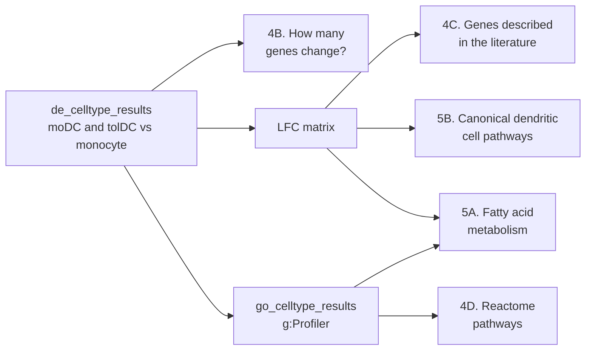
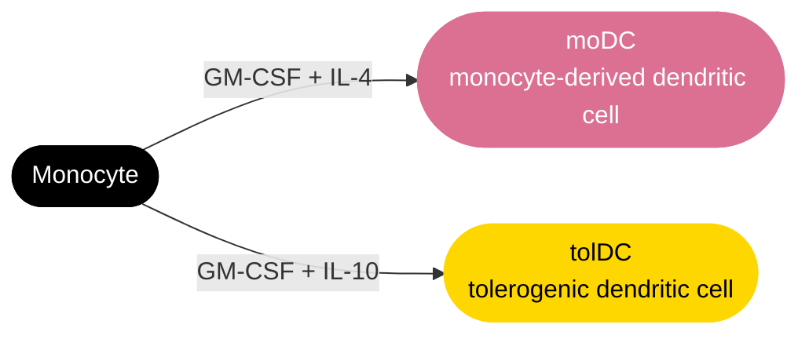
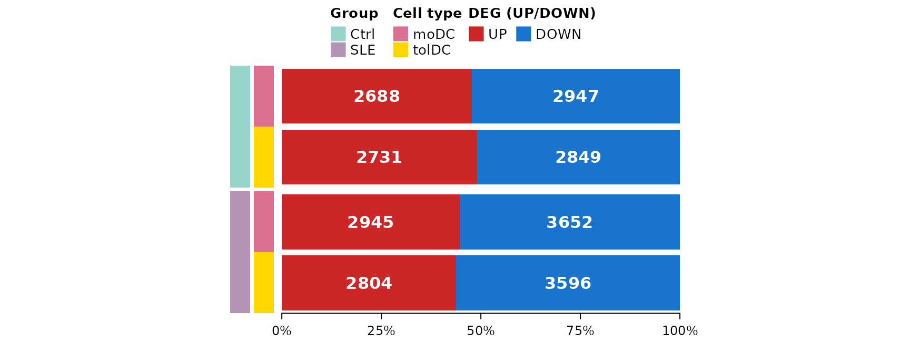
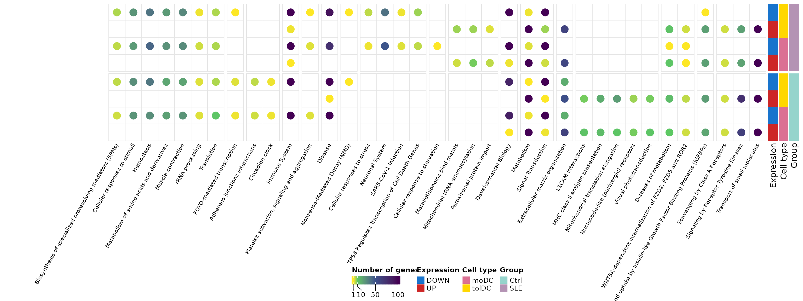
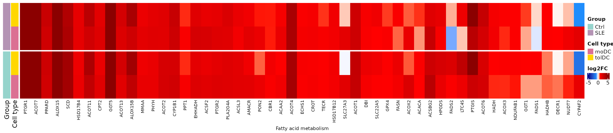
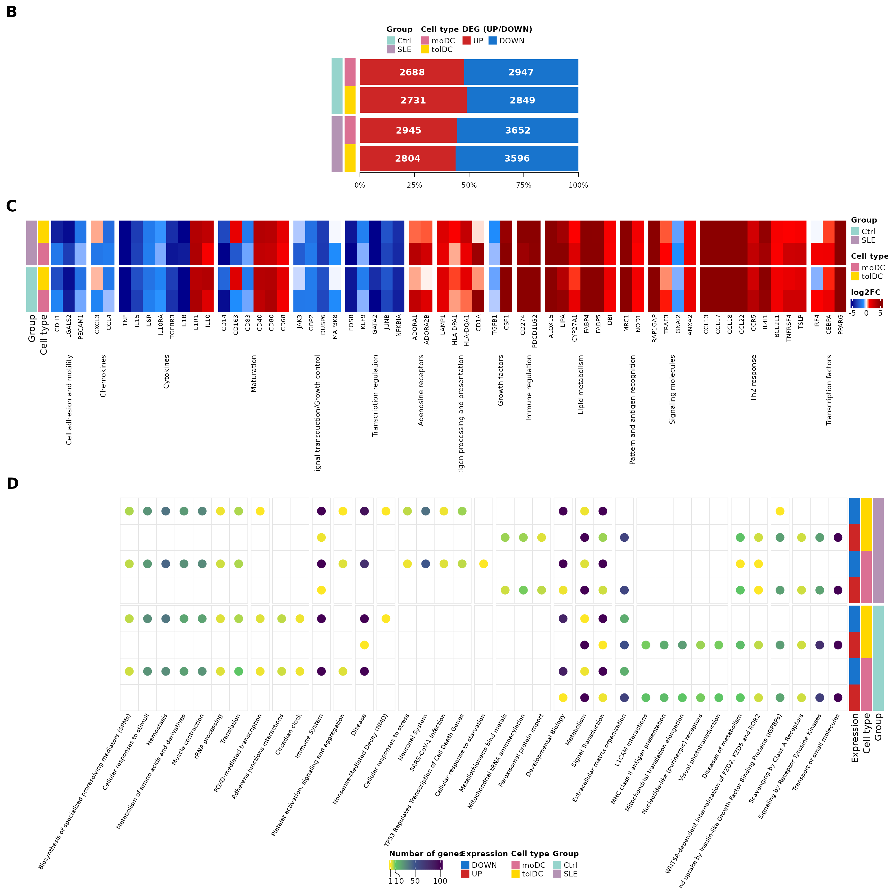

# Lesson 5: Differentiation of monocytes into dendritic cells

## Welcome

In the previous lessons we compared **patients against controls** within
each cell type. Now we change the question: **what changes when a
monocyte differentiates into a dendritic cell?**, and **does this
process happen in the same way in lupus patients as in controls?**

**What you need to know beforehand:** you should have completed the
lessons [Differentially expressed
genes](https://eveliacoss.github.io/GeneExprLupusMx/articles/l3_DEGs_en.md)
and [Biological functions of
DEGs](https://eveliacoss.github.io/GeneExprLupusMx/articles/l4_GOterms_en.md).

**By the end you will be able to:**

1.  Set up a comparison **between cell types** using a reference level
    (monocytes).
2.  Explain why a design may include **covariates** (disease activity,
    glucocorticoid dose).
3.  Validate an experiment by comparing your results with **genes
    described in the literature**.
4.  Summarize thousands of genes into **Reactome pathways** and identify
    metabolic changes.
5.  Reproduce **Figures 4 and 5** of the article.

**Estimated time:** 1.5 hours.

### Lesson map



## Glossary

These are the terms we will use. Come back here whenever you need to.

- **Cell differentiation**: the process by which a cell acquires a new
  identity and new functions.
- **GM-CSF, IL-4, IL-10**: cytokines added to the culture to direct
  differentiation.
- **moDC**: monocyte-derived dendritic cells; they activate the immune
  response.
- **tolDC**: tolerogenic dendritic cells; they promote immune tolerance.
- **Reference level**: the group against which the others are compared
  (here, monocytes).
- **Covariate**: a variable included in the model to account for its
  effect (for example, the dose of a drug).
- **Within-group comparison**: each cell type is compared against the
  monocytes **of the same group** (controls with controls, patients with
  patients).
- **Metabolic reprogramming**: a change in the metabolic pathways a cell
  uses when it changes function.

## 1. Setup

``` r

library(GeneExprLupusMx) # package data
library(tidyverse)       # table manipulation and plots
library(ComplexHeatmap)  # heatmaps
library(circlize)        # color scales for ComplexHeatmap
library(grid)            # drawing shapes inside the heatmaps
library(cowplot)         # combining plots into a panel
```

Colors and thresholds (the same as in the previous lessons):

``` r

cell_color  <- c(monocyte = "black", moDC = "palevioletred", tolDC = "gold1")
group_color <- c(Ctrl = "#96d4ccff", SLE = "#b493b4ff")
deg_color   <- c(UP = "firebrick3", DOWN = "dodgerblue3")
lfc_color   <- colorRamp2(c(-5, -1, 0, 1, 5), c("darkblue", "dodgerblue", "white", "red", "darkred"))

lfc_threshold  <- 1
padj_threshold <- 0.05
```

## 2. Step 1: the experiment (Figure 4A)

Each volunteer’s monocytes were cultured *in vitro* with different
cytokines to obtain two types of dendritic cells:



Because each volunteer contributes all three cell types, we can ask
which genes **change upon differentiation** by comparing each dendritic
cell type against the monocytes. If differentiation worked, we expect to
see large changes and known genes switching on or off.

## 3. Step 2: the analysis design

We make the comparison **within each group**: the controls’ dendritic
cells against the controls’ monocytes, and the patients’ dendritic cells
against the patients’ monocytes. This way, each group has its own
reference.

The model is different in each group:

| Group | Design | Why? |
|----|----|----|
| Controls | `~ Cell_type` | We are only interested in the cell type |
| Patients | `~ SLEDAI_category + Cell_type + Dose_category` | Patients differ in disease activity and glucocorticoid dose; including them as **covariates** accounts for their effect |

Let us see how these covariates are distributed among the patients (one
row per volunteer):

``` r

metadata_cleaned %>%
  filter(Group == "SLE", Cell_type == "monocyte") %>%
  dplyr::count(SLEDAI_category, Dose_category)
#>   SLEDAI_category Dose_category n
#> 1        Activity             0 4
#> 2        Activity             1 9
#> 3     No_activity             0 2
#> 4     No_activity             1 2
#> 5            Zero             0 3
#> 6            Zero             1 3
```

`Dose_category` indicates whether the patient receives glucocorticoids
(1) or not (0), and `SLEDAI_category` is her level of disease activity.
By adjusting for them, the effect of `Cell_type` reflects
differentiation and not these clinical differences.

This is the analysis, the same one that generates the package checkpoint
(`data-raw/lesson5_checkpoints.R`). Running it takes a few minutes:

``` r

library(DESeq2)

full_dds <- DESeqDataSetFromTximport(txi     = filtered_txi,
                                     colData = metadata_cleaned,
                                     design  = ~ Cell_type)

run_celltype_de <- function(group, design) {
  dds_group <- full_dds[, full_dds$Group == group]
  dds_group$Cell_type       <- relevel(dds_group$Cell_type, ref = "monocyte")
  dds_group$SLEDAI_category <- relevel(dds_group$SLEDAI_category, ref = "Zero")
  dds_group$Dose_category   <- relevel(dds_group$Dose_category, ref = "0")
  design(dds_group) <- design
  dds_group <- DESeq(dds_group)
  lapply(c(moDC = "moDC", tolDC = "tolDC"), function(cell) {
    res <- as.data.frame(results(dds_group, alpha = 0.05,
                                 name = paste0("Cell_type_", cell, "_vs_monocyte")))
    data.frame(gene = rownames(res), res, row.names = NULL)
  })
}

ctrl <- run_celltype_de("Ctrl", ~ Cell_type)
sle  <- run_celltype_de("SLE",  ~ SLEDAI_category + Cell_type + Dose_category)
de_celltype_results <- list(Ctrl_moDC = ctrl$moDC, Ctrl_tolDC = ctrl$tolDC,
                            SLE_moDC  = sle$moDC,  SLE_tolDC  = sle$tolDC)
```

We use the checkpoint:

``` r

names(de_celltype_results)
#> [1] "Ctrl_moDC"  "Ctrl_tolDC" "SLE_moDC"   "SLE_tolDC"
head(de_celltype_results$Ctrl_moDC[order(de_celltype_results$Ctrl_moDC$padj), ])
#>         gene  baseMean log2FoldChange     lfcSE     stat        pvalue
#> 11881   MRC1 68435.137       9.146538 0.2613979 34.99086 3.098523e-268
#> 17371 SLC7A8  4486.754       8.216655 0.2413625 34.04280 5.187183e-254
#> 6460   GPNMB 64903.360       9.443920 0.2816243 33.53376 1.553122e-246
#> 19706  TREM2  6019.286      10.614697 0.3247763 32.68310 2.714885e-234
#> 4641    ECM1  2623.108       7.358515 0.2325977 31.63623 1.172972e-219
#> 890     APOE 70848.544      11.967432 0.3869356 30.92874 4.907850e-210
#>                padj
#> 11881 4.765219e-264
#> 17371 3.988684e-250
#> 6460  7.961823e-243
#> 19706 1.043806e-230
#> 4641  3.607826e-216
#> 890   1.257964e-206
```

A positive LFC means the gene is **higher in the dendritic cell** than
in the monocyte; a negative one means it is **switched off** upon
differentiation.

## 4. Step 3: how many genes change? (Figure 4B)

With the same thresholds as in the previous lessons (\|LFC\| ≥ 1 and
padj \< 0.05), we split the DEGs of each comparison by direction:

``` r

deg_genes <- function(comparison, direction) {
  df <- de_celltype_results[[comparison]]
  df <- df[!is.na(df$padj) & df$padj < padj_threshold, ]
  if (direction == "UP") df$gene[df$log2FoldChange >= lfc_threshold]
  else df$gene[df$log2FoldChange <= -lfc_threshold]
}

deg_counts <- tibble(comparison = names(de_celltype_results)) %>%
  mutate(Group     = sub("_.*", "", comparison),
         Cell_type = sub(".*_", "", comparison),
         UP        = sapply(comparison, function(x) length(deg_genes(x, "UP"))),
         DOWN      = sapply(comparison, function(x) length(deg_genes(x, "DOWN"))))
deg_counts
#> # A tibble: 4 × 5
#>   comparison Group Cell_type    UP  DOWN
#>   <chr>      <chr> <chr>     <int> <int>
#> 1 Ctrl_moDC  Ctrl  moDC       2688  2947
#> 2 Ctrl_tolDC Ctrl  tolDC      2731  2849
#> 3 SLE_moDC   SLE   moDC       2945  3652
#> 4 SLE_tolDC  SLE   tolDC      2804  3596
```

Each comparison is identified with two color columns (group and cell
type), and next to them we draw the proportion of up- and down-regulated
genes. We build it with `ComplexHeatmap`: a single-column *heatmap* for
the group, one annotation for the cell type, and another with a
*barplot*:

``` r

# proportion of up- and down-regulated genes in each comparison
deg_prop <- as.matrix(deg_counts[, c("UP", "DOWN")]) / (deg_counts$UP + deg_counts$DOWN)

# cell type, to the right of the group
celltype_anno <- rowAnnotation("Cell type" = deg_counts$Cell_type,
                               col = list("Cell type" = cell_color[c("moDC", "tolDC")]),
                               show_annotation_name = FALSE)

# barplot of proportions (UP first, DOWN second) with the number of genes inside.
# It is a custom annotation: it receives the rows of each block (index) and draws them.
deg_barplot <- rowAnnotation(
  "DEG (UP/DOWN)" = AnnotationFunction(
    fun = function(index, k, n) {
      pushViewport(viewport(xscale = c(0, 1), yscale = c(0.5, length(index) + 0.5)))
      y     <- rev(seq_along(index)) # the first row goes on top
      up    <- deg_prop[index, "UP"]
      down  <- deg_prop[index, "DOWN"]
      label <- gpar(col = "white", fontface = "bold")
      grid.rect(x = 0, y = y, width = up, height = 0.9, just = "left",
                default.units = "native", gp = gpar(fill = deg_color[["UP"]], col = NA))
      grid.rect(x = up, y = y, width = down, height = 0.9, just = "left",
                default.units = "native", gp = gpar(fill = deg_color[["DOWN"]], col = NA))
      grid.text(deg_counts$UP[index], x = up / 2, y = y, default.units = "native", gp = label)
      grid.text(deg_counts$DOWN[index], x = up + down / 2, y = y, default.units = "native", gp = label)
      if (k == n) { # axis only below the last block
        grid.xaxis(at = c(0, 0.25, 0.5, 0.75, 1), label = c("0%", "25%", "50%", "75%", "100%"),
                   gp = gpar(fontsize = 9))
      }
      popViewport()
    },
    var_import = list(deg_prop, deg_counts, deg_color),
    subsettable = TRUE, which = "row", width = unit(10, "cm")),
  show_annotation_name = FALSE)

# base heatmap: one column with the group, split into Ctrl and SLE
group_ht <- Heatmap(deg_counts$Group, name = "Group", col = group_color,
                    width = unit(5, "mm"), row_split = deg_counts$Group, row_title = NULL,
                    show_row_names = FALSE, show_column_names = FALSE,
                    right_annotation = celltype_anno)

ht_fig4b <- group_ht + deg_barplot

lgd_deg <- Legend(labels = c("UP", "DOWN"), title = "DEG (UP/DOWN)",
                  legend_gp = gpar(fill = deg_color), nrow = 1)
```

``` r

draw(ht_fig4b, heatmap_legend_list = list(lgd_deg), merge_legends = TRUE,
     heatmap_legend_side = "top", annotation_legend_side = "top",
     padding = unit(c(10, 2, 2, 2), "mm")) # bottom margin for the axis
```



**Thousands of genes change** in each comparison, compared with the 94
that change between patients and controls (lesson 3). Differentiation
is, by far, the largest transcriptomic change in the study, just as we
saw in the PCA of lesson 2. Patients have somewhat more down-regulated
genes than controls.

**Challenge 1.** How many genes go up in **all four** comparisons (moDC
and tolDC, in controls and patients)? And how many go down in all four?

*Hint:* `Reduce(intersect, ...)` applied to a list of vectors.

Show solution

``` r

up_all   <- Reduce(intersect, lapply(names(de_celltype_results), deg_genes, direction = "UP"))
down_all <- Reduce(intersect, lapply(names(de_celltype_results), deg_genes, direction = "DOWN"))
c(UP = length(up_all), DOWN = length(down_all))
#>   UP DOWN 
#> 1924 2164
```

More than half of the DEGs in each comparison are shared: there is a
**common differentiation program** that does not depend on the type of
dendritic cell or on the group.

## 5. An LFC matrix for all the DEGs

For the next plots we need a matrix with the LFC of each gene in the
four comparisons. We include the genes that are DEGs in at least one
comparison:

``` r

all_deg <- unique(unlist(lapply(names(de_celltype_results), function(x)
  c(deg_genes(x, "UP"), deg_genes(x, "DOWN")))))
length(all_deg)
#> [1] 8111

lfc_mat <- sapply(de_celltype_results, function(df)
  df$log2FoldChange[match(all_deg, df$gene)])
rownames(lfc_mat) <- all_deg
lfc_mat[1:4, ]
#>       Ctrl_moDC Ctrl_tolDC SLE_moDC SLE_tolDC
#> A2M    9.742309   7.948722 9.925345  8.432369
#> A4GNT  2.991895   1.377433 3.308340  2.056710
#> AARS2  1.130076   1.071933 1.282804  1.263579
#> ABCA6  3.162758   2.327826 2.237093  2.249498
```

Since we will show them several times, we write a function that draws an
LFC *heatmap* with one row per comparison and one column per gene,
grouping the genes by process:

``` r

# row order: patients on top, tolDC before moDC
comparison_info <- tibble(comparison = c("SLE_tolDC", "SLE_moDC", "Ctrl_tolDC", "Ctrl_moDC"),
                          Group      = sub("_.*", "", comparison),
                          Cell_type  = sub(".*_", "", comparison))

plot_lfc_heatmap <- function(genes, process = NULL, process_levels = unique(process),
                             title = NULL, title_rot = 90) {
  mat <- t(lfc_mat[genes, comparison_info$comparison, drop = FALSE]) # rows = comparisons
  Heatmap(
    mat, name = "log2FC", col = lfc_color, na_col = "gray",
    cluster_rows = FALSE, cluster_columns = FALSE,
    show_row_names = FALSE, column_names_gp = gpar(fontsize = 8),
    left_annotation = rowAnnotation(
      Group = comparison_info$Group, "Cell type" = comparison_info$Cell_type,
      col = list(Group = group_color, "Cell type" = cell_color)),
    row_split = factor(comparison_info$Group, levels = c("SLE", "Ctrl")), row_title = NULL,
    column_split = if (is.null(process)) NULL else factor(process, levels = process_levels),
    column_title = title, column_title_rot = title_rot, column_title_side = "bottom",
    column_title_gp = gpar(fontsize = 9), column_gap = unit(2, "mm"),
    heatmap_legend_param = list(direction = "horizontal"))
}
```

## 6. Step 4: do the genes we expected change? (Figure 4C)

If our cells differentiated properly, the genes that the literature
describes for monocyte-to-moDC differentiation should change in the same
direction. The curated list `moDC_genes` gathers 90 genes of this kind,
grouped by process:

``` r

dplyr::count(moDC_genes, process, sort = TRUE)
#>                                             process  n
#> 1                                         Cytokines 11
#> 2                                      Th2 response 10
#> 3                                        Maturation  7
#> 4                          Transcription regulation  7
#> 5                        Cell adhesion and motility  6
#> 6                                  Lipid metabolism  6
#> 7                                        Regulatory  6
#> 8                               Signaling molecules  6
#> 9               Antigen processing and presentation  4
#> 10                                       Chemokines  4
#> 11               Signal transduction/Growth control  4
#> 12                  Pattern and antigen recognition  3
#> 13                            Transcription factors  3
#> 14                              Adenosine receptors  2
#> 15                                     Ca2+ binding  2
#> 16                                   Growth factors  2
#> 17                                Immune regulation  2
#> 18                                       chaperones  2
#> 19                                 oxidative stress  2
#> 20 TP53 Regulates Transcription of Cell Death Genes  1
```

We use the processes of Figure 4C: first the **expected** changes of
differentiation (maturation, cytokines, chemokines…) and then
**context-dependent** processes (Th2 response, lipid metabolism…):

``` r

fig4c_processes <- c(
  # expected changes in differentiation
  "Cell adhesion and motility", "Chemokines", "Cytokines", "Maturation",
  "Signal transduction/Growth control", "Transcription regulation",
  # processes that change depending on context
  "Adenosine receptors", "Antigen processing and presentation", "Growth factors",
  "Immune regulation", "Lipid metabolism", "Pattern and antigen recognition",
  "Signaling molecules", "Th2 response", "Transcription factors")

fig4c_genes <- moDC_genes %>%
  filter(process %in% fig4c_processes, gene %in% rownames(lfc_mat)) %>%
  mutate(process = factor(process, levels = fig4c_processes)) %>%
  arrange(process)
nrow(fig4c_genes)
#> [1] 62
```

Does the direction of change in our controls’ moDCs match what is
described in the literature?

``` r

observed <- ifelse(lfc_mat[fig4c_genes$gene, "Ctrl_moDC"] > 0, "Upregulated", "Downregulated")
mean(observed == fig4c_genes$Expression)
#> [1] 0.7903226
```

About 80% of the genes change in the expected direction: *in vitro*
differentiation reproduces the known program.

``` r

ht_fig4c <- plot_lfc_heatmap(fig4c_genes$gene, process = fig4c_genes$process,
                             process_levels = fig4c_processes,
                             title = levels(fig4c_genes$process))
draw(ht_fig4c, heatmap_legend_side = "right", annotation_legend_side = "right")
```


The monocyte marker `CD14` is **switched off** and the dendritic cell
costimulatory molecules (`CD40`, `CD80`) are **switched on**, in both
controls and patients. The tolDCs share much of this program, but not
all of it: for example, they **switch on** `CD163`, a
tolerance-associated marker that moDCs switch off.

**Challenge 2.** Which genes in `fig4c_genes` do **not** change in the
direction described by the literature in the controls’ moDCs?

Show solution

``` r

fig4c_genes %>%
  mutate(observed = observed, Ctrl_moDC_LFC = round(lfc_mat[gene, "Ctrl_moDC"], 2)) %>%
  filter(observed != Expression) %>%
  dplyr::select(gene, process, Expression, observed, Ctrl_moDC_LFC)
#>        gene             process    Expression      observed Ctrl_moDC_LFC
#> 1      IL1B           Cytokines   Upregulated Downregulated         -5.82
#> 2      CD83          Maturation   Upregulated Downregulated         -0.79
#> 3      CD40          Maturation Downregulated   Upregulated          3.16
#> 4      CD80          Maturation Downregulated   Upregulated          3.75
#> 5      CD68          Maturation Downregulated   Upregulated          1.40
#> 6     TGFB1      Growth factors   Upregulated Downregulated         -0.45
#> 7     CD274   Immune regulation Downregulated   Upregulated          5.05
#> 8  PDCD1LG2   Immune regulation Downregulated   Upregulated          6.28
#> 9     GNAI2 Signaling molecules   Upregulated Downregulated         -0.95
#> 10    IL4I1        Th2 response Downregulated   Upregulated          4.70
#> 11   BCL2L1        Th2 response Downregulated   Upregulated          1.47
#> 12  TNFRSF4        Th2 response Downregulated   Upregulated          2.64
#> 13     TSLP        Th2 response Downregulated   Upregulated          2.65
```

The discrepancies may be due to differences in the culture protocol or
to the reference studies having used other conditions. It is normal for
not all genes to match.

## 7. Step 5: which processes change? (Figure 4D)

### 7.1 Functional enrichment

As in the previous lesson, we look for the enriched terms in each DEG
list with g:Profiler, now in <GO:BP>, KEGG, and Reactome. The lists have
about 3,000 genes each, so they are queried one by one:

``` r

library(gprofiler2)
set_base_url("https://biit.cs.ut.ee/gprofiler_archive3/e113_eg59_p19") # archived version (June 2025)

deg_lists <- list()
for (group in c("Ctrl", "SLE")) for (cell in c("moDC", "tolDC")) for (direction in c("UP", "DOWN"))
  deg_lists[[paste(group, direction, cell, sep = "_")]] <- deg_genes(paste(group, cell, sep = "_"), direction)

gost_res <- lapply(names(deg_lists), function(query)
  gost(deg_lists[query], organism = "hsapiens", correction_method = "fdr",
       user_threshold = 0.05, sources = c("GO:BP", "KEGG", "REAC"), evcodes = TRUE))
```

The result is in the `go_celltype_results` checkpoint:

``` r

attr(go_celltype_results, "gprofiler_version")
#> [1] "e113_eg59_p19_903d2221"
go_celltype_results %>%
  dplyr::count(query, source) %>%
  pivot_wider(names_from = source, values_from = n)
#> # A tibble: 8 × 4
#>   query           `GO:BP`  KEGG  REAC
#>   <chr>             <int> <int> <int>
#> 1 Ctrl_DOWN_moDC     1683    34   106
#> 2 Ctrl_DOWN_tolDC    1805    43   152
#> 3 Ctrl_UP_moDC       1235    15    39
#> 4 Ctrl_UP_tolDC       914    33    27
#> 5 SLE_DOWN_moDC      1910    71    96
#> 6 SLE_DOWN_tolDC     1997    63    95
#> 7 SLE_UP_moDC         960    26    30
#> 8 SLE_UP_tolDC        912    24    27
```

### 7.2 Summarizing into Reactome parent pathways

Thousands of terms are too many to look at. We summarize them as in
lesson 4: to each gene we assign its Reactome **parent pathway**, the
most general term (with the most genes) in which it appears. If a gene
has a parent pathway in controls, we use that same pathway in patients,
so that both groups are compared with the same categories:

``` r

reac_parent <- go_celltype_results %>%
  filter(source == "REAC") %>%
  mutate(Group = sub("_.*", "", query)) %>%
  separate_rows(intersection, sep = ",") %>%
  dplyr::rename(gene = intersection) %>%
  group_by(Group, gene) %>%
  summarise(parent = term_name[which.max(term_size)], .groups = "drop")

ctrl_parent <- reac_parent %>% filter(Group == "Ctrl") %>% dplyr::select(gene, ctrl_parent = parent)

deg_long <- expand_grid(Group = c("Ctrl", "SLE"), direction = c("UP", "DOWN"),
                        Cell_type = c("moDC", "tolDC")) %>%
  mutate(query = paste(Group, direction, Cell_type, sep = "_"),
         gene  = map2(paste(Group, Cell_type, sep = "_"), direction, deg_genes)) %>%
  unnest(gene)

parent_counts <- deg_long %>%
  inner_join(reac_parent, by = c("Group", "gene")) %>%
  left_join(ctrl_parent, by = "gene") %>%
  mutate(parent = ifelse(Group == "SLE" & !is.na(ctrl_parent), ctrl_parent, parent)) %>%
  dplyr::count(parent, query)

dplyr::n_distinct(parent_counts$parent) # parent pathways
#> [1] 37
```

We build a pathway × list matrix with the number of genes (empty if the
pathway does not appear in that list):

``` r

query_order <- c("Ctrl_UP_moDC", "Ctrl_DOWN_moDC", "Ctrl_UP_tolDC", "Ctrl_DOWN_tolDC",
                 "SLE_UP_moDC", "SLE_DOWN_moDC", "SLE_UP_tolDC", "SLE_DOWN_tolDC")

pathway_mat <- parent_counts %>%
  pivot_wider(names_from = query, values_from = n) %>%
  column_to_rownames("parent") %>%
  as.matrix()
pathway_mat <- t(pathway_mat[, query_order])          # rows = lists, columns = pathways
pathway_mat <- pathway_mat[, order(tolower(colnames(pathway_mat)))] # pathways in alphabetical order

# group the pathways by which lists they appear in: UP or DOWN if the pathway is in that list,
# NA if it is not (for example, "UP_NA_UP_NA_NA_NA_NA_NA")
pathway_pattern <- apply(pathway_mat, 2, function(x)
  paste(ifelse(is.na(x), "NA", ifelse(grepl("_UP_", query_order), "UP", "DOWN")), collapse = "_"))

# row order: patients on top; tolDC before moDC; DOWN before UP
row_order <- c("SLE_DOWN_tolDC", "SLE_UP_tolDC", "SLE_DOWN_moDC", "SLE_UP_moDC",
               "Ctrl_DOWN_tolDC", "Ctrl_UP_tolDC", "Ctrl_DOWN_moDC", "Ctrl_UP_moDC")
pathway_mat <- pathway_mat[row_order, ]
pathway_mat[, 1:4]
#>                 Adherens junctions interactions
#> SLE_DOWN_tolDC                               NA
#> SLE_UP_tolDC                                 NA
#> SLE_DOWN_moDC                                NA
#> SLE_UP_moDC                                  NA
#> Ctrl_DOWN_tolDC                               5
#> Ctrl_UP_tolDC                                NA
#> Ctrl_DOWN_moDC                                4
#> Ctrl_UP_moDC                                 NA
#>                 Biosynthesis of specialized proresolving mediators (SPMs)
#> SLE_DOWN_tolDC                                                          6
#> SLE_UP_tolDC                                                           NA
#> SLE_DOWN_moDC                                                           5
#> SLE_UP_moDC                                                            NA
#> Ctrl_DOWN_tolDC                                                         5
#> Ctrl_UP_tolDC                                                          NA
#> Ctrl_DOWN_moDC                                                          4
#> Ctrl_UP_moDC                                                           NA
#>                 Cellular response to starvation Cellular responses to stimuli
#> SLE_DOWN_tolDC                               NA                            27
#> SLE_UP_tolDC                                 NA                            NA
#> SLE_DOWN_moDC                                 1                            25
#> SLE_UP_moDC                                  NA                            NA
#> Ctrl_DOWN_tolDC                              NA                            29
#> Ctrl_UP_tolDC                                NA                            NA
#> Ctrl_DOWN_moDC                               NA                            27
#> Ctrl_UP_moDC                                 NA                            NA
```

``` r

count_color <- colorRamp2(c(1, 10, 50, 100), c("#FDE725", "#5DC863", "#3B528B", "#440154"))
query_info  <- tibble(query = row_order,
                      Group = sub("_.*", "", query),
                      Expression = sub("^[^_]+_([^_]+)_.*", "\\1", query),
                      Cell_type  = sub(".*_", "", query))

ht_fig4d <- Heatmap(
  pathway_mat, name = "Number of genes", col = count_color, na_col = "white",
  cluster_rows = FALSE, cluster_columns = FALSE, show_row_names = FALSE,
  column_names_gp = gpar(fontsize = 8), column_names_rot = 60,
  rect_gp = gpar(type = "none"),
  layer_fun = function(j, i, x, y, w, h, fill) {
    grid.rect(x = x, y = y, width = w, height = h, gp = gpar(col = "gray90", fill = NA))
    value <- pindex(pathway_mat, i, j)
    keep  <- !is.na(value) # a circle only where the pathway appears
    if (any(keep)) grid.circle(x = x[keep], y = y[keep], r = unit(2, "mm"),
                               gp = gpar(fill = count_color(value[keep]), col = NA))
  },
  right_annotation = rowAnnotation(
    Expression = query_info$Expression, "Cell type" = query_info$Cell_type,
    Group = query_info$Group,
    col = list(Expression = deg_color, "Cell type" = cell_color, Group = group_color)),
  row_split = factor(query_info$Group, levels = c("SLE", "Ctrl")), row_title = NULL,
  column_split = pathway_pattern, column_title = NULL, column_gap = unit(1.5, "mm"),
  heatmap_legend_param = list(direction = "horizontal", at = c(1, 10, 50, 100)))

draw(ht_fig4d, merge_legends = TRUE, heatmap_legend_side = "bottom",
     annotation_legend_side = "bottom", padding = unit(c(2, 55, 2, 2), "mm")) # margin for the labels
```



Each column is a Reactome parent pathway and each circle indicates how
many DEGs from that list belong to it. The pathways are grouped by which
lists they appear in, and the rows show the patients first.

- **Common pathways:** “Metabolism” and “Signal Transduction” appear in
  all eight lists, with many genes. They are the **common program** of
  differentiation.
- **Control-only pathways:** “MHC class II antigen presentation”, “L1CAM
  interactions”, and others appear only among the genes that go **up**
  in the controls’ dendritic cells. Antigen presentation via MHC class
  II is a central function of dendritic cells; that it does not appear
  enriched in patients suggests that this program is activated less in
  lupus.
- **Patient-only pathways:** “Metallothioneins bind metals”,
  “Mitochondrial tRNA aminoacylation”, and “Peroxisomal protein import”
  appear only among the genes that go up in patients.

Remember that a circle indicates **enrichment**, not an expression
value: to confirm these differences we would need to directly compare
the dendritic cells of patients and controls.

## 8. Step 6: fatty acid metabolism (Figure 5A)

A dendritic cell does not only change its markers: it also changes its
**metabolism**. We take the genes of the Reactome term “Fatty acid
metabolism” in any of the lists:

``` r

fatty_term <- go_celltype_results %>%
  filter(source == "REAC", term_name == "Fatty acid metabolism") %>%
  separate_rows(intersection, sep = ",") %>%
  dplyr::rename(gene = intersection)

# Order: list by list (controls first) and, within each
# list, the most significant genes first (lowest padj, highest |LFC|)
fatty_genes <- unlist(lapply(query_order, function(q) {
  genes <- fatty_term$gene[fatty_term$query == q]
  de <- de_celltype_results[[sub("_(UP|DOWN)_", "_", q)]] # e.g., Ctrl_UP_moDC -> Ctrl_moDC
  de <- de[de$gene %in% genes, ]
  de$gene[order(de$padj, -abs(de$log2FoldChange))]
})) %>% unique()
length(fatty_genes)
#> [1] 53
head(fatty_genes, 10)
#>  [1] "PTGR1"   "ACOT7"   "PPARD"   "ALOX15"  "SCD"     "HSD17B4" "ACOT11" 
#>  [8] "CPT2"    "GGT5"    "ACOT13"
```

``` r

ht_fig5a <- plot_lfc_heatmap(fatty_genes, title = "Fatty acid metabolism", title_rot = 0)
draw(ht_fig5a, heatmap_legend_side = "right", annotation_legend_side = "right")
```



Most of these genes go **up** in both types of dendritic cells and in
both groups: differentiation involves a **metabolic reprogramming**
toward lipid synthesis and use. Remember that in lesson 4 we found lipid
metabolism genes altered in the patients’ tolDCs; here we see that this
metabolism is central for these cells.

## 9. Step 7: canonical dendritic cell pathways (Figure 5B)

Finally, we review genes associated with dendritic cell function
according to Gene Ontology (curated list `dc_genes`): differentiation,
antigen presentation, migration, chemokine receptors…

``` r

fig5b_genes <- dc_genes %>%
  filter(gene %in% rownames(lfc_mat)) %>%
  arrange(process)
dplyr::count(fig5b_genes, process)
#>                                process  n
#> 1                   Adhesion molecules  1
#> 2  Antigen processing and presentation  7
#> 3                            Apoptosis  6
#> 4                  Chemokine receptors  6
#> 5                  Cytokine production  4
#> 6                   DC differentiation 13
#> 7                          DC-specific  3
#> 8                       Growth factors  1
#> 9                   Immune checkpoints  2
#> 10                   Immune modulators  5
#> 11                    Lipid metabolism  2
#> 12                           Migration  7
#> 13                 Pattern recognition  7
#> 14                  Protein processing  2
#> 15                   Signaling kinases  5
#> 16                       TAM signaling 11
#> 17               Transcription factors  9
#> 18            Transport and Metabolism  1
```

``` r

ht_fig5b <- plot_lfc_heatmap(fig5b_genes$gene, process = fig5b_genes$process,
                             title = sort(unique(fig5b_genes$process)))
draw(ht_fig5b, heatmap_legend_side = "right", annotation_legend_side = "right")
```


The antigen presentation, migration, and chemokine receptor genes change
in a similar way in controls and patients: **the patients’ dendritic
cells acquire the canonical differentiation program**. The differences
between groups are of degree, not of direction.

**Challenge 3.** Are there genes in `dc_genes` that change in
**opposite** directions between the controls’ moDCs and the patients’
moDCs?

*Hint:* compare the sign of `lfc_mat[, "Ctrl_moDC"]` and
`lfc_mat[, "SLE_moDC"]`.

Show solution

``` r

fig5b_genes %>%
  mutate(Ctrl_moDC = lfc_mat[gene, "Ctrl_moDC"], SLE_moDC = lfc_mat[gene, "SLE_moDC"]) %>%
  filter(sign(Ctrl_moDC) != sign(SLE_moDC)) %>%
  mutate(across(c(Ctrl_moDC, SLE_moDC), ~ round(.x, 2)))
#>       gene     process             GOterm info Ctrl_moDC SLE_moDC
#> 1 TMEM176B DC-specific DC differentiation           0.73    -0.06
#> 2 TMEM176A DC-specific DC differentiation           0.38    -0.73
```

There are few genes, and with small LFCs: the differentiation program is
very similar in both groups.

## 10. To finish: Figures 4 and 5 of the article

Panel A of Figure 4 is the diagram from section 2. We join the other
panels; the `padding` argument leaves a margin above and to the left of
each panel so that the letters do not overlap with the plots:

``` r

grab <- function(ht, ...) {
  grid::grid.grabExpr(draw(ht, merge_legends = TRUE, ...), wrap.grobs = TRUE)
}

figure_4 <- plot_grid(
  grab(ht_fig4b, heatmap_legend_list = list(lgd_deg),
       heatmap_legend_side = "top", annotation_legend_side = "top",
       padding = unit(c(10, 12, 12, 2), "mm")),
  grab(ht_fig4c, heatmap_legend_side = "right", annotation_legend_side = "right",
       padding = unit(c(2, 12, 12, 2), "mm")),
  grab(ht_fig4d, heatmap_legend_side = "bottom", annotation_legend_side = "bottom",
       padding = unit(c(2, 55, 12, 2), "mm")),
  labels = c("B", "C", "D"), label_size = 20, ncol = 1, rel_heights = c(0.7, 1, 1.5))
figure_4
```



``` r


# Number of DEGs per comparison, for the figure caption
n_deg <- function(comparison, direction) {
  format(length(deg_genes(comparison, direction)), big.mark = ",")
}
```

**Figure 4.** Differentiation of monocytes into moDCs and tolDCs.
**(A)** Diagram of the *in vitro* differentiation of monocytes into
dendritic cells (section 2). **(B)** Number of DEGs in the dendritic
cells of controls and patients, using monocytes as the reference. In
controls, 2,688 genes go up and 2,947 go down in moDCs, and 2,731 go up
and 2,849 go down in tolDCs; in patients, 2,945 go up and 3,652 go down
in moDCs, and 2,804 go up and 3,596 go down in tolDCs. **(C)** Genes
previously described as increased or decreased during the
differentiation of monocytes into moDCs; the changes expected in our
data are shown. **(D)** Reactome parent pathways enriched among the DEGs
of each list (g:Profiler); the color indicates the number of genes. DEGs
were selected with \|LFC\| ≥ 1 and padj \< 0.05. SLE, systemic lupus
erythematosus; Ctrl, healthy control; moDC, monocyte-derived dendritic
cells; tolDC, tolerogenic dendritic cells.

``` r

figure_5 <- plot_grid(
  grab(ht_fig5a, heatmap_legend_side = "right", annotation_legend_side = "right",
       padding = unit(c(2, 12, 12, 2), "mm")),
  grab(ht_fig5b, heatmap_legend_side = "right", annotation_legend_side = "right",
       padding = unit(c(2, 12, 12, 2), "mm")),
  labels = c("A", "B"), label_size = 20, ncol = 1, rel_heights = c(0.8, 1))
figure_5
```


**Figure 5.** DEGs between dendritic cells and monocytes of lupus
patients and controls, related to dendritic cell differentiation.
**(A)** The 53 DEGs of the Reactome term *Fatty acid metabolism*,
reflecting the metabolic reprogramming in the transition from monocyte
to dendritic cell. **(B)** 92 genes associated with canonical pathways
of dendritic cell differentiation and function (Gene Ontology). The
color scale indicates the LFC of each dendritic cell type relative to
monocytes in each group. DEGs were selected with \|LFC\| ≥ 1 and padj \<
0.05. SLE, systemic lupus erythematosus; Ctrl, healthy control; moDC,
monocyte-derived dendritic cells; tolDC, tolerogenic dendritic cells.

The original figures can be found in the
[article](https://www.frontiersin.org/journals/immunology/articles/10.3389/fimmu.2026.1771959/full).

To save them in high resolution:

``` r

ggsave("Figure_4.png", figure_4, width = 16, height = 16, dpi = 300)
ggsave("Figure_5.png", figure_5, width = 18, height = 8, dpi = 300)
```

## 11. Summary

| Step | Key function | What for? |
|----|----|----|
| Design with covariates | `design(dds) <- ~ covariables + Cell_type` | Account for clinical effects |
| Compare against a reference | `relevel(Cell_type, ref = "monocyte")` | Measure the change due to differentiation |
| Count DEGs | `deg_genes()` | Gauge the size of the change |
| Validate with the literature | `moDC_genes` | Confirm that differentiation worked |
| Summarize functions | Reactome parent pathways | See processes instead of thousands of genes |
| Explore a process | LFC heatmap | See how each gene changes in each comparison |

### Common beginner mistakes

- **Comparing DEG counts between groups with different sample sizes**:
  more samples means more power and more DEGs (here, 23 patients versus
  10 controls).
- **Forgetting covariates**: if patients differ in treatment, its effect
  can be confounded with that of cell type.
- **Interpreting an LFC without its reference**: here a positive LFC is
  “higher than in the monocyte”, not “higher in patients”.
- **Expecting all genes from the literature to match**: culture
  protocols vary.

## 12. Next steps

The differentiation of monocytes into dendritic cells follows a very
similar program in patients and controls, with major changes in the
immune system and in lipid metabolism. The lesson [The transcriptional
signature of tolerogenic dendritic
cells](https://eveliacoss.github.io/GeneExprLupusMx/articles/l6_DEGs_tolDcs_en.md)
focuses on tolDCs and evaluates whether the patients’ tolDCs acquire the
tolerogenic signature described in the literature.

To continue, click the **Next lesson: The tolDC signature** button at
the bottom of this page.

[← Previous lesson: Biological functions of
DEGs](https://eveliacoss.github.io/GeneExprLupusMx/articles/l4_GOterms_en.md)
[Next lesson: The tolDC signature
→](https://eveliacoss.github.io/GeneExprLupusMx/articles/l6_DEGs_tolDcs_en.md)

[↑ Back to top](#top "Back to the top of the page")

## Session information

``` r

sessionInfo()
#> R version 4.6.1 (2026-06-24)
#> Platform: x86_64-pc-linux-gnu
#> Running under: Ubuntu 24.04.5 LTS
#> 
#> Matrix products: default
#> BLAS:   /usr/lib/x86_64-linux-gnu/openblas-pthread/libblas.so.3 
#> LAPACK: /usr/lib/x86_64-linux-gnu/openblas-pthread/libopenblasp-r0.3.26.so;  LAPACK version 3.12.0
#> 
#> locale:
#>  [1] LC_CTYPE=C.UTF-8       LC_NUMERIC=C           LC_TIME=C.UTF-8       
#>  [4] LC_COLLATE=C.UTF-8     LC_MONETARY=C.UTF-8    LC_MESSAGES=C.UTF-8   
#>  [7] LC_PAPER=C.UTF-8       LC_NAME=C              LC_ADDRESS=C          
#> [10] LC_TELEPHONE=C         LC_MEASUREMENT=C.UTF-8 LC_IDENTIFICATION=C   
#> 
#> time zone: UTC
#> tzcode source: system (glibc)
#> 
#> attached base packages:
#> [1] grid      stats     graphics  grDevices utils     datasets  methods  
#> [8] base     
#> 
#> other attached packages:
#>  [1] cowplot_1.2.0              circlize_0.4.18           
#>  [3] ComplexHeatmap_2.28.0      lubridate_1.9.5           
#>  [5] forcats_1.0.1              stringr_1.6.0             
#>  [7] dplyr_1.2.1                purrr_1.2.2               
#>  [9] readr_2.2.0                tidyr_1.3.2               
#> [11] tibble_3.3.1               ggplot2_4.0.3             
#> [13] tidyverse_2.0.0            GeneExprLupusMx_0.0.0.9000
#> 
#> loaded via a namespace (and not attached):
#>  [1] shape_1.4.6.1       gtable_0.3.6        rjson_0.2.23       
#>  [4] xfun_0.62           bslib_0.12.0        GlobalOptions_0.1.4
#>  [7] tzdb_0.5.0          vctrs_0.7.3         tools_4.6.1        
#> [10] generics_0.1.4      stats4_4.6.1        parallel_4.6.1     
#> [13] cluster_2.1.8.2     pkgconfig_2.0.3     RColorBrewer_1.1-3 
#> [16] S7_0.2.2            desc_1.4.3          S4Vectors_0.50.3   
#> [19] lifecycle_1.0.5     compiler_4.6.1      farver_2.1.2       
#> [22] textshaping_1.0.5   codetools_0.2-20    clue_0.3-68        
#> [25] htmltools_0.5.9     sass_0.4.10         yaml_2.3.12        
#> [28] pillar_1.11.1       pkgdown_2.2.1       crayon_1.5.3       
#> [31] jquerylib_0.1.4     cachem_1.1.0        iterators_1.0.14   
#> [34] foreach_1.5.2       tidyselect_1.2.1    digest_0.6.39      
#> [37] stringi_1.8.9       labeling_0.4.3      fastmap_1.2.0      
#> [40] colorspace_2.1-4    cli_3.6.6           magrittr_2.0.5     
#> [43] utf8_1.2.6          withr_3.0.3         scales_1.4.0       
#> [46] timechange_0.4.0    rmarkdown_2.32      matrixStats_1.5.0  
#> [49] otel_0.2.0          ragg_1.5.2          png_0.1-9          
#> [52] GetoptLong_1.1.1    hms_1.1.4           evaluate_1.0.5     
#> [55] knitr_1.52          IRanges_2.46.0      doParallel_1.0.17  
#> [58] rlang_1.3.0         glue_1.8.1          BiocGenerics_0.58.1
#> [61] jsonlite_2.0.0      R6_2.6.1            systemfonts_1.3.2  
#> [64] fs_2.1.0
```
