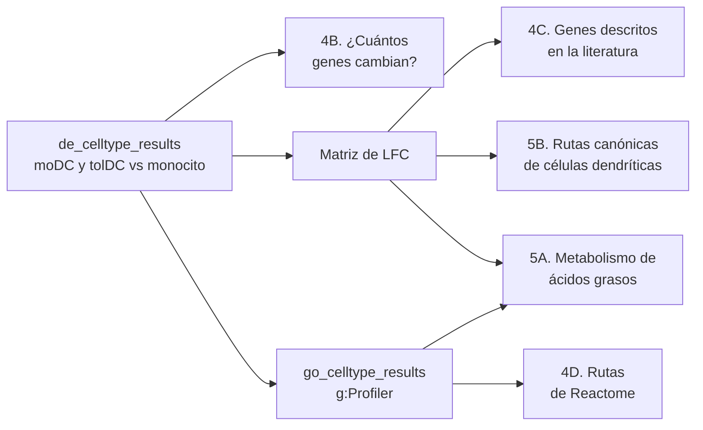
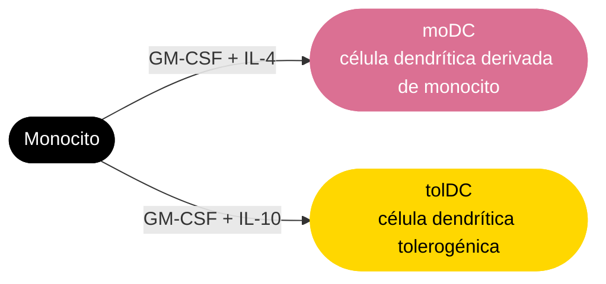
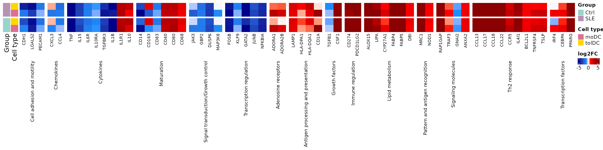
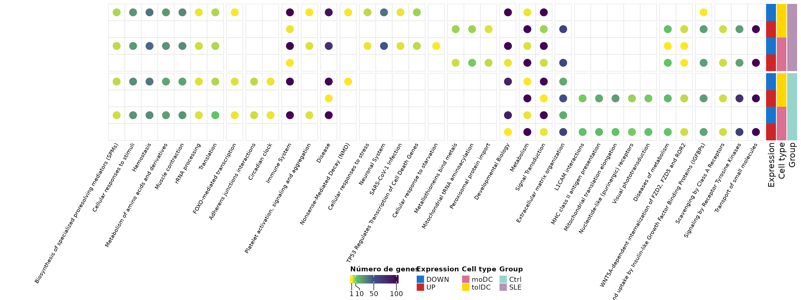
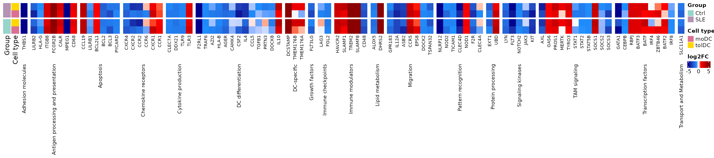
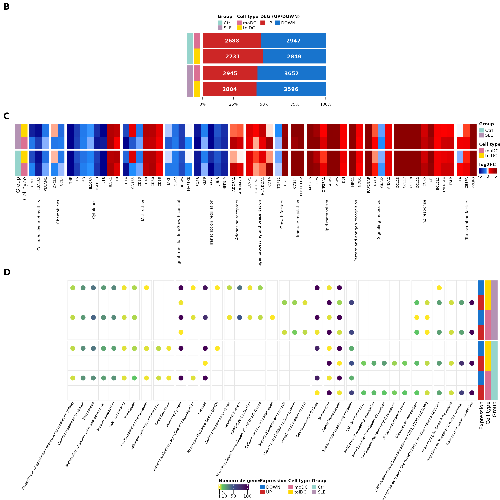
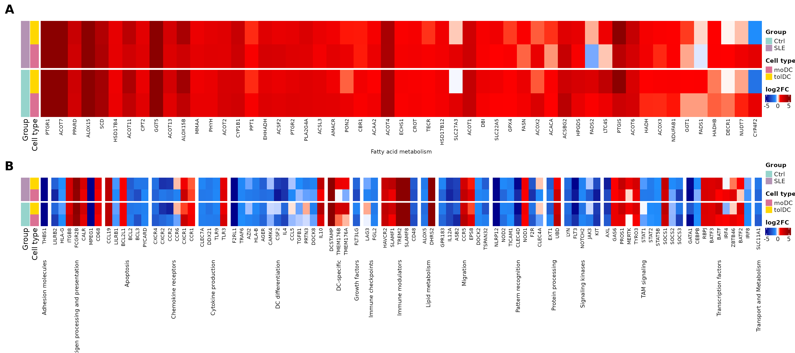

# Lección 5: Diferenciación de monocitos a células dendríticas

## Bienvenida

En las lecciones anteriores comparamos **pacientes contra controles**
dentro de cada tipo celular. Ahora cambiamos la pregunta: **¿qué cambia
cuando un monocito se diferencia en célula dendrítica?**, y **¿ese
proceso ocurre igual en las pacientes con lupus que en los controles?**

**Lo que necesitas saber antes:** haber hecho las lecciones [Genes
diferencialmente expresados entre pacientes y
controles](https://eveliacoss.github.io/GeneExprLupusMx/articles/l3_DEGs_es.md)
y [Funciones biológicas de los genes diferencialmente
expresados](https://eveliacoss.github.io/GeneExprLupusMx/articles/l4_GOterms_es.md).

**Al terminar podrás:**

1.  Plantear una comparación **entre tipos celulares** usando un nivel
    de referencia (los monocitos).
2.  Explicar por qué un diseño puede incluir **covariables** (actividad
    de la enfermedad, dosis de glucocorticoides).
3.  Validar un experimento comparando tus resultados con **genes
    descritos en la literatura**.
4.  Resumir miles de genes en **rutas de Reactome** e identificar
    cambios metabólicos.
5.  Reproducir las **Figuras 4 y 5** del artículo.

**Tiempo estimado:** 1.5 horas.

### Mapa de la lección



## Glosario

Estos son los términos que usaremos. Vuelve aquí cada vez que lo
necesites.

- **Diferenciación celular**: proceso por el que una célula adquiere una
  identidad y funciones nuevas.
- **GM-CSF, IL-4, IL-10**: citocinas que se agregan al cultivo para
  dirigir la diferenciación.
- **moDC**: células dendríticas derivadas de monocitos; activan la
  respuesta inmune.
- **tolDC**: células dendríticas tolerogénicas; promueven la tolerancia
  inmunológica.
- **Nivel de referencia**: el grupo contra el que se comparan los demás
  (aquí, los monocitos).
- **Covariable**: variable que se incluye en el modelo para descontar su
  efecto (por ejemplo, la dosis de un medicamento).
- **Comparación dentro de grupo**: se compara cada tipo celular contra
  los monocitos **del mismo grupo** (controles con controles, pacientes
  con pacientes).
- **Reprogramación metabólica**: cambio en las rutas metabólicas que usa
  una célula al cambiar de función.

## 1. Preparación

``` r

library(GeneExprLupusMx) # datos del paquete
library(tidyverse)       # manipulación de tablas y gráficas
library(ComplexHeatmap)  # heatmaps
library(circlize)        # escalas de color para ComplexHeatmap
library(grid)            # dibujar formas dentro de los heatmaps
library(cowplot)         # unir gráficas en un panel
```

Colores y umbrales (los mismos de las lecciones anteriores):

``` r

cell_color  <- c(monocyte = "black", moDC = "palevioletred", tolDC = "gold1")
group_color <- c(Ctrl = "#96d4ccff", SLE = "#b493b4ff")
deg_color   <- c(UP = "firebrick3", DOWN = "dodgerblue3")
lfc_color   <- colorRamp2(c(-5, -1, 0, 1, 5), c("darkblue", "dodgerblue", "white", "red", "darkred"))

lfc_threshold  <- 1
padj_threshold <- 0.05
```

## 2. **Paso 1:** el experimento (Figura 4A)

Los monocitos de cada voluntaria se cultivaron *in vitro* con distintas
citocinas para obtener dos tipos de células dendríticas:



Como cada voluntaria aporta los tres tipos celulares, podemos preguntar
qué genes **cambian al diferenciarse** comparando cada célula dendrítica
contra los monocitos. Si la diferenciación funcionó, esperamos ver
cambios grandes y genes conocidos encendiéndose o apagándose.

## 3. **Paso 2:** el diseño del análisis

Hacemos la comparación **dentro de cada grupo**: las células dendríticas
de los controles contra los monocitos de los controles, y las de las
pacientes contra los monocitos de las pacientes. Así, cada grupo tiene
su propia referencia.

El modelo es distinto en cada grupo:

| Grupo | Diseño | ¿Por qué? |
|----|----|----|
| Controles | `~ Cell_type` | Solo nos interesa el tipo celular |
| Pacientes | `~ SLEDAI_category + Cell_type + Dose_category` | Las pacientes difieren en actividad de la enfermedad y en dosis de glucocorticoides; incluirlas como **covariables** descuenta su efecto |

Veamos cómo se reparten esas covariables entre las pacientes (una fila
por voluntaria):

``` r

metadata_cleaned %>%
  filter(Group == "SLE", Cell_type == "monocyte") %>%
  dplyr::count(SLEDAI_category, Dose_category)
#>   SLEDAI_category Dose_category n
#> 1        Activity             0 4
#> 2        Activity             1 9
#> 3     No_activity             0 2
#> 4     No_activity             1 2
#> 5            Zero             0 3
#> 6            Zero             1 3
```

`Dose_category` indica si la paciente recibe glucocorticoides (1) o no
(0), y `SLEDAI_category`, su nivel de actividad. Al ajustar por ellas,
el efecto de `Cell_type` refleja la diferenciación y no estas
diferencias clínicas.

Este es el análisis, el mismo que genera el checkpoint del paquete
(`data-raw/lesson5_checkpoints.R`). Correrlo toma unos minutos:

``` r

library(DESeq2)

full_dds <- DESeqDataSetFromTximport(txi     = filtered_txi,
                                     colData = metadata_cleaned,
                                     design  = ~ Cell_type)

run_celltype_de <- function(group, design) {
  dds_group <- full_dds[, full_dds$Group == group]
  dds_group$Cell_type       <- relevel(dds_group$Cell_type, ref = "monocyte")
  dds_group$SLEDAI_category <- relevel(dds_group$SLEDAI_category, ref = "Zero")
  dds_group$Dose_category   <- relevel(dds_group$Dose_category, ref = "0")
  design(dds_group) <- design
  dds_group <- DESeq(dds_group)
  lapply(c(moDC = "moDC", tolDC = "tolDC"), function(cell) {
    res <- as.data.frame(results(dds_group, alpha = 0.05,
                                 name = paste0("Cell_type_", cell, "_vs_monocyte")))
    data.frame(gene = rownames(res), res, row.names = NULL)
  })
}

ctrl <- run_celltype_de("Ctrl", ~ Cell_type)
sle  <- run_celltype_de("SLE",  ~ SLEDAI_category + Cell_type + Dose_category)
de_celltype_results <- list(Ctrl_moDC = ctrl$moDC, Ctrl_tolDC = ctrl$tolDC,
                            SLE_moDC  = sle$moDC,  SLE_tolDC  = sle$tolDC)
```

Usamos el checkpoint:

``` r

names(de_celltype_results)
#> [1] "Ctrl_moDC"  "Ctrl_tolDC" "SLE_moDC"   "SLE_tolDC"
head(de_celltype_results$Ctrl_moDC[order(de_celltype_results$Ctrl_moDC$padj), ])
#>         gene  baseMean log2FoldChange     lfcSE     stat        pvalue
#> 11881   MRC1 68435.137       9.146538 0.2613979 34.99086 3.098523e-268
#> 17371 SLC7A8  4486.754       8.216655 0.2413625 34.04280 5.187183e-254
#> 6460   GPNMB 64903.360       9.443920 0.2816243 33.53376 1.553122e-246
#> 19706  TREM2  6019.286      10.614697 0.3247763 32.68310 2.714885e-234
#> 4641    ECM1  2623.108       7.358515 0.2325977 31.63623 1.172972e-219
#> 890     APOE 70848.544      11.967432 0.3869356 30.92874 4.907850e-210
#>                padj
#> 11881 4.765219e-264
#> 17371 3.988684e-250
#> 6460  7.961823e-243
#> 19706 1.043806e-230
#> 4641  3.607826e-216
#> 890   1.257964e-206
```

Un LFC positivo significa que el gen está **más alto en la célula
dendrítica** que en el monocito; uno negativo, que se **apaga** al
diferenciarse.

## 4. **Paso 3:** ¿cuántos genes cambian? (Figura 4B)

Con los mismos umbrales de las lecciones anteriores (\|LFC\| ≥ 1 y padj
\< 0.05), separamos los DEG de cada comparación por dirección:

``` r

deg_genes <- function(comparison, direction) {
  df <- de_celltype_results[[comparison]]
  df <- df[!is.na(df$padj) & df$padj < padj_threshold, ]
  if (direction == "UP") df$gene[df$log2FoldChange >= lfc_threshold]
  else df$gene[df$log2FoldChange <= -lfc_threshold]
}

deg_counts <- tibble(comparison = names(de_celltype_results)) %>%
  mutate(Group     = sub("_.*", "", comparison),
         Cell_type = sub(".*_", "", comparison),
         UP        = sapply(comparison, function(x) length(deg_genes(x, "UP"))),
         DOWN      = sapply(comparison, function(x) length(deg_genes(x, "DOWN"))))
deg_counts
#> # A tibble: 4 × 5
#>   comparison Group Cell_type    UP  DOWN
#>   <chr>      <chr> <chr>     <int> <int>
#> 1 Ctrl_moDC  Ctrl  moDC       2688  2947
#> 2 Ctrl_tolDC Ctrl  tolDC      2731  2849
#> 3 SLE_moDC   SLE   moDC       2945  3652
#> 4 SLE_tolDC  SLE   tolDC      2804  3596
```

Cada comparación se identifica con dos columnas de color (grupo y tipo
celular) y a su lado se dibuja la proporción de genes que suben y bajan.
Lo construimos con `ComplexHeatmap`: un *heatmap* de una sola columna
para el grupo, una anotación para el tipo celular y otra con un
*barplot*:

``` r

# proporción de genes que suben y bajan en cada comparación
deg_prop <- as.matrix(deg_counts[, c("UP", "DOWN")]) / (deg_counts$UP + deg_counts$DOWN)

# tipo celular, a la derecha del grupo
celltype_anno <- rowAnnotation("Cell type" = deg_counts$Cell_type,
                               col = list("Cell type" = cell_color[c("moDC", "tolDC")]),
                               show_annotation_name = FALSE)

# barplot de proporciones (UP primero, DOWN después) con el número de genes dentro.
# Es una anotación personalizada: recibe las filas de cada bloque (index) y las dibuja.
deg_barplot <- rowAnnotation(
  "DEG (UP/DOWN)" = AnnotationFunction(
    fun = function(index, k, n) {
      pushViewport(viewport(xscale = c(0, 1), yscale = c(0.5, length(index) + 0.5)))
      y     <- rev(seq_along(index)) # la primera fila va arriba
      up    <- deg_prop[index, "UP"]
      down  <- deg_prop[index, "DOWN"]
      label <- gpar(col = "white", fontface = "bold")
      grid.rect(x = 0, y = y, width = up, height = 0.9, just = "left",
                default.units = "native", gp = gpar(fill = deg_color[["UP"]], col = NA))
      grid.rect(x = up, y = y, width = down, height = 0.9, just = "left",
                default.units = "native", gp = gpar(fill = deg_color[["DOWN"]], col = NA))
      grid.text(deg_counts$UP[index], x = up / 2, y = y, default.units = "native", gp = label)
      grid.text(deg_counts$DOWN[index], x = up + down / 2, y = y, default.units = "native", gp = label)
      if (k == n) { # eje solo debajo del último bloque
        grid.xaxis(at = c(0, 0.25, 0.5, 0.75, 1), label = c("0%", "25%", "50%", "75%", "100%"),
                   gp = gpar(fontsize = 9))
      }
      popViewport()
    },
    var_import = list(deg_prop, deg_counts, deg_color),
    subsettable = TRUE, which = "row", width = unit(10, "cm")),
  show_annotation_name = FALSE)

# heatmap base: una columna con el grupo, dividida en Ctrl y SLE
group_ht <- Heatmap(deg_counts$Group, name = "Group", col = group_color,
                    width = unit(5, "mm"), row_split = deg_counts$Group, row_title = NULL,
                    show_row_names = FALSE, show_column_names = FALSE,
                    right_annotation = celltype_anno)

ht_fig4b <- group_ht + deg_barplot

lgd_deg <- Legend(labels = c("UP", "DOWN"), title = "DEG (UP/DOWN)",
                  legend_gp = gpar(fill = deg_color), nrow = 1)
```

``` r

draw(ht_fig4b, heatmap_legend_list = list(lgd_deg), merge_legends = TRUE,
     heatmap_legend_side = "top", annotation_legend_side = "top",
     padding = unit(c(10, 2, 2, 2), "mm")) # margen inferior para el eje
```


**Miles de genes cambian** en cada comparación, frente a los 94 que
cambian entre pacientes y controles (lección 3). La diferenciación es,
por mucho, el mayor cambio transcriptómico del estudio, igual que vimos
en el PCA de la lección 2. Las pacientes tienen algo más de genes que
bajan que los controles.

**Reto 1.** ¿Cuántos genes suben en **las cuatro** comparaciones (moDC y
tolDC, en controles y pacientes)? ¿Y cuántos bajan en las cuatro?

*Pista:* `Reduce(intersect, ...)` aplicado a una lista de vectores.

Ver solución

``` r

up_all   <- Reduce(intersect, lapply(names(de_celltype_results), deg_genes, direction = "UP"))
down_all <- Reduce(intersect, lapply(names(de_celltype_results), deg_genes, direction = "DOWN"))
c(UP = length(up_all), DOWN = length(down_all))
#>   UP DOWN 
#> 1924 2164
```

Más de la mitad de los DEG de cada comparación son compartidos: hay un
**programa común de diferenciación** que no depende del tipo de célula
dendrítica ni del grupo.

## 5. Una matriz de LFC para todos los DEG

Para las siguientes gráficas necesitamos una matriz con el LFC de cada
gen en las cuatro comparaciones. Incluimos los genes que son DEG en al
menos una comparación:

``` r

all_deg <- unique(unlist(lapply(names(de_celltype_results), function(x)
  c(deg_genes(x, "UP"), deg_genes(x, "DOWN")))))
length(all_deg)
#> [1] 8111

lfc_mat <- sapply(de_celltype_results, function(df)
  df$log2FoldChange[match(all_deg, df$gene)])
rownames(lfc_mat) <- all_deg
lfc_mat[1:4, ]
#>       Ctrl_moDC Ctrl_tolDC SLE_moDC SLE_tolDC
#> A2M    9.742309   7.948722 9.925345  8.432369
#> A4GNT  2.991895   1.377433 3.308340  2.056710
#> AARS2  1.130076   1.071933 1.282804  1.263579
#> ABCA6  3.162758   2.327826 2.237093  2.249498
```

Como las mostraremos varias veces, escribimos una función que dibuja un
*heatmap* de LFC con una fila por comparación y una columna por gen,
agrupando los genes por proceso:

``` r

# orden de las filas: pacientes arriba, tolDC antes que moDC
comparison_info <- tibble(comparison = c("SLE_tolDC", "SLE_moDC", "Ctrl_tolDC", "Ctrl_moDC"),
                          Group      = sub("_.*", "", comparison),
                          Cell_type  = sub(".*_", "", comparison))

plot_lfc_heatmap <- function(genes, process = NULL, process_levels = unique(process),
                             title = NULL, title_rot = 90) {
  mat <- t(lfc_mat[genes, comparison_info$comparison, drop = FALSE]) # filas = comparaciones
  Heatmap(
    mat, name = "log2FC", col = lfc_color, na_col = "gray",
    cluster_rows = FALSE, cluster_columns = FALSE,
    show_row_names = FALSE, column_names_gp = gpar(fontsize = 8),
    left_annotation = rowAnnotation(
      Group = comparison_info$Group, "Cell type" = comparison_info$Cell_type,
      col = list(Group = group_color, "Cell type" = cell_color)),
    row_split = factor(comparison_info$Group, levels = c("SLE", "Ctrl")), row_title = NULL,
    column_split = if (is.null(process)) NULL else factor(process, levels = process_levels),
    column_title = title, column_title_rot = title_rot, column_title_side = "bottom",
    column_title_gp = gpar(fontsize = 9), column_gap = unit(2, "mm"),
    heatmap_legend_param = list(direction = "horizontal"))
}
```

## 6. **Paso 4:** ¿cambian los genes que esperábamos? (Figura 4C)

Si nuestras células se diferenciaron bien, los genes que la literatura
describe para la diferenciación de monocito a moDC deberían cambiar en
la misma dirección. La lista curada `moDC_genes` reúne 90 genes de este
tipo, agrupados por proceso:

``` r

dplyr::count(moDC_genes, process, sort = TRUE)
#>                                             process  n
#> 1                                         Cytokines 11
#> 2                                      Th2 response 10
#> 3                                        Maturation  7
#> 4                          Transcription regulation  7
#> 5                        Cell adhesion and motility  6
#> 6                                  Lipid metabolism  6
#> 7                                        Regulatory  6
#> 8                               Signaling molecules  6
#> 9               Antigen processing and presentation  4
#> 10                                       Chemokines  4
#> 11               Signal transduction/Growth control  4
#> 12                  Pattern and antigen recognition  3
#> 13                            Transcription factors  3
#> 14                              Adenosine receptors  2
#> 15                                     Ca2+ binding  2
#> 16                                   Growth factors  2
#> 17                                Immune regulation  2
#> 18                                       chaperones  2
#> 19                                 oxidative stress  2
#> 20 TP53 Regulates Transcription of Cell Death Genes  1
```

Usamos los procesos de la Figura 4C: primero los cambios **esperados**
de la diferenciación (maduración, citocinas, quimiocinas…) y después
procesos **que dependen del contexto** (respuesta Th2, metabolismo de
lípidos…):

``` r

fig4c_processes <- c(
  # cambios esperados en la diferenciación
  "Cell adhesion and motility", "Chemokines", "Cytokines", "Maturation",
  "Signal transduction/Growth control", "Transcription regulation",
  # procesos que cambian según el contexto
  "Adenosine receptors", "Antigen processing and presentation", "Growth factors",
  "Immune regulation", "Lipid metabolism", "Pattern and antigen recognition",
  "Signaling molecules", "Th2 response", "Transcription factors")

fig4c_genes <- moDC_genes %>%
  filter(process %in% fig4c_processes, gene %in% rownames(lfc_mat)) %>%
  mutate(process = factor(process, levels = fig4c_processes)) %>%
  arrange(process)
nrow(fig4c_genes)
#> [1] 62
```

¿Coincide la dirección del cambio en nuestras moDC de controles con lo
descrito en la literatura?

``` r

observed <- ifelse(lfc_mat[fig4c_genes$gene, "Ctrl_moDC"] > 0, "Upregulated", "Downregulated")
mean(observed == fig4c_genes$Expression)
#> [1] 0.7903226
```

Cerca del 80 % de los genes cambia en la dirección esperada: la
diferenciación *in vitro* reproduce el programa conocido.

``` r

ht_fig4c <- plot_lfc_heatmap(fig4c_genes$gene, process = fig4c_genes$process,
                             process_levels = fig4c_processes,
                             title = levels(fig4c_genes$process))
draw(ht_fig4c, heatmap_legend_side = "right", annotation_legend_side = "right")
```



El marcador de monocito `CD14` se **apaga** y las moléculas
coestimuladoras de las células dendríticas (`CD40`, `CD80`) se
**encienden**, en controles y en pacientes. Las tolDC comparten buena
parte de este programa, pero no todo: por ejemplo, **encienden**
`CD163`, un marcador asociado a la tolerancia que las moDC apagan.

**Reto 2.** ¿Qué genes de `fig4c_genes` **no** cambian en la dirección
descrita por la literatura en las moDC de los controles?

Ver solución

``` r

fig4c_genes %>%
  mutate(observed = observed, Ctrl_moDC_LFC = round(lfc_mat[gene, "Ctrl_moDC"], 2)) %>%
  filter(observed != Expression) %>%
  dplyr::select(gene, process, Expression, observed, Ctrl_moDC_LFC)
#>        gene             process    Expression      observed Ctrl_moDC_LFC
#> 1      IL1B           Cytokines   Upregulated Downregulated         -5.82
#> 2      CD83          Maturation   Upregulated Downregulated         -0.79
#> 3      CD40          Maturation Downregulated   Upregulated          3.16
#> 4      CD80          Maturation Downregulated   Upregulated          3.75
#> 5      CD68          Maturation Downregulated   Upregulated          1.40
#> 6     TGFB1      Growth factors   Upregulated Downregulated         -0.45
#> 7     CD274   Immune regulation Downregulated   Upregulated          5.05
#> 8  PDCD1LG2   Immune regulation Downregulated   Upregulated          6.28
#> 9     GNAI2 Signaling molecules   Upregulated Downregulated         -0.95
#> 10    IL4I1        Th2 response Downregulated   Upregulated          4.70
#> 11   BCL2L1        Th2 response Downregulated   Upregulated          1.47
#> 12  TNFRSF4        Th2 response Downregulated   Upregulated          2.64
#> 13     TSLP        Th2 response Downregulated   Upregulated          2.65
```

Las discrepancias pueden deberse a diferencias en el protocolo de
cultivo o a que los estudios de referencia usaron otras condiciones. Es
normal que no todos los genes coincidan.

## 7. **Paso 5:** ¿qué procesos cambian? (Figura 4D)

### 7.1 Enriquecimiento funcional

Como en la lección anterior, buscamos los términos enriquecidos en cada
lista de DEG con g:Profiler, ahora en <GO:BP>, KEGG y Reactome. Las
listas tienen unos 3,000 genes cada una, así que se consultan una por
una:

``` r

library(gprofiler2)
set_base_url("https://biit.cs.ut.ee/gprofiler_archive3/e113_eg59_p19") # versión archivada (junio de 2025)

deg_lists <- list()
for (group in c("Ctrl", "SLE")) for (cell in c("moDC", "tolDC")) for (direction in c("UP", "DOWN"))
  deg_lists[[paste(group, direction, cell, sep = "_")]] <- deg_genes(paste(group, cell, sep = "_"), direction)

gost_res <- lapply(names(deg_lists), function(query)
  gost(deg_lists[query], organism = "hsapiens", correction_method = "fdr",
       user_threshold = 0.05, sources = c("GO:BP", "KEGG", "REAC"), evcodes = TRUE))
```

El resultado está en el checkpoint `go_celltype_results`:

``` r

attr(go_celltype_results, "gprofiler_version")
#> [1] "e113_eg59_p19_903d2221"
go_celltype_results %>%
  dplyr::count(query, source) %>%
  pivot_wider(names_from = source, values_from = n)
#> # A tibble: 8 × 4
#>   query           `GO:BP`  KEGG  REAC
#>   <chr>             <int> <int> <int>
#> 1 Ctrl_DOWN_moDC     1683    34   106
#> 2 Ctrl_DOWN_tolDC    1805    43   152
#> 3 Ctrl_UP_moDC       1235    15    39
#> 4 Ctrl_UP_tolDC       914    33    27
#> 5 SLE_DOWN_moDC      1910    71    96
#> 6 SLE_DOWN_tolDC     1997    63    95
#> 7 SLE_UP_moDC         960    26    30
#> 8 SLE_UP_tolDC        912    24    27
```

### 7.2 Resumir en rutas padre de Reactome

Miles de términos son demasiados para verlos. Los resumimos como en la
lección 4: a cada gen le asignamos su **ruta padre** de Reactome, el
término más general (con más genes) en el que aparece. Si un gen tiene
ruta padre en los controles, usamos esa misma ruta en las pacientes,
para comparar ambos grupos con las mismas categorías:

``` r

reac_parent <- go_celltype_results %>%
  filter(source == "REAC") %>%
  mutate(Group = sub("_.*", "", query)) %>%
  separate_rows(intersection, sep = ",") %>%
  dplyr::rename(gene = intersection) %>%
  group_by(Group, gene) %>%
  summarise(parent = term_name[which.max(term_size)], .groups = "drop")

ctrl_parent <- reac_parent %>% filter(Group == "Ctrl") %>% dplyr::select(gene, ctrl_parent = parent)

deg_long <- expand_grid(Group = c("Ctrl", "SLE"), direction = c("UP", "DOWN"),
                        Cell_type = c("moDC", "tolDC")) %>%
  mutate(query = paste(Group, direction, Cell_type, sep = "_"),
         gene  = map2(paste(Group, Cell_type, sep = "_"), direction, deg_genes)) %>%
  unnest(gene)

parent_counts <- deg_long %>%
  inner_join(reac_parent, by = c("Group", "gene")) %>%
  left_join(ctrl_parent, by = "gene") %>%
  mutate(parent = ifelse(Group == "SLE" & !is.na(ctrl_parent), ctrl_parent, parent)) %>%
  dplyr::count(parent, query)

dplyr::n_distinct(parent_counts$parent) # rutas padre
#> [1] 37
```

Construimos una matriz de rutas × listas con el número de genes (vacía
si la ruta no aparece en esa lista):

``` r

query_order <- c("Ctrl_UP_moDC", "Ctrl_DOWN_moDC", "Ctrl_UP_tolDC", "Ctrl_DOWN_tolDC",
                 "SLE_UP_moDC", "SLE_DOWN_moDC", "SLE_UP_tolDC", "SLE_DOWN_tolDC")

pathway_mat <- parent_counts %>%
  pivot_wider(names_from = query, values_from = n) %>%
  column_to_rownames("parent") %>%
  as.matrix()
pathway_mat <- t(pathway_mat[, query_order])          # filas = listas, columnas = rutas
pathway_mat <- pathway_mat[, order(tolower(colnames(pathway_mat)))] # rutas en orden alfabético

# agrupar las rutas según en qué listas aparecen: UP o DOWN si la ruta está en esa lista,
# NA si no está (por ejemplo, "UP_NA_UP_NA_NA_NA_NA_NA")
pathway_pattern <- apply(pathway_mat, 2, function(x)
  paste(ifelse(is.na(x), "NA", ifelse(grepl("_UP_", query_order), "UP", "DOWN")), collapse = "_"))

# orden de las filas: pacientes arriba; tolDC antes que moDC; DOWN antes que UP
row_order <- c("SLE_DOWN_tolDC", "SLE_UP_tolDC", "SLE_DOWN_moDC", "SLE_UP_moDC",
               "Ctrl_DOWN_tolDC", "Ctrl_UP_tolDC", "Ctrl_DOWN_moDC", "Ctrl_UP_moDC")
pathway_mat <- pathway_mat[row_order, ]
pathway_mat[, 1:4]
#>                 Adherens junctions interactions
#> SLE_DOWN_tolDC                               NA
#> SLE_UP_tolDC                                 NA
#> SLE_DOWN_moDC                                NA
#> SLE_UP_moDC                                  NA
#> Ctrl_DOWN_tolDC                               5
#> Ctrl_UP_tolDC                                NA
#> Ctrl_DOWN_moDC                                4
#> Ctrl_UP_moDC                                 NA
#>                 Biosynthesis of specialized proresolving mediators (SPMs)
#> SLE_DOWN_tolDC                                                          6
#> SLE_UP_tolDC                                                           NA
#> SLE_DOWN_moDC                                                           5
#> SLE_UP_moDC                                                            NA
#> Ctrl_DOWN_tolDC                                                         5
#> Ctrl_UP_tolDC                                                          NA
#> Ctrl_DOWN_moDC                                                          4
#> Ctrl_UP_moDC                                                           NA
#>                 Cellular response to starvation Cellular responses to stimuli
#> SLE_DOWN_tolDC                               NA                            27
#> SLE_UP_tolDC                                 NA                            NA
#> SLE_DOWN_moDC                                 1                            25
#> SLE_UP_moDC                                  NA                            NA
#> Ctrl_DOWN_tolDC                              NA                            29
#> Ctrl_UP_tolDC                                NA                            NA
#> Ctrl_DOWN_moDC                               NA                            27
#> Ctrl_UP_moDC                                 NA                            NA
```

``` r

count_color <- colorRamp2(c(1, 10, 50, 100), c("#FDE725", "#5DC863", "#3B528B", "#440154"))
query_info  <- tibble(query = row_order,
                      Group = sub("_.*", "", query),
                      Expression = sub("^[^_]+_([^_]+)_.*", "\\1", query),
                      Cell_type  = sub(".*_", "", query))

ht_fig4d <- Heatmap(
  pathway_mat, name = "Número de genes", col = count_color, na_col = "white",
  cluster_rows = FALSE, cluster_columns = FALSE, show_row_names = FALSE,
  column_names_gp = gpar(fontsize = 8), column_names_rot = 60,
  rect_gp = gpar(type = "none"),
  layer_fun = function(j, i, x, y, w, h, fill) {
    grid.rect(x = x, y = y, width = w, height = h, gp = gpar(col = "gray90", fill = NA))
    value <- pindex(pathway_mat, i, j)
    keep  <- !is.na(value) # un círculo solo donde la ruta aparece
    if (any(keep)) grid.circle(x = x[keep], y = y[keep], r = unit(2, "mm"),
                               gp = gpar(fill = count_color(value[keep]), col = NA))
  },
  right_annotation = rowAnnotation(
    Expression = query_info$Expression, "Cell type" = query_info$Cell_type,
    Group = query_info$Group,
    col = list(Expression = deg_color, "Cell type" = cell_color, Group = group_color)),
  row_split = factor(query_info$Group, levels = c("SLE", "Ctrl")), row_title = NULL,
  column_split = pathway_pattern, column_title = NULL, column_gap = unit(1.5, "mm"),
  heatmap_legend_param = list(direction = "horizontal", at = c(1, 10, 50, 100)))

draw(ht_fig4d, merge_legends = TRUE, heatmap_legend_side = "bottom",
     annotation_legend_side = "bottom", padding = unit(c(2, 55, 2, 2), "mm")) # margen para las etiquetas
```



Cada columna es una ruta padre de Reactome y cada círculo indica cuántos
DEG de esa lista pertenecen a ella. Las rutas están agrupadas según en
qué listas aparecen, y las filas muestran primero a las pacientes.

- **Rutas comunes:** “Metabolism” y “Signal Transduction” aparecen en
  las ocho listas, con muchos genes. Son el **programa común** de la
  diferenciación.
- **Rutas solo de los controles:** “MHC class II antigen presentation”,
  “L1CAM interactions” y otras aparecen únicamente entre los genes que
  **suben** en las células dendríticas de los controles. La presentación
  de antígenos por MHC de clase II es una función central de las células
  dendríticas; que no aparezca enriquecida en las pacientes sugiere que
  este programa se activa menos en el lupus.
- **Rutas solo de las pacientes:** “Metallothioneins bind metals”,
  “Mitochondrial tRNA aminoacylation” y “Peroxisomal protein import”
  aparecen solo entre los genes que suben en las pacientes.

Recuerda que un círculo indica **enriquecimiento**, no un valor de
expresión: para confirmar estas diferencias habría que comparar
directamente las células dendríticas de pacientes y controles.

## 8. **Paso 6:** metabolismo de ácidos grasos (Figura 5A)

Una célula dendrítica no solo cambia sus marcadores: también cambia su
**metabolismo**. Tomamos los genes del término de Reactome “Fatty acid
metabolism” en cualquiera de las listas:

``` r

fatty_term <- go_celltype_results %>%
  filter(source == "REAC", term_name == "Fatty acid metabolism") %>%
  separate_rows(intersection, sep = ",") %>%
  dplyr::rename(gene = intersection)

# Orden: lista por lista (primero los controles) y, dentro de cada
# lista, los genes más significativos primero (menor padj, mayor |LFC|)
fatty_genes <- unlist(lapply(query_order, function(q) {
  genes <- fatty_term$gene[fatty_term$query == q]
  de <- de_celltype_results[[sub("_(UP|DOWN)_", "_", q)]] # p. ej., Ctrl_UP_moDC -> Ctrl_moDC
  de <- de[de$gene %in% genes, ]
  de$gene[order(de$padj, -abs(de$log2FoldChange))]
})) %>% unique()
length(fatty_genes)
#> [1] 53
head(fatty_genes, 10)
#>  [1] "PTGR1"   "ACOT7"   "PPARD"   "ALOX15"  "SCD"     "HSD17B4" "ACOT11" 
#>  [8] "CPT2"    "GGT5"    "ACOT13"
```

``` r

ht_fig5a <- plot_lfc_heatmap(fatty_genes, title = "Fatty acid metabolism", title_rot = 0)
draw(ht_fig5a, heatmap_legend_side = "right", annotation_legend_side = "right")
```


La mayoría de estos genes **suben** en ambos tipos de células
dendríticas y en ambos grupos: la diferenciación implica una
**reprogramación metabólica** hacia la síntesis y el uso de lípidos.
Recuerda que en la lección 4 encontramos genes del metabolismo de
lípidos alterados en las tolDC de las pacientes; aquí vemos que ese
metabolismo es central para estas células.

## 9. **Paso 7:** rutas canónicas de las células dendríticas (Figura 5B)

Por último, revisamos genes asociados a la función de las células
dendríticas según Gene Ontology (lista curada `dc_genes`):
diferenciación, presentación de antígeno, migración, receptores de
quimiocinas…

``` r

fig5b_genes <- dc_genes %>%
  filter(gene %in% rownames(lfc_mat)) %>%
  arrange(process)
dplyr::count(fig5b_genes, process)
#>                                process  n
#> 1                   Adhesion molecules  1
#> 2  Antigen processing and presentation  7
#> 3                            Apoptosis  6
#> 4                  Chemokine receptors  6
#> 5                  Cytokine production  4
#> 6                   DC differentiation 13
#> 7                          DC-specific  3
#> 8                       Growth factors  1
#> 9                   Immune checkpoints  2
#> 10                   Immune modulators  5
#> 11                    Lipid metabolism  2
#> 12                           Migration  7
#> 13                 Pattern recognition  7
#> 14                  Protein processing  2
#> 15                   Signaling kinases  5
#> 16                       TAM signaling 11
#> 17               Transcription factors  9
#> 18            Transport and Metabolism  1
```

``` r

ht_fig5b <- plot_lfc_heatmap(fig5b_genes$gene, process = fig5b_genes$process,
                             title = sort(unique(fig5b_genes$process)))
draw(ht_fig5b, heatmap_legend_side = "right", annotation_legend_side = "right")
```



Los genes de presentación de antígeno, migración y receptores de
quimiocinas cambian de forma parecida en controles y pacientes: **las
células dendríticas de las pacientes adquieren el programa canónico de
diferenciación**. Las diferencias entre grupos son de grado, no de
dirección.

**Reto 3.** ¿Hay genes de `dc_genes` que cambien en direcciones
**opuestas** entre las moDC de controles y las de pacientes?

*Pista:* compara el signo de `lfc_mat[, "Ctrl_moDC"]` y
`lfc_mat[, "SLE_moDC"]`.

Ver solución

``` r

fig5b_genes %>%
  mutate(Ctrl_moDC = lfc_mat[gene, "Ctrl_moDC"], SLE_moDC = lfc_mat[gene, "SLE_moDC"]) %>%
  filter(sign(Ctrl_moDC) != sign(SLE_moDC)) %>%
  mutate(across(c(Ctrl_moDC, SLE_moDC), ~ round(.x, 2)))
#>       gene     process             GOterm info Ctrl_moDC SLE_moDC
#> 1 TMEM176B DC-specific DC differentiation           0.73    -0.06
#> 2 TMEM176A DC-specific DC differentiation           0.38    -0.73
```

Son pocos genes y con LFC pequeños: el programa de diferenciación es muy
parecido en ambos grupos.

## 10. Para terminar: las Figuras 4 y 5 del artículo

El panel A de la Figura 4 es el esquema de la sección 2. Unimos los
demás paneles; el argumento `padding` deja un margen arriba y a la
izquierda de cada panel para que las letras no se encimen con las
gráficas:

``` r

grab <- function(ht, ...) {
  grid::grid.grabExpr(draw(ht, merge_legends = TRUE, ...), wrap.grobs = TRUE)
}

figure_4 <- plot_grid(
  grab(ht_fig4b, heatmap_legend_list = list(lgd_deg),
       heatmap_legend_side = "top", annotation_legend_side = "top",
       padding = unit(c(10, 12, 12, 2), "mm")),
  grab(ht_fig4c, heatmap_legend_side = "right", annotation_legend_side = "right",
       padding = unit(c(2, 12, 12, 2), "mm")),
  grab(ht_fig4d, heatmap_legend_side = "bottom", annotation_legend_side = "bottom",
       padding = unit(c(2, 55, 12, 2), "mm")),
  labels = c("B", "C", "D"), label_size = 20, ncol = 1, rel_heights = c(0.7, 1, 1.5))
figure_4
```



``` r


# Número de DEG por comparación, para el pie de figura
n_deg <- function(comparison, direction) {
  format(length(deg_genes(comparison, direction)), big.mark = ",")
}
```

**Figura 4.** Diferenciación de monocitos a moDC y tolDC. **(A)**
Esquema de la diferenciación *in vitro* de monocitos en células
dendríticas (sección 2). **(B)** Número de DEG en las células
dendríticas de controles y pacientes, usando los monocitos como
referencia. En los controles, 2,688 genes suben y 2,947 bajan en las
moDC, y 2,731 suben y 2,849 bajan en las tolDC; en las pacientes, 2,945
suben y 3,652 bajan en las moDC, y 2,804 suben y 3,596 bajan en las
tolDC. **(C)** Genes descritos previamente como aumentados o disminuidos
durante la diferenciación de monocitos a moDC; se muestran los cambios
esperados en nuestros datos. **(D)** Rutas padre de Reactome
enriquecidas entre los DEG de cada lista (g:Profiler); el color indica
el número de genes. Los DEG se seleccionaron con \|LFC\| ≥ 1 y padj \<
0.05. SLE, lupus eritematoso sistémico; Ctrl, control sano; moDC,
células dendríticas derivadas de monocitos; tolDC, células dendríticas
tolerogénicas.

``` r

figure_5 <- plot_grid(
  grab(ht_fig5a, heatmap_legend_side = "right", annotation_legend_side = "right",
       padding = unit(c(2, 12, 12, 2), "mm")),
  grab(ht_fig5b, heatmap_legend_side = "right", annotation_legend_side = "right",
       padding = unit(c(2, 12, 12, 2), "mm")),
  labels = c("A", "B"), label_size = 20, ncol = 1, rel_heights = c(0.8, 1))
figure_5
```



**Figura 5.** DEG entre células dendríticas y monocitos de pacientes con
lupus y controles, relacionados con la diferenciación de células
dendríticas. **(A)** Los 53 DEG del término de Reactome *Fatty acid
metabolism*, que reflejan la reprogramación metabólica en la transición
de monocito a célula dendrítica. **(B)** 92 genes asociados a rutas
canónicas de diferenciación y función de las células dendríticas (Gene
Ontology). La escala de color indica el LFC de cada tipo de célula
dendrítica respecto a los monocitos en cada grupo. Los DEG se
seleccionaron con \|LFC\| ≥ 1 y padj \< 0.05. SLE, lupus eritematoso
sistémico; Ctrl, control sano; moDC, células dendríticas derivadas de
monocitos; tolDC, células dendríticas tolerogénicas.

Las figuras originales se encuentran en el
[artículo](https://www.frontiersin.org/journals/immunology/articles/10.3389/fimmu.2026.1771959/full).

Para guardarlas en alta resolución:

``` r

ggsave("Figura_4.png", figure_4, width = 16, height = 16, dpi = 300)
ggsave("Figura_5.png", figure_5, width = 18, height = 8, dpi = 300)
```

## 11. Resumen

| Paso | Función clave | ¿Para qué? |
|----|----|----|
| Diseño con covariables | `design(dds) <- ~ covariables + Cell_type` | Descontar efectos clínicos |
| Comparar contra una referencia | `relevel(Cell_type, ref = "monocyte")` | Medir el cambio de la diferenciación |
| Contar DEG | `deg_genes()` | Dimensionar el cambio |
| Validar con la literatura | `moDC_genes` | Confirmar que la diferenciación funcionó |
| Resumir funciones | rutas padre de Reactome | Ver procesos en lugar de miles de genes |
| Explorar un proceso | heatmap de LFC | Ver cómo cambia cada gen en cada comparación |

### Errores comunes de principiante

- **Comparar números de DEG entre grupos con distinto tamaño de
  muestra**: con más muestras hay más poder y más DEG (aquí, 23
  pacientes contra 10 controles).
- **Olvidar las covariables**: si las pacientes difieren en tratamiento,
  su efecto puede confundirse con el del tipo celular.
- **Interpretar un LFC sin su referencia**: aquí un LFC positivo es “más
  alto que en el monocito”, no “más alto en pacientes”.
- **Esperar que todos los genes de la literatura coincidan**: los
  protocolos de cultivo varían.

## 12. Próximos pasos

La diferenciación de monocitos a células dendríticas sigue un programa
muy similar en pacientes y controles, con cambios importantes en el
sistema inmune y en el metabolismo de lípidos. La lección [La firma
transcripcional de las células dendríticas
tolerogénicas](https://eveliacoss.github.io/GeneExprLupusMx/articles/l6_DEGs_tolDcs_es.md)
se enfoca en las tolDC y evalúa si las de las pacientes adquieren la
firma tolerogénica descrita en la literatura.

Para continuar, da clic en el botón **Siguiente lección: La firma de las
tolDC** al final de esta página.

[← Lección anterior: Funciones biológicas de los
DEG](https://eveliacoss.github.io/GeneExprLupusMx/articles/l4_GOterms_es.md)
[Siguiente lección: La firma de las tolDC
→](https://eveliacoss.github.io/GeneExprLupusMx/articles/l6_DEGs_tolDcs_es.md)

[↑ Volver a Inicio](#top "Volver al inicio de la página")

## Información de la sesión

``` r

sessionInfo()
#> R version 4.6.1 (2026-06-24)
#> Platform: x86_64-pc-linux-gnu
#> Running under: Ubuntu 24.04.5 LTS
#> 
#> Matrix products: default
#> BLAS:   /usr/lib/x86_64-linux-gnu/openblas-pthread/libblas.so.3 
#> LAPACK: /usr/lib/x86_64-linux-gnu/openblas-pthread/libopenblasp-r0.3.26.so;  LAPACK version 3.12.0
#> 
#> locale:
#>  [1] LC_CTYPE=C.UTF-8       LC_NUMERIC=C           LC_TIME=C.UTF-8       
#>  [4] LC_COLLATE=C.UTF-8     LC_MONETARY=C.UTF-8    LC_MESSAGES=C.UTF-8   
#>  [7] LC_PAPER=C.UTF-8       LC_NAME=C              LC_ADDRESS=C          
#> [10] LC_TELEPHONE=C         LC_MEASUREMENT=C.UTF-8 LC_IDENTIFICATION=C   
#> 
#> time zone: UTC
#> tzcode source: system (glibc)
#> 
#> attached base packages:
#> [1] grid      stats     graphics  grDevices utils     datasets  methods  
#> [8] base     
#> 
#> other attached packages:
#>  [1] cowplot_1.2.0              circlize_0.4.18           
#>  [3] ComplexHeatmap_2.28.0      lubridate_1.9.5           
#>  [5] forcats_1.0.1              stringr_1.6.0             
#>  [7] dplyr_1.2.1                purrr_1.2.2               
#>  [9] readr_2.2.0                tidyr_1.3.2               
#> [11] tibble_3.3.1               ggplot2_4.0.3             
#> [13] tidyverse_2.0.0            GeneExprLupusMx_0.0.0.9000
#> 
#> loaded via a namespace (and not attached):
#>  [1] shape_1.4.6.1       gtable_0.3.6        rjson_0.2.23       
#>  [4] xfun_0.62           bslib_0.12.0        GlobalOptions_0.1.4
#>  [7] tzdb_0.5.0          vctrs_0.7.3         tools_4.6.1        
#> [10] generics_0.1.4      stats4_4.6.1        parallel_4.6.1     
#> [13] cluster_2.1.8.2     pkgconfig_2.0.3     RColorBrewer_1.1-3 
#> [16] S7_0.2.2            desc_1.4.3          S4Vectors_0.50.3   
#> [19] lifecycle_1.0.5     compiler_4.6.1      farver_2.1.2       
#> [22] textshaping_1.0.5   codetools_0.2-20    clue_0.3-68        
#> [25] htmltools_0.5.9     sass_0.4.10         yaml_2.3.12        
#> [28] pillar_1.11.1       pkgdown_2.2.1       crayon_1.5.3       
#> [31] jquerylib_0.1.4     cachem_1.1.0        iterators_1.0.14   
#> [34] foreach_1.5.2       tidyselect_1.2.1    digest_0.6.39      
#> [37] stringi_1.8.9       labeling_0.4.3      fastmap_1.2.0      
#> [40] colorspace_2.1-4    cli_3.6.6           magrittr_2.0.5     
#> [43] utf8_1.2.6          withr_3.0.3         scales_1.4.0       
#> [46] timechange_0.4.0    rmarkdown_2.32      matrixStats_1.5.0  
#> [49] otel_0.2.0          ragg_1.5.2          png_0.1-9          
#> [52] GetoptLong_1.1.1    hms_1.1.4           evaluate_1.0.5     
#> [55] knitr_1.52          IRanges_2.46.0      doParallel_1.0.17  
#> [58] rlang_1.3.0         glue_1.8.1          BiocGenerics_0.58.1
#> [61] jsonlite_2.0.0      R6_2.6.1            systemfonts_1.3.2  
#> [64] fs_2.1.0
```
