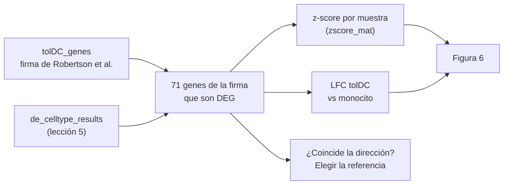
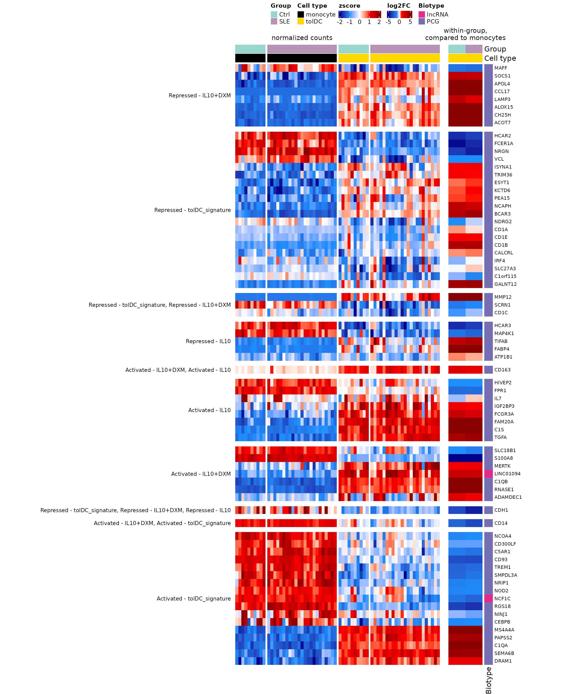
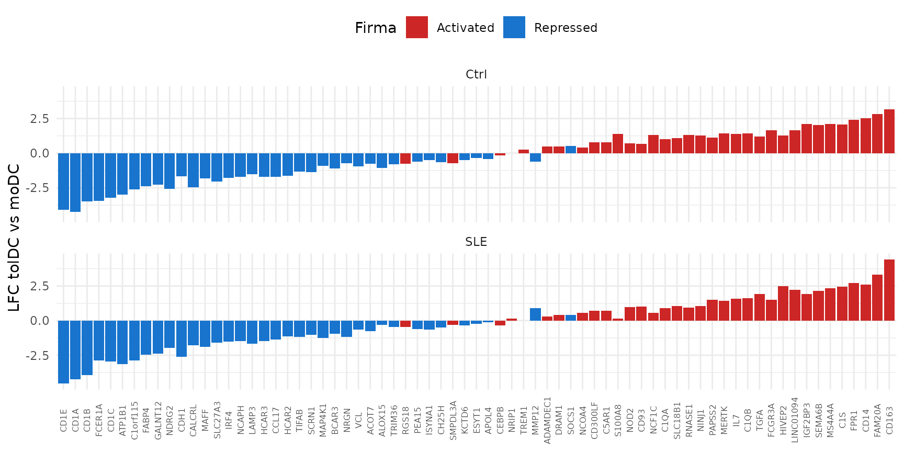

# Lección 6: La firma transcripcional de las células dendríticas tolerogénicas

## Bienvenida

Las **células dendríticas tolerogénicas (tolDC)** son una promesa
terapéutica para el lupus: en lugar de activar al sistema inmune, lo
calman. Pero para usarlas en pacientes hay que responder una pregunta:
**¿las tolDC obtenidas de pacientes con lupus adquieren el mismo
programa tolerogénico que las de personas sanas?** En esta lección lo
evaluamos con una **firma transcripcional** publicada.

**Lo que necesitas saber antes:** haber hecho la lección [Diferenciación
de monocitos a células
dendríticas](https://eveliacoss.github.io/GeneExprLupusMx/articles/l5_DEGs_monocytes_diff_es.md).

**Al terminar podrás:**

1.  Usar una **firma transcripcional** de la literatura para evaluar tus
    propias muestras.
2.  Combinar en una figura la **expresión por muestra** (z-score) y el
    **cambio por comparación** (LFC).
3.  Explicar por qué **la elección de la referencia** cambia la
    interpretación de un LFC.
4.  Calcular el cambio entre dos tipos celulares a partir de dos
    comparaciones con la misma referencia.
5.  Reproducir la **Figura 6** del artículo.

**Tiempo estimado:** 1 hora.

### Mapa de la lección



## Glosario

Estos son los términos que usaremos. Vuelve aquí cada vez que lo
necesites.

- **Tolerancia inmunológica**: capacidad del sistema inmune de no atacar
  al propio cuerpo; en el lupus se pierde.
- **tolDC**: células dendríticas tolerogénicas; promueven la tolerancia.
- **Firma transcripcional**: conjunto de genes cuya expresión
  caracteriza a un tipo o estado celular.
- **Activado / reprimido**: gen que sube / baja en el estado celular de
  interés respecto a una referencia.
- **IL-10, dexametasona (DXM)**: una citocina antiinflamatoria y un
  glucocorticoide que se usan para generar tolDC *in vitro*.
- **Referencia**: el tipo celular contra el que se calcula un LFC;
  cambiarla cambia el signo y el tamaño del LFC.

## 1. Preparación

``` r

library(GeneExprLupusMx) # datos del paquete
library(tidyverse)       # manipulación de tablas y gráficas
library(ComplexHeatmap)  # heatmaps
library(circlize)        # escalas de color para ComplexHeatmap
```

Colores y umbrales (los mismos de las lecciones anteriores):

``` r

cell_color    <- c(monocyte = "black", moDC = "palevioletred", tolDC = "gold1")
group_color   <- c(Ctrl = "#96d4ccff", SLE = "#b493b4ff")
biotype_color <- c(PCG = "#7570B3", lncRNA = "#E7298A")
zscore_color  <- colorRamp2(c(-2, -1, 0, 1, 2), c("darkblue", "dodgerblue", "white", "red", "darkred"))
lfc_color     <- colorRamp2(c(-5, -1, 0, 1, 5), c("darkblue", "dodgerblue", "white", "red", "darkred"))

lfc_threshold  <- 1
padj_threshold <- 0.05
```

## 2. Paso 1: la firma de las tolDC

[Robertson et al. (2021)](https://doi.org/10.3389/fimmu.2021.733231)
compararon tolDC generadas con distintos protocolos e identificaron los
genes que distinguen a las tolDC. El paquete los incluye en
`tolDC_genes`:

``` r

head(tolDC_genes)
#>        gene                        tolDC_signature biotype
#> 1    RNASE1                   Activated - IL10+DXM     PCG
#> 2    S100A8                   Activated - IL10+DXM     PCG
#> 3     CD163 Activated - IL10+DXM, Activated - IL10     PCG
#> 4   SELENOP                   Activated - IL10+DXM     PCG
#> 5 LINC01094                   Activated - IL10+DXM  lncRNA
#> 6   SLC18B1                   Activated - IL10+DXM     PCG
#>                                                                                      link
#> 1 https://www.frontiersin.org/journals/immunology/articles/10.3389/fimmu.2021.733231/full
#> 2 https://www.frontiersin.org/journals/immunology/articles/10.3389/fimmu.2021.733231/full
#> 3 https://www.frontiersin.org/journals/immunology/articles/10.3389/fimmu.2021.733231/full
#> 4 https://www.frontiersin.org/journals/immunology/articles/10.3389/fimmu.2021.733231/full
#> 5 https://www.frontiersin.org/journals/immunology/articles/10.3389/fimmu.2021.733231/full
#> 6 https://www.frontiersin.org/journals/immunology/articles/10.3389/fimmu.2021.733231/full
dplyr::count(tolDC_genes, tolDC_signature)
#>                                                        tolDC_signature  n
#> 1                                                     Activated - IL10  9
#> 2                                                 Activated - IL10+DXM  8
#> 3                               Activated - IL10+DXM, Activated - IL10  1
#> 4                    Activated - IL10+DXM, Activated - tolDC_signature  1
#> 5                                          Activated - tolDC_signature 23
#> 6                                                     Repressed - IL10  7
#> 7                                                 Repressed - IL10+DXM  8
#> 8                                          Repressed - tolDC_signature 25
#> 9                    Repressed - tolDC_signature, Repressed - IL10+DXM  3
#> 10 Repressed - tolDC_signature, Repressed - IL10+DXM, Repressed - IL10  1
```

Cada categoría tiene dos partes:

- **Dirección:** `Activated` (el gen sube en las tolDC) o `Repressed`
  (baja).
- **Protocolo:** tolDC generadas con IL-10 (`IL10`), con IL-10 y
  dexametasona (`IL10+DXM`), o la firma de consenso de tolDC
  (`tolDC_signature`). Algunos genes aparecen en varios protocolos.

## 3. Paso 2: ¿qué genes de la firma cambian en nuestros datos?

Usamos los resultados de la lección anterior (`de_celltype_results`):
cada célula dendrítica comparada contra los monocitos, en controles y
pacientes. Nos quedamos con los genes de la firma que son DEG en **al
menos una** de las cuatro comparaciones:

``` r

deg_genes <- function(comparison) {
  df <- de_celltype_results[[comparison]]
  df$gene[!is.na(df$padj) & df$padj < padj_threshold & abs(df$log2FoldChange) >= lfc_threshold]
}
all_deg <- unique(unlist(lapply(names(de_celltype_results), deg_genes)))

signature_deg <- tolDC_genes %>%
  filter(gene %in% all_deg, gene %in% rownames(zscore_mat))
nrow(signature_deg)
#> [1] 71
dplyr::count(signature_deg, biotype)
#>   biotype  n
#> 1     PCG 69
#> 2  lncRNA  2
```

**71 de los 86 genes de la firma cambian** durante la diferenciación de
nuestras células. Casi todos codifican proteínas (PCG); dos son RNA
largos no codificantes (lncRNA).

## 4. Paso 3: la Figura 6

La figura tiene dos *heatmaps* alineados por gen:

- **Izquierda:** la expresión (z-score) de cada gen en cada muestra de
  monocitos y tolDC, de controles y pacientes.
- **Derecha:** el LFC de las tolDC respecto a los monocitos, en
  controles y en pacientes.

Preparamos la parte izquierda con el checkpoint `zscore_mat`:

``` r

sample_info <- metadata_cleaned %>%
  filter(Cell_type %in% c("monocyte", "tolDC")) %>%
  mutate(condition = factor(paste(Group, Cell_type, sep = "_"),
                            levels = c("Ctrl_monocyte", "SLE_monocyte", "Ctrl_tolDC", "SLE_tolDC"))) %>%
  arrange(condition)

zscore_sig <- zscore_mat[signature_deg$gene, sample_info$sample_ID]
dim(zscore_sig)
#> [1] 71 66
```

Y la derecha, con el LFC de las tolDC:

``` r

lfc_sig <- sapply(de_celltype_results[c("Ctrl_tolDC", "SLE_tolDC")], function(df)
  df$log2FoldChange[match(signature_deg$gene, df$gene)])
rownames(lfc_sig) <- signature_deg$gene
head(lfc_sig)
#>           Ctrl_tolDC SLE_tolDC
#> RNASE1     11.397672  9.845166
#> S100A8     -7.470788 -7.799939
#> CD163       2.079173  1.746231
#> LINC01094   2.870405  2.776301
#> SLC18B1    -1.023044 -1.479387
#> MERTK       1.427936  1.628772
```

Fijamos el **orden de las categorías y de los genes**. Dentro de cada
categoría, los genes están ordenados por similitud (*clustering*); aquí
escribimos ese orden explícitamente para que la figura siempre se vea
igual:

``` r

fig6_order <- list(
  "Repressed - IL10+DXM" = c("MAFF", "SOCS1", "APOL4", "CCL17", "LAMP3", "ALOX15", "CH25H", "ACOT7"),
  "Repressed - tolDC_signature" = c("HCAR2", "FCER1A", "NRGN", "VCL", "ISYNA1", "TRIM36", "ESYT1",
                                    "KCTD6", "PEA15", "NCAPH", "BCAR3", "NDRG2", "CD1A", "CD1E",
                                    "CD1B", "CALCRL", "IRF4", "SLC27A3", "C1orf115", "GALNT12"),
  "Repressed - tolDC_signature, Repressed - IL10+DXM" = c("MMP12", "SCRN1", "CD1C"),
  "Repressed - IL10" = c("HCAR3", "MAP4K1", "TIFAB", "FABP4", "ATP1B1"),
  "Activated - IL10+DXM, Activated - IL10" = c("CD163"),
  "Activated - IL10" = c("HIVEP2", "FPR1", "IL7", "IGF2BP3", "FCGR3A", "FAM20A", "C1S", "TGFA"),
  "Activated - IL10+DXM" = c("SLC18B1", "S100A8", "MERTK", "LINC01094", "C1QB", "RNASE1", "ADAMDEC1"),
  "Repressed - tolDC_signature, Repressed - IL10+DXM, Repressed - IL10" = c("CDH1"),
  "Activated - IL10+DXM, Activated - tolDC_signature" = c("CD14"),
  "Activated - tolDC_signature" = c("NCOA4", "CD300LF", "C5AR1", "CD93", "TREM1", "SMPDL3A", "NRIP1",
                                    "NOD2", "NCF1C", "RGS18", "NINJ1", "CEBPB", "MS4A4A", "PAPSS2",
                                    "C1QA", "SEMA6B", "DRAM1"))

# ¿Son los mismos 71 genes que seleccionamos?
setequal(unlist(fig6_order), signature_deg$gene)
#> [1] TRUE

# reordenar genes, z-scores y LFC según la figura
fig6_genes   <- unlist(fig6_order, use.names = FALSE)
fig6_split   <- factor(rep(names(fig6_order), lengths(fig6_order)), levels = names(fig6_order))
signature_deg <- signature_deg[match(fig6_genes, signature_deg$gene), ]
zscore_sig   <- zscore_sig[fig6_genes, ]
lfc_sig      <- lfc_sig[fig6_genes, ]
```

Con todo en orden, dibujamos los dos paneles:

``` r

ht_zscore <- Heatmap(
  zscore_sig, name = "zscore", col = zscore_color,
  cluster_rows = FALSE, cluster_columns = FALSE, # el orden viene de fig6_order
  show_row_names = FALSE, show_column_names = FALSE,
  top_annotation = HeatmapAnnotation(
    Group       = as.character(sample_info$Group),
    "Cell type" = as.character(sample_info$Cell_type),
    col = list(Group = group_color, "Cell type" = cell_color),
    show_annotation_name = FALSE),
  column_split = sample_info$condition,
  column_title = c("", "normalized counts", "", ""), column_title_gp = gpar(fontsize = 11),
  row_split = fig6_split, row_title_rot = 0,
  row_title_gp = gpar(fontsize = 9), row_gap = unit(3, "mm"),
  heatmap_legend_param = list(direction = "horizontal"),
  width = unit(12, "cm"))

ht_lfc <- Heatmap(
  lfc_sig, name = "log2FC", col = lfc_color,
  cluster_columns = FALSE, show_column_names = FALSE,
  column_title = "within-group,\ncompared to monocytes", column_title_gp = gpar(fontsize = 11),
  row_names_gp = gpar(fontsize = 8),
  top_annotation = HeatmapAnnotation(
    Group       = c("Ctrl", "SLE"),
    "Cell type" = c("tolDC", "tolDC"),
    col = list(Group = group_color, "Cell type" = cell_color),
    show_legend = FALSE),
  right_annotation = rowAnnotation(Biotype = signature_deg$biotype,
                                   col = list(Biotype = biotype_color)),
  heatmap_legend_param = list(direction = "horizontal"),
  width = unit(2, "cm"))

ht_fig6 <- ht_zscore + ht_lfc

ht_opt$message <- FALSE
draw(ht_fig6, ht_gap = unit(5, "mm"), merge_legends = TRUE,
     heatmap_legend_side = "top", annotation_legend_side = "top")
```



**Figura 6.** Firmas transcripcionales asociadas a las tolDC obtenidas
al comparar pacientes con lupus (SLE) y controles. *Heatmaps* que
muestran 71 DEG asociados a las firmas transcripcionales de las tolDC
(Robertson et al., 2021): 39 suben y 30 bajan en las tolDC de ambos
grupos respecto a los monocitos, y 2 cambian en direcciones opuestas
según el grupo. Las filas representan genes, agrupados por la categoría
de la firma, y las columnas representan muestras de monocitos y tolDC
diferenciadas *in vitro*, coloreadas según el tipo celular y el grupo
(SLE o Ctrl). Panel izquierdo: *heatmap* con los valores de expresión
génica normalizada (z-score). Panel derecho: *heatmap* con los valores
de LFC de las tolDC respecto a los monocitos en cada grupo. Los DEG se
seleccionaron con \|LFC\| ≥ 1 y padj \< 0.05 en al menos una comparación
(moDC o tolDC contra monocitos, en pacientes o en controles). Los
biotipos se indican con colores: morado para los genes codificantes de
proteínas (PCG) y rosa para los RNA largos no codificantes (lncRNA).
SLE, lupus eritematoso sistémico; Ctrl, control sano; tolDC, células
dendríticas tolerogénicas; LFC, log2 fold change.

La figura original se encuentra en el
[artículo](https://www.frontiersin.org/journals/immunology/articles/10.3389/fimmu.2026.1771959/full).

Para guardarla en alta resolución:

``` r

png("Figura_6.png", width = 13, height = 16, units = "in", res = 300)
draw(ht_fig6, ht_gap = unit(5, "mm"), merge_legends = TRUE,
     heatmap_legend_side = "top", annotation_legend_side = "top")
dev.off()
```

**¿Qué observas?**

- En el panel izquierdo, los patrones de las tolDC de **controles y
  pacientes son muy parecidos**: los genes que se encienden o se apagan
  lo hacen en ambos grupos.
- En el panel derecho, los LFC de controles y pacientes casi siempre
  tienen el mismo color.
- **Las tolDC de las pacientes adquieren el programa transcripcional
  tolerogénico**, igual que las de los controles. Es una buena noticia
  para su posible uso terapéutico.

**Reto 1.** ¿Qué genes de la firma cambian en **direcciones opuestas**
en las tolDC de controles y de pacientes?

*Pista:* compara el signo de las dos columnas de `lfc_sig`.

Ver solución

``` r

lfc_sig[sign(lfc_sig[, "Ctrl_tolDC"]) != sign(lfc_sig[, "SLE_tolDC"]), ]
#>          Ctrl_tolDC SLE_tolDC
#> SLC27A3 -0.06446974 0.2778644
#> IL7     -0.57867180 0.2691748
```

Solo dos genes, y con LFC pequeños: el programa tolerogénico es
prácticamente el mismo en ambos grupos.

## 5. Paso 4: ¿cambian en la dirección de la firma? La importancia de la referencia

La firma dice qué genes están **activados** o **reprimidos** en las
tolDC. ¿Coincide con nuestros LFC?

``` r

expected <- ifelse(grepl("^Activated", signature_deg$tolDC_signature), 1, -1)
mean(sign(lfc_sig[, "Ctrl_tolDC"]) == expected)
#> [1] 0.4225352
```

¡Solo coincide el 42 %! ¿Las tolDC están mal diferenciadas? No: estamos
usando **otra referencia**. Robertson et al. definieron la firma
comparando tolDC contra **células dendríticas no tolerogénicas** (como
nuestras moDC), mientras que nuestros LFC comparan tolDC contra
**monocitos**.

Veamos `CD14`: es “activado” en la firma, pero baja en nuestras tolDC.

``` r

sapply(de_celltype_results, function(df) round(df$log2FoldChange[df$gene == "CD14"], 2))
#>  Ctrl_moDC Ctrl_tolDC   SLE_moDC  SLE_tolDC 
#>      -4.78      -2.23      -5.77      -3.15
```

`CD14` es un marcador de monocito: baja en las tolDC (−2.2) y baja aún
más en las moDC (−4.8). **Comparada con la moDC, la tolDC conserva más
`CD14`**, que es justo lo que describe la firma.

### 5.1 De dos comparaciones a una

No necesitamos repetir el análisis para comparar tolDC contra moDC. Como
ambas se compararon contra los **mismos monocitos**, en el mismo modelo,
basta con restar:

``` math
\text{LFC}_{\text{tolDC vs moDC}} = \text{LFC}_{\text{tolDC vs mono}} - \text{LFC}_{\text{moDC vs mono}}
```

``` r

lfc_all <- sapply(de_celltype_results, function(df)
  df$log2FoldChange[match(signature_deg$gene, df$gene)])
rownames(lfc_all) <- signature_deg$gene

tol_vs_modc <- cbind(Ctrl = lfc_all[, "Ctrl_tolDC"] - lfc_all[, "Ctrl_moDC"],
                     SLE  = lfc_all[, "SLE_tolDC"]  - lfc_all[, "SLE_moDC"])

colMeans(sign(tol_vs_modc) == expected) # proporción que coincide con la firma
#>     Ctrl      SLE 
#> 0.943662 0.915493
```

Ahora **más del 90 % de los genes coincide** con la firma, en controles
y en pacientes. La diferenciación tolerogénica funcionó; solo había que
compararla contra la referencia correcta.

``` r

tibble(gene = rownames(tol_vs_modc), signature = ifelse(expected == 1, "Activated", "Repressed"),
       Ctrl = tol_vs_modc[, "Ctrl"], SLE = tol_vs_modc[, "SLE"]) %>%
  pivot_longer(c(Ctrl, SLE), names_to = "Group", values_to = "LFC") %>%
  ggplot(aes(x = reorder(gene, LFC), y = LFC, fill = signature)) +
  geom_col() +
  facet_wrap(~ Group, ncol = 1) +
  scale_fill_manual(values = c(Activated = "firebrick3", Repressed = "dodgerblue3")) +
  labs(x = NULL, y = "LFC tolDC vs moDC", fill = "Firma") +
  theme_minimal(base_size = 11) +
  theme(axis.text.x = element_text(angle = 90, vjust = 0.5, size = 6), legend.position = "top")
```



Los genes “activados” (rojo) quedan casi todos a la derecha, con LFC
positivo, y los “reprimidos” (azul) a la izquierda.

**Restar LFC da la magnitud, no la significancia.** La resta da el mismo
LFC que estimaría `DESeq2`, pero no su valor p. Para probar
estadísticamente tolDC contra moDC hay que pedirlo al objeto de
`DESeq2`, por ejemplo con
`results(dds, contrast = c("Cell_type", "tolDC", "moDC"))`.

**Reto 2.** ¿Qué genes **no** coinciden con la firma aun usando la moDC
como referencia?

Ver solución

``` r

tibble(gene = rownames(tol_vs_modc), signature = signature_deg$tolDC_signature,
       Ctrl = round(tol_vs_modc[, "Ctrl"], 2), SLE = round(tol_vs_modc[, "SLE"], 2)) %>%
  filter(sign(Ctrl) != expected | sign(SLE) != expected)
#> # A tibble: 6 × 4
#>   gene    signature                                          Ctrl   SLE
#>   <chr>   <chr>                                             <dbl> <dbl>
#> 1 SOCS1   Repressed - IL10+DXM                               0.5   0.43
#> 2 MMP12   Repressed - tolDC_signature, Repressed - IL10+DXM -0.6   0.91
#> 3 TREM1   Activated - tolDC_signature                        0.27  0   
#> 4 SMPDL3A Activated - tolDC_signature                       -0.71 -0.32
#> 5 RGS18   Activated - tolDC_signature                       -0.75 -0.47
#> 6 CEBPB   Activated - tolDC_signature                       -0.16 -0.35
```

Son pocos genes, la mayoría con LFC cercanos a cero. Las diferencias de
protocolo entre estudios (citocinas, tiempos de cultivo) explican bien
este nivel de discrepancia.

## 6. Resumen

| Paso | Función clave | ¿Para qué? |
|----|----|----|
| Cargar una firma | `tolDC_genes` | Usar conocimiento previo para evaluar tus datos |
| Seleccionar genes | `filter(gene %in% all_deg)` | Quedarte con los genes de la firma que cambian |
| Expresión por muestra | `zscore_mat` | Ver la variabilidad entre muestras |
| Cambio por comparación | LFC de `de_celltype_results` | Resumir el cambio de cada grupo |
| Cambiar de referencia | resta de LFC | Comparar dos tipos celulares sin repetir el análisis |

### Errores comunes de principiante

- **Comparar con una firma sin revisar su referencia**: un LFC solo
  tiene sentido respecto a algo.
- **Concluir que algo “falló” porque no coincide la dirección**: primero
  verifica que estás comparando lo mismo.
- **Usar la resta de LFC como prueba estadística**: da la magnitud, no
  el valor p.

## 7. Próximos pasos

Las tolDC de las pacientes adquieren el programa tolerogénico descrito
en la literatura, de forma muy similar a las de los controles. Sin
embargo, comparar los LFC de dos modelos separados no permite probar
estadísticamente si la diferenciación difiere entre grupos. La lección
[¿Se diferencian igual las células de pacientes y
controles?](https://eveliacoss.github.io/GeneExprLupusMx/articles/l7_DEGs_between_groups_es.md)
responde esta pregunta con un modelo de interacción.

Para continuar, da clic en el botón **Siguiente lección: Comparar la
diferenciación entre grupos** al final de esta página.

[← Lección anterior: Diferenciación de
monocitos](https://eveliacoss.github.io/GeneExprLupusMx/articles/l5_DEGs_monocytes_diff_es.md)
[Siguiente lección: Comparar la diferenciación entre grupos
→](https://eveliacoss.github.io/GeneExprLupusMx/articles/l7_DEGs_between_groups_es.md)

[↑ Volver a Inicio](#top "Volver al inicio de la página")

## Información de la sesión

``` r

sessionInfo()
#> R version 4.6.1 (2026-06-24)
#> Platform: x86_64-pc-linux-gnu
#> Running under: Ubuntu 24.04.5 LTS
#> 
#> Matrix products: default
#> BLAS:   /usr/lib/x86_64-linux-gnu/openblas-pthread/libblas.so.3 
#> LAPACK: /usr/lib/x86_64-linux-gnu/openblas-pthread/libopenblasp-r0.3.26.so;  LAPACK version 3.12.0
#> 
#> locale:
#>  [1] LC_CTYPE=C.UTF-8       LC_NUMERIC=C           LC_TIME=C.UTF-8       
#>  [4] LC_COLLATE=C.UTF-8     LC_MONETARY=C.UTF-8    LC_MESSAGES=C.UTF-8   
#>  [7] LC_PAPER=C.UTF-8       LC_NAME=C              LC_ADDRESS=C          
#> [10] LC_TELEPHONE=C         LC_MEASUREMENT=C.UTF-8 LC_IDENTIFICATION=C   
#> 
#> time zone: UTC
#> tzcode source: system (glibc)
#> 
#> attached base packages:
#> [1] grid      stats     graphics  grDevices utils     datasets  methods  
#> [8] base     
#> 
#> other attached packages:
#>  [1] circlize_0.4.18            ComplexHeatmap_2.28.0     
#>  [3] lubridate_1.9.5            forcats_1.0.1             
#>  [5] stringr_1.6.0              dplyr_1.2.1               
#>  [7] purrr_1.2.2                readr_2.2.0               
#>  [9] tidyr_1.3.2                tibble_3.3.1              
#> [11] ggplot2_4.0.3              tidyverse_2.0.0           
#> [13] GeneExprLupusMx_0.0.0.9000
#> 
#> loaded via a namespace (and not attached):
#>  [1] shape_1.4.6.1       gtable_0.3.6        rjson_0.2.23       
#>  [4] xfun_0.62           bslib_0.12.0        GlobalOptions_0.1.4
#>  [7] tzdb_0.5.0          vctrs_0.7.3         tools_4.6.1        
#> [10] generics_0.1.4      stats4_4.6.1        parallel_4.6.1     
#> [13] cluster_2.1.8.2     pkgconfig_2.0.3     RColorBrewer_1.1-3 
#> [16] S7_0.2.2            desc_1.4.3          S4Vectors_0.50.3   
#> [19] lifecycle_1.0.5     compiler_4.6.1      farver_2.1.2       
#> [22] textshaping_1.0.5   codetools_0.2-20    clue_0.3-68        
#> [25] htmltools_0.5.9     sass_0.4.10         yaml_2.3.12        
#> [28] pillar_1.11.1       pkgdown_2.2.1       crayon_1.5.3       
#> [31] jquerylib_0.1.4     cachem_1.1.0        iterators_1.0.14   
#> [34] foreach_1.5.2       tidyselect_1.2.1    digest_0.6.39      
#> [37] stringi_1.8.9       labeling_0.4.3      fastmap_1.2.0      
#> [40] colorspace_2.1-4    cli_3.6.6           magrittr_2.0.5     
#> [43] utf8_1.2.6          withr_3.0.3         scales_1.4.0       
#> [46] timechange_0.4.0    rmarkdown_2.32      matrixStats_1.5.0  
#> [49] otel_0.2.0          ragg_1.5.2          png_0.1-9          
#> [52] GetoptLong_1.1.1    hms_1.1.4           evaluate_1.0.5     
#> [55] knitr_1.52          IRanges_2.46.0      doParallel_1.0.17  
#> [58] rlang_1.3.0         glue_1.8.1          BiocGenerics_0.58.1
#> [61] jsonlite_2.0.0      R6_2.6.1            systemfonts_1.3.2  
#> [64] fs_2.1.0
```
