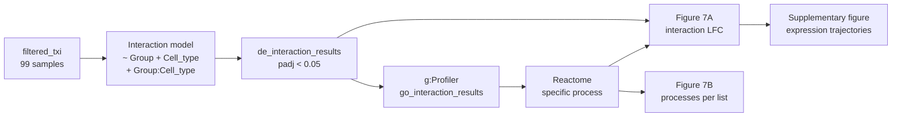
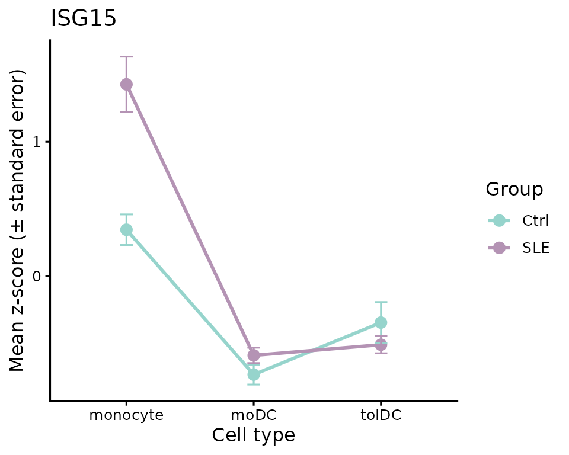
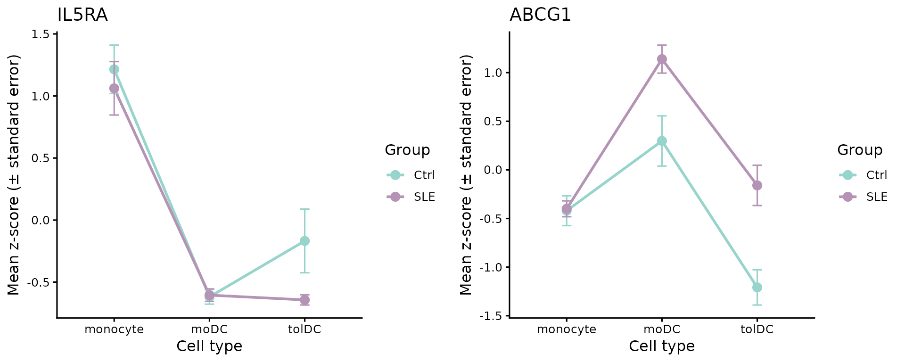
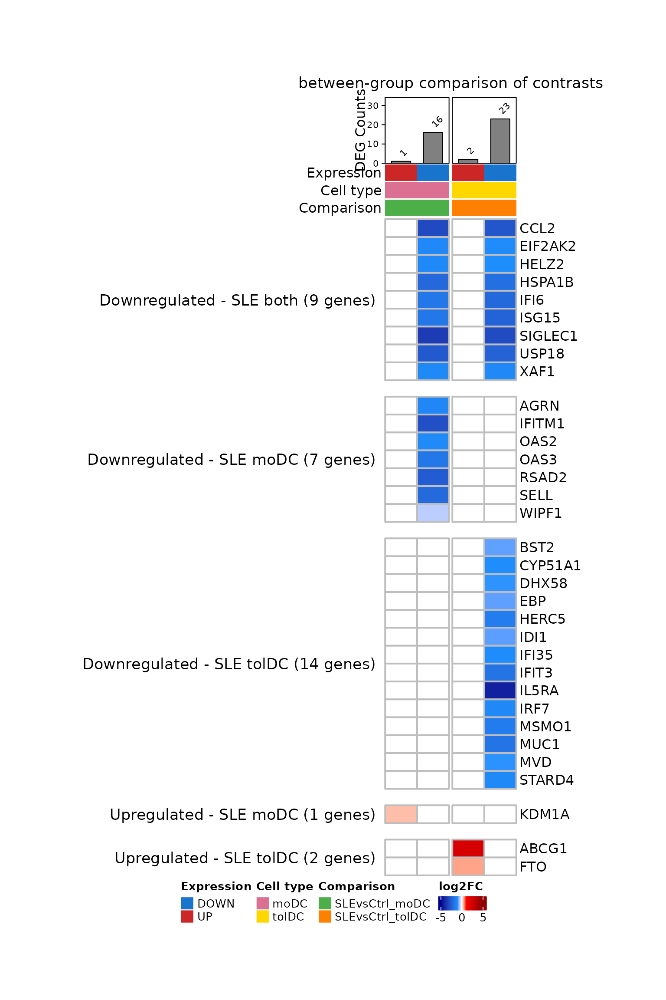
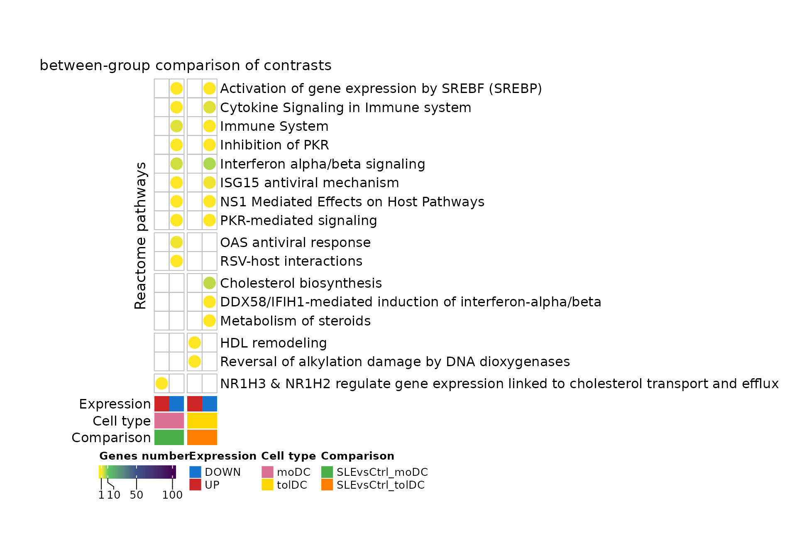
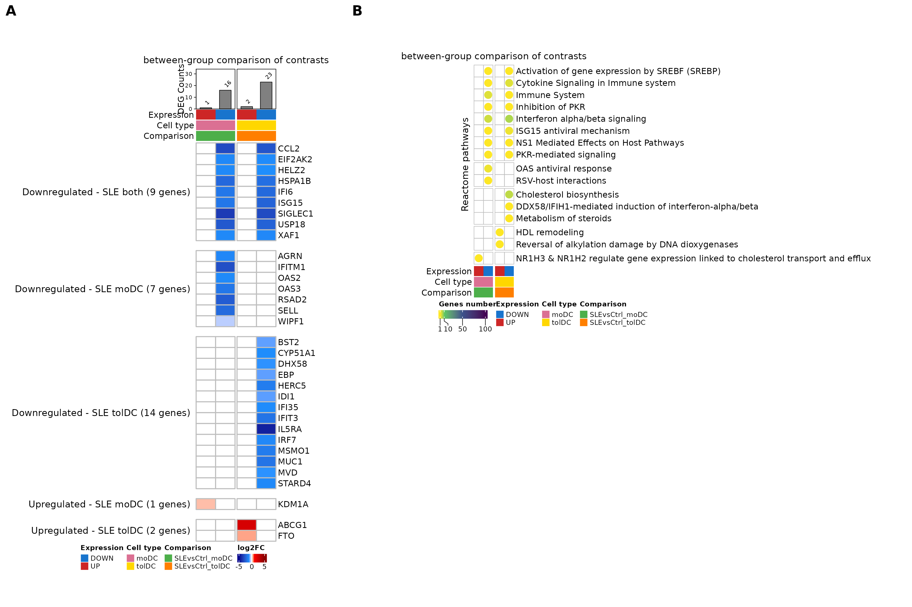
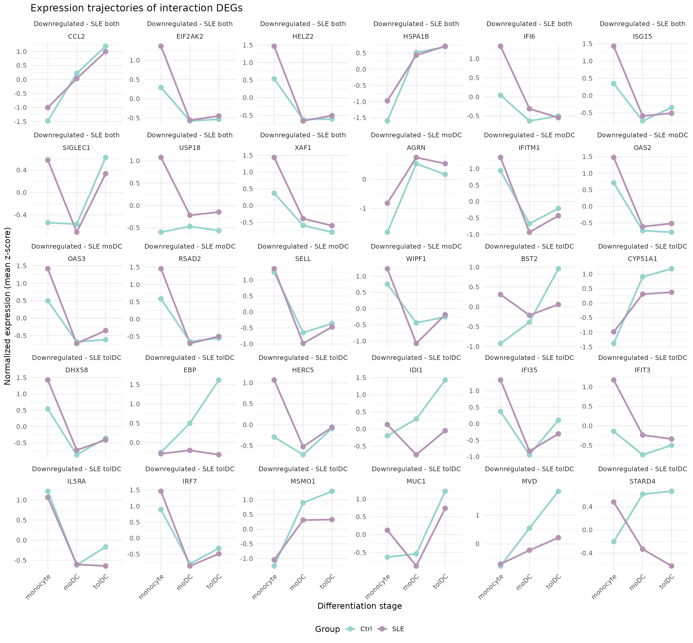

# Lesson 7: Do patient and control cells differentiate in the same way?

## Welcome

In lesson 5 we saw that, upon differentiation, the monocytes of patients
and controls change thousands of genes, and that the changes look very
similar. But “looking similar” is not “being the same”. In this lesson
we ask the question statistically: **are there genes whose change from
monocyte to dendritic cell is different in lupus patients?** To answer
it we will use an **interaction model**, which directly compares the
contrasts of both groups.

**What you need to know beforehand:** you should have completed the
lesson [Differentiation of monocytes into dendritic
cells](https://eveliacoss.github.io/GeneExprLupusMx/articles/l5_DEGs_monocytes_diff_en.md).

**By the end you will be able to:**

1.  Explain what an **interaction** is and why it is described as a
    “difference of differences”.
2.  Fit a `~ Group + Cell_type + Group:Cell_type` model with `DESeq2`
    and interpret its coefficients.
3.  Visualize an interaction with a line plot.
4.  Summarize genes by their Reactome **specific process**.
5.  Reproduce **panels A and B of Figure 7** of the article.
6.  Interpret an interaction using each group’s **expression
    trajectories**.

**Estimated time:** 1.5 hours.

### Lesson map



## Glossary

These are the terms we will use. Come back here whenever you need to.

- **Contrast**: a comparison between two conditions; for example, moDC
  against monocyte.
- **Interaction**: occurs when the effect of one factor depends on
  another. Here, when the change from monocyte to dendritic cell (factor
  `Cell_type`) depends on whether the person is a patient or a control
  (factor `Group`).
- **Difference of differences**: the value of an interaction. It is the
  change in patients minus the change in controls.
- **Coefficient**: each number a model estimates; `DESeq2` lists them
  with [`resultsNames()`](https://rdrr.io/pkg/DESeq2/man/results.html).
- **Specific process**: among all the enriched terms in which a gene
  appears, the one with the **fewest** genes; the most concrete.
- **Expression trajectory**: how a gene’s mean expression changes across
  the differentiation stages (monocyte → moDC → tolDC) in each group.

## 1. Setup

``` r

library(GeneExprLupusMx) # package data
library(tidyverse)       # table manipulation and plots
library(ComplexHeatmap)  # heatmaps
library(circlize)        # color scales for ComplexHeatmap
library(cowplot)         # combining plots into panels
```

Colors and threshold (the same as in the previous lessons, plus those
for the lists in this lesson):

``` r

cell_color       <- c(monocyte = "black", moDC = "palevioletred", tolDC = "gold1")
group_color      <- c(Ctrl = "#96d4ccff", SLE = "#b493b4ff")
expression_color <- c(UP = "firebrick3", DOWN = "dodgerblue3")
comparison_color <- c(SLEvsCtrl_moDC = "#4daf4a", SLEvsCtrl_tolDC = "#ff7f00")
lfc_color        <- colorRamp2(c(-5, -1, 0, 1, 5), c("darkblue", "dodgerblue", "white", "red", "darkred"))

padj_threshold <- 0.05
```

## 2. **Step 1:** what is an interaction?

Let us take an interferon-stimulated gene, `ISG15`. In lesson 5 we
calculated its LFC from monocyte to dendritic cell in each group:

``` r

sapply(de_celltype_results, function(df) round(df$log2FoldChange[df$gene == "ISG15"], 2))
#>  Ctrl_moDC Ctrl_tolDC   SLE_moDC  SLE_tolDC 
#>      -1.69      -0.95      -3.41      -3.27
```

`ISG15` goes down upon differentiation in both groups, but in patients
it goes down **more**: in moDCs, −3.41 versus −1.69. The difference
between those two changes is the **interaction**:

``` math
\text{interaction} = \text{LFC}_{\text{SLE}} - \text{LFC}_{\text{Ctrl}} = -3.41 - (-1.69) = -1.72
```

A line plot makes it evident. We plot the mean z-score of each group in
each cell type, using the `zscore_mat` checkpoint:

``` r

plot_interaction <- function(gene) {
  metadata_cleaned %>%
    mutate(zscore    = zscore_mat[gene, as.character(sample_ID)],
           Cell_type = factor(Cell_type, levels = c("monocyte", "moDC", "tolDC"))) %>%
    group_by(Group, Cell_type) %>%
    summarise(mean_z = mean(zscore), se = sd(zscore) / sqrt(n()), .groups = "drop") %>%
    ggplot(aes(x = Cell_type, y = mean_z, color = Group, group = Group)) +
    geom_line(linewidth = 1) +
    geom_point(size = 3) +
    geom_errorbar(aes(ymin = mean_z - se, ymax = mean_z + se), width = 0.1) +
    scale_color_manual(values = group_color) +
    labs(title = gene, x = "Cell type", y = "Mean z-score (± standard error)", color = "Group") +
    theme_classic(base_size = 12)
}
```

``` r

plot_interaction("ISG15")
```



- If the two lines were **parallel**, the gene would change the same way
  in both groups: there would be no interaction.
- Here they are **not parallel**: patients start from a much higher
  value in monocytes (the interferon signature from lessons 2 and 3) and
  drop more upon differentiation.

**A negative interaction does not mean “lower in patients”.** It means
the gene **goes down more** (or goes up less) upon differentiation in
patients. In the case of `ISG15`, the moDCs of both groups end up with
similar levels; what changes is the slope, because patients start from a
higher value.

## 3. **Step 2:** the interaction model

In lesson 5 we fit one model per group and compared their LFCs “by eye”.
To obtain a **p-value** for the difference, we need to fit a single
model with all 99 samples and an interaction term, `Group:Cell_type`:

``` r

library(DESeq2)

dds <- DESeqDataSetFromTximport(txi     = filtered_txi,
                                colData = metadata_cleaned,
                                design  = ~ Group + Cell_type + Group:Cell_type)
dds$Group     <- relevel(dds$Group, ref = "Ctrl")         # reference: controls
dds$Cell_type <- relevel(dds$Cell_type, ref = "monocyte") # reference: monocytes
dds <- DESeq(dds) # takes a few minutes

resultsNames(dds)
#> [1] "Intercept"                   "Group_SLE_vs_Ctrl"
#> [3] "Cell_type_moDC_vs_monocyte"  "Cell_type_tolDC_vs_monocyte"
#> [5] "GroupSLE.Cell_typemoDC"      "GroupSLE.Cell_typetolDC"
```

Each coefficient answers a different question:

| Coefficient | What does it measure? |
|----|----|
| `Intercept` | The baseline expression: control monocytes |
| `Group_SLE_vs_Ctrl` | SLE against Ctrl, **in monocytes** |
| `Cell_type_moDC_vs_monocyte` | moDC against monocyte, **in controls** |
| `Cell_type_tolDC_vs_monocyte` | tolDC against monocyte, **in controls** |
| `GroupSLE.Cell_typemoDC` | **Interaction:** how much the moDC-versus-monocyte difference changes in patients |
| `GroupSLE.Cell_typetolDC` | **Interaction:** the same for tolDC versus monocyte |

We are interested in the last two:

``` r

de_interaction_results <- lapply(c(moDC = "moDC", tolDC = "tolDC"), function(cell) {
  res <- as.data.frame(results(dds, alpha = 0.05, name = paste0("GroupSLE.Cell_type", cell)))
  data.frame(gene = rownames(res), res, row.names = NULL)
})
```

Because the model takes a while to fit, the package includes the result
as a checkpoint, `de_interaction_results`:

``` r

names(de_interaction_results)
#> [1] "moDC"  "tolDC"
head(de_interaction_results$tolDC[order(de_interaction_results$tolDC$padj), ])
#>         gene   baseMean log2FoldChange     lfcSE      stat       pvalue
#> 7705   ISG15 1571.72540     -2.3242527 0.3964015 -5.863381 4.535367e-09
#> 7348    IFI6 5171.46042     -2.1636287 0.4035187 -5.361905 8.234902e-08
#> 7345   IFI35 1270.40241     -1.1028139 0.2149937 -5.129518 2.904851e-07
#> 1690    BST2 6388.65236     -0.8485252 0.1706817 -4.971388 6.647534e-07
#> 16889 SH3TC2   18.24524     -4.6162394 0.9279896 -4.974452 6.543263e-07
#> 5079    ETV7   57.87252     -3.7694878 0.7671254 -4.913783 8.933559e-07
#>               padj
#> 7705  6.634789e-05
#> 7348  6.023419e-04
#> 7345  1.416502e-03
#> 1690  1.944936e-03
#> 16889 1.944936e-03
#> 5079  2.178151e-03
```

Let us check that the interaction LFC is the difference of differences
we calculated by hand for `ISG15`:

``` r

sapply(de_interaction_results, function(df) round(df$log2FoldChange[df$gene == "ISG15"], 2))
#>  moDC tolDC 
#> -1.73 -2.32
```

In moDCs we get −1.73, practically the −1.72 we calculated by
subtracting. The small difference arises because in lesson 5 the
patients’ model was also adjusted for disease activity and
glucocorticoid dose.

## 4. **Step 3:** which genes change differently?

A gene has a significant interaction if its `padj < 0.05`. We classify
it as `UP` or `DOWN` according to the sign of the LFC, and name each
list `SLEvsCtrl_<direction>_<cell type>`:

``` r

deg_df <- imap_dfr(de_interaction_results, function(df, cell) {
  df %>%
    filter(!is.na(padj), padj < padj_threshold) %>%
    mutate(query = paste0("SLEvsCtrl_", ifelse(log2FoldChange > 0, "UP", "DOWN"), "_", cell))
})

query_order <- c("SLEvsCtrl_UP_moDC", "SLEvsCtrl_DOWN_moDC", "SLEvsCtrl_UP_tolDC", "SLEvsCtrl_DOWN_tolDC")
dplyr::count(deg_df, query = factor(query, levels = query_order))
#>                  query  n
#> 1    SLEvsCtrl_UP_moDC  1
#> 2  SLEvsCtrl_DOWN_moDC 28
#> 3   SLEvsCtrl_UP_tolDC  3
#> 4 SLEvsCtrl_DOWN_tolDC 38
```

**There are very few genes**, compared with the thousands in lesson 5:
almost the entire differentiation program is the same in patients and
controls. And most of the interactions are **negative**: these are genes
that go down more upon differentiation in patients.

Here we only require `padj < 0.05`. The LFC of an interaction is a
difference between two changes, and all these genes already have
differences of at least 0.34 in absolute value.

**Challenge 1.** How many of these genes also have a large interaction,
with `|log2FoldChange| ≥ 1`?

Show solution

``` r

deg_df %>%
  group_by(query) %>%
  summarise(total = n(), lfc_1 = sum(abs(log2FoldChange) >= 1))
#> # A tibble: 4 × 3
#>   query                total lfc_1
#>   <chr>                <int> <int>
#> 1 SLEvsCtrl_DOWN_moDC     28    23
#> 2 SLEvsCtrl_DOWN_tolDC    38    28
#> 3 SLEvsCtrl_UP_moDC        1     0
#> 4 SLEvsCtrl_UP_tolDC       3     1
```

Most of the genes in the `DOWN` lists have an interaction greater than
1: in patients, their drop upon differentiation is at least twice that
in controls.

**Challenge 2.** Use `plot_interaction()` to plot `IL5RA` and `ABCG1`.
Which cell type explains each interaction?

Show solution

``` r

plot_grid(plot_interaction("IL5RA"), plot_interaction("ABCG1"), nrow = 1)
```



- **`IL5RA`** goes down in the tolDCs of both groups, but much more in
  patients (interaction in tolDC, LFC ≈ −4.3).
- **`ABCG1`**, a cholesterol transporter, goes down from monocyte to
  tolDC in controls, but goes up a little in patients: the lines diverge
  (interaction in tolDC, LFC ≈ 2.4).

## 5. **Step 4:** which processes do they take part in?

As in the previous lessons, we look for enriched terms in each list with
g:Profiler (<GO:BP>, KEGG, and Reactome):

``` r

library(gprofiler2)
set_base_url("https://biit.cs.ut.ee/gprofiler_archive3/e113_eg59_p19") # archived version (June 2025)

deg_lists <- split(deg_df$gene, deg_df$query)
gost_res <- gost(deg_lists, organism = "hsapiens", correction_method = "fdr",
                 user_threshold = 0.05, sources = c("GO:BP", "KEGG", "REAC"), evcodes = TRUE)
```

The result is in the `go_interaction_results` checkpoint:

``` r

attr(go_interaction_results, "gprofiler_version")
#> [1] "e113_eg59_p19_903d2221"
go_interaction_results %>%
  dplyr::count(query, source) %>%
  pivot_wider(names_from = source, values_from = n)
#> # A tibble: 4 × 4
#>   query                `GO:BP`  KEGG  REAC
#>   <chr>                  <int> <int> <int>
#> 1 SLEvsCtrl_DOWN_moDC      228     5    12
#> 2 SLEvsCtrl_DOWN_tolDC     190     3    14
#> 3 SLEvsCtrl_UP_moDC        115    NA    18
#> 4 SLEvsCtrl_UP_tolDC        94     2     9
```

For the figure we use only **Reactome (REAC)**. To each gene we assign
its **specific process**: the Reactome term with the fewest genes in
which it appears (as in lesson 4):

``` r

reac_specific <- go_interaction_results %>%
  filter(source == "REAC") %>%
  separate_rows(intersection, sep = ",") %>%
  dplyr::rename(gene = intersection) %>%
  group_by(gene) %>%
  summarise(specific_process = term_name[which.min(term_size)], .groups = "drop")

deg_reac <- inner_join(deg_df, reac_specific, by = "gene")
dplyr::n_distinct(deg_reac$gene) # genes with annotation in Reactome
#> [1] 33
dplyr::count(deg_reac, query = factor(query, levels = query_order))
#>                  query  n
#> 1    SLEvsCtrl_UP_moDC  1
#> 2  SLEvsCtrl_DOWN_moDC 16
#> 3   SLEvsCtrl_UP_tolDC  2
#> 4 SLEvsCtrl_DOWN_tolDC 23
```

Of the 57 genes with a significant interaction, 33 have a Reactome
process. Those are the genes in Figure 7A.

## 6. **Step 5:** shared and exclusive genes (Figure 7A)

We make a genes × lists matrix with the interaction LFC; it is empty
(`NA`) if the gene is not in that list:

``` r

lfc_mat <- deg_reac %>%
  dplyr::select(gene, query, log2FoldChange) %>%
  pivot_wider(names_from = query, values_from = log2FoldChange) %>%
  column_to_rownames("gene") %>%
  as.matrix()
lfc_mat <- lfc_mat[order(rownames(lfc_mat)), query_order] # genes in alphabetical order
head(lfc_mat)
#>         SLEvsCtrl_UP_moDC SLEvsCtrl_DOWN_moDC SLEvsCtrl_UP_tolDC
#> ABCG1                  NA                  NA            2.35661
#> AGRN                   NA           -1.251214                 NA
#> BST2                   NA                  NA                 NA
#> CCL2                   NA           -3.075918                 NA
#> CYP51A1                NA                  NA                 NA
#> DHX58                  NA                  NA                 NA
#>         SLEvsCtrl_DOWN_tolDC
#> ABCG1                     NA
#> AGRN                      NA
#> BST2              -0.8485252
#> CCL2              -2.7396710
#> CYP51A1           -1.0842723
#> DHX58             -0.9784128
```

We group the genes according to which lists they appear in. We will
later use the same function to group the processes in Figure 7B:

``` r

list_direction <- sub("SLEvsCtrl_(UP|DOWN)_.*", "\\1", query_order) # UP, DOWN, UP, DOWN

# e.g., "NA_DOWN_NA_DOWN" = it is in DOWN_moDC and in DOWN_tolDC
presence_pattern <- function(mat) {
  apply(!is.na(mat), 1, function(x) paste(ifelse(x, list_direction, "NA"), collapse = "_"))
}

pattern_labels <- c(NA_DOWN_NA_DOWN = "Downregulated - SLE both",
                    NA_DOWN_NA_NA   = "Downregulated - SLE moDC",
                    NA_NA_NA_DOWN   = "Downregulated - SLE tolDC",
                    UP_NA_NA_NA     = "Upregulated - SLE moDC",
                    NA_NA_UP_NA     = "Upregulated - SLE tolDC")

gene_pattern <- factor(pattern_labels[presence_pattern(lfc_mat)], levels = pattern_labels)
table(gene_pattern)
#> gene_pattern
#>  Downregulated - SLE both  Downregulated - SLE moDC Downregulated - SLE tolDC 
#>                         9                         7                        14 
#>    Upregulated - SLE moDC   Upregulated - SLE tolDC 
#>                         1                         2

# label for each group with its number of genes
gene_split <- gene_pattern
levels(gene_split) <- paste0(levels(gene_pattern), " (", table(gene_pattern), " genes)")
```

Now the column annotations. Each list is identified by its direction,
its cell type, and its comparison; above it goes a *barplot* with the
number of genes in each list:

``` r

column_info <- tibble(query      = query_order,
                      Expression = list_direction,
                      Cell_type  = sub(".*_", "", query),
                      Comparison = sub("_(UP|DOWN)", "", query))

column_anno <- function() {
  HeatmapAnnotation("Expression" = column_info$Expression,
                    "Cell type"  = column_info$Cell_type,
                    "Comparison" = column_info$Comparison,
                    col = list("Expression" = expression_color,
                               "Cell type"  = cell_color,
                               "Comparison" = comparison_color),
                    annotation_name_side = "left")
}

deg_counts <- colSums(!is.na(lfc_mat))
counts_anno <- HeatmapAnnotation(
  "DEG Counts" = anno_barplot(deg_counts, add_numbers = TRUE, height = unit(2, "cm")),
  annotation_name_side = "left")
```

``` r

ht_fig7a <- Heatmap(
  lfc_mat, name = "log2FC", col = lfc_color,
  na_col = "white", rect_gp = gpar(col = "gray", lwd = 2),
  cluster_rows = FALSE, cluster_columns = FALSE, show_column_names = FALSE,
  column_split = column_info$Comparison, column_title = "between-group comparison of contrasts",
  row_split = gene_split, row_title_rot = 0, row_gap = unit(5, "mm"),
  top_annotation = c(counts_anno, column_anno()),
  heatmap_legend_param = list(direction = "horizontal"),
  width = unit(4, "cm"), height = unit(20, "cm"))

ht_opt$message <- FALSE
draw(ht_fig7a, merge_legends = TRUE,
     heatmap_legend_side = "bottom", annotation_legend_side = "bottom")
```



**What do you observe?**

- Almost all the genes are **blue**: they go down more upon
  differentiation in patients.
- The **9 genes shared** by moDC and tolDC are almost all ISGs (`ISG15`,
  `IFI6`, `USP18`, `XAF1`, `SIGLEC1`…). Patients start from monocytes
  with a high interferon signature, and that signature is lost upon
  differentiation.
- The **tolDCs** also have cholesterol synthesis genes (`CYP51A1`,
  `MSMO1`, `MVD`, `IDI1`, `EBP`), and up-regulate `ABCG1`, which pumps
  cholesterol out of the cell.
- In moDCs, only `KDM1A` has a positive interaction.

**Challenge 3.** Which of the genes in Figure 7A are ISGs? Use the
`isg_genes` list from lesson 4.

Show solution

``` r

isg_in_fig <- rownames(lfc_mat)[rownames(lfc_mat) %in% isg_genes$genes]
isg_in_fig
#>  [1] "BST2"    "CCL2"    "DHX58"   "EIF2AK2" "HELZ2"   "HERC5"   "IFI35"  
#>  [8] "IFI6"    "IFIT3"   "IFITM1"  "IRF7"    "ISG15"   "OAS2"    "OAS3"   
#> [15] "RSAD2"   "SELL"    "USP18"   "XAF1"
table(gene_pattern[rownames(lfc_mat) %in% isg_genes$genes])
#> 
#>  Downregulated - SLE both  Downregulated - SLE moDC Downregulated - SLE tolDC 
#>                         7                         5                         6 
#>    Upregulated - SLE moDC   Upregulated - SLE tolDC 
#>                         0                         0
```

The ISGs are among the shared genes and those that go down in each cell
type; none is among those that go up.

## 7. **Step 6:** processes per list (Figure 7B)

We count how many genes in each list belong to each specific process,
and leave the cells without genes empty:

``` r

process_mat <- deg_reac %>%
  dplyr::count(specific_process, query) %>%
  pivot_wider(names_from = query, values_from = n) %>%
  column_to_rownames("specific_process") %>%
  as.matrix()
process_mat <- process_mat[order(tolower(rownames(process_mat))), query_order] # alphabetical order

process_pattern <- presence_pattern(process_mat) # groups in alphabetical order
table(process_pattern)
#> process_pattern
#> NA_DOWN_NA_DOWN   NA_DOWN_NA_NA   NA_NA_NA_DOWN     NA_NA_UP_NA     UP_NA_NA_NA 
#>               8               2               3               2               1
```

Each cell holds a circle colored by the number of genes. We draw it with
`layer_fun`, as in lesson 5:

``` r

count_color <- colorRamp2(c(1, 10, 50, 100), c("#FDE725", "#5DC863", "#3B528B", "#440154"))

ht_fig7b <- Heatmap(
  process_mat, name = "Genes number", col = count_color, na_col = "white",
  cluster_rows = FALSE, cluster_columns = FALSE, show_column_names = FALSE,
  row_names_max_width = max_text_width(rownames(process_mat)), # full long names
  rect_gp = gpar(type = "none"),
  layer_fun = function(j, i, x, y, w, h, fill) {
    grid.rect(x = x, y = y, width = w, height = h, gp = gpar(col = "gray", fill = NA))
    value <- pindex(process_mat, i, j)
    keep  <- !is.na(value) # only cells with genes
    if (any(keep)) {
      grid.circle(x = x[keep], y = y[keep], r = unit(2, "mm"),
                  gp = gpar(fill = count_color(value[keep]), col = NA))
    }
  },
  column_split = column_info$Comparison, column_title = "between-group comparison of contrasts",
  row_split = process_pattern, row_title = "Reactome pathways",
  bottom_annotation = column_anno(),
  heatmap_legend_param = list(at = c(1, 10, 50, 100), direction = "horizontal"),
  width = unit(2, "cm"), height = unit(10, "cm"))

draw(ht_fig7b, merge_legends = TRUE,
     heatmap_legend_side = "bottom", annotation_legend_side = "bottom")
```



**What do you observe?**

- The **interferon and antiviral response** processes (“Interferon
  alpha/beta signaling”, “ISG15 antiviral mechanism”, “PKR-mediated
  signaling”) appear in the genes that go down in **both** cell types.
- **Cholesterol metabolism** (“Cholesterol biosynthesis”, “Metabolism of
  steroids”) appears only in **tolDCs**, and so does “HDL remodeling”,
  with `ABCG1`, among the genes that go up in them.
- In moDCs, the only gene that goes up (`KDM1A`) is associated with
  cholesterol transport (“NR1H3 & NR1H2 regulate gene expression…”).

**Challenge 4.** Which genes make up each process in Figure 7B?

Show solution

``` r

deg_reac %>%
  group_by(specific_process) %>%
  summarise(genes = paste(sort(unique(gene)), collapse = ", "))
#> # A tibble: 16 × 2
#>    specific_process                                                        genes
#>    <chr>                                                                   <chr>
#>  1 Activation of gene expression by SREBF (SREBP)                          HELZ2
#>  2 Cholesterol biosynthesis                                                CYP5…
#>  3 Cytokine Signaling in Immune system                                     CCL2…
#>  4 DDX58/IFIH1-mediated induction of interferon-alpha/beta                 DHX58
#>  5 HDL remodeling                                                          ABCG1
#>  6 ISG15 antiviral mechanism                                               HERC…
#>  7 Immune System                                                           SELL…
#>  8 Inhibition of PKR                                                       EIF2…
#>  9 Interferon alpha/beta signaling                                         BST2…
#> 10 Metabolism of steroids                                                  STAR…
#> 11 NR1H3 & NR1H2 regulate gene expression linked to cholesterol transport… KDM1A
#> 12 NS1 Mediated Effects on Host Pathways                                   ISG15
#> 13 OAS antiviral response                                                  OAS2…
#> 14 PKR-mediated signaling                                                  HSPA…
#> 15 RSV-host interactions                                                   AGRN 
#> 16 Reversal of alkylation damage by DNA dioxygenases                       FTO
```

## 8. To finish: Figure 7 of the article

We reproduce panels A and B. As in the previous lessons, we capture the
*heatmaps* as graphical objects and join them with
[`plot_grid()`](https://wilkelab.org/cowplot/reference/plot_grid.html):

``` r

grab <- function(ht, ...) {
  grid::grid.grabExpr(draw(ht, merge_legends = TRUE, heatmap_legend_side = "bottom",
                           annotation_legend_side = "bottom", ...), wrap.grobs = TRUE)
}

figure_7 <- plot_grid(
  grab(ht_fig7a, padding = unit(c(2, 2, 12, 2), "mm")),
  plot_grid(grab(ht_fig7b, padding = unit(c(2, 2, 12, 2), "mm")), NULL,
            ncol = 1, rel_heights = c(0.6, 0.4), labels = c("B", ""), label_size = 20),
  labels = c("A", ""), label_size = 20, nrow = 1, rel_widths = c(0.38, 0.62))
figure_7
```



**Figure 7.** Monocyte-derived dendritic cells (*in vitro* moDCs and
tolDCs) and associated transcriptional programs, obtained when comparing
SLE against Ctrl. **(A)** *Heatmap* of the 33 DEGs shared by or
exclusive to moDCs and tolDCs, using monocytes as the reference: genes
whose change from monocyte to dendritic cell is different in patients
than in controls (`DESeq2` interaction term `Group:Cell_type`; padj \<
0.05) and that have a Reactome annotation. 9 genes go down in both cell
types, 7 only in moDCs, and 14 only in tolDCs; 1 goes up only in moDCs
and 2 only in tolDCs. The color scale indicates the interaction LFC:
negative (blue) if the gene goes down more upon differentiation in
patients and positive (red) if it goes up more. The number of DEGs in
each list is shown at the top. **(B)** Significant biological processes
(Reactome; g:Profiler, hypergeometric test with FDR correction) involved
in patients in these comparisons. Each gene is assigned to its most
specific process; the circle color indicates the number of genes. SLE,
systemic lupus erythematosus; Ctrl, healthy control; moDC,
monocyte-derived dendritic cells; tolDC, tolerogenic dendritic cells;
DEG, differentially expressed genes; LFC, log2 fold change.

The original figure can be found in the
[article](https://www.frontiersin.org/journals/immunology/articles/10.3389/fimmu.2026.1771959/full).

To save it in high resolution:

``` r

ggsave("Figure_7AB.png", figure_7, width = 18, height = 12, dpi = 300)
```

## 9. Going further: expression trajectories (Supplementary figure)

In Figure 7A, 30 of the 33 genes have a **negative** interaction. If the
interaction captures an effect of lupus on differentiation, what does it
mean that almost all of them go down? There are three possible
explanations, and each one leaves a different footprint on the Ctrl and
SLE lines:

| Explanation | What would we see? |
|----|----|
| **Baseline difference that is lost** | Patients start from monocytes with higher expression and, upon differentiation, both groups reach similar levels. |
| **Attenuated induction** | Both groups start at the same level; the gene goes up upon differentiation, but less in patients. |
| **Excessive repression** | Both groups start at the same level; the gene goes down upon differentiation, but more in patients. |

To tell them apart we plot each gene’s **trajectory**: the mean z-score
of each group in monocytes, moDCs and tolDCs. First we select the genes
that go down and compute the means, as in `plot_interaction()`:

``` r

trajectory_genes <- tibble(gene = rownames(lfc_mat), classification = as.character(gene_pattern)) %>%
  filter(startsWith(classification, "Downregulated"))
nrow(trajectory_genes)
#> [1] 30

exp_mean_df <- zscore_mat[trajectory_genes$gene, as.character(metadata_cleaned$sample_ID)] %>%
  as.data.frame() %>%
  rownames_to_column("gene") %>%
  pivot_longer(-gene, names_to = "sample_ID", values_to = "expression") %>%
  left_join(metadata_cleaned %>%
              mutate(sample_ID = as.character(sample_ID)) %>%
              dplyr::select(sample_ID, Group, Cell_type),
            by = "sample_ID") %>%
  group_by(Group, Cell_type, gene) %>%
  summarise(mean_expression = mean(expression), .groups = "drop") %>%
  left_join(trajectory_genes, by = "gene") %>%
  mutate(Cell_type = factor(Cell_type, levels = c("monocyte", "moDC", "tolDC")))
head(exp_mean_df)
#> # A tibble: 6 × 5
#>   Group Cell_type gene    mean_expression classification           
#>   <fct> <fct>     <chr>             <dbl> <chr>                    
#> 1 Ctrl  moDC      AGRN              0.544 Downregulated - SLE moDC 
#> 2 Ctrl  moDC      BST2             -0.390 Downregulated - SLE tolDC
#> 3 Ctrl  moDC      CCL2              0.221 Downregulated - SLE both 
#> 4 Ctrl  moDC      CYP51A1           0.901 Downregulated - SLE tolDC
#> 5 Ctrl  moDC      DHX58            -0.862 Downregulated - SLE tolDC
#> 6 Ctrl  moDC      EBP               0.500 Downregulated - SLE tolDC
```

Now we plot one panel per gene, grouped by their classification in
Figure 7A:

``` r

exp_mean_trajectory <- ggplot(exp_mean_df,
                              aes(x = Cell_type, y = mean_expression, group = Group, color = Group)) +
  geom_line(linewidth = 1.2) +
  geom_point(size = 3) +
  facet_wrap(classification ~ gene, scales = "free_y", ncol = 6) +
  scale_color_manual(values = group_color) +
  labs(title = "Expression trajectories of interaction DEGs",
       x = "Differentiation stage", y = "Normalized expression (mean z-score)", color = "Group") +
  theme_minimal(base_size = 12) +
  theme(axis.text.x = element_text(angle = 45, hjust = 1), legend.position = "bottom")
exp_mean_trajectory
```



**Supplementary figure.** Expression trajectories of the 30 interaction
DEGs that go down in patients across differentiation stages (Monocyte →
moDC → tolDC) in controls (Ctrl) and SLE. Lines represent mean
normalized expression (z-score) per group, with points indicating each
differentiation stage. Genes are grouped according to their
classification in Figure 7A: down in both cell types (Downregulated -
SLE both, 9 genes), only in moDCs (Downregulated - SLE moDC, 7 genes) or
only in tolDCs (Downregulated - SLE tolDC, 14 genes). The trajectories
show that the negative interaction reflects a disease-specific
modulation of dendritic cell differentiation. SLE, systemic lupus
erythematosus; Ctrl, healthy control; moDC, monocyte-derived dendritic
cells; tolDC, tolerogenic dendritic cells; DEG, differentially expressed
genes.

More details in the
[article](https://www.frontiersin.org/journals/immunology/articles/10.3389/fimmu.2026.1771959/full).

Which of the three explanations dominates? For each gene we compare the
SLE − Ctrl difference in monocytes (**baseline**) with the difference in
the dendritic cell where the interaction is significant (**final**; for
genes in both cell types, the average of moDC and tolDC):

- If the baseline difference is larger than the final one, it is a
  **baseline difference that is lost**.
- Otherwise, if the gene goes up upon differentiation in controls, it is
  an **attenuated induction**; if it goes down, it is an **excessive
  repression**.

``` r

trajectory_type <- exp_mean_df %>%
  pivot_wider(names_from = c(Group, Cell_type), values_from = mean_expression) %>%
  mutate(
    Ctrl_DC = case_when(endsWith(classification, "moDC")  ~ Ctrl_moDC,
                        endsWith(classification, "tolDC") ~ Ctrl_tolDC,
                        TRUE ~ (Ctrl_moDC + Ctrl_tolDC) / 2),
    SLE_DC  = case_when(endsWith(classification, "moDC")  ~ SLE_moDC,
                        endsWith(classification, "tolDC") ~ SLE_tolDC,
                        TRUE ~ (SLE_moDC + SLE_tolDC) / 2),
    baseline_diff = SLE_monocyte - Ctrl_monocyte,
    final_diff    = SLE_DC - Ctrl_DC,
    trajectory = case_when(abs(baseline_diff) >= abs(final_diff) ~ "Baseline difference lost",
                           Ctrl_DC > Ctrl_monocyte              ~ "Attenuated induction",
                           TRUE                                 ~ "Excessive repression"))

dplyr::count(trajectory_type, trajectory)
#> # A tibble: 3 × 2
#>   trajectory                   n
#>   <chr>                    <int>
#> 1 Attenuated induction         6
#> 2 Baseline difference lost    21
#> 3 Excessive repression         3
n_trajectory <- function(type) sum(trajectory_type$trajectory == type)
n_isg_basal  <- sum(trajectory_type$gene[trajectory_type$trajectory == "Baseline difference lost"] %in% isg_genes$genes)
```

**What do you notice?**

- In 21 genes, 17 of them ISGs (`ISG15`, `IFI6`, `OAS2`, `RSAD2`…), the
  difference **already exists in monocytes**: patients start with a high
  interferon signature and, upon differentiation, both groups reach
  similar levels. The negative interaction does not mean these genes are
  switched off too much, but that the baseline difference is lost.
- In 6 genes, all from tolDCs, both groups start at similar levels and
  the gene **is induced less in patients**.
- In 3 genes, the drop upon differentiation is larger in patients.

So a negative interaction can come from very different places: always
look at the trajectories before interpreting it.

**Challenge 5.** Which genes show attenuated induction? Which Reactome
specific process do they belong to?

Show solution

``` r

trajectory_type %>%
  filter(trajectory == "Attenuated induction") %>%
  left_join(reac_specific, by = "gene") %>%
  dplyr::select(gene, classification, specific_process)
#> # A tibble: 6 × 3
#>   gene    classification            specific_process        
#>   <chr>   <chr>                     <chr>                   
#> 1 CYP51A1 Downregulated - SLE tolDC Cholesterol biosynthesis
#> 2 EBP     Downregulated - SLE tolDC Cholesterol biosynthesis
#> 3 IDI1    Downregulated - SLE tolDC Cholesterol biosynthesis
#> 4 MSMO1   Downregulated - SLE tolDC Cholesterol biosynthesis
#> 5 MVD     Downregulated - SLE tolDC Cholesterol biosynthesis
#> 6 STARD4  Downregulated - SLE tolDC Metabolism of steroids
```

They are **cholesterol synthesis** genes that control tolDCs induce upon
differentiation and patient tolDCs induce less.

To save the supplementary figure:

``` r

ggsave("Supplementary_figure_trajectories.png", exp_mean_trajectory, width = 14, height = 13, dpi = 300)
```

## 10. Summary

| Step | Key function | What for? |
|----|----|----|
| See an interaction | `plot_interaction()` | Compare the slopes of two groups |
| Interaction model | `~ Group + Cell_type + Group:Cell_type` | Test whether a contrast changes between groups |
| Read coefficients | [`resultsNames()`](https://rdrr.io/pkg/DESeq2/man/results.html), `results(name = ...)` | Choose the right question |
| Select genes | `padj < 0.05` and sign of the LFC | Separate UP and DOWN lists |
| Summarize functions | Reactome specific process | See processes instead of genes |
| Interpret an interaction | trajectories with [`facet_wrap()`](https://ggplot2.tidyverse.org/reference/facet_wrap.html) | Tell apart baseline differences, attenuated induction and excessive repression |

### Common beginner mistakes

- **Comparing the LFCs of two separate models “by eye”**: it gives an
  idea, but not a p-value. To test the difference you need an
  interaction term.
- **Reading a negative interaction as “lower in patients”**: it means
  the gene goes down more upon differentiation; the absolute values may
  still be higher.
- **Forgetting the references**: the main coefficients
  (`Cell_type_moDC_vs_monocyte`) describe the **controls**, not all the
  samples.

## 11. Next steps

This lesson completes the learning path. The patients’ cells
differentiate almost the same way as the controls’; the differences are
concentrated in the **interferon signature**, which patients carry from
the monocytes and lose upon differentiation, and in the **cholesterol
metabolism** of tolDCs. A natural question to explore further is which
transcription factors regulate these genes.

To review the whole journey, go back to [Get started with
GeneExprLupusMx](https://eveliacoss.github.io/GeneExprLupusMx/articles/intro_en.md)
from the *Articles* menu, or click the **Previous lesson** button at the
bottom of this page. To work with the data outside R, see the [Data
download](https://eveliacoss.github.io/GeneExprLupusMx/articles/download_en.md)
page.

[← Previous lesson: The tolDC
signature](https://eveliacoss.github.io/GeneExprLupusMx/articles/l6_DEGs_tolDcs_en.md)

[↑ Back to top](#top "Back to the top of the page")

## Session information

``` r

sessionInfo()
#> R version 4.6.1 (2026-06-24)
#> Platform: x86_64-pc-linux-gnu
#> Running under: Ubuntu 24.04.5 LTS
#> 
#> Matrix products: default
#> BLAS:   /usr/lib/x86_64-linux-gnu/openblas-pthread/libblas.so.3 
#> LAPACK: /usr/lib/x86_64-linux-gnu/openblas-pthread/libopenblasp-r0.3.26.so;  LAPACK version 3.12.0
#> 
#> locale:
#>  [1] LC_CTYPE=C.UTF-8       LC_NUMERIC=C           LC_TIME=C.UTF-8       
#>  [4] LC_COLLATE=C.UTF-8     LC_MONETARY=C.UTF-8    LC_MESSAGES=C.UTF-8   
#>  [7] LC_PAPER=C.UTF-8       LC_NAME=C              LC_ADDRESS=C          
#> [10] LC_TELEPHONE=C         LC_MEASUREMENT=C.UTF-8 LC_IDENTIFICATION=C   
#> 
#> time zone: UTC
#> tzcode source: system (glibc)
#> 
#> attached base packages:
#> [1] grid      stats     graphics  grDevices utils     datasets  methods  
#> [8] base     
#> 
#> other attached packages:
#>  [1] cowplot_1.2.0              circlize_0.4.18           
#>  [3] ComplexHeatmap_2.28.0      lubridate_1.9.5           
#>  [5] forcats_1.0.1              stringr_1.6.0             
#>  [7] dplyr_1.2.1                purrr_1.2.2               
#>  [9] readr_2.2.0                tidyr_1.3.2               
#> [11] tibble_3.3.1               ggplot2_4.0.3             
#> [13] tidyverse_2.0.0            GeneExprLupusMx_0.0.0.9000
#> 
#> loaded via a namespace (and not attached):
#>  [1] shape_1.4.6.1       gtable_0.3.6        rjson_0.2.23       
#>  [4] xfun_0.62           bslib_0.12.0        GlobalOptions_0.1.4
#>  [7] tzdb_0.5.0          vctrs_0.7.3         tools_4.6.1        
#> [10] generics_0.1.4      stats4_4.6.1        parallel_4.6.1     
#> [13] cluster_2.1.8.2     pkgconfig_2.0.3     RColorBrewer_1.1-3 
#> [16] S7_0.2.2            desc_1.4.3          S4Vectors_0.50.3   
#> [19] lifecycle_1.0.5     compiler_4.6.1      farver_2.1.2       
#> [22] textshaping_1.0.5   codetools_0.2-20    clue_0.3-68        
#> [25] htmltools_0.5.9     sass_0.4.10         yaml_2.3.12        
#> [28] pillar_1.11.1       pkgdown_2.2.1       crayon_1.5.3       
#> [31] jquerylib_0.1.4     cachem_1.1.0        iterators_1.0.14   
#> [34] foreach_1.5.2       tidyselect_1.2.1    digest_0.6.39      
#> [37] stringi_1.8.9       labeling_0.4.3      fastmap_1.2.0      
#> [40] colorspace_2.1-4    cli_3.6.6           magrittr_2.0.5     
#> [43] utf8_1.2.6          withr_3.0.3         scales_1.4.0       
#> [46] timechange_0.4.0    rmarkdown_2.32      matrixStats_1.5.0  
#> [49] otel_0.2.0          ragg_1.5.2          png_0.1-9          
#> [52] GetoptLong_1.1.1    hms_1.1.4           evaluate_1.0.5     
#> [55] knitr_1.52          IRanges_2.46.0      doParallel_1.0.17  
#> [58] rlang_1.3.0         glue_1.8.1          BiocGenerics_0.58.1
#> [61] jsonlite_2.0.0      R6_2.6.1            systemfonts_1.3.2  
#> [64] fs_2.1.0
```
