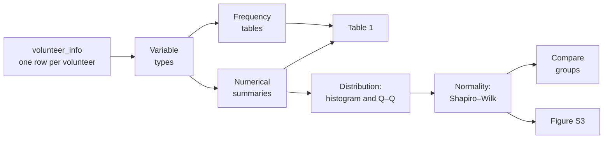
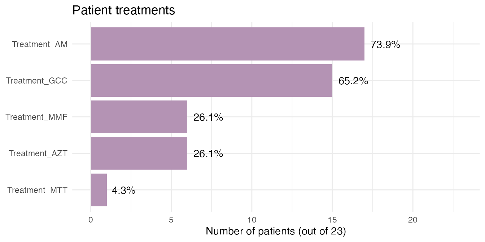
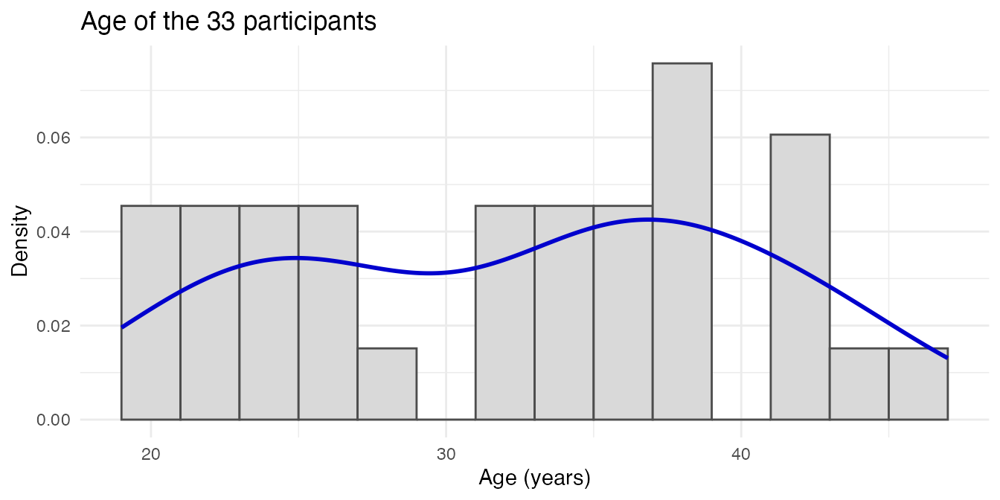
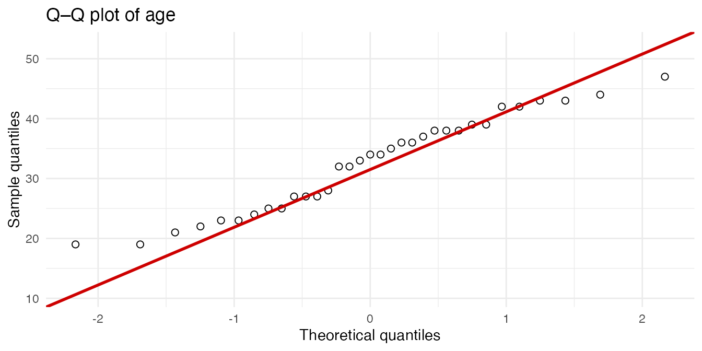
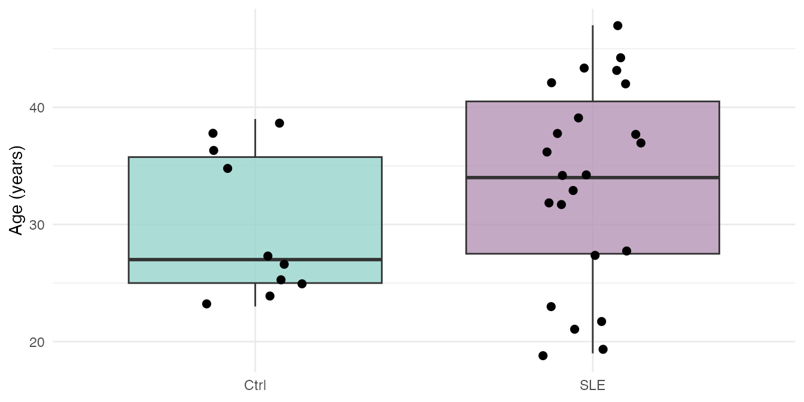
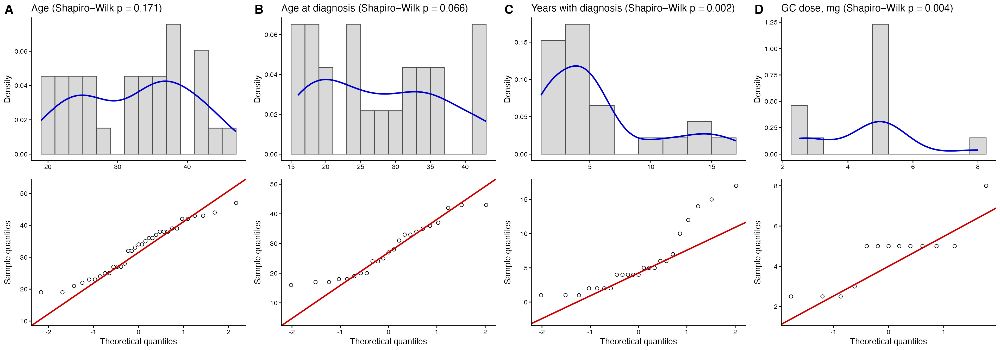

# Lesson 1: Meeting the participants

## Welcome

Before analyzing the expression of thousands of genes, it is worth
getting to know **the people** behind the samples: How old are they? How
long have they had the diagnosis? What treatments do they receive? In
this lesson we describe the 33 study participants using descriptive
statistics, tables, and plots.

**What you need to know beforehand:** the basics of R and of
`dplyr`/`ggplot2`. You do not need to know anything about RNA-seq.

**By the end you will be able to:**

1.  Distinguish **continuous** and **categorical** variables, and know
    how to summarize each one.
2.  Calculate the mean, median, standard deviation, and interquartile
    range.
3.  Build frequency tables and a **Table 1** that describes the cohort.
4.  Assess whether a variable follows a **normal distribution** using
    histograms, Q–Q plots, and the Shapiro–Wilk test.
5.  Choose an appropriate test to compare two groups.

**Estimated time:** 45 to 60 minutes.

### Lesson map



## Glossary

These are the terms we will use. Come back here whenever you need to.

- **Continuous variable**: can take any numerical value within a range
  (age, dose).
- **Categorical variable**: classifies observations into groups (group,
  nephritis yes/no).
- **Mean**: the average. It is sensitive to extreme values.
- **Median**: the middle value when the data are sorted. It is robust to
  extreme values.
- **Standard deviation (SD)**: how far the data are from the mean, on
  average.
- **Interquartile range (IQR)**: interval between the 25th percentile
  (Q1) and the 75th percentile (Q3); it contains the central half of the
  data.
- **Normal distribution**: a symmetric, bell-shaped distribution.
- **Histogram**: bar chart showing how many data points fall in each
  interval.
- **Density**: smoothed version of the histogram.
- **Q–Q plot**: compares the quantiles of the data with those of a
  theoretical normal distribution.
- **Shapiro–Wilk test**: statistical test of normality.
- **p-value**: probability of observing data as extreme as ours if the
  null hypothesis were true.
- **t-test**: compares the means of two groups; assumes normality.
- **Wilcoxon (Mann–Whitney) test**: compares two groups without assuming
  normality.
- **Fisher’s exact test**: assesses the association between two
  categorical variables; works well with small samples.

## 1. Setup

``` r

library(GeneExprLupusMx) # our data
library(tidyverse)       # table manipulation (dplyr) and plots (ggplot2)
library(cowplot)         # combine several plots into a panel
```

We use the same colors for each group in all the lessons:

``` r

group_color <- c(Ctrl = "#96d4ccff", SLE = "#b493b4ff")
```

## 2. The data: `volunteer_info`

`volunteer_info` has **one row per volunteer** (not per sample), with
her clinical and recruitment information:

``` r

dim(volunteer_info)
#> [1] 33 16
glimpse(volunteer_info)
#> Rows: 33
#> Columns: 16
#> $ Volunteer_ID           <chr> "QR011", "QR013", "QR014", "QR017", "QR020", "Q…
#> $ Volunteer              <int> 1, 2, 3, 4, 5, 6, 7, 8, 9, 10, 11, 12, 13, 14, …
#> $ Group                  <fct> Ctrl, Ctrl, SLE, SLE, SLE, SLE, Ctrl, SLE, Ctrl…
#> $ Age_years              <int> 25, 23, 32, 22, 42, 23, 38, 32, 27, 37, 39, 47,…
#> $ Years_with_diagnosis   <int> NA, NA, 5, 4, 5, 4, NA, 12, NA, 6, NA, 4, 6, 10…
#> $ Age_at_diagnosis_years <int> NA, NA, 27, 18, 37, 19, NA, 20, NA, 31, NA, 43,…
#> $ SLEDAI                 <int> NA, NA, 1, 1, 0, 0, NA, 1, NA, 1, NA, 0, 0, 1, …
#> $ Nephritis              <fct> NA, NA, Yes, No, No, No, NA, No, NA, No, NA, Ye…
#> $ Treatment_GCC          <lgl> NA, NA, TRUE, TRUE, FALSE, FALSE, NA, TRUE, NA,…
#> $ GCC_drug               <chr> NA, NA, "PDN", "PDN", NA, NA, NA, "PDN", NA, "P…
#> $ GCC_dose_mg            <dbl> NA, NA, 5.0, 8.0, NA, NA, NA, 5.0, NA, 2.5, NA,…
#> $ Treatment_AM           <lgl> NA, NA, TRUE, FALSE, TRUE, FALSE, NA, TRUE, NA,…
#> $ Treatment_MMF          <lgl> NA, NA, TRUE, FALSE, FALSE, FALSE, NA, FALSE, N…
#> $ Treatment_AZT          <lgl> NA, NA, FALSE, FALSE, TRUE, FALSE, NA, TRUE, NA…
#> $ Treatment_MTT          <lgl> NA, NA, FALSE, FALSE, FALSE, FALSE, NA, FALSE, …
#> $ Time_of_recruitment    <date> 2022-06-01, 2022-06-01, 2022-06-01, 2022-06-01…
```

Many columns only make sense for patients (for example, years with the
diagnosis), so they are `NA` in controls. We store the patients in a
separate object, because we will use it often:

``` r

patients <- filter(volunteer_info, Group == "SLE")
nrow(patients)
#> [1] 23
```

## 3. **Step 1:** identify the type of each variable

The type of variable determines **how to summarize it, how to plot it,
and which test to use**:

| Type | Variables in `volunteer_info` | Summarized with | Plotted with |
|----|----|----|----|
| Continuous | `Age_years`, `Age_at_diagnosis_years`, `Years_with_diagnosis`, `GCC_dose_mg` | mean (SD) or median \[IQR\] | histogram, boxplot, Q–Q |
| Categorical | `Group`, `Nephritis`, `SLEDAI` (0/1), `GCC_drug` | n (%) | bars |
| Logical (yes/no) | `Treatment_GCC`, `Treatment_AM`, `Treatment_MMF`, `Treatment_AZT`, `Treatment_MTT` | n (%) | bars |
| Date | `Time_of_recruitment` | range, count per month | bars by date |

`SLEDAI` is stored as a number (0 or 1), but it is **categorical**: 1
indicates active disease (SLEDAI score ≥ 6) and 0 indicates no activity
or low activity (0–5 points). Averaging it would not make much sense; it
is better to count it.

## 4. **Step 2:** summarize continuous variables

### 4.1 Mean, median, and spread

Let us start with age, comparing controls and patients:

``` r

volunteer_info %>%
  group_by(Group) %>%
  summarise(n      = n(),
            mean   = mean(Age_years),
            sd     = sd(Age_years),
            median = median(Age_years),
            q1     = quantile(Age_years, 0.25),
            q3     = quantile(Age_years, 0.75),
            min    = min(Age_years),
            max    = max(Age_years))
#> # A tibble: 2 × 9
#>   Group     n  mean    sd median    q1    q3   min   max
#>   <fct> <int> <dbl> <dbl>  <dbl> <dbl> <dbl> <int> <int>
#> 1 Ctrl     10  29.9  6.31     27  25    35.8    23    39
#> 2 SLE      23  33.6  8.54     34  27.5  40.5    19    47
```

Patients are, on average, about 4 years older than controls. In section
8 we will see whether this difference is larger than what we would
expect by chance.

### 4.2 Summarize several variables at once

For the variables that only exist in patients, we convert the table to
long format and summarize each variable. `na.rm = TRUE` ignores missing
values:

``` r

continuous_vars <- c("Age_at_diagnosis_years", "Years_with_diagnosis", "GCC_dose_mg")

patients %>%
  pivot_longer(all_of(continuous_vars), names_to = "variable", values_to = "value") %>%
  group_by(variable) %>%
  summarise(n      = sum(!is.na(value)),
            mean   = mean(value, na.rm = TRUE),
            sd     = sd(value, na.rm = TRUE),
            median = median(value, na.rm = TRUE),
            min    = min(value, na.rm = TRUE),
            max    = max(value, na.rm = TRUE))
#> # A tibble: 3 × 7
#>   variable                   n  mean    sd median   min   max
#>   <chr>                  <int> <dbl> <dbl>  <dbl> <dbl> <dbl>
#> 1 Age_at_diagnosis_years    23 27.8   8.97     27  16      43
#> 2 GCC_dose_mg               13  4.5   1.54      5   2.5     8
#> 3 Years_with_diagnosis      23  5.78  4.67      4   1      17
```

Notice that `GCC_dose_mg` has **n = 13**, even though 15 patients
receive glucocorticoids: in two cases the dose was not recorded.

**Mean or median?** If the data are symmetric, the mean and median are
similar and the mean (with its SD) is a good summary. If there are
extreme values or the distribution is skewed, use the median and the
IQR. In `Years_with_diagnosis`, the median (4 years) is lower than the
mean: a few patients with many years of diagnosis “pull” the mean
upward.

## 5. **Step 3:** tables of categorical variables

### 5.1 Frequencies and percentages

How many patients have nephritis?

``` r

patients %>%
  dplyr::count(Nephritis) %>%
  mutate(percent = round(100 * n / sum(n), 1))
#>   Nephritis  n percent
#> 1        No 20      87
#> 2       Yes  3      13
```

### 5.2 Treatments

Each treatment is in its own column (`TRUE`/`FALSE`). To count them all
together, we convert them to long format. When summing `TRUE`/`FALSE`, R
counts the `TRUE` values:

``` r

treatments <- patients %>%
  pivot_longer(starts_with("Treatment_"), names_to = "treatment", values_to = "receives") %>%
  group_by(treatment) %>%
  summarise(n = sum(receives), percent = round(100 * mean(receives), 1)) %>%
  arrange(desc(n))

knitr::kable(treatments, col.names = c("Treatment", "n", "%"))
```

| Treatment     |   n |    % |
|:--------------|----:|-----:|
| Treatment_AM  |  17 | 73.9 |
| Treatment_GCC |  15 | 65.2 |
| Treatment_AZT |   6 | 26.1 |
| Treatment_MMF |   6 | 26.1 |
| Treatment_MTT |   1 |  4.3 |

[`knitr::kable()`](https://rdrr.io/pkg/knitr/man/kable.html) turns any R
table into a formatted table for documents like this one.

``` r

ggplot(treatments, aes(x = reorder(treatment, n), y = n)) +
  geom_col(fill = group_color["SLE"]) +
  geom_text(aes(label = paste0(percent, "%")), hjust = -0.2) +
  coord_flip() +
  scale_y_continuous(limits = c(0, 23)) +
  labs(x = NULL, y = "Number of patients (out of 23)", title = "Patient treatments") +
  theme_minimal()
```



Antimalarials (`AM`) and glucocorticoids (`GCC`) are the most frequent
treatments.

### 5.3 Contingency tables

A **contingency table** cross-tabulates two categorical variables. Which
glucocorticoid and what dose does each patient receive?

``` r

table(drug = patients$GCC_drug, dose_mg = patients$GCC_dose_mg, useNA = "ifany")
#>       dose_mg
#> drug   2.5 3 5 8 <NA>
#>   PDN    3 1 6 1    0
#>   PDS    0 0 2 0    2
#>   <NA>   0 0 0 0    8
```

`useNA = "ifany"` also shows missing values: 8 patients do not receive
glucocorticoids (`<NA>` in both) and 2 receive PDS with no recorded
dose.

**Challenge 1.** How many patients receive 0, 1, 2, or 3 different
immunosuppressive treatments other than glucocorticoids (`AM`, `MMF`,
`AZT`, `MTT`)?

*Hint:* [`rowSums()`](https://rdrr.io/r/base/colSums.html) adds up
columns row by row; `TRUE` values count as 1.

Show solution

``` r

patients %>%
  mutate(n_treatments = rowSums(across(c(Treatment_AM, Treatment_MMF,
                                         Treatment_AZT, Treatment_MTT)))) %>%
  dplyr::count(n_treatments)
#>   n_treatments n
#> 1            0 6
#> 2            1 6
#> 3            2 9
#> 4            3 2
```

Most patients receive one or two of these treatments; 6 receive none.

## 6. **Step 4:** Table 1

Almost all clinical articles include a **Table 1** that describes the
participants by group. We will build it with three small functions that
turn a column into text with the usual format:

``` r

mean_sd    <- function(x) sprintf("%.1f (%.1f)", mean(x, na.rm = TRUE), sd(x, na.rm = TRUE))
median_iqr <- function(x) sprintf("%.1f [%.1f–%.1f]", median(x, na.rm = TRUE),
                                  quantile(x, 0.25, na.rm = TRUE), quantile(x, 0.75, na.rm = TRUE))
n_pct      <- function(x) sprintf("%d (%.0f%%)", sum(x, na.rm = TRUE), 100 * mean(x, na.rm = TRUE))

mean_sd(volunteer_info$Age_years)
#> [1] "32.5 (8.0)"
```

Now we apply each function to each group.
[`summarise()`](https://dplyr.tidyverse.org/reference/summarise.html)
creates one column per characteristic (with short names) and then we
“pivot” the table so that the groups become columns:

``` r

table1 <- volunteer_info %>%
  group_by(Group) %>%
  summarise(
    n                    = as.character(n()),
    age                  = mean_sd(Age_years),
    age_at_diagnosis     = mean_sd(Age_at_diagnosis_years),
    years_with_diagnosis = median_iqr(Years_with_diagnosis),
    sledai_active        = n_pct(SLEDAI == 1),
    nephritis            = n_pct(Nephritis == "Yes"),
    gcc                  = n_pct(Treatment_GCC),
    am                   = n_pct(Treatment_AM),
    mmf                  = n_pct(Treatment_MMF),
    azt                  = n_pct(Treatment_AZT),
    mtt                  = n_pct(Treatment_MTT)
  ) %>%
  pivot_longer(-Group, names_to = "characteristic") %>%
  pivot_wider(names_from = Group, values_from = value)

table1
#> # A tibble: 11 × 3
#>    characteristic       Ctrl       SLE          
#>    <chr>                <chr>      <chr>        
#>  1 n                    10         23           
#>  2 age                  29.9 (6.3) 33.6 (8.5)   
#>  3 age_at_diagnosis     NaN (NA)   27.8 (9.0)   
#>  4 years_with_diagnosis NA [NA–NA] 4.0 [2.0–6.5]
#>  5 sledai_active        0 (NaN%)   10 (43%)     
#>  6 nephritis            0 (NaN%)   3 (13%)      
#>  7 gcc                  0 (NaN%)   15 (65%)     
#>  8 am                   0 (NaN%)   17 (74%)     
#>  9 mmf                  0 (NaN%)   6 (26%)      
#> 10 azt                  0 (NaN%)   6 (26%)      
#> 11 mtt                  0 (NaN%)   1 (4%)
```

To present it, we replace the short names with readable labels. Storing
them in a separate vector keeps the **data** apart from their
**presentation**:

``` r

table1_labels <- c(
  n                    = "n",
  age                  = "Age, years, mean (SD)",
  age_at_diagnosis     = "Age at diagnosis, mean (SD)",
  years_with_diagnosis = "Years with diagnosis, median [IQR]",
  sledai_active        = "Active SLEDAI (≥ 6), n (%)",
  nephritis            = "Nephritis, n (%)",
  gcc                  = "Glucocorticoids, n (%)",
  am                   = "Antimalarials, n (%)",
  mmf                  = "Mycophenolate, n (%)",
  azt                  = "Azathioprine, n (%)",
  mtt                  = "Methotrexate, n (%)"
)

table1 %>%
  mutate(characteristic = table1_labels[characteristic]) %>%
  knitr::kable(col.names = c("Characteristic", "Ctrl", "SLE"))
```

| Characteristic                       | Ctrl         | SLE             |
|:-------------------------------------|:-------------|:----------------|
| n                                    | 10           | 23              |
| Age, years, mean (SD)                | 29.9 (6.3)   | 33.6 (8.5)      |
| Age at diagnosis, mean (SD)          | NaN (NA)     | 27.8 (9.0)      |
| Years with diagnosis, median \[IQR\] | NA \[NA–NA\] | 4.0 \[2.0–6.5\] |
| Active SLEDAI (≥ 6), n (%)           | 0 (NaN%)     | 10 (43%)        |
| Nephritis, n (%)                     | 0 (NaN%)     | 3 (13%)         |
| Glucocorticoids, n (%)               | 0 (NaN%)     | 15 (65%)        |
| Antimalarials, n (%)                 | 0 (NaN%)     | 17 (74%)        |
| Mycophenolate, n (%)                 | 0 (NaN%)     | 6 (26%)         |
| Azathioprine, n (%)                  | 0 (NaN%)     | 6 (26%)         |
| Methotrexate, n (%)                  | 0 (NaN%)     | 1 (4%)          |

**Table 1.** Sociodemographic and clinical characteristics of the 33
volunteers: 10 healthy controls (Ctrl) and 23 patients with systemic
lupus erythematosus (SLE). Continuous variables are summarized as mean
(SD) or median \[IQR\], and categorical variables as n (%). Active
disease was defined as a SLEDAI score ≥ 6. SD, standard deviation; IQR,
interquartile range; SLEDAI, SLE Disease Activity Index.

The original table can be found in the
[article](https://www.frontiersin.org/journals/immunology/articles/10.3389/fimmu.2026.1771959/full).

In controls, the clinical rows appear as `NA`, `NaN`, or `0 (NaN%)`
because those variables do not apply: they have no diagnosis or
treatment. In an article we would write them as “—”.

**Challenge 2.** Replace the meaningless values for controls with `"—"`.

*Hint:* `grepl("NA|NaN", Ctrl)` detects those values.

Show solution

``` r

table1 %>%
  mutate(Ctrl = ifelse(grepl("NA|NaN", Ctrl), "—", Ctrl),
         characteristic = table1_labels[characteristic]) %>%
  knitr::kable(col.names = c("Characteristic", "Ctrl", "SLE"))
```

| Characteristic                       | Ctrl       | SLE             |
|:-------------------------------------|:-----------|:----------------|
| n                                    | 10         | 23              |
| Age, years, mean (SD)                | 29.9 (6.3) | 33.6 (8.5)      |
| Age at diagnosis, mean (SD)          | —          | 27.8 (9.0)      |
| Years with diagnosis, median \[IQR\] | —          | 4.0 \[2.0–6.5\] |
| Active SLEDAI (≥ 6), n (%)           | —          | 10 (43%)        |
| Nephritis, n (%)                     | —          | 3 (13%)         |
| Glucocorticoids, n (%)               | —          | 15 (65%)        |
| Antimalarials, n (%)                 | —          | 17 (74%)        |
| Mycophenolate, n (%)                 | —          | 6 (26%)         |
| Azathioprine, n (%)                  | —          | 6 (26%)         |
| Methotrexate, n (%)                  | —          | 1 (4%)          |

## 7. **Step 5:** do they follow a normal distribution?

Many statistical tests (such as the t-test) assume that the data follow
a **normal distribution**. Before using them, we need to check this. We
will do it in three complementary ways.

### 7.1 Histogram with density curve

The histogram shows the shape of the data; the density curve smooths it.
A normal distribution looks like a symmetric bell.

``` r

ggplot(volunteer_info, aes(x = Age_years)) +
  geom_histogram(aes(y = after_stat(density)), binwidth = 2,
                 fill = "grey85", color = "grey30") +
  geom_density(color = "blue3", linewidth = 1) +
  labs(x = "Age (years)", y = "Density", title = "Age of the 33 participants") +
  theme_minimal()
```



`after_stat(density)` puts the histogram on the same scale as the
density curve.

### 7.2 Q–Q plot

The Q–Q plot compares each data point with the value it would have if
the distribution were perfectly normal. **If the points follow the red
line, the data are approximately normal**; if they curve or move away
from the line at the ends, they are not.

``` r

ggplot(volunteer_info, aes(sample = Age_years)) +
  stat_qq(shape = 1, size = 2) +
  stat_qq_line(color = "red3", linewidth = 1) +
  labs(x = "Theoretical quantiles", y = "Sample quantiles", title = "Q–Q plot of age") +
  theme_minimal()
```



The age points follow the line quite well.

### 7.3 Shapiro–Wilk test

The Shapiro–Wilk test puts a number on what we see in the plots:

- **Null hypothesis:** the data come from a normal distribution.
- **p \< 0.05:** there is evidence that they are **not** normal.
- **p ≥ 0.05:** there is no evidence against normality.

``` r

shapiro.test(volunteer_info$Age_years)
#> 
#>  Shapiro-Wilk normality test
#> 
#> data:  volunteer_info$Age_years
#> W = 0.95378, p-value = 0.1713
```

Let us apply it to all four continuous variables at once:

``` r

normality <- tibble(variable = c("Age_years", continuous_vars)) %>%
  mutate(
    values  = map(variable, ~ na.omit(volunteer_info[[.x]])),
    n       = map_int(values, length),
    W       = map_dbl(values, ~ shapiro.test(.x)$statistic),
    p_value = map_dbl(values, ~ shapiro.test(.x)$p.value),
    normal  = p_value >= 0.05 # TRUE = compatible with normality
  ) %>%
  dplyr::select(-values)

knitr::kable(normality, digits = 3)
```

| variable               |   n |     W | p_value | normal |
|:-----------------------|----:|------:|--------:|:-------|
| Age_years              |  33 | 0.954 |   0.171 | TRUE   |
| Age_at_diagnosis_years |  23 | 0.920 |   0.066 | TRUE   |
| Years_with_diagnosis   |  23 | 0.841 |   0.002 | FALSE  |
| GCC_dose_mg            |  13 | 0.783 |   0.004 | FALSE  |

Age and age at diagnosis are compatible with a normal distribution;
years with diagnosis and glucocorticoid dose are **not**.

**Beware of small samples.** With little data (here, n = 13 for the
dose) the test has low power: it may fail to detect real deviations. And
p ≥ 0.05 does **not prove** normality; it only says there is no evidence
against it. That is why the test is always combined with the plots.

## 8. **Step 6:** compare two groups

Normality determines which test to use:

| Data | Test | R function |
|----|----|----|
| Normal | t-test | [`t.test()`](https://rdrr.io/r/stats/t.test.html) |
| Not normal or small n | Wilcoxon (Mann–Whitney) | [`wilcox.test()`](https://rdrr.io/r/stats/wilcox.test.html) |
| Two categorical variables | Fisher’s exact | [`fisher.test()`](https://rdrr.io/r/stats/fisher.test.html) |

### 8.1 Does age differ between controls and patients?

Age is approximately normal, so we use the t-test:

``` r

ggplot(volunteer_info, aes(x = Group, y = Age_years, fill = Group)) +
  geom_boxplot(alpha = 0.8, outlier.shape = NA) +
  geom_jitter(width = 0.15, size = 2) +
  scale_fill_manual(values = group_color) +
  labs(x = NULL, y = "Age (years)") +
  theme_minimal() +
  theme(legend.position = "none")
```



``` r


t.test(Age_years ~ Group, data = volunteer_info)
#> 
#>  Welch Two Sample t-test
#> 
#> data:  Age_years by Group
#> t = -1.3863, df = 23.036, p-value = 0.1789
#> alternative hypothesis: true difference in means between group Ctrl and group SLE is not equal to 0
#> 95 percent confidence interval:
#>  -9.242292  1.824901
#> sample estimates:
#> mean in group Ctrl  mean in group SLE 
#>            29.9000            33.6087
```

p \> 0.05: **there is no evidence that age differs** between controls
and patients. This is good news: the groups are comparable in age, so
age should not confound the gene expression comparisons.

### 8.2 Is nephritis associated with disease activity?

Both variables are categorical and very few patients have nephritis, so
we use Fisher’s exact test:

``` r

table(SLEDAI = patients$SLEDAI, Nephritis = patients$Nephritis)
#>       Nephritis
#> SLEDAI No Yes
#>      0 12   1
#>      1  8   2
fisher.test(table(patients$SLEDAI, patients$Nephritis))
#> 
#>  Fisher's Exact Test for Count Data
#> 
#> data:  table(patients$SLEDAI, patients$Nephritis)
#> p-value = 0.5596
#> alternative hypothesis: true odds ratio is not equal to 1
#> 95 percent confidence interval:
#>    0.1284169 191.1868934
#> sample estimates:
#> odds ratio 
#>   2.857952
```

With only 3 patients with nephritis there is no power to detect an
association (p \> 0.05). “Not finding a difference” is **not the same**
as “proving there is no difference”.

**Challenge 3.** Have patients with active disease (`SLEDAI == 1`) had
the diagnosis for more years than those with no or low activity
(`SLEDAI == 0`)? Choose the test according to section 7.3.

*Hint:* `Years_with_diagnosis` is **not** normal.

Show solution

Since `Years_with_diagnosis` is not normal, we use the Wilcoxon test:

``` r

patients %>%
  group_by(SLEDAI) %>%
  summarise(n = n(), median_years = median(Years_with_diagnosis))
#> # A tibble: 2 × 3
#>   SLEDAI     n median_years
#>    <int> <int>        <dbl>
#> 1      0    13          4  
#> 2      1    10          4.5

wilcox.test(Years_with_diagnosis ~ SLEDAI, data = patients, exact = FALSE)
#> 
#>  Wilcoxon rank sum test with continuity correction
#> 
#> data:  Years_with_diagnosis by SLEDAI
#> W = 69.5, p-value = 0.8022
#> alternative hypothesis: true location shift is not equal to 0
```

The medians are almost equal (4 and 4.5 years) and p \> 0.05: there is
no evidence of a difference. `exact = FALSE` avoids a warning when there
are tied values.

## 9. To finish: the article figure

Let us bring together what we have learned in **Supplementary Figure
S3** of the article: for each continuous variable, a histogram with its
density curve (top) and its Q–Q plot (bottom). Since we will repeat the
same thing four times, we store it in a function:

``` r

distribution_panel <- function(x, title, binwidth) {
  df <- data.frame(value = na.omit(x))
  p_value <- shapiro.test(df$value)$p.value

  p_hist <- ggplot(df, aes(x = value)) +
    geom_histogram(aes(y = after_stat(density)), binwidth = binwidth,
                   fill = "grey85", color = "grey30") +
    geom_density(color = "blue3", linewidth = 1) +
    labs(x = NULL, y = "Density",
         title = sprintf("%s (Shapiro–Wilk p = %.3f)", title, p_value)) +
    theme_classic(base_size = 12)

  p_qq <- ggplot(df, aes(sample = value)) +
    stat_qq(shape = 1, size = 2) +
    stat_qq_line(color = "red3", linewidth = 1) +
    labs(x = "Theoretical quantiles", y = "Sample quantiles") +
    theme_classic(base_size = 12)

  plot_grid(p_hist, p_qq, ncol = 1, align = "v")
}
```

``` r

figure_s3 <- plot_grid(
  distribution_panel(volunteer_info$Age_years,        "Age",                  binwidth = 2),
  distribution_panel(patients$Age_at_diagnosis_years, "Age at diagnosis",     binwidth = 2),
  distribution_panel(patients$Years_with_diagnosis,   "Years with diagnosis", binwidth = 2),
  distribution_panel(patients$GCC_dose_mg,            "GC dose, mg",          binwidth = 0.5),
  labels = c("A", "B", "C", "D"), label_size = 18, nrow = 1
)
figure_s3
```



**Supplementary Figure S3.** Distribution and normality assessment of
the continuous variables. Each panel shows the histogram with the
density curve (top) and the Q–Q plot (bottom) of **(A)** the age of all
volunteers (n = 33) and, in patients (n = 23), **(B)** age at diagnosis,
**(C)** time since diagnosis, and **(D)** glucocorticoid (GC) dose. The
title of each panel includes the p-value of the Shapiro–Wilk test. In
the Q–Q plots, the sample quantiles are compared with the theoretical
quantiles of a normal distribution (red line). The figures illustrate
the distributional properties of the variables and their deviation from
normality, assessed with the Shapiro–Wilk test.

The original supplementary figure can be found in the [supplementary
material of the
article](https://www.frontiersin.org/journals/immunology/articles/10.3389/fimmu.2026.1771959/full#supplementaryMaterial).

To save it in high resolution:

``` r

ggsave("Figure_S3_normality.png", figure_s3, width = 20, height = 7, dpi = 300)
```

## 10. Summary

| Step | Key function | What for? |
|----|----|----|
| Get to know the data | [`glimpse()`](https://pillar.r-lib.org/reference/glimpse.html) | See the types and values of each column |
| Summarize continuous variables | [`summarise()`](https://dplyr.tidyverse.org/reference/summarise.html) with [`mean()`](https://rdrr.io/r/base/mean.html), [`sd()`](https://rdrr.io/r/stats/sd.html), [`median()`](https://rdrr.io/r/stats/median.html), [`quantile()`](https://rdrr.io/r/stats/quantile.html) | Describe center and spread |
| Count categorical variables | [`dplyr::count()`](https://dplyr.tidyverse.org/reference/count.html), [`table()`](https://rdrr.io/r/base/table.html) | Frequencies and contingency tables |
| Table 1 | [`summarise()`](https://dplyr.tidyverse.org/reference/summarise.html) + [`pivot_wider()`](https://tidyr.tidyverse.org/reference/pivot_wider.html) + [`knitr::kable()`](https://rdrr.io/pkg/knitr/man/kable.html) | Describe the cohort by group |
| Distribution | [`geom_histogram()`](https://ggplot2.tidyverse.org/reference/geom_histogram.html) + [`geom_density()`](https://ggplot2.tidyverse.org/reference/geom_density.html) | See the shape of the data |
| Normality | [`stat_qq()`](https://ggplot2.tidyverse.org/reference/geom_qq.html), [`shapiro.test()`](https://rdrr.io/r/stats/shapiro.test.html) | Decide which test to use |
| Compare groups | [`t.test()`](https://rdrr.io/r/stats/t.test.html), [`wilcox.test()`](https://rdrr.io/r/stats/wilcox.test.html), [`fisher.test()`](https://rdrr.io/r/stats/fisher.test.html) | Assess differences between groups |
| Figure | [`cowplot::plot_grid()`](https://wilkelab.org/cowplot/reference/plot_grid.html) | Combine plots into a panel |

### Common beginner mistakes

- **Averaging categorical variables** coded as numbers (such as `SLEDAI`
  0/1).
- **Reporting the mean of skewed data**: use the median \[IQR\].
- **Forgetting the `NA` values**: use `na.rm = TRUE` and report the
  actual n of each variable.
- **Using the t-test without checking normality**.
- **Interpreting p ≥ 0.05 as “there is no difference”**: with small
  samples, statistical power may be lacking.

## 11. Next steps

With the cohort characterized, the next step is to analyze the gene
expression of these same participants. In the lesson [From RNA-seq
counts to data
exploration](https://eveliacoss.github.io/GeneExprLupusMx/articles/intro_RNAseq_en.md)
you will import and normalize the counts, and explore the structure of
the data with *heatmaps* and PCA. What you learned here informs the
design of that analysis: for example, age does not differ between
groups, so it is not an important source of confounding.

To continue, click the **Next lesson: From RNA-seq counts to data
exploration** button at the bottom of this page.

[← Previous lesson: Get started with the
package](https://eveliacoss.github.io/GeneExprLupusMx/articles/intro_en.md)
[Next lesson: From RNA-seq counts to data exploration
→](https://eveliacoss.github.io/GeneExprLupusMx/articles/intro_RNAseq_en.md)

[↑ Back to top](#top "Back to the top of the page")

## Session information

``` r

sessionInfo()
#> R version 4.6.0 (2026-04-24)
#> Platform: aarch64-apple-darwin23
#> Running under: macOS Tahoe 26.6.2
#> 
#> Matrix products: default
#> BLAS:   /Library/Frameworks/R.framework/Versions/4.6/Resources/lib/libRblas.0.dylib 
#> LAPACK: /Library/Frameworks/R.framework/Versions/4.6/Resources/lib/libRlapack.dylib;  LAPACK version 3.12.1
#> 
#> locale:
#> [1] en_US.UTF-8/en_US.UTF-8/en_US.UTF-8/C/en_US.UTF-8/en_US.UTF-8
#> 
#> time zone: America/Mexico_City
#> tzcode source: internal
#> 
#> attached base packages:
#> [1] stats     graphics  grDevices utils     datasets  methods   base     
#> 
#> other attached packages:
#>  [1] cowplot_1.2.0              lubridate_1.9.5           
#>  [3] forcats_1.0.1              stringr_1.6.0             
#>  [5] dplyr_1.2.1                purrr_1.2.2               
#>  [7] readr_2.2.0                tidyr_1.3.2               
#>  [9] tibble_3.3.1               ggplot2_4.0.3             
#> [11] tidyverse_2.0.0            GeneExprLupusMx_0.0.0.9000
#> 
#> loaded via a namespace (and not attached):
#>  [1] utf8_1.2.6         sass_0.4.10        generics_0.1.4     stringi_1.8.9     
#>  [5] hms_1.1.4          digest_0.6.39      magrittr_2.0.5     timechange_0.4.0  
#>  [9] evaluate_1.0.5     grid_4.6.0         RColorBrewer_1.1-3 fastmap_1.2.0     
#> [13] jsonlite_2.0.0     scales_1.4.0       textshaping_1.0.5  jquerylib_0.1.4   
#> [17] cli_3.6.6          rlang_1.3.0        withr_3.0.3        cachem_1.1.0      
#> [21] yaml_2.3.12        otel_0.2.0         tools_4.6.0        tzdb_0.5.0        
#> [25] vctrs_0.7.3        R6_2.6.1           lifecycle_1.0.5    fs_2.1.0          
#> [29] htmlwidgets_1.6.4  ragg_1.5.2         pkgconfig_2.0.3    desc_1.4.3        
#> [33] pkgdown_2.2.1      pillar_1.11.1      bslib_0.11.0       gtable_0.3.6      
#> [37] glue_1.8.1         systemfonts_1.3.2  xfun_0.60          tidyselect_1.2.1  
#> [41] rstudioapi_0.19.0  knitr_1.51         farver_2.1.2       htmltools_0.5.9   
#> [45] labeling_0.4.3     rmarkdown_2.31     compiler_4.6.0     S7_0.2.2
```
