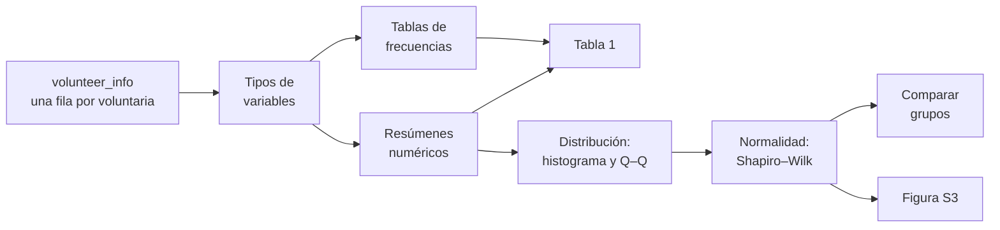
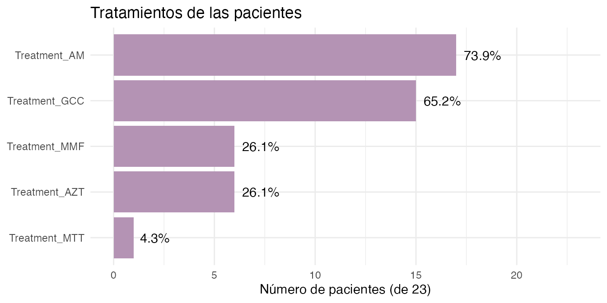
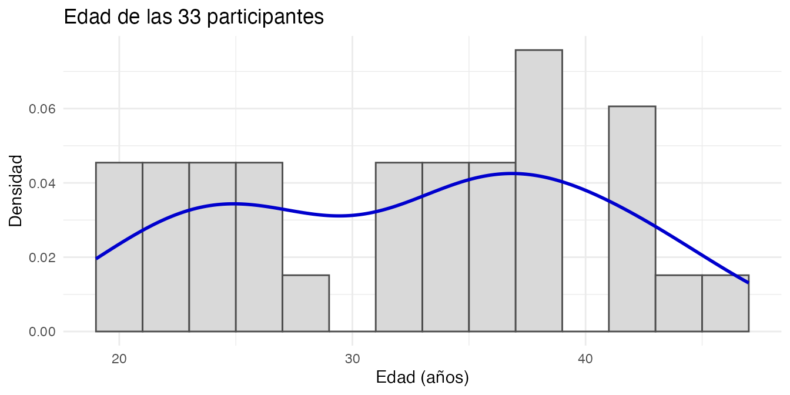
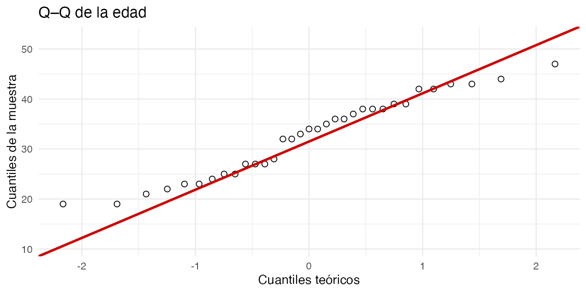
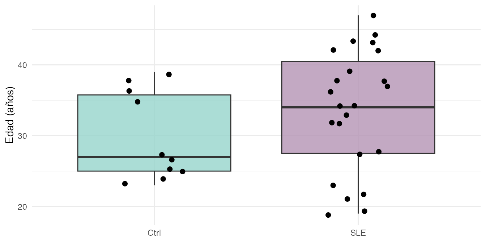
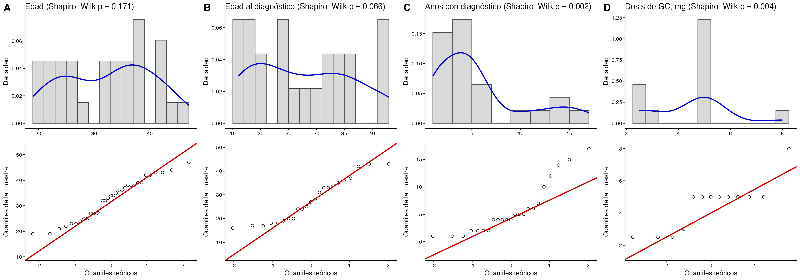

# Lección 1: Conociendo a las participantes

## Bienvenida

Antes de analizar la expresión de miles de genes conviene conocer a
**las personas** detrás de las muestras: ¿qué edad tienen?, ¿cuánto
tiempo llevan con el diagnóstico?, ¿qué tratamientos reciben? En esta
lección describimos a las 33 participantes del estudio con estadística
descriptiva, tablas y gráficas.

**Lo que necesitas saber antes:** lo básico de R y de `dplyr`/`ggplot2`.
No necesitas saber nada de RNA-seq.

**Al terminar podrás:**

1.  Distinguir variables **continuas** y **categóricas**, y saber cómo
    resumir cada una.
2.  Calcular media, mediana, desviación estándar y rango
    intercuartílico.
3.  Construir tablas de frecuencias y una **Tabla 1** que describa a la
    cohorte.
4.  Evaluar si una variable sigue una **distribución normal** con
    histogramas, gráficas Q–Q y la prueba de Shapiro–Wilk.
5.  Elegir una prueba adecuada para comparar dos grupos.

**Tiempo estimado:** 45 a 60 minutos.

### Mapa de la lección



## Glosario

Estos son los términos que usaremos. Vuelve aquí cada vez que lo
necesites.

- **Variable continua**: puede tomar cualquier valor numérico dentro de
  un rango (edad, dosis).
- **Variable categórica**: clasifica en grupos (grupo, nefritis sí/no).
- **Media**: el promedio. Es sensible a valores extremos.
- **Mediana**: el valor del centro al ordenar los datos. Es robusta a
  valores extremos.
- **Desviación estándar (DE)**: qué tanto se alejan los datos de la
  media, en promedio.
- **Rango intercuartílico (RIC)**: intervalo entre el percentil 25 (Q1)
  y el 75 (Q3); contiene a la mitad central de los datos.
- **Distribución normal**: distribución simétrica en forma de campana.
- **Histograma**: gráfica de barras que muestra cuántos datos caen en
  cada intervalo.
- **Densidad**: versión suavizada del histograma.
- **Gráfica Q–Q**: compara los cuantiles de los datos con los de una
  distribución normal teórica.
- **Prueba de Shapiro–Wilk**: prueba estadística de normalidad.
- **Valor p**: probabilidad de observar datos tan extremos como los
  nuestros si la hipótesis nula fuera cierta.
- **Prueba t**: compara las medias de dos grupos; supone normalidad.
- **Prueba de Wilcoxon (Mann–Whitney)**: compara dos grupos sin suponer
  normalidad.
- **Prueba exacta de Fisher**: evalúa la asociación entre dos variables
  categóricas; funciona bien con pocos datos.

## 1. Preparación

``` r

library(GeneExprLupusMx) # nuestros datos
library(tidyverse)       # manipulación de tablas (dplyr) y gráficas (ggplot2)
library(cowplot)         # unir varias gráficas en un panel
```

Usamos los mismos colores para cada grupo en todas las lecciones:

``` r

group_color <- c(Ctrl = "#96d4ccff", SLE = "#b493b4ff")
```

## 2. Los datos: `volunteer_info`

`volunteer_info` tiene **una fila por voluntaria** (no por muestra), con
su información clínica y de reclutamiento:

``` r

dim(volunteer_info)
#> [1] 33 16
glimpse(volunteer_info)
#> Rows: 33
#> Columns: 16
#> $ Volunteer_ID           <chr> "QR011", "QR013", "QR014", "QR017", "QR020", "Q…
#> $ Volunteer              <int> 1, 2, 3, 4, 5, 6, 7, 8, 9, 10, 11, 12, 13, 14, …
#> $ Group                  <fct> Ctrl, Ctrl, SLE, SLE, SLE, SLE, Ctrl, SLE, Ctrl…
#> $ Age_years              <int> 25, 23, 32, 22, 42, 23, 38, 32, 27, 37, 39, 47,…
#> $ Years_with_diagnosis   <int> NA, NA, 5, 4, 5, 4, NA, 12, NA, 6, NA, 4, 6, 10…
#> $ Age_at_diagnosis_years <int> NA, NA, 27, 18, 37, 19, NA, 20, NA, 31, NA, 43,…
#> $ SLEDAI                 <int> NA, NA, 1, 1, 0, 0, NA, 1, NA, 1, NA, 0, 0, 1, …
#> $ Nephritis              <fct> NA, NA, Yes, No, No, No, NA, No, NA, No, NA, Ye…
#> $ Treatment_GCC          <lgl> NA, NA, TRUE, TRUE, FALSE, FALSE, NA, TRUE, NA,…
#> $ GCC_drug               <chr> NA, NA, "PDN", "PDN", NA, NA, NA, "PDN", NA, "P…
#> $ GCC_dose_mg            <dbl> NA, NA, 5.0, 8.0, NA, NA, NA, 5.0, NA, 2.5, NA,…
#> $ Treatment_AM           <lgl> NA, NA, TRUE, FALSE, TRUE, FALSE, NA, TRUE, NA,…
#> $ Treatment_MMF          <lgl> NA, NA, TRUE, FALSE, FALSE, FALSE, NA, FALSE, N…
#> $ Treatment_AZT          <lgl> NA, NA, FALSE, FALSE, TRUE, FALSE, NA, TRUE, NA…
#> $ Treatment_MTT          <lgl> NA, NA, FALSE, FALSE, FALSE, FALSE, NA, FALSE, …
#> $ Time_of_recruitment    <date> 2022-06-01, 2022-06-01, 2022-06-01, 2022-06-01…
```

Muchas columnas solo tienen sentido para las pacientes (por ejemplo, los
años con diagnóstico), así que en los controles valen `NA`. Guardamos a
las pacientes en un objeto aparte, porque lo usaremos seguido:

``` r

patients <- filter(volunteer_info, Group == "SLE")
nrow(patients)
#> [1] 23
```

## 3. **Paso 1:** identificar el tipo de cada variable

El tipo de variable decide **cómo resumirla, cómo graficarla y qué
prueba usar**:

| Tipo | Variables en `volunteer_info` | Se resume con | Se grafica con |
|----|----|----|----|
| Continua | `Age_years`, `Age_at_diagnosis_years`, `Years_with_diagnosis`, `GCC_dose_mg` | media (DE) o mediana \[RIC\] | histograma, cajas, Q–Q |
| Categórica | `Group`, `Nephritis`, `SLEDAI` (0/1), `GCC_drug` | n (%) | barras |
| Lógica (sí/no) | `Treatment_GCC`, `Treatment_AM`, `Treatment_MMF`, `Treatment_AZT`, `Treatment_MTT` | n (%) | barras |
| Fecha | `Time_of_recruitment` | rango, conteo por mes | barras por fecha |

`SLEDAI` está guardada como número (0 o 1), pero es **categórica**: 1
indica enfermedad activa (puntaje SLEDAI ≥ 6) y 0, sin actividad o con
actividad baja (0–5 puntos). Promediarla no tendría mucho sentido;
conviene contarla.

## 4. **Paso 2:** resumir variables continuas

### 4.1 Media, mediana y dispersión

Empecemos con la edad, comparando controles y pacientes:

``` r

volunteer_info %>%
  group_by(Group) %>%
  summarise(n      = n(),
            mean   = mean(Age_years),
            sd     = sd(Age_years),
            median = median(Age_years),
            q1     = quantile(Age_years, 0.25),
            q3     = quantile(Age_years, 0.75),
            min    = min(Age_years),
            max    = max(Age_years))
#> # A tibble: 2 × 9
#>   Group     n  mean    sd median    q1    q3   min   max
#>   <fct> <int> <dbl> <dbl>  <dbl> <dbl> <dbl> <int> <int>
#> 1 Ctrl     10  29.9  6.31     27  25    35.8    23    39
#> 2 SLE      23  33.6  8.54     34  27.5  40.5    19    47
```

Las pacientes tienen, en promedio, unos 4 años más que los controles. En
la sección 8 veremos si esa diferencia es mayor de lo que esperaríamos
por azar.

### 4.2 Resumir varias variables a la vez

Para las variables que solo existen en las pacientes, pasamos la tabla a
formato largo y resumimos cada variable. `na.rm = TRUE` ignora los
valores faltantes:

``` r

continuous_vars <- c("Age_at_diagnosis_years", "Years_with_diagnosis", "GCC_dose_mg")

patients %>%
  pivot_longer(all_of(continuous_vars), names_to = "variable", values_to = "value") %>%
  group_by(variable) %>%
  summarise(n      = sum(!is.na(value)),
            mean   = mean(value, na.rm = TRUE),
            sd     = sd(value, na.rm = TRUE),
            median = median(value, na.rm = TRUE),
            min    = min(value, na.rm = TRUE),
            max    = max(value, na.rm = TRUE))
#> # A tibble: 3 × 7
#>   variable                   n  mean    sd median   min   max
#>   <chr>                  <int> <dbl> <dbl>  <dbl> <dbl> <dbl>
#> 1 Age_at_diagnosis_years    23 27.8   8.97     27  16      43
#> 2 GCC_dose_mg               13  4.5   1.54      5   2.5     8
#> 3 Years_with_diagnosis      23  5.78  4.67      4   1      17
```

Observa que `GCC_dose_mg` tiene **n = 13**, aunque 15 pacientes reciben
glucocorticoides: en dos casos no se registró la dosis.

**¿Media o mediana?** Si los datos son simétricos, media y mediana se
parecen y la media (con su DE) es un buen resumen. Si hay valores
extremos o la distribución está sesgada, usa la mediana y el RIC. En
`Years_with_diagnosis`, la mediana (4 años) es menor que la media: unas
pocas pacientes con muchos años de diagnóstico “jalan” la media hacia
arriba.

## 5. **Paso 3:** tablas de variables categóricas

### 5.1 Frecuencias y porcentajes

¿Cuántas pacientes tienen nefritis?

``` r

patients %>%
  dplyr::count(Nephritis) %>%
  mutate(percent = round(100 * n / sum(n), 1))
#>   Nephritis  n percent
#> 1        No 20      87
#> 2       Yes  3      13
```

### 5.2 Tratamientos

Cada tratamiento está en su propia columna (`TRUE`/`FALSE`). Para
contarlos todos juntos, los pasamos a formato largo. Al sumar
`TRUE`/`FALSE`, R cuenta los `TRUE`:

``` r

treatments <- patients %>%
  pivot_longer(starts_with("Treatment_"), names_to = "treatment", values_to = "receives") %>%
  group_by(treatment) %>%
  summarise(n = sum(receives), percent = round(100 * mean(receives), 1)) %>%
  arrange(desc(n))

knitr::kable(treatments, col.names = c("Tratamiento", "n", "%"))
```

| Tratamiento   |   n |    % |
|:--------------|----:|-----:|
| Treatment_AM  |  17 | 73.9 |
| Treatment_GCC |  15 | 65.2 |
| Treatment_AZT |   6 | 26.1 |
| Treatment_MMF |   6 | 26.1 |
| Treatment_MTT |   1 |  4.3 |

[`knitr::kable()`](https://rdrr.io/pkg/knitr/man/kable.html) convierte
cualquier tabla de R en una tabla con formato para documentos como este.

``` r

ggplot(treatments, aes(x = reorder(treatment, n), y = n)) +
  geom_col(fill = group_color["SLE"]) +
  geom_text(aes(label = paste0(percent, "%")), hjust = -0.2) +
  coord_flip() +
  scale_y_continuous(limits = c(0, 23)) +
  labs(x = NULL, y = "Número de pacientes (de 23)", title = "Tratamientos de las pacientes") +
  theme_minimal()
```



Los antimaláricos (`AM`) y los glucocorticoides (`GCC`) son los
tratamientos más frecuentes.

### 5.3 Tablas de contingencia

Una **tabla de contingencia** cruza dos variables categóricas. ¿Qué
glucocorticoide y qué dosis recibe cada paciente?

``` r

table(drug = patients$GCC_drug, dose_mg = patients$GCC_dose_mg, useNA = "ifany")
#>       dose_mg
#> drug   2.5 3 5 8 <NA>
#>   PDN    3 1 6 1    0
#>   PDS    0 0 2 0    2
#>   <NA>   0 0 0 0    8
```

`useNA = "ifany"` muestra también los faltantes: 8 pacientes no reciben
glucocorticoides (`<NA>` en ambas) y 2 reciben PDS sin dosis registrada.

**Reto 1.** ¿Cuántas pacientes reciben 0, 1, 2 o 3 tratamientos
inmunosupresores distintos de los glucocorticoides (`AM`, `MMF`, `AZT`,
`MTT`)?

*Pista:* [`rowSums()`](https://rdrr.io/r/base/colSums.html) suma
columnas fila por fila; los `TRUE` cuentan como 1.

Ver solución

``` r

patients %>%
  mutate(n_treatments = rowSums(across(c(Treatment_AM, Treatment_MMF,
                                         Treatment_AZT, Treatment_MTT)))) %>%
  dplyr::count(n_treatments)
#>   n_treatments n
#> 1            0 6
#> 2            1 6
#> 3            2 9
#> 4            3 2
```

La mayoría de las pacientes recibe uno o dos de estos tratamientos; 6 no
reciben ninguno.

## 6. **Paso 4:** la Tabla 1

Casi todos los artículos clínicos incluyen una **Tabla 1** que describe
a los participantes por grupo. La construiremos con tres funciones
pequeñas que convierten una columna en texto con el formato habitual:

``` r

mean_sd    <- function(x) sprintf("%.1f (%.1f)", mean(x, na.rm = TRUE), sd(x, na.rm = TRUE))
median_iqr <- function(x) sprintf("%.1f [%.1f–%.1f]", median(x, na.rm = TRUE),
                                  quantile(x, 0.25, na.rm = TRUE), quantile(x, 0.75, na.rm = TRUE))
n_pct      <- function(x) sprintf("%d (%.0f%%)", sum(x, na.rm = TRUE), 100 * mean(x, na.rm = TRUE))

mean_sd(volunteer_info$Age_years)
#> [1] "32.5 (8.0)"
```

Ahora aplicamos cada función a cada grupo.
[`summarise()`](https://dplyr.tidyverse.org/reference/summarise.html)
crea una columna por característica (con nombres cortos en inglés) y
luego “giramos” la tabla para que los grupos queden como columnas:

``` r

table1 <- volunteer_info %>%
  group_by(Group) %>%
  summarise(
    n                    = as.character(n()),
    age                  = mean_sd(Age_years),
    age_at_diagnosis     = mean_sd(Age_at_diagnosis_years),
    years_with_diagnosis = median_iqr(Years_with_diagnosis),
    sledai_active        = n_pct(SLEDAI == 1),
    nephritis            = n_pct(Nephritis == "Yes"),
    gcc                  = n_pct(Treatment_GCC),
    am                   = n_pct(Treatment_AM),
    mmf                  = n_pct(Treatment_MMF),
    azt                  = n_pct(Treatment_AZT),
    mtt                  = n_pct(Treatment_MTT)
  ) %>%
  pivot_longer(-Group, names_to = "characteristic") %>%
  pivot_wider(names_from = Group, values_from = value)

table1
#> # A tibble: 11 × 3
#>    characteristic       Ctrl       SLE          
#>    <chr>                <chr>      <chr>        
#>  1 n                    10         23           
#>  2 age                  29.9 (6.3) 33.6 (8.5)   
#>  3 age_at_diagnosis     NaN (NA)   27.8 (9.0)   
#>  4 years_with_diagnosis NA [NA–NA] 4.0 [2.0–6.5]
#>  5 sledai_active        0 (NaN%)   10 (43%)     
#>  6 nephritis            0 (NaN%)   3 (13%)      
#>  7 gcc                  0 (NaN%)   15 (65%)     
#>  8 am                   0 (NaN%)   17 (74%)     
#>  9 mmf                  0 (NaN%)   6 (26%)      
#> 10 azt                  0 (NaN%)   6 (26%)      
#> 11 mtt                  0 (NaN%)   1 (4%)
```

Para presentarla, cambiamos los nombres cortos por etiquetas legibles.
Guardarlas en un vector aparte separa los **datos** de su
**presentación**:

``` r

table1_labels <- c(
  n                    = "n",
  age                  = "Edad, años, media (DE)",
  age_at_diagnosis     = "Edad al diagnóstico, media (DE)",
  years_with_diagnosis = "Años con diagnóstico, mediana [RIC]",
  sledai_active        = "SLEDAI activo (≥ 6), n (%)",
  nephritis            = "Nefritis, n (%)",
  gcc                  = "Glucocorticoides, n (%)",
  am                   = "Antimaláricos, n (%)",
  mmf                  = "Micofenolato, n (%)",
  azt                  = "Azatioprina, n (%)",
  mtt                  = "Metotrexato, n (%)"
)

table1 %>%
  mutate(characteristic = table1_labels[characteristic]) %>%
  knitr::kable(col.names = c("Característica", "Ctrl", "SLE"))
```

| Característica                        | Ctrl         | SLE             |
|:--------------------------------------|:-------------|:----------------|
| n                                     | 10           | 23              |
| Edad, años, media (DE)                | 29.9 (6.3)   | 33.6 (8.5)      |
| Edad al diagnóstico, media (DE)       | NaN (NA)     | 27.8 (9.0)      |
| Años con diagnóstico, mediana \[RIC\] | NA \[NA–NA\] | 4.0 \[2.0–6.5\] |
| SLEDAI activo (≥ 6), n (%)            | 0 (NaN%)     | 10 (43%)        |
| Nefritis, n (%)                       | 0 (NaN%)     | 3 (13%)         |
| Glucocorticoides, n (%)               | 0 (NaN%)     | 15 (65%)        |
| Antimaláricos, n (%)                  | 0 (NaN%)     | 17 (74%)        |
| Micofenolato, n (%)                   | 0 (NaN%)     | 6 (26%)         |
| Azatioprina, n (%)                    | 0 (NaN%)     | 6 (26%)         |
| Metotrexato, n (%)                    | 0 (NaN%)     | 1 (4%)          |

En los controles, las filas clínicas aparecen como `NA`, `NaN` o
`0 (NaN%)` porque esas variables no aplican: no tienen diagnóstico ni
tratamiento. En un artículo las escribiríamos como “—”.

**Reto 2.** Reemplaza los valores sin sentido de los controles por
`"—"`.

*Pista:* `grepl("NA|NaN", Ctrl)` detecta esos valores.

Ver solución

``` r

table1 %>%
  mutate(Ctrl = ifelse(grepl("NA|NaN", Ctrl), "—", Ctrl),
         characteristic = table1_labels[characteristic]) %>%
  knitr::kable(col.names = c("Característica", "Ctrl", "SLE"))
```

| Característica                        | Ctrl       | SLE             |
|:--------------------------------------|:-----------|:----------------|
| n                                     | 10         | 23              |
| Edad, años, media (DE)                | 29.9 (6.3) | 33.6 (8.5)      |
| Edad al diagnóstico, media (DE)       | —          | 27.8 (9.0)      |
| Años con diagnóstico, mediana \[RIC\] | —          | 4.0 \[2.0–6.5\] |
| SLEDAI activo (≥ 6), n (%)            | —          | 10 (43%)        |
| Nefritis, n (%)                       | —          | 3 (13%)         |
| Glucocorticoides, n (%)               | —          | 15 (65%)        |
| Antimaláricos, n (%)                  | —          | 17 (74%)        |
| Micofenolato, n (%)                   | —          | 6 (26%)         |
| Azatioprina, n (%)                    | —          | 6 (26%)         |
| Metotrexato, n (%)                    | —          | 1 (4%)          |

## 7. **Paso 5:** ¿siguen una distribución normal?

Muchas pruebas estadísticas (como la prueba t) suponen que los datos
siguen una **distribución normal**. Antes de usarlas hay que revisarlo.
Lo haremos de tres formas complementarias.

### 7.1 Histograma con curva de densidad

El histograma muestra la forma de los datos; la curva de densidad la
suaviza. Una distribución normal se ve como una campana simétrica.

``` r

ggplot(volunteer_info, aes(x = Age_years)) +
  geom_histogram(aes(y = after_stat(density)), binwidth = 2,
                 fill = "grey85", color = "grey30") +
  geom_density(color = "blue3", linewidth = 1) +
  labs(x = "Edad (años)", y = "Densidad", title = "Edad de las 33 participantes") +
  theme_minimal()
```



`after_stat(density)` pone el histograma en la misma escala que la curva
de densidad.

### 7.2 Gráfica Q–Q

La gráfica Q–Q compara cada dato con el valor que tendría si la
distribución fuera perfectamente normal. **Si los puntos siguen la línea
roja, los datos son aproximadamente normales**; si se curvan o se
separan en los extremos, no lo son.

``` r

ggplot(volunteer_info, aes(sample = Age_years)) +
  stat_qq(shape = 1, size = 2) +
  stat_qq_line(color = "red3", linewidth = 1) +
  labs(x = "Cuantiles teóricos", y = "Cuantiles de la muestra", title = "Q–Q de la edad") +
  theme_minimal()
```



Los puntos de la edad siguen la línea bastante bien.

### 7.3 Prueba de Shapiro–Wilk

La prueba de Shapiro–Wilk pone un número a lo que vemos en las gráficas:

- **Hipótesis nula:** los datos vienen de una distribución normal.
- **p \< 0.05:** hay evidencia de que **no** son normales.
- **p ≥ 0.05:** no hay evidencia en contra de la normalidad.

``` r

shapiro.test(volunteer_info$Age_years)
#> 
#>  Shapiro-Wilk normality test
#> 
#> data:  volunteer_info$Age_years
#> W = 0.95378, p-value = 0.1713
```

Apliquémosla a las cuatro variables continuas de una vez:

``` r

normality <- tibble(variable = c("Age_years", continuous_vars)) %>%
  mutate(
    values  = map(variable, ~ na.omit(volunteer_info[[.x]])),
    n       = map_int(values, length),
    W       = map_dbl(values, ~ shapiro.test(.x)$statistic),
    p_value = map_dbl(values, ~ shapiro.test(.x)$p.value),
    normal  = p_value >= 0.05 # TRUE = compatible con normalidad
  ) %>%
  dplyr::select(-values)

knitr::kable(normality, digits = 3)
```

| variable               |   n |     W | p_value | normal |
|:-----------------------|----:|------:|--------:|:-------|
| Age_years              |  33 | 0.954 |   0.171 | TRUE   |
| Age_at_diagnosis_years |  23 | 0.920 |   0.066 | TRUE   |
| Years_with_diagnosis   |  23 | 0.841 |   0.002 | FALSE  |
| GCC_dose_mg            |  13 | 0.783 |   0.004 | FALSE  |

La edad y la edad al diagnóstico son compatibles con una distribución
normal; los años con diagnóstico y la dosis de glucocorticoides **no**.

**Cuidado con muestras pequeñas.** Con pocos datos (aquí, n = 13 para la
dosis) la prueba tiene poco poder: puede no detectar desviaciones
reales. Y que p ≥ 0.05 **no demuestra** normalidad; solo dice que no hay
evidencia en contra. Por eso siempre se combina la prueba con las
gráficas.

## 8. **Paso 6:** comparar dos grupos

La normalidad decide qué prueba usar:

| Datos | Prueba | Función en R |
|----|----|----|
| Normales | prueba t | [`t.test()`](https://rdrr.io/r/stats/t.test.html) |
| No normales o n pequeña | Wilcoxon (Mann–Whitney) | [`wilcox.test()`](https://rdrr.io/r/stats/wilcox.test.html) |
| Dos variables categóricas | exacta de Fisher | [`fisher.test()`](https://rdrr.io/r/stats/fisher.test.html) |

### 8.1 ¿Difiere la edad entre controles y pacientes?

La edad es aproximadamente normal, así que usamos la prueba t:

``` r

ggplot(volunteer_info, aes(x = Group, y = Age_years, fill = Group)) +
  geom_boxplot(alpha = 0.8, outlier.shape = NA) +
  geom_jitter(width = 0.15, size = 2) +
  scale_fill_manual(values = group_color) +
  labs(x = NULL, y = "Edad (años)") +
  theme_minimal() +
  theme(legend.position = "none")
```



``` r


t.test(Age_years ~ Group, data = volunteer_info)
#> 
#>  Welch Two Sample t-test
#> 
#> data:  Age_years by Group
#> t = -1.3863, df = 23.036, p-value = 0.1789
#> alternative hypothesis: true difference in means between group Ctrl and group SLE is not equal to 0
#> 95 percent confidence interval:
#>  -9.242292  1.824901
#> sample estimates:
#> mean in group Ctrl  mean in group SLE 
#>            29.9000            33.6087
```

p \> 0.05: **no hay evidencia de que la edad difiera** entre controles y
pacientes. Es una buena noticia: los grupos son comparables en edad, así
que la edad no debería confundir las comparaciones de expresión génica.

### 8.2 ¿Se asocia la nefritis con la actividad de la enfermedad?

Ambas variables son categóricas y hay muy pocas pacientes con nefritis,
así que usamos la prueba exacta de Fisher:

``` r

table(SLEDAI = patients$SLEDAI, Nephritis = patients$Nephritis)
#>       Nephritis
#> SLEDAI No Yes
#>      0 12   1
#>      1  8   2
fisher.test(table(patients$SLEDAI, patients$Nephritis))
#> 
#>  Fisher's Exact Test for Count Data
#> 
#> data:  table(patients$SLEDAI, patients$Nephritis)
#> p-value = 0.5596
#> alternative hypothesis: true odds ratio is not equal to 1
#> 95 percent confidence interval:
#>    0.1284169 191.1868934
#> sample estimates:
#> odds ratio 
#>   2.857952
```

Con solo 3 pacientes con nefritis no hay poder para detectar una
asociación (p \> 0.05). “No encontrar diferencia” **no es lo mismo** que
“demostrar que no hay diferencia”.

**Reto 3.** ¿Llevan más años con el diagnóstico las pacientes con
enfermedad activa (`SLEDAI == 1`) que las que no tienen actividad o la
tienen baja (`SLEDAI == 0`)? Elige la prueba según la sección 7.3.

*Pista:* `Years_with_diagnosis` **no** es normal.

Ver solución

Como `Years_with_diagnosis` no es normal, usamos la prueba de Wilcoxon:

``` r

patients %>%
  group_by(SLEDAI) %>%
  summarise(n = n(), median_years = median(Years_with_diagnosis))
#> # A tibble: 2 × 3
#>   SLEDAI     n median_years
#>    <int> <int>        <dbl>
#> 1      0    13          4  
#> 2      1    10          4.5

wilcox.test(Years_with_diagnosis ~ SLEDAI, data = patients, exact = FALSE)
#> 
#>  Wilcoxon rank sum test with continuity correction
#> 
#> data:  Years_with_diagnosis by SLEDAI
#> W = 69.5, p-value = 0.8022
#> alternative hypothesis: true location shift is not equal to 0
```

Las medianas son casi iguales (4 y 4.5 años) y p \> 0.05: no hay
evidencia de diferencia. `exact = FALSE` evita un aviso cuando hay
valores empatados.

## 9. Para terminar: la figura del artículo

Reunamos lo aprendido en la **Figura suplementaria S3** del artículo:
para cada variable continua, un histograma con su curva de densidad
(arriba) y su gráfica Q–Q (abajo). Como repetiremos lo mismo cuatro
veces, lo guardamos en una función:

``` r

distribution_panel <- function(x, title, binwidth) {
  df <- data.frame(value = na.omit(x))
  p_value <- shapiro.test(df$value)$p.value

  p_hist <- ggplot(df, aes(x = value)) +
    geom_histogram(aes(y = after_stat(density)), binwidth = binwidth,
                   fill = "grey85", color = "grey30") +
    geom_density(color = "blue3", linewidth = 1) +
    labs(x = NULL, y = "Densidad",
         title = sprintf("%s (Shapiro–Wilk p = %.3f)", title, p_value)) +
    theme_classic(base_size = 12)

  p_qq <- ggplot(df, aes(sample = value)) +
    stat_qq(shape = 1, size = 2) +
    stat_qq_line(color = "red3", linewidth = 1) +
    labs(x = "Cuantiles teóricos", y = "Cuantiles de la muestra") +
    theme_classic(base_size = 12)

  plot_grid(p_hist, p_qq, ncol = 1, align = "v")
}
```

``` r

figure_s3 <- plot_grid(
  distribution_panel(volunteer_info$Age_years,        "Edad",                 binwidth = 2),
  distribution_panel(patients$Age_at_diagnosis_years, "Edad al diagnóstico",  binwidth = 2),
  distribution_panel(patients$Years_with_diagnosis,   "Años con diagnóstico", binwidth = 2),
  distribution_panel(patients$GCC_dose_mg,            "Dosis de GC, mg",      binwidth = 0.5),
  labels = c("A", "B", "C", "D"), label_size = 18, nrow = 1
)
figure_s3
```



**Figura suplementaria S3.** Distribución y evaluación de la normalidad
de las variables continuas. Cada panel muestra el histograma con la
curva de densidad (arriba) y la gráfica Q–Q (abajo) de **(A)** la edad
de todas las voluntarias (n = 33) y, en las pacientes (n = 23), **(B)**
la edad al diagnóstico, **(C)** el tiempo desde el diagnóstico y **(D)**
la dosis de glucocorticoides (GC). El título de cada panel incluye el
valor p de la prueba de Shapiro–Wilk. En las gráficas Q–Q, los cuantiles
de la muestra se comparan con los cuantiles teóricos de una distribución
normal (línea roja). Las figuras ilustran las propiedades de
distribución de las variables y su desviación de la normalidad, evaluada
con la prueba de Shapiro–Wilk.

La figura suplementaria original se encuentra en el [material
suplementario del
artículo](https://www.frontiersin.org/journals/immunology/articles/10.3389/fimmu.2026.1771959/full#supplementaryMaterial).

Para guardarla en alta resolución:

``` r

ggsave("Figura_S3_normalidad.png", figure_s3, width = 20, height = 7, dpi = 300)
```

## 10. Resumen

| Paso | Función clave | ¿Para qué? |
|----|----|----|
| Conocer los datos | [`glimpse()`](https://pillar.r-lib.org/reference/glimpse.html) | Ver tipos y valores de cada columna |
| Resumir continuas | [`summarise()`](https://dplyr.tidyverse.org/reference/summarise.html) con [`mean()`](https://rdrr.io/r/base/mean.html), [`sd()`](https://rdrr.io/r/stats/sd.html), [`median()`](https://rdrr.io/r/stats/median.html), [`quantile()`](https://rdrr.io/r/stats/quantile.html) | Describir centro y dispersión |
| Contar categóricas | [`dplyr::count()`](https://dplyr.tidyverse.org/reference/count.html), [`table()`](https://rdrr.io/r/base/table.html) | Frecuencias y tablas de contingencia |
| Tabla 1 | [`summarise()`](https://dplyr.tidyverse.org/reference/summarise.html) + [`pivot_wider()`](https://tidyr.tidyverse.org/reference/pivot_wider.html) + [`knitr::kable()`](https://rdrr.io/pkg/knitr/man/kable.html) | Describir la cohorte por grupo |
| Distribución | [`geom_histogram()`](https://ggplot2.tidyverse.org/reference/geom_histogram.html) + [`geom_density()`](https://ggplot2.tidyverse.org/reference/geom_density.html) | Ver la forma de los datos |
| Normalidad | [`stat_qq()`](https://ggplot2.tidyverse.org/reference/geom_qq.html), [`shapiro.test()`](https://rdrr.io/r/stats/shapiro.test.html) | Decidir qué prueba usar |
| Comparar grupos | [`t.test()`](https://rdrr.io/r/stats/t.test.html), [`wilcox.test()`](https://rdrr.io/r/stats/wilcox.test.html), [`fisher.test()`](https://rdrr.io/r/stats/fisher.test.html) | Evaluar diferencias entre grupos |
| Figura | [`cowplot::plot_grid()`](https://wilkelab.org/cowplot/reference/plot_grid.html) | Combinar gráficas en un panel |

### Errores comunes de principiante

- **Promediar variables categóricas** codificadas como números (como
  `SLEDAI` 0/1).
- **Reportar la media de datos sesgados**: usa la mediana \[RIC\].
- **Olvidar los `NA`**: usa `na.rm = TRUE` y reporta la n real de cada
  variable.
- **Usar la prueba t sin revisar la normalidad**.
- **Interpretar p ≥ 0.05 como “no hay diferencia”**: con muestras
  pequeñas, puede faltar poder estadístico.

## 11. ¿Y después?

En la siguiente lección, [De las cuentas de RNA-seq a la exploración de
datos](https://eveliacoss.github.io/GeneExprLupusMx/articles/intro_RNAseq_es.md),
explorarás la expresión génica de estas mismas participantes. Lo que
aprendiste aquí ayuda a decidir qué variables clínicas incluir en el
diseño (por ejemplo, la edad no difiere entre grupos, así que no es una
fuente importante de confusión).

[← Lección anterior: Primeros pasos con el
paquete](https://eveliacoss.github.io/GeneExprLupusMx/articles/intro_es.md)
[Siguiente lección: De las cuentas de RNA-seq a la exploración de datos
→](https://eveliacoss.github.io/GeneExprLupusMx/articles/intro_RNAseq_es.md)

[↑ Inicio](#top "Volver al inicio de la página")

## Información de la sesión

``` r

sessionInfo()
#> R version 4.6.0 (2026-04-24)
#> Platform: aarch64-apple-darwin23
#> Running under: macOS Tahoe 26.6.2
#> 
#> Matrix products: default
#> BLAS:   /Library/Frameworks/R.framework/Versions/4.6/Resources/lib/libRblas.0.dylib 
#> LAPACK: /Library/Frameworks/R.framework/Versions/4.6/Resources/lib/libRlapack.dylib;  LAPACK version 3.12.1
#> 
#> locale:
#> [1] en_US.UTF-8/en_US.UTF-8/en_US.UTF-8/C/en_US.UTF-8/en_US.UTF-8
#> 
#> time zone: America/Mexico_City
#> tzcode source: internal
#> 
#> attached base packages:
#> [1] stats     graphics  grDevices utils     datasets  methods   base     
#> 
#> other attached packages:
#>  [1] cowplot_1.2.0              lubridate_1.9.5           
#>  [3] forcats_1.0.1              stringr_1.6.0             
#>  [5] dplyr_1.2.1                purrr_1.2.2               
#>  [7] readr_2.2.0                tidyr_1.3.2               
#>  [9] tibble_3.3.1               ggplot2_4.0.3             
#> [11] tidyverse_2.0.0            GeneExprLupusMx_0.0.0.9000
#> 
#> loaded via a namespace (and not attached):
#>  [1] utf8_1.2.6         sass_0.4.10        generics_0.1.4     stringi_1.8.9     
#>  [5] hms_1.1.4          digest_0.6.39      magrittr_2.0.5     timechange_0.4.0  
#>  [9] evaluate_1.0.5     grid_4.6.0         RColorBrewer_1.1-3 fastmap_1.2.0     
#> [13] jsonlite_2.0.0     scales_1.4.0       textshaping_1.0.5  jquerylib_0.1.4   
#> [17] cli_3.6.6          rlang_1.3.0        withr_3.0.3        cachem_1.1.0      
#> [21] yaml_2.3.12        otel_0.2.0         tools_4.6.0        tzdb_0.5.0        
#> [25] vctrs_0.7.3        R6_2.6.1           lifecycle_1.0.5    fs_2.1.0          
#> [29] htmlwidgets_1.6.4  ragg_1.5.2         pkgconfig_2.0.3    desc_1.4.3        
#> [33] pkgdown_2.2.1      pillar_1.11.1      bslib_0.11.0       gtable_0.3.6      
#> [37] glue_1.8.1         systemfonts_1.3.2  xfun_0.60          tidyselect_1.2.1  
#> [41] rstudioapi_0.19.0  knitr_1.51         farver_2.1.2       htmltools_0.5.9   
#> [45] labeling_0.4.3     rmarkdown_2.31     compiler_4.6.0     S7_0.2.2
```
