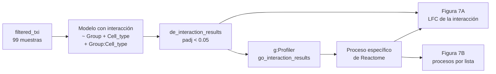
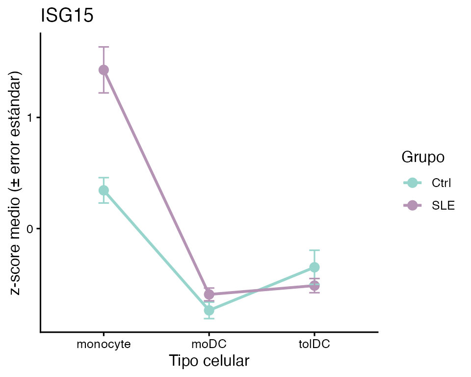
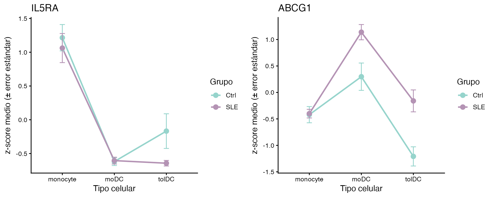
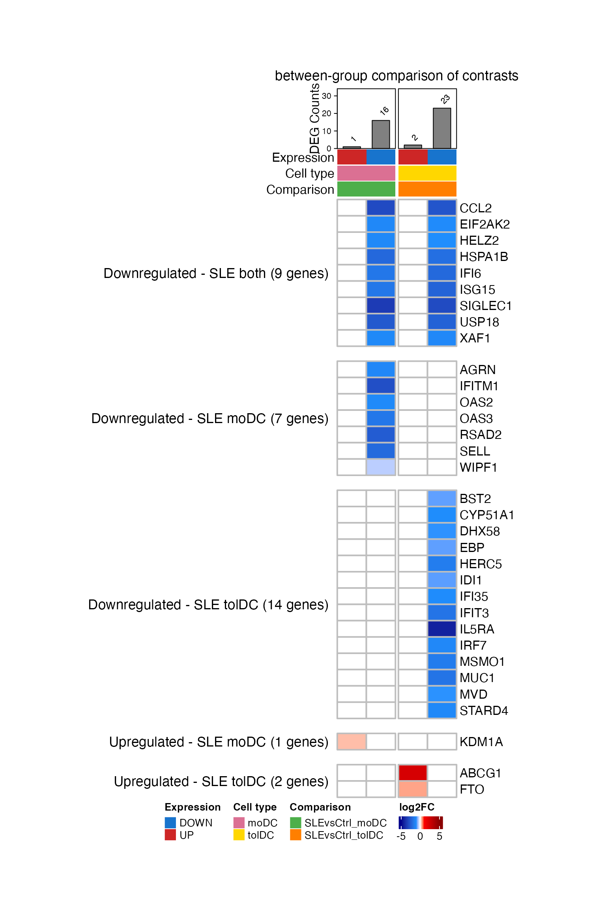
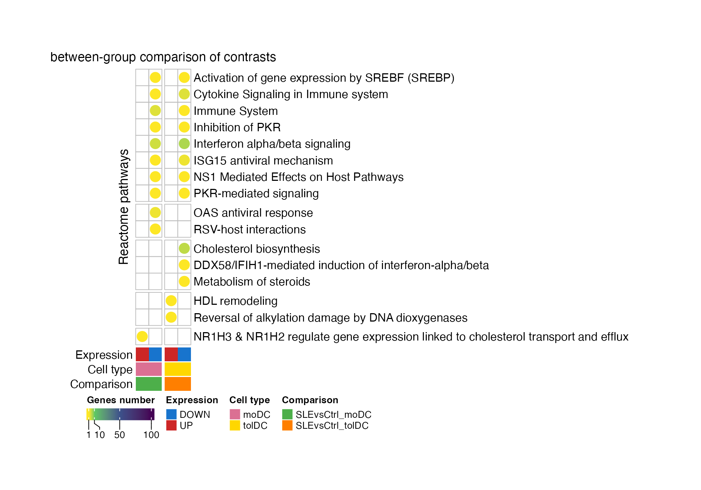
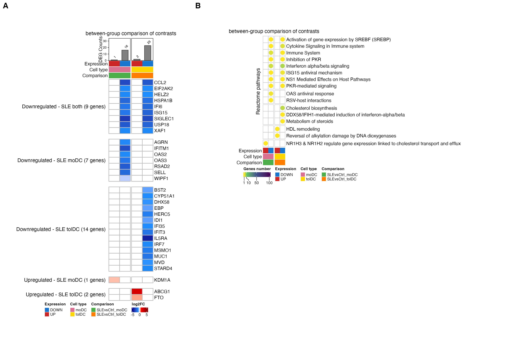

# Lección 7: ¿Se diferencian igual las células de pacientes y controles?

## Bienvenida

En la lección 5 vimos que, al diferenciarse, los monocitos de pacientes
y de controles cambian miles de genes, y que los cambios se parecen
mucho. Pero “parecerse” no es “ser iguales”. En esta lección hacemos la
pregunta de forma estadística: **¿hay genes cuyo cambio de monocito a
célula dendrítica es distinto en las pacientes con lupus?** Para
responderla usaremos un **modelo con interacción**, que compara
directamente los contrastes de ambos grupos.

**Lo que necesitas saber antes:** haber hecho la lección [Diferenciación
de monocitos a células
dendríticas](https://eveliacoss.github.io/GeneExprLupusMx/articles/l5_DEGs_monocytes_diff_es.md).

**Al terminar podrás:**

1.  Explicar qué es una **interacción** y por qué se describe como una
    “diferencia de diferencias”.
2.  Ajustar un modelo `~ Group + Cell_type + Group:Cell_type` con
    `DESeq2` e interpretar sus coeficientes.
3.  Visualizar una interacción con una gráfica de líneas.
4.  Resumir los genes con su **proceso específico** de Reactome.
5.  Reproducir los paneles **A y B de la Figura 7** del artículo.

**Tiempo estimado:** 1.5 horas.

### Mapa de la lección



## Glosario

Estos son los términos que usaremos. Vuelve aquí cada vez que lo
necesites.

- **Contraste**: una comparación entre dos condiciones; por ejemplo,
  moDC contra monocito.
- **Interacción**: ocurre cuando el efecto de un factor depende de otro.
  Aquí, cuando el cambio de monocito a célula dendrítica (factor
  `Cell_type`) depende de si la persona es paciente o control (factor
  `Group`).
- **Diferencia de diferencias**: el valor de una interacción. Es el
  cambio en las pacientes menos el cambio en los controles.
- **Coeficiente**: cada número que estima un modelo; `DESeq2` los lista
  con [`resultsNames()`](https://rdrr.io/pkg/DESeq2/man/results.html).
- **Proceso específico**: entre todos los términos enriquecidos en los
  que aparece un gen, el que tiene **menos** genes; el más concreto.

## 1. Preparación

``` r

library(GeneExprLupusMx) # datos del paquete
library(tidyverse)       # manipulación de tablas y gráficas
library(ComplexHeatmap)  # heatmaps
library(circlize)        # escalas de color para ComplexHeatmap
library(cowplot)         # unir gráficas en paneles
```

Colores y umbral (los mismos de las lecciones anteriores, más los de las
listas de esta lección):

``` r

cell_color       <- c(monocyte = "black", moDC = "palevioletred", tolDC = "gold1")
group_color      <- c(Ctrl = "#96d4ccff", SLE = "#b493b4ff")
expression_color <- c(UP = "firebrick3", DOWN = "dodgerblue3")
comparison_color <- c(SLEvsCtrl_moDC = "#4daf4a", SLEvsCtrl_tolDC = "#ff7f00")
lfc_color        <- colorRamp2(c(-5, -1, 0, 1, 5), c("darkblue", "dodgerblue", "white", "red", "darkred"))

padj_threshold <- 0.05
```

## 2. Paso 1: ¿qué es una interacción?

Tomemos un gen estimulado por interferón, `ISG15`. En la lección 5
calculamos su LFC de monocito a célula dendrítica en cada grupo:

``` r

sapply(de_celltype_results, function(df) round(df$log2FoldChange[df$gene == "ISG15"], 2))
#>  Ctrl_moDC Ctrl_tolDC   SLE_moDC  SLE_tolDC 
#>      -1.69      -0.95      -3.41      -3.27
```

`ISG15` baja al diferenciarse en ambos grupos, pero en las pacientes
baja **más**: en las moDC, −3.41 contra −1.69. La diferencia entre esos
dos cambios es la **interacción**:

``` math
\text{interacción} = \text{LFC}_{\text{SLE}} - \text{LFC}_{\text{Ctrl}} = -3.41 - (-1.69) = -1.72
```

Una gráfica de líneas lo hace evidente. Graficamos el z-score medio de
cada grupo en cada tipo celular, usando el checkpoint `zscore_mat`:

``` r

plot_interaction <- function(gene) {
  metadata_cleaned %>%
    mutate(zscore    = zscore_mat[gene, as.character(sample_ID)],
           Cell_type = factor(Cell_type, levels = c("monocyte", "moDC", "tolDC"))) %>%
    group_by(Group, Cell_type) %>%
    summarise(mean_z = mean(zscore), se = sd(zscore) / sqrt(n()), .groups = "drop") %>%
    ggplot(aes(x = Cell_type, y = mean_z, color = Group, group = Group)) +
    geom_line(linewidth = 1) +
    geom_point(size = 3) +
    geom_errorbar(aes(ymin = mean_z - se, ymax = mean_z + se), width = 0.1) +
    scale_color_manual(values = group_color) +
    labs(title = gene, x = "Tipo celular", y = "z-score medio (± error estándar)", color = "Grupo") +
    theme_classic(base_size = 12)
}
```

``` r

plot_interaction("ISG15")
```



- Si las dos líneas fueran **paralelas**, el gen cambiaría igual en
  ambos grupos: no habría interacción.
- Aquí **no son paralelas**: las pacientes parten de un valor mucho más
  alto en los monocitos (la firma de interferón de la lección 3) y caen
  más al diferenciarse.

**Una interacción negativa no significa “más bajo en las pacientes”.**
Significa que el gen **baja más** (o sube menos) al diferenciarse en las
pacientes. En el caso de `ISG15`, las moDC de ambos grupos terminan con
niveles parecidos; lo que cambia es la pendiente, porque las pacientes
parten de un valor más alto.

## 3. Paso 2: el modelo con interacción

En la lección 5 ajustamos un modelo para cada grupo y comparamos sus LFC
“a ojo”. Para obtener un **valor p** de la diferencia, hay que ajustar
un solo modelo con las 99 muestras y un término de interacción,
`Group:Cell_type`:

``` r

library(DESeq2)

dds <- DESeqDataSetFromTximport(txi     = filtered_txi,
                                colData = metadata_cleaned,
                                design  = ~ Group + Cell_type + Group:Cell_type)
dds$Group     <- relevel(dds$Group, ref = "Ctrl")         # referencia: controles
dds$Cell_type <- relevel(dds$Cell_type, ref = "monocyte") # referencia: monocitos
dds <- DESeq(dds) # tarda unos minutos

resultsNames(dds)
#> [1] "Intercept"                   "Group_SLE_vs_Ctrl"
#> [3] "Cell_type_moDC_vs_monocyte"  "Cell_type_tolDC_vs_monocyte"
#> [5] "GroupSLE.Cell_typemoDC"      "GroupSLE.Cell_typetolDC"
```

Cada coeficiente responde una pregunta distinta:

| Coeficiente | ¿Qué mide? |
|----|----|
| `Intercept` | La expresión de referencia: monocitos de los controles |
| `Group_SLE_vs_Ctrl` | SLE contra Ctrl, **en los monocitos** |
| `Cell_type_moDC_vs_monocyte` | moDC contra monocito, **en los controles** |
| `Cell_type_tolDC_vs_monocyte` | tolDC contra monocito, **en los controles** |
| `GroupSLE.Cell_typemoDC` | **Interacción:** cuánto cambia, en las pacientes, la diferencia moDC contra monocito |
| `GroupSLE.Cell_typetolDC` | **Interacción:** lo mismo para tolDC contra monocito |

Nos interesan los dos últimos:

``` r

de_interaction_results <- lapply(c(moDC = "moDC", tolDC = "tolDC"), function(cell) {
  res <- as.data.frame(results(dds, alpha = 0.05, name = paste0("GroupSLE.Cell_type", cell)))
  data.frame(gene = rownames(res), res, row.names = NULL)
})
```

Como el modelo tarda en ajustarse, el paquete incluye el resultado como
checkpoint, `de_interaction_results`:

``` r

names(de_interaction_results)
#> [1] "moDC"  "tolDC"
head(de_interaction_results$tolDC[order(de_interaction_results$tolDC$padj), ])
#>         gene   baseMean log2FoldChange     lfcSE      stat       pvalue
#> 7705   ISG15 1571.72540     -2.3242527 0.3964015 -5.863381 4.535367e-09
#> 7348    IFI6 5171.46042     -2.1636287 0.4035187 -5.361905 8.234902e-08
#> 7345   IFI35 1270.40241     -1.1028139 0.2149937 -5.129518 2.904851e-07
#> 1690    BST2 6388.65236     -0.8485252 0.1706817 -4.971388 6.647534e-07
#> 16889 SH3TC2   18.24524     -4.6162394 0.9279896 -4.974452 6.543263e-07
#> 5079    ETV7   57.87252     -3.7694878 0.7671254 -4.913783 8.933559e-07
#>               padj
#> 7705  6.634789e-05
#> 7348  6.023419e-04
#> 7345  1.416502e-03
#> 1690  1.944936e-03
#> 16889 1.944936e-03
#> 5079  2.178151e-03
```

Comprobemos que el LFC de la interacción es la diferencia de diferencias
que calculamos a mano para `ISG15`:

``` r

sapply(de_interaction_results, function(df) round(df$log2FoldChange[df$gene == "ISG15"], 2))
#>  moDC tolDC 
#> -1.73 -2.32
```

En las moDC obtenemos −1.73, prácticamente el −1.72 que calculamos
restando. La pequeña diferencia viene de que en la lección 5 el modelo
de las pacientes también se ajustó por actividad de la enfermedad y
dosis de glucocorticoides.

## 4. Paso 3: ¿qué genes cambian distinto?

Un gen tiene una interacción significativa si su `padj < 0.05`. Lo
clasificamos como `UP` o `DOWN` según el signo del LFC, y nombramos cada
lista como `SLEvsCtrl_<dirección>_<tipo celular>`:

``` r

deg_df <- imap_dfr(de_interaction_results, function(df, cell) {
  df %>%
    filter(!is.na(padj), padj < padj_threshold) %>%
    mutate(query = paste0("SLEvsCtrl_", ifelse(log2FoldChange > 0, "UP", "DOWN"), "_", cell))
})

query_order <- c("SLEvsCtrl_UP_moDC", "SLEvsCtrl_DOWN_moDC", "SLEvsCtrl_UP_tolDC", "SLEvsCtrl_DOWN_tolDC")
dplyr::count(deg_df, query = factor(query, levels = query_order))
#>                  query  n
#> 1    SLEvsCtrl_UP_moDC  1
#> 2  SLEvsCtrl_DOWN_moDC 28
#> 3   SLEvsCtrl_UP_tolDC  3
#> 4 SLEvsCtrl_DOWN_tolDC 38
```

**Son muy pocos genes**, comparados con los miles de la lección 5: casi
todo el programa de diferenciación es el mismo en pacientes y controles.
Y la mayoría de las interacciones son **negativas**: son genes que bajan
más al diferenciarse en las pacientes.

Aquí solo pedimos `padj < 0.05`. El LFC de una interacción es una
diferencia entre dos cambios, y todos estos genes ya tienen diferencias
de al menos 0.34 en valor absoluto.

**Reto 1.** ¿Cuántos de estos genes tienen además una interacción
grande, con `|log2FoldChange| ≥ 1`?

Ver solución

``` r

deg_df %>%
  group_by(query) %>%
  summarise(total = n(), lfc_1 = sum(abs(log2FoldChange) >= 1))
#> # A tibble: 4 × 3
#>   query                total lfc_1
#>   <chr>                <int> <int>
#> 1 SLEvsCtrl_DOWN_moDC     28    23
#> 2 SLEvsCtrl_DOWN_tolDC    38    28
#> 3 SLEvsCtrl_UP_moDC        1     0
#> 4 SLEvsCtrl_UP_tolDC       3     1
```

La mayoría de los genes de las listas `DOWN` tienen una interacción
mayor a 1: en las pacientes, su caída al diferenciarse es al menos el
doble que en los controles.

**Reto 2.** Usa `plot_interaction()` para graficar `IL5RA` y `ABCG1`.
¿Qué tipo celular explica cada interacción?

Ver solución

``` r

plot_grid(plot_interaction("IL5RA"), plot_interaction("ABCG1"), nrow = 1)
```



- **`IL5RA`** baja en las tolDC de ambos grupos, pero mucho más en las
  pacientes (interacción en tolDC, LFC ≈ −4.3).
- **`ABCG1`**, un transportador de colesterol, baja de monocito a tolDC
  en los controles, pero sube un poco en las pacientes: las líneas se
  separan (interacción en tolDC, LFC ≈ 2.4).

## 5. Paso 4: ¿en qué procesos participan?

Como en las lecciones anteriores, buscamos términos enriquecidos en cada
lista con g:Profiler (<GO:BP>, KEGG y Reactome):

``` r

library(gprofiler2)
set_base_url("https://biit.cs.ut.ee/gprofiler_archive3/e113_eg59_p19") # versión archivada (junio de 2025)

deg_lists <- split(deg_df$gene, deg_df$query)
gost_res <- gost(deg_lists, organism = "hsapiens", correction_method = "fdr",
                 user_threshold = 0.05, sources = c("GO:BP", "KEGG", "REAC"), evcodes = TRUE)
```

El resultado está en el checkpoint `go_interaction_results`:

``` r

attr(go_interaction_results, "gprofiler_version")
#> [1] "e113_eg59_p19_903d2221"
go_interaction_results %>%
  dplyr::count(query, source) %>%
  pivot_wider(names_from = source, values_from = n)
#> # A tibble: 4 × 4
#>   query                `GO:BP`  KEGG  REAC
#>   <chr>                  <int> <int> <int>
#> 1 SLEvsCtrl_DOWN_moDC      228     5    12
#> 2 SLEvsCtrl_DOWN_tolDC     190     3    14
#> 3 SLEvsCtrl_UP_moDC        115    NA    18
#> 4 SLEvsCtrl_UP_tolDC        94     2     9
```

Para la figura usamos solo **Reactome (REAC)**. A cada gen le asignamos
su **proceso específico**: el término de Reactome con menos genes en el
que aparece (como en la lección 4):

``` r

reac_specific <- go_interaction_results %>%
  filter(source == "REAC") %>%
  separate_rows(intersection, sep = ",") %>%
  dplyr::rename(gene = intersection) %>%
  group_by(gene) %>%
  summarise(specific_process = term_name[which.min(term_size)], .groups = "drop")

deg_reac <- inner_join(deg_df, reac_specific, by = "gene")
dplyr::n_distinct(deg_reac$gene) # genes con anotación en Reactome
#> [1] 33
dplyr::count(deg_reac, query = factor(query, levels = query_order))
#>                  query  n
#> 1    SLEvsCtrl_UP_moDC  1
#> 2  SLEvsCtrl_DOWN_moDC 16
#> 3   SLEvsCtrl_UP_tolDC  2
#> 4 SLEvsCtrl_DOWN_tolDC 23
```

De los 57 genes con interacción significativa, 33 tienen un proceso de
Reactome. Esos son los genes de la Figura 7A.

## 6. Paso 5: genes compartidos y exclusivos (Figura 7A)

Hacemos una matriz de genes × listas con el LFC de la interacción; queda
vacía (`NA`) si el gen no está en esa lista:

``` r

lfc_mat <- deg_reac %>%
  dplyr::select(gene, query, log2FoldChange) %>%
  pivot_wider(names_from = query, values_from = log2FoldChange) %>%
  column_to_rownames("gene") %>%
  as.matrix()
lfc_mat <- lfc_mat[order(rownames(lfc_mat)), query_order] # genes en orden alfabético
head(lfc_mat)
#>         SLEvsCtrl_UP_moDC SLEvsCtrl_DOWN_moDC SLEvsCtrl_UP_tolDC
#> ABCG1                  NA                  NA            2.35661
#> AGRN                   NA           -1.251214                 NA
#> BST2                   NA                  NA                 NA
#> CCL2                   NA           -3.075918                 NA
#> CYP51A1                NA                  NA                 NA
#> DHX58                  NA                  NA                 NA
#>         SLEvsCtrl_DOWN_tolDC
#> ABCG1                     NA
#> AGRN                      NA
#> BST2              -0.8485252
#> CCL2              -2.7396710
#> CYP51A1           -1.0842723
#> DHX58             -0.9784128
```

Agrupamos los genes según en qué listas aparecen. Con la misma función
agruparemos después los procesos de la Figura 7B:

``` r

list_direction <- sub("SLEvsCtrl_(UP|DOWN)_.*", "\\1", query_order) # UP, DOWN, UP, DOWN

# p. ej., "NA_DOWN_NA_DOWN" = está en DOWN_moDC y en DOWN_tolDC
presence_pattern <- function(mat) {
  apply(!is.na(mat), 1, function(x) paste(ifelse(x, list_direction, "NA"), collapse = "_"))
}

pattern_labels <- c(NA_DOWN_NA_DOWN = "Downregulated - SLE both",
                    NA_DOWN_NA_NA   = "Downregulated - SLE moDC",
                    NA_NA_NA_DOWN   = "Downregulated - SLE tolDC",
                    UP_NA_NA_NA     = "Upregulated - SLE moDC",
                    NA_NA_UP_NA     = "Upregulated - SLE tolDC")

gene_pattern <- factor(pattern_labels[presence_pattern(lfc_mat)], levels = pattern_labels)
table(gene_pattern)
#> gene_pattern
#>  Downregulated - SLE both  Downregulated - SLE moDC Downregulated - SLE tolDC 
#>                         9                         7                        14 
#>    Upregulated - SLE moDC   Upregulated - SLE tolDC 
#>                         1                         2

# etiqueta de cada grupo con su número de genes
gene_split <- gene_pattern
levels(gene_split) <- paste0(levels(gene_pattern), " (", table(gene_pattern), " genes)")
```

Ahora las anotaciones de las columnas. Cada lista se identifica por su
dirección, su tipo celular y su comparación; encima va un *barplot* con
el número de genes de cada lista:

``` r

column_info <- tibble(query      = query_order,
                      Expression = list_direction,
                      Cell_type  = sub(".*_", "", query),
                      Comparison = sub("_(UP|DOWN)", "", query))

column_anno <- function() {
  HeatmapAnnotation("Expression" = column_info$Expression,
                    "Cell type"  = column_info$Cell_type,
                    "Comparison" = column_info$Comparison,
                    col = list("Expression" = expression_color,
                               "Cell type"  = cell_color,
                               "Comparison" = comparison_color),
                    annotation_name_side = "left")
}

deg_counts <- colSums(!is.na(lfc_mat))
counts_anno <- HeatmapAnnotation(
  "DEG Counts" = anno_barplot(deg_counts, add_numbers = TRUE, height = unit(2, "cm")),
  annotation_name_side = "left")
```

``` r

ht_fig7a <- Heatmap(
  lfc_mat, name = "log2FC", col = lfc_color,
  na_col = "white", rect_gp = gpar(col = "gray", lwd = 2),
  cluster_rows = FALSE, cluster_columns = FALSE, show_column_names = FALSE,
  column_split = column_info$Comparison, column_title = "between-group comparison of contrasts",
  row_split = gene_split, row_title_rot = 0, row_gap = unit(5, "mm"),
  top_annotation = c(counts_anno, column_anno()),
  heatmap_legend_param = list(direction = "horizontal"),
  width = unit(4, "cm"), height = unit(20, "cm"))

ht_opt$message <- FALSE
draw(ht_fig7a, merge_legends = TRUE,
     heatmap_legend_side = "bottom", annotation_legend_side = "bottom")
```



**¿Qué observas?**

- Casi todos los genes son **azules**: bajan más al diferenciarse en las
  pacientes.
- Los **9 genes compartidos** por moDC y tolDC son casi todos ISG
  (`ISG15`, `IFI6`, `USP18`, `XAF1`, `SIGLEC1`…). Las pacientes parten
  de monocitos con una firma de interferón alta, y esa firma se pierde
  al diferenciarse.
- Las **tolDC** tienen además genes de la síntesis de colesterol
  (`CYP51A1`, `MSMO1`, `MVD`, `IDI1`, `EBP`), y suben `ABCG1`, que saca
  colesterol de la célula.
- En las moDC, solo `KDM1A` tiene una interacción positiva.

**Reto 3.** ¿Cuáles de los genes de la Figura 7A son ISG? Usa la lista
`isg_genes` de la lección 4.

Ver solución

``` r

isg_in_fig <- rownames(lfc_mat)[rownames(lfc_mat) %in% isg_genes$genes]
isg_in_fig
#>  [1] "BST2"    "CCL2"    "DHX58"   "EIF2AK2" "HELZ2"   "HERC5"   "IFI35"  
#>  [8] "IFI6"    "IFIT3"   "IFITM1"  "IRF7"    "ISG15"   "OAS2"    "OAS3"   
#> [15] "RSAD2"   "SELL"    "USP18"   "XAF1"
table(gene_pattern[rownames(lfc_mat) %in% isg_genes$genes])
#> 
#>  Downregulated - SLE both  Downregulated - SLE moDC Downregulated - SLE tolDC 
#>                         7                         5                         6 
#>    Upregulated - SLE moDC   Upregulated - SLE tolDC 
#>                         0                         0
```

Los ISG están en los genes compartidos y en los que bajan en cada tipo
celular; ninguno está entre los que suben.

## 7. Paso 6: procesos por lista (Figura 7B)

Contamos cuántos genes de cada lista pertenecen a cada proceso
específico, y dejamos vacías las celdas sin genes:

``` r

process_mat <- deg_reac %>%
  dplyr::count(specific_process, query) %>%
  pivot_wider(names_from = query, values_from = n) %>%
  column_to_rownames("specific_process") %>%
  as.matrix()
process_mat <- process_mat[order(tolower(rownames(process_mat))), query_order] # orden alfabético

process_pattern <- presence_pattern(process_mat) # grupos en orden alfabético
table(process_pattern)
#> process_pattern
#> NA_DOWN_NA_DOWN   NA_DOWN_NA_NA   NA_NA_NA_DOWN     NA_NA_UP_NA     UP_NA_NA_NA 
#>               8               2               3               2               1
```

Cada celda lleva un círculo coloreado según el número de genes. Lo
dibujamos con `layer_fun`, como en la lección 5:

``` r

count_color <- colorRamp2(c(1, 10, 50, 100), c("#FDE725", "#5DC863", "#3B528B", "#440154"))

ht_fig7b <- Heatmap(
  process_mat, name = "Genes number", col = count_color, na_col = "white",
  cluster_rows = FALSE, cluster_columns = FALSE, show_column_names = FALSE,
  row_names_max_width = max_text_width(rownames(process_mat)), # nombres largos completos
  rect_gp = gpar(type = "none"),
  layer_fun = function(j, i, x, y, w, h, fill) {
    grid.rect(x = x, y = y, width = w, height = h, gp = gpar(col = "gray", fill = NA))
    value <- pindex(process_mat, i, j)
    keep  <- !is.na(value) # solo celdas con genes
    if (any(keep)) {
      grid.circle(x = x[keep], y = y[keep], r = unit(2, "mm"),
                  gp = gpar(fill = count_color(value[keep]), col = NA))
    }
  },
  column_split = column_info$Comparison, column_title = "between-group comparison of contrasts",
  row_split = process_pattern, row_title = "Reactome pathways",
  bottom_annotation = column_anno(),
  heatmap_legend_param = list(at = c(1, 10, 50, 100), direction = "horizontal"),
  width = unit(2, "cm"), height = unit(10, "cm"))

draw(ht_fig7b, merge_legends = TRUE,
     heatmap_legend_side = "bottom", annotation_legend_side = "bottom")
```



**¿Qué observas?**

- Los procesos de **interferón y respuesta antiviral** (“Interferon
  alpha/beta signaling”, “ISG15 antiviral mechanism”, “PKR-mediated
  signaling”) aparecen en los genes que bajan en **ambos** tipos
  celulares.
- El **metabolismo del colesterol** (“Cholesterol biosynthesis”,
  “Metabolism of steroids”) aparece solo en las **tolDC**, y “HDL
  remodeling”, con `ABCG1`, entre los genes que suben en ellas.
- En las moDC, el único gen que sube (`KDM1A`) se asocia con el
  transporte de colesterol (“NR1H3 & NR1H2 regulate gene expression…”).

**Reto 4.** ¿Qué genes forman cada proceso de la Figura 7B?

Ver solución

``` r

deg_reac %>%
  group_by(specific_process) %>%
  summarise(genes = paste(sort(unique(gene)), collapse = ", "))
#> # A tibble: 16 × 2
#>    specific_process                                                        genes
#>    <chr>                                                                   <chr>
#>  1 Activation of gene expression by SREBF (SREBP)                          HELZ2
#>  2 Cholesterol biosynthesis                                                CYP5…
#>  3 Cytokine Signaling in Immune system                                     CCL2…
#>  4 DDX58/IFIH1-mediated induction of interferon-alpha/beta                 DHX58
#>  5 HDL remodeling                                                          ABCG1
#>  6 ISG15 antiviral mechanism                                               HERC…
#>  7 Immune System                                                           SELL…
#>  8 Inhibition of PKR                                                       EIF2…
#>  9 Interferon alpha/beta signaling                                         BST2…
#> 10 Metabolism of steroids                                                  STAR…
#> 11 NR1H3 & NR1H2 regulate gene expression linked to cholesterol transport… KDM1A
#> 12 NS1 Mediated Effects on Host Pathways                                   ISG15
#> 13 OAS antiviral response                                                  OAS2…
#> 14 PKR-mediated signaling                                                  HSPA…
#> 15 RSV-host interactions                                                   AGRN 
#> 16 Reversal of alkylation damage by DNA dioxygenases                       FTO
```

## 8. Para terminar: la Figura 7 del artículo

Reproducimos los paneles A y B. Como en las lecciones anteriores,
capturamos los *heatmaps* como objetos gráficos y los unimos con
[`plot_grid()`](https://wilkelab.org/cowplot/reference/plot_grid.html):

``` r

grab <- function(ht, ...) {
  grid::grid.grabExpr(draw(ht, merge_legends = TRUE, heatmap_legend_side = "bottom",
                           annotation_legend_side = "bottom", ...), wrap.grobs = TRUE)
}

figure_7 <- plot_grid(
  grab(ht_fig7a, padding = unit(c(2, 2, 12, 2), "mm")),
  plot_grid(grab(ht_fig7b, padding = unit(c(2, 2, 12, 2), "mm")), NULL,
            ncol = 1, rel_heights = c(0.6, 0.4), labels = c("B", ""), label_size = 20),
  labels = c("A", ""), label_size = 20, nrow = 1, rel_widths = c(0.38, 0.62))
figure_7
```



**Figura 7.** Células dendríticas derivadas de monocitos (moDC y tolDC
*in vitro*) y programas transcripcionales asociados, obtenidos al
comparar SLE contra Ctrl. **(A)** *Heatmap* de los 33 DEG compartidos o
exclusivos de las moDC y las tolDC, usando los monocitos como
referencia: genes cuyo cambio de monocito a célula dendrítica es
distinto en las pacientes que en los controles (término de interacción
`Group:Cell_type` de `DESeq2`; padj \< 0.05) y que tienen anotación en
Reactome. 9 genes bajan en ambos tipos celulares, 7 solo en las moDC y
14 solo en las tolDC; 1 sube solo en las moDC y 2 solo en las tolDC. La
escala de color indica el LFC de la interacción: negativo (azul) si el
gen baja más al diferenciarse en las pacientes y positivo (rojo) si sube
más. Arriba se muestra el número de DEG de cada lista. **(B)** Procesos
biológicos significativos (Reactome; g:Profiler, prueba hipergeométrica
con corrección FDR) implicados en las pacientes en estas comparaciones.
Cada gen se asigna a su proceso más específico; el color del círculo
indica el número de genes. SLE, lupus eritematoso sistémico; Ctrl,
control sano; moDC, células dendríticas derivadas de monocitos; tolDC,
células dendríticas tolerogénicas; DEG, genes diferencialmente
expresados; LFC, log2 fold change.

La figura original se encuentra en el
[artículo](https://www.frontiersin.org/journals/immunology/articles/10.3389/fimmu.2026.1771959/full).

Para guardarla en alta resolución:

``` r

ggsave("Figura_7AB.png", figure_7, width = 18, height = 12, dpi = 300)
```

## 9. Resumen

| Paso | Función clave | ¿Para qué? |
|----|----|----|
| Ver una interacción | `plot_interaction()` | Comparar las pendientes de dos grupos |
| Modelo con interacción | `~ Group + Cell_type + Group:Cell_type` | Probar si un contraste cambia entre grupos |
| Leer coeficientes | [`resultsNames()`](https://rdrr.io/pkg/DESeq2/man/results.html), `results(name = ...)` | Elegir la pregunta correcta |
| Seleccionar genes | `padj < 0.05` y signo del LFC | Separar listas UP y DOWN |
| Resumir funciones | proceso específico de Reactome | Ver procesos en lugar de genes |

### Errores comunes de principiante

- **Comparar “a ojo” los LFC de dos modelos separados**: da una idea,
  pero no un valor p. Para probar la diferencia hay que usar un término
  de interacción.
- **Leer una interacción negativa como “más bajo en las pacientes”**:
  significa que el gen baja más al diferenciarse; los valores absolutos
  pueden seguir siendo mayores.
- **Olvidar las referencias**: los coeficientes principales
  (`Cell_type_moDC_vs_monocyte`) describen a los **controles**, no a
  todas las muestras.

## 10. ¿Y después?

Las células de las pacientes se diferencian casi igual que las de los
controles. Las pocas diferencias se concentran en dos programas: la
**firma de interferón**, que las pacientes traen desde los monocitos y
pierden al diferenciarse, y el **metabolismo del colesterol** en las
tolDC. Si quieres profundizar, puedes preguntar: ¿qué factores de
transcripción regulan estos genes?

[← Lección anterior: La firma de las
tolDC](https://eveliacoss.github.io/GeneExprLupusMx/articles/l6_DEGs_tolDcs_es.md)

[↑ Inicio](#top "Volver al inicio de la página")

## Información de la sesión

``` r

sessionInfo()
#> R version 4.6.0 (2026-04-24)
#> Platform: aarch64-apple-darwin23
#> Running under: macOS Tahoe 26.6.2
#> 
#> Matrix products: default
#> BLAS:   /Library/Frameworks/R.framework/Versions/4.6/Resources/lib/libRblas.0.dylib 
#> LAPACK: /Library/Frameworks/R.framework/Versions/4.6/Resources/lib/libRlapack.dylib;  LAPACK version 3.12.1
#> 
#> locale:
#> [1] en_US.UTF-8/en_US.UTF-8/en_US.UTF-8/C/en_US.UTF-8/en_US.UTF-8
#> 
#> time zone: America/Mexico_City
#> tzcode source: internal
#> 
#> attached base packages:
#> [1] grid      stats     graphics  grDevices utils     datasets  methods  
#> [8] base     
#> 
#> other attached packages:
#>  [1] cowplot_1.2.0              circlize_0.4.18           
#>  [3] ComplexHeatmap_2.28.0      lubridate_1.9.5           
#>  [5] forcats_1.0.1              stringr_1.6.0             
#>  [7] dplyr_1.2.1                purrr_1.2.2               
#>  [9] readr_2.2.0                tidyr_1.3.2               
#> [11] tibble_3.3.1               ggplot2_4.0.3             
#> [13] tidyverse_2.0.0            GeneExprLupusMx_0.0.0.9000
#> 
#> loaded via a namespace (and not attached):
#>  [1] shape_1.4.6.1       gtable_0.3.6        rjson_0.2.23       
#>  [4] xfun_0.60           bslib_0.11.0        htmlwidgets_1.6.4  
#>  [7] GlobalOptions_0.1.4 tzdb_0.5.0          vctrs_0.7.3        
#> [10] tools_4.6.0         generics_0.1.4      stats4_4.6.0       
#> [13] parallel_4.6.0      cluster_2.1.8.2     pkgconfig_2.0.3    
#> [16] RColorBrewer_1.1-3  S7_0.2.2            desc_1.4.3         
#> [19] S4Vectors_0.50.1    lifecycle_1.0.5     compiler_4.6.0     
#> [22] farver_2.1.2        textshaping_1.0.5   codetools_0.2-20   
#> [25] clue_0.3-68         htmltools_0.5.9     sass_0.4.10        
#> [28] yaml_2.3.12         pillar_1.11.1       pkgdown_2.2.1      
#> [31] crayon_1.5.3        jquerylib_0.1.4     cachem_1.1.0       
#> [34] magick_2.9.1        iterators_1.0.14    foreach_1.5.2      
#> [37] tidyselect_1.2.1    digest_0.6.39       stringi_1.8.9      
#> [40] labeling_0.4.3      fastmap_1.2.0       colorspace_2.1-3   
#> [43] cli_3.6.6           magrittr_2.0.5      utf8_1.2.6         
#> [46] withr_3.0.3         scales_1.4.0        timechange_0.4.0   
#> [49] rmarkdown_2.31      matrixStats_1.5.0   otel_0.2.0         
#> [52] ragg_1.5.2          png_0.1-9           GetoptLong_1.1.1   
#> [55] hms_1.1.4           evaluate_1.0.5      knitr_1.51         
#> [58] IRanges_2.46.0      doParallel_1.0.17   rlang_1.3.0        
#> [61] Rcpp_1.1.2          glue_1.8.1          BiocGenerics_0.58.1
#> [64] rstudioapi_0.19.0   jsonlite_2.0.0      R6_2.6.1           
#> [67] systemfonts_1.3.2   fs_2.1.0
```
