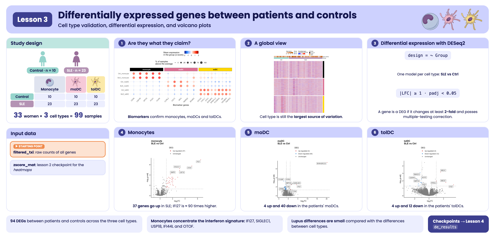

```{r, include = FALSE}
knitr::opts_chunk$set(
  collapse = TRUE,
  comment = "#>",
  message = FALSE,
  warning = FALSE,
  fig.align = "center",
  fig.width = 7,
  fig.height = 4.5
)
```

```{css, echo = FALSE, file = "../lesson.css"}
```

## Welcome

In the previous lessons you met the participants and explored gene expression: you saw that cell type dominates the variation and that some patients have an interferon signature. Now we will ask the central question of the study using statistics: **which genes change their expression in lupus, within each cell type?**

**What you need to know beforehand:** having completed the lesson [From RNA-seq counts to data exploration](intro_RNAseq_en.html) (normalization, VST, z-scores, and PCA).

**By the end you will be able to:**

1. Validate the identity of the cell types with **biomarker** genes.
2. Run a **differential expression** analysis with `DESeq2` and understand each column of its results.
3. Define differentially expressed genes (**DEGs**) with thresholds on the *log2 fold change* and the adjusted p-value.
4. Build and interpret **volcano plots**.
5. Reproduce **Figure 2** of the article.

**Estimated time:** 1.5 hours.

### Lesson map

```{=html}
<pre class="mermaid">
flowchart LR
  A["Package data<br/>counts + metadata"] --> B["1. Biomarkers:<br/>are these the right cells?"]
  A --> C["2. Global heatmap<br/>by cell type"]
  A --> D["3. DESeq2:<br/>SLE vs Ctrl by cell type"]
  D --> E["4. DEGs:<br/>|LFC| ≥ 1 and padj &lt; 0.05"]
  E --> F["5. Volcano plots"]
  B --> G["Figure 2"]
  C --> G
  F --> G
</pre>
<script type="module">
  import mermaid from "https://cdn.jsdelivr.net/npm/mermaid@11/dist/mermaid.esm.min.mjs";
  mermaid.initialize({ startOnLoad: true });
</script>
```

## Glossary

These are the terms we will use. Come back here whenever you need to.

- **Biomarker**: a gene whose expression characterizes a cell type.
- **Differential expression**: difference in the expression of a gene between two conditions (here, SLE versus Ctrl).
- **DEG** (*differentially expressed gene*): a gene that is differentially expressed according to the thresholds we choose.
- **Fold change**: how many times the expression changes. A *fold change* of 2 means double.
- **log2 fold change (LFC)**: the *fold change* on a log2 scale. LFC = 1 is double; LFC = −1, half; LFC = 0, no change.
- **Wald test**: test used by `DESeq2` to assess whether the LFC is different from zero.
- **p-value**: probability of observing data as extreme as ours if the null hypothesis were true (here, if there were actually no difference).
- **Multiple comparisons**: when testing thousands of genes, some will come out significant by chance.
- **FDR** (*false discovery rate*): expected proportion of false positives among the genes we declare significant.
- **Benjamini–Hochberg (BH)**: method that corrects p-values to control the FDR.
- **padj**: p-value adjusted by BH. This is the one used to decide.
- **Independent filtering**: `DESeq2` does not compute `padj` for genes with very few reads, because they lack statistical power; they are left as `NA`.
- **Volcano plot**: plot of the LFC (x axis) against significance (y axis) for all genes.

```{r lesson_overview, echo = FALSE, out.width = "100%", fig.cap = "Visual summary of lesson 3."}

```

## 1. Setup

```{r setup}
library(GeneExprLupusMx) # package data and heatmap functions
library(DESeq2)          # differential expression
library(tidyverse)       # table manipulation and plots
library(ComplexHeatmap)  # heatmaps
library(circlize)        # color scales for ComplexHeatmap
library(ggrepel)         # non-overlapping labels
library(cowplot)         # combine plots into a panel

# Large package objects: downloaded only the first time (see ?download_data)
filtered_txi <- download_data("filtered_txi")
zscore_mat   <- download_data("zscore_mat")
```

Colors and thresholds we will use throughout the lesson:

```{r colores}
cell_color  <- c(monocyte = "black", moDC = "palevioletred", tolDC = "gold1")
group_color <- c(Ctrl = "#96d4ccff", SLE = "#b493b4ff")

lfc_threshold  <- 1    # minimum |log2 fold change|
padj_threshold <- 0.05 # maximum adjusted p-value
```

### Starting point

This lesson uses the package data: the counts (`filtered_txi`), the metadata (`metadata_cleaned`), the volunteer information (`volunteer_info`), and the `zscore_mat` checkpoint from the previous lesson.

For the differential expression analysis we start from the **raw counts of all genes**. We create a `DESeqDataSet` object with the design `~ Group` (SLE versus Ctrl), which we will later split by cell type:

```{r full_dds}
metadata_cleaned$Group <- relevel(metadata_cleaned$Group, ref = "Ctrl")

full_dds <- DESeqDataSetFromTximport(txi     = filtered_txi,
                                     colData = metadata_cleaned,
                                     design  = ~ Group)
full_dds
```

::: {.alert .alert-info}
**Why don't we use the `dds` checkpoint?** In the previous lesson we filtered lowly expressed genes for visualization. For differential expression this is not needed: `DESeq2` applies its own **independent filtering** and leaves `padj = NA` for genes without information. Starting from all the counts lets `DESeq2` decide which genes have enough information to be tested.
:::

## 2. **Step 1:** are the cells what they claim to be?

Before comparing patients against controls, let us check that each sample is of the cell type it claims to be. For this we use **biomarkers**: genes known to be expressed in one cell type and not in the others.

```{r markers}
markers <- list(
  monocyte = c("CD36", "CSF3R", "DPYD", "FCN1", "VCAN"),
  moDC     = c("CD1C", "IRF4", "NDRG2", "CCRL2", "SPARC"), # as in the published Figure 2B
  tolDC    = c("IGF2BP3", "CD163", "FCGR2A", "DTX1", "GK", "EPB41L3", "TNFSF9", "CXCL1", "EFEMP2")
)
marker_genes <- unlist(markers)
all(marker_genes %in% rownames(zscore_mat)) # are they all in the data?
```

For each combination of group and cell type we calculate two numbers per gene, based on the z-scores:

- **Mean expression (z-score):** positive if the gene is above its average in that group.
- **Percentage of samples above the average** (z-score > 0): how consistent that expression is across the samples in the group.

```{r marker_summary}
marker_df <- as.data.frame(zscore_mat[marker_genes, ]) %>%
  rownames_to_column("gene") %>%
  pivot_longer(-gene, names_to = "sample_ID", values_to = "expression") %>%
  left_join(dplyr::select(metadata_cleaned, sample_ID, Group, Cell_type), by = "sample_ID") %>%
  group_by(Group, Cell_type, gene) %>%
  summarise(mean_expression = mean(expression),
            pct_expressed   = 100 * mean(expression > 0),
            .groups = "drop") %>%
  mutate(condition    = paste(Group, Cell_type, sep = "_"),
         marker_group = factor(case_when(gene %in% markers$monocyte ~ "monocyte",
                                         gene %in% markers$moDC     ~ "moDC",
                                         gene %in% markers$tolDC    ~ "tolDC"),
                               levels = names(markers)))
head(marker_df)
```

We plot it as a *dot plot*: the color is the mean expression and the size is the percentage of samples.

```{r dotplot, fig.width = 10, fig.height = 5}
# minimum and maximum mean expression, for the color scale
min_val <- min(marker_df$mean_expression, na.rm = TRUE)
max_val <- max(marker_df$mean_expression, na.rm = TRUE)

p_markers <- marker_df %>%
  mutate(condition = factor(condition, levels = c("SLE_tolDC", "Ctrl_tolDC", "SLE_moDC",
                                                  "Ctrl_moDC", "SLE_monocyte", "Ctrl_monocyte"))) %>%
  ggplot(aes(x = gene, y = condition, color = mean_expression, size = pct_expressed)) +
  geom_point(alpha = 0.8) +
  scale_color_gradientn(
    colors = c("darkblue", "dodgerblue", "white", "red", "darkred"),
    values = scales::rescale(c(-2, min_val, 0, max_val, 2)),
    limits = c(-2, 2),
    oob = scales::squish # values outside [-2, 2] take the color of the end
  ) +
  ggh4x::facet_wrap2(
    ~ marker_group, scales = "free_x", nrow = 1,
    strip = ggh4x::strip_themed(
      background_x = lapply(cell_color, function(col) element_rect(fill = col)),
      text_x = list(element_text(color = "white", face = "bold"),
                    element_text(color = "white", face = "bold"),
                    element_text(color = "black", face = "bold")))) +
  labs(x = "Biomarker genes", y = NULL,
       color = "Mean expression\nin the group (z-score)",
       size = "% of samples\nabove the average") +
  theme_minimal(base_size = 13) +
  theme(legend.position = "top", legend.box = "vertical",
        axis.text.x = element_text(angle = 45, hjust = 1))
p_markers
```

**What do you observe?** Each group of biomarkers is red (high expression) exactly in its own cell type, in both controls and patients, and blue in the others. **The identity of the samples is correct**: we can trust the comparisons we will make.

## 3. **Step 2:** a global view with a *heatmap*

Before the statistics, let us look at all the genes at once. We will calculate the z-scores **within each cell type** (not across all samples), so that the color shows how each sample compares with the others of **its own cell type**.

The package function `get_heatmap_mat()` applies the VST transformation, removes genes with no variation, and calculates the z-scores:

```{r heatmap_mats}
cell_types <- c("monocyte", "moDC", "tolDC")

heatmap_mats <- lapply(cell_types, function(cell) {
  mat <- get_heatmap_mat(full_dds[, full_dds$Cell_type == cell])
  colnames(mat) <- sub("_.*", "", colnames(mat)) # QR011_0 -> QR011
  mat
})
names(heatmap_mats) <- cell_types
sapply(heatmap_mats, nrow) # genes with variation in each cell type
```

We rename the columns with the volunteer identifier (`QR011_0` → `QR011`): this way, in the three heatmaps, **each column is the same person**. We keep the genes present in all three and order the volunteers by group and disease activity:

```{r heatmap_order}
common_genes <- Reduce(intersect, lapply(heatmap_mats, rownames))
length(common_genes)

sample_info <- volunteer_info %>%
  arrange(Group, SLEDAI)

heatmap_mats <- lapply(heatmap_mats, function(mat) mat[common_genes, sample_info$Volunteer_ID])
```

Now we build one heatmap per cell type with the package's `create_heatmap()` and stack them. At the top we add two annotations: the age and the group of each volunteer.

```{r heatmap, fig.width = 8, fig.height = 9}
top_annotation <- HeatmapAnnotation(
  "Age (years)" = sample_info$Age_years,
  Group         = sample_info$Group,
  col = list("Age (years)" = colorRamp2(range(sample_info$Age_years), c("#e6d1be", "#bd5a00")),
             Group         = group_color),
  annotation_legend_param = list("Age (years)" = list(direction = "horizontal"))
)

heatmap_list <- create_heatmap(heatmap_mats$monocyte, cell_color[["monocyte"]], sample_info$Group) %v%
  create_heatmap(heatmap_mats$moDC,  cell_color[["moDC"]],  sample_info$Group) %v%
  create_heatmap(heatmap_mats$tolDC, cell_color[["tolDC"]], sample_info$Group)

cell_legend <- Legend(labels = cell_types, title = "Cell type",
                      legend_gp = grid::gpar(fill = cell_color))

ht_opt$message <- FALSE
draw(top_annotation %v% heatmap_list,
     merge_legends = TRUE, annotation_legend_list = list(cell_legend),
     annotation_legend_side = "top", heatmap_legend_side = "top")
```

Each block is a cell type (color bar on the right), each row a gene, and each column a volunteer. **No obvious pattern separates patients from controls**: the differences, if they exist, are in relatively few genes and cannot be seen at a glance among more than 16,000. To find them we need statistics.

## 4. **Step 3:** differential expression with DESeq2

### 4.1 The question

For each gene, in each cell type, we ask: **is its expression different in patients than in controls?** We do the analysis **separately for each cell type**, because we already saw (in the PCA of the previous lesson) that cell type is the largest source of variation: mixing them would mask the differences due to lupus.

### 4.2 Step by step with monocytes

We select the 33 monocyte samples:

```{r de_mono_subset}
dds_mo <- full_dds[, full_dds$Cell_type == "monocyte"]
dds_mo$Cell_type <- droplevels(dds_mo$Cell_type) # remove levels that no longer exist
design(dds_mo) # ~ Group
table(dds_mo$Group)
```

`DESeq()` does the whole analysis in a single function, in three steps:

1. **Normalization:** estimates the size factors (as in the previous lesson).
2. **Dispersion:** estimates how much each gene varies between replicates of the same group.
3. **Model and test:** fits a negative binomial model and uses the **Wald test** to assess whether the LFC between groups is different from zero.

```{r de_mono_run}
dds_mo <- DESeq(dds_mo, quiet = TRUE)
resultsNames(dds_mo) # available comparisons
```

We extract the `Group_SLE_vs_Ctrl` comparison (SLE against the reference, Ctrl):

```{r de_mono_results}
res_mo <- results(dds_mo, name = "Group_SLE_vs_Ctrl")
head(res_mo[order(res_mo$padj), ])
```

What does each column mean?

| Column | Meaning |
|--------|---------|
| `baseMean` | Mean normalized expression of the gene across all samples |
| `log2FoldChange` | LFC of SLE against Ctrl: positive = higher in patients; negative = lower |
| `lfcSE` | Standard error of the LFC (uncertainty of the estimate) |
| `stat` | Wald test statistic (LFC / lfcSE) |
| `pvalue` | p-value of the Wald test |
| `padj` | p-value adjusted by Benjamini–Hochberg (**the one we use to decide**) |

`IFI27` tops the list: its LFC of 6.5 means that in the patients' monocytes it is expressed about 2^6.5^ ≈ 90 times more than in controls. It is one of the interferon signature genes you saw in the previous lesson.

```{r de_mono_summary}
summary(res_mo, alpha = padj_threshold)
```

::: {.alert .alert-warning}
**Why so many `NA` values in `padj`?** This is the **independent filtering**: genes with very few reads lack the power to detect differences, so `DESeq2` excludes them from the multiple comparisons correction. This gains power for the rest. Genes with extreme values (*outliers*) can also end up as `NA`. These genes are not considered in the analysis.
:::

### 4.3 The three cell types

We repeat the same for each cell type with a function. We store the results as tables, with the gene name in a column:

```{r de_all}
run_de <- function(cell) {
  dds_cell <- full_dds[, full_dds$Cell_type == cell]
  dds_cell$Cell_type <- droplevels(dds_cell$Cell_type)
  dds_cell <- DESeq(dds_cell, quiet = TRUE)
  results(dds_cell, name = "Group_SLE_vs_Ctrl") %>%
    as.data.frame() %>%
    rownames_to_column("gene")
}

de_results <- lapply(cell_types, run_de)
names(de_results) <- cell_types
sapply(de_results, nrow)
```

## 5. **Step 4:** which genes change?

A gene is **differentially expressed (DEG)** if it meets two conditions:

- **Statistical significance:** `padj < 0.05`.
- **Magnitude of change:** `|log2FoldChange| ≥ 1`, that is, at least double or half.

Requiring both avoids keeping genes that change "significantly" but very little, and genes that change a lot but unreliably.

```{r classify}
classify_deg <- function(df) {
  df %>%
    filter(!is.na(padj)) %>%
    mutate(Expression = case_when(
      log2FoldChange >=  lfc_threshold & padj < padj_threshold ~ "Up-regulated",
      log2FoldChange <= -lfc_threshold & padj < padj_threshold ~ "Down-regulated",
      TRUE                                                     ~ "Unchanged"))
}

de_classified <- lapply(de_results, classify_deg)

sapply(de_classified, function(df) table(factor(df$Expression,
  levels = c("Up-regulated", "Down-regulated", "Unchanged"))))
```

| Cell type | Up in SLE | Down in SLE |
|---|---|---|
| Monocytes | 37 | 0 |
| moDC | 4 | 40 |
| tolDC | 4 | 12 |

In monocytes all the changes are **increases**; in dendritic cells differentiated *in vitro*, **decreases** predominate.

::: {.callout-note}
**Challenge 1.** How many genes go up and down in each cell type if you use `|LFC| ≥ 0.5` instead of 1?

*Hint:* change `lfc_threshold` and apply `classify_deg()` again.
:::

<details class="callout-tip">
<summary>Show solution</summary>

```{r reto1}
lfc_threshold <- 0.5
sapply(lapply(de_results, classify_deg), function(df) table(factor(df$Expression,
  levels = c("Up-regulated", "Down-regulated", "Unchanged"))))
lfc_threshold <- 1 # return to the original threshold
```

With a more permissive threshold more DEGs appear (for example, 58 instead of 37 in monocytes). The choice of threshold changes the results, which is why it must always be reported.

</details>

## 6. **Step 5:** volcano plots

### 6.1 How to read a volcano plot

A volcano plot shows **all the genes** of a comparison:

- **x axis — log2 fold change:** to the right, genes higher in SLE; to the left, lower.
- **y axis — −log10(padj):** the higher up, the more significant. A `padj` of 0.05 sits at 1.3; one of 0.0001, at 4.
- **Dashed lines:** the thresholds. Genes **above** the horizontal line and **outside** the vertical ones are DEGs.

The "volcano" shape appears because genes with large changes tend to also be the most significant.

### 6.2 A function for the three cell types

We write a function that colors the genes according to their classification, draws the thresholds, and labels the 5 most significant genes in each direction (you can change this with `n_labels`):

```{r volcano_fun}
plot_volcano <- function(df, title, n_labels = 5) {
  n_up   <- sum(df$Expression == "Up-regulated")
  n_down <- sum(df$Expression == "Down-regulated")
  df <- df %>%
    mutate(DEG = factor(Expression,
                        levels = c("Up-regulated", "Down-regulated", "Unchanged"),
                        labels = c(paste0("Up-regulated (", n_up, ")"),
                                   paste0("Down-regulated (", n_down, ")"),
                                   "Unchanged")))
  deg_colors <- setNames(c("firebrick3", "dodgerblue3", "gray50"), levels(df$DEG))

  # genes to label: the most significant in each direction
  top_genes <- df %>%
    filter(Expression != "Unchanged") %>%
    group_by(Expression) %>%
    arrange(padj, desc(abs(log2FoldChange)), .by_group = TRUE) %>%
    slice_head(n = n_labels) %>%
    ungroup()

  ggplot(df, aes(x = log2FoldChange, y = -log10(padj))) +
    geom_point(aes(color = DEG), size = 0.7) +
    geom_vline(xintercept = c(-lfc_threshold, lfc_threshold), linetype = "dashed", alpha = 0.5) +
    geom_hline(yintercept = -log10(padj_threshold), linetype = "dashed", alpha = 0.5) +
    geom_label_repel(data = top_genes, aes(label = gene), size = 3, max.overlaps = Inf) +
    scale_color_manual(values = deg_colors) +
    guides(color = guide_legend(override.aes = list(size = 1.5))) +
    labs(title = title, color = "DEG",
         x = expression("log"[2] * "FC"), y = expression("-log"[10] * "p-adj")) +
    theme_classic(base_size = 12) +
    theme(plot.title = element_text(face = "bold"), legend.position = "top",
          legend.direction = "vertical")
}
```

### 6.3 Monocytes

```{r volcano_mo, fig.width = 5, fig.height = 5.5}
p_volcano_mo <- plot_volcano(de_classified$monocyte, "monocyte\nSLE vs Ctrl")
p_volcano_mo
```

The 37 DEGs in monocytes **go up** in patients, and almost none goes down. The most significant ones (`IFI27`, `SIGLEC1`, `USP18`, `IFI44L`, `OTOF`) are **interferon-stimulated genes**: this is the interferon signature you saw in the previous lesson, now confirmed with statistics.

### 6.4 moDC

```{r volcano_modc, fig.width = 5, fig.height = 5.5}
p_volcano_modc <- plot_volcano(de_classified$moDC, "moDC\nSLE vs Ctrl")
p_volcano_modc
```

In moDC the pattern is reversed: **genes that go down predominate** (40) and only 4 go up. `IFI27` still appears among those that go up.

::: {.alert .alert-warning}
**Beware of extreme LFCs.** `BIVM-ERCC5` appears with an LFC close to 20 (a million times higher). Values like this are usually due to genes with **almost zero reads in one of the groups**: dividing by a nearly null number inflates the *fold change*. Before interpreting such a gene, check its normalized counts. `DESeq2` offers `lfcShrink()` to obtain more realistic LFCs in these cases.
:::

### 6.5 tolDC

```{r volcano_toldc, fig.width = 5, fig.height = 5.5}
p_volcano_toldc <- plot_volcano(de_classified$tolDC, "tolDC\nSLE vs Ctrl")
p_volcano_toldc
```

In tolDC there are 4 genes that go up and 12 that go down. Among those that go up are `ABCA1` and `ABCG1`, cholesterol transporters: a hint of alterations in **lipid metabolism**, which we will explore in the next lesson.

### 6.6 Which genes do the cell types share?

```{r shared}
up_genes <- lapply(de_classified, function(df) df$gene[df$Expression == "Up-regulated"])
down_genes <- lapply(de_classified, function(df) df$gene[df$Expression == "Down-regulated"])

Reduce(intersect, up_genes)                   # up in all three cell types
intersect(down_genes$moDC, down_genes$tolDC)  # down in moDC and tolDC

c(up = length(unique(unlist(up_genes))), down = length(unique(unlist(down_genes))))
```

**`IFI27` goes up in all three cell types**: it is a shared mark of lupus that persists even after differentiating the cells *in vitro*. In total there are **94 distinct DEGs** (43 up and 51 down); in the next lesson we will find out which biological functions they have.

::: {.callout-note}
**Challenge 2.** Make a table with the LFC and `padj` of `IFI27`, `USP18`, and `SIGLEC1` in the three cell types. In which one does each gene change the most?

*Hint:* `bind_rows(de_results, .id = "Cell_type")` joins the three tables into one.
:::

<details class="callout-tip">
<summary>Show solution</summary>

```{r reto2}
bind_rows(de_results, .id = "Cell_type") %>%
  filter(gene %in% c("IFI27", "USP18", "SIGLEC1")) %>%
  dplyr::select(gene, Cell_type, log2FoldChange, padj) %>%
  arrange(gene, Cell_type)
```

All three genes change the most in monocytes. `IFI27` is the only one significant in all three cell types.

</details>

::: {.callout-note}
**Challenge 3.** Save the moDC DEGs to a CSV file, sorted by `padj`.

*Hint:* `filter()`, `arrange()`, and `write.csv()`.
:::

<details class="callout-tip">
<summary>Show solution</summary>

```{r reto3, eval = FALSE}
de_classified$moDC %>%
  filter(Expression != "Unchanged") %>%
  arrange(padj) %>%
  write.csv("DEG_moDC_SLE_vs_Ctrl.csv", row.names = FALSE)
```

</details>

## 7. To finish: Figure 2 of the article

We bring everything together in Figure 2. The `ComplexHeatmap` heatmap is not a `ggplot2` plot, so we first "capture" it as a graphical object with `grid::grid.grabExpr()` so that we can combine it with the others:

```{r figura_2, fig.width = 20, fig.height = 11, out.width = "100%"}
p_heatmap <- grid::grid.grabExpr(
  draw(top_annotation %v% heatmap_list,
       merge_legends = TRUE, annotation_legend_list = list(cell_legend),
       annotation_legend_side = "top", heatmap_legend_side = "top"),
  wrap.grobs = TRUE # keeps the drawing code so it can be redrawn inside the panel
)

right_panels <- plot_grid(
  p_markers,
  plot_grid(p_volcano_mo, p_volcano_modc, p_volcano_toldc,
            labels = c("C", "D", "E"), label_size = 18, nrow = 1),
  labels = c("B", ""), label_size = 18, ncol = 1, rel_heights = c(0.9, 1)
)

figure_2 <- plot_grid(p_heatmap, right_panels, labels = c("A", ""), label_size = 18,
                      nrow = 1, rel_widths = c(0.8, 1))
figure_2

# Number of DEGs per cell type, for the figure caption
up_n   <- function(cell) sum(de_classified[[cell]]$Expression == "Up-regulated")
down_n <- function(cell) sum(de_classified[[cell]]$Expression == "Down-regulated")
```

::: {.caption-justify}
**Figure 2.** Validation of the cell types and integrated transcriptomic profile between groups. **(A)** *Heatmap* of normalized gene expression, with genes in the rows and samples in the columns, for monocytes, moDC, and tolDC differentiated *in vitro*. The color scale represents the normalized counts as z-scores. At the top, the age and group of each volunteer (SLE or Ctrl) are annotated. **(B)** Biomarkers specific to each cell type. The color scale indicates the mean expression per group (z-score) and the dot size indicates the percentage of samples above the average of each gene. Each column is a biomarker of the cell type indicated above. **(C–E)** Volcano plots of the genes differentially expressed between groups in **(C)** monocytes (`r up_n("monocyte")` up and `r down_n("monocyte")` down in SLE), **(D)** moDC (`r up_n("moDC")` up and `r down_n("moDC")` down), and **(E)** tolDC (`r up_n("tolDC")` up and `r down_n("tolDC")` down). DEGs were selected with |LFC| ≥ 1 and padj < 0.05, using the Wald test with Benjamini–Hochberg correction (FDR).

The original figure can be found in the [article](https://www.frontiersin.org/journals/immunology/articles/10.3389/fimmu.2026.1771959/full).
:::

To save it in high resolution:

```{r save_figure, eval = FALSE}
ggsave("Figure_2.png", figure_2, width = 20, height = 11, dpi = 300)
```

## 8. Checkpoint for the next lesson

You do not need to save anything: the package includes the result of this lesson under the same name, `de_results` (the `DESeq2` results for the three cell types). The next lesson will start from there.

## 9. Summary

| Step | Key function | What for? |
|------|--------------|-----------|
| Validate cell types | biomarker *dot plot* | Confirm the identity of the samples |
| Global view | `get_heatmap_mat()`, `create_heatmap()` | See the expression of all genes |
| Differential expression | `DESeq()`, `results()` | Test each gene: SLE versus Ctrl |
| Define DEGs | `padj < 0.05` and `|LFC| ≥ 1` | Keep reliable and relevant changes |
| Visualize | volcano plot | See the magnitude and significance of all genes |
| Compare cell types | `intersect()` | Find shared changes |

### Common beginner mistakes

- **Using `pvalue` instead of `padj`:** with thousands of genes, hundreds would come out significant by chance.
- **Mixing all cell types in a single comparison:** variation between cell types masks the differences due to lupus.
- **Interpreting a huge LFC without checking the counts:** it may come from genes with almost no reads.
- **Not reporting the thresholds:** the number of DEGs depends on them.
- **Thinking that "not a DEG" means "does not change":** with 10 controls, statistical power is limited.

## 10. Next steps

We have identified **which** genes change between patients and controls. The lesson [Biological functions of differentially expressed genes](l4_GOterms_en.html) addresses **what functions they perform**: through a functional enrichment analysis, we will associate the 94 DEGs with biological processes and pathways from Gene Ontology and Reactome.

To continue, click the **Next lesson: Biological functions of DEGs** button at the bottom of this page.

```{=html}
<nav class="lesson-nav">
  <a class="lesson-prev" href="intro_RNAseq_en.html">← Previous lesson: From RNA-seq counts to data exploration</a>
  <a class="lesson-next" href="l4_GOterms_en.html">Next lesson: Biological functions of DEGs →</a>
</nav>
<a class="back-to-top" href="#top" onclick="window.scrollTo({top: 0, behavior: 'instant'}); return false;" title="Back to the top of the page">↑ Back to top</a>
```

## Session information

```{r}
sessionInfo()
```
