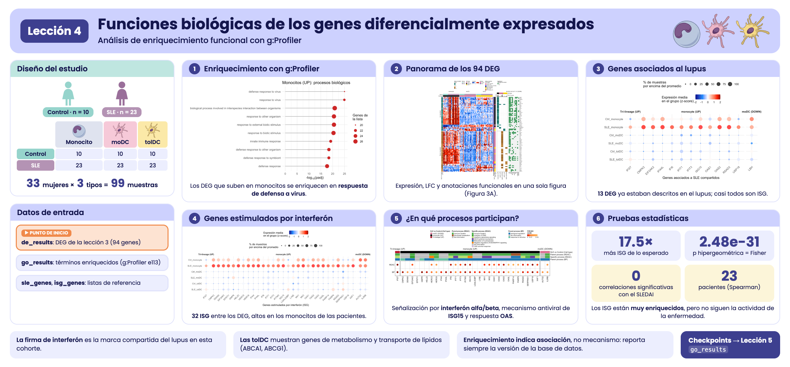

```{r, include = FALSE}
knitr::opts_chunk$set(
  collapse = TRUE,
  comment = "#>",
  message = FALSE,
  warning = FALSE,
  fig.align = "center",
  fig.width = 7,
  fig.height = 4.5
)
```

```{css, echo = FALSE, file = "../lesson.css"}
```

## Bienvenida

En la lección anterior encontramos **94 genes diferencialmente expresados (DEG)** entre pacientes con lupus y controles. Una lista de genes, por sí sola, dice poco: la pregunta ahora es **¿qué hacen esos genes?, ¿participan en procesos biológicos comunes?**

**Lo que necesitas saber antes:** haber hecho la lección [Genes diferencialmente expresados entre pacientes y controles](l3_DEGs_es.html).

**Al terminar podrás:**

1. Explicar qué es un **análisis de enriquecimiento funcional** y qué pregunta responde.
2. Hacer un análisis de enriquecimiento con **g:Profiler** e interpretar sus resultados.
3. Reconocer las principales bases de datos funcionales (Gene Ontology, Reactome, KEGG…).
4. Identificar genes asociados al lupus y **genes estimulados por interferón** entre los DEG.
5. Reproducir la **Figura 3** del artículo.
6. Correlacionar la expresión de los ISG con la actividad de la enfermedad (SLEDAI).

**Tiempo estimado:** 1.5 horas.

### Mapa de la lección

```{=html}
<pre class="mermaid">
flowchart LR
  A["de_results<br/>(lección 3)"] --> B["94 DEG por tipo<br/>celular y dirección"]
  B --> C["g:Profiler:<br/>enriquecimiento"]
  B --> D["Listas de referencia:<br/>SLE e ISG"]
  C --> E["3A. Heatmaps DEG,<br/>LFC y anotaciones"]
  D --> F["3B y 3C. Dot plots"]
  C --> G["3D. Procesos REAC y BP"]
  E --> H["Figura 3"]
  F --> H
  G --> H
  D --> I["ISG vs SLEDAI:<br/>Spearman"]
</pre>
<script type="module">
  import mermaid from "https://cdn.jsdelivr.net/npm/mermaid@11/dist/mermaid.esm.min.mjs";
  mermaid.initialize({ startOnLoad: true });
</script>
```

## Glosario

Estos son los términos que usaremos. Vuelve aquí cada vez que lo necesites.

- **Anotación funcional**: información sobre qué hace un gen (procesos, rutas, localización…).
- **Término**: una categoría funcional, por ejemplo "respuesta a virus", con su lista de genes.
- **Enriquecimiento funcional**: prueba si un término aparece en nuestra lista de genes **más de lo esperado por azar**.
- **Prueba hipergeométrica**: prueba estadística del enriquecimiento (como sacar canicas de una bolsa sin reemplazo).
- **Gene Ontology (GO)**: vocabulario de funciones con tres ramas: proceso biológico (**BP**), componente celular (**CC**) y función molecular (**MF**).
- **Reactome (REAC)**, **KEGG**, **WikiPathways (WP)**: bases de datos de rutas biológicas.
- **TF**: sitios de unión de factores de transcripción. **MIRNA**: blancos de microRNAs. **HP**: fenotipos humanos. **CORUM**: complejos de proteínas.
- **Término padre / específico**: las bases de datos están organizadas en jerarquías; un término general (padre) contiene términos más específicos.
- **ISG** (*interferon-stimulated genes*): genes que se encienden en respuesta al interferón.
- **SLEDAI** (*SLE Disease Activity Index*): puntaje de actividad del lupus; más alto = enfermedad más activa.
- **Correlación de Spearman** (rho): mide si dos variables suben o bajan juntas comparando sus rangos; va de −1 a 1.

```{r lesson_overview, echo = FALSE, out.width = "100%", fig.cap = "Resumen visual de la lección 4."}

```

## 1. Preparación

```{r setup}
library(GeneExprLupusMx) # datos del paquete
library(tidyverse)       # manipulación de tablas y gráficas
library(ComplexHeatmap)  # heatmaps
library(circlize)        # escalas de color para ComplexHeatmap
library(grid)            # dibujar formas dentro de los heatmaps
library(cowplot)         # unir gráficas en un panel

# Objetos grandes del paquete: se descargan solo la primera vez (ver ?download_data)
zscore_mat <- download_data("zscore_mat")
```

Colores y umbrales (los mismos de la lección anterior):

```{r colores}
cell_color  <- c(monocyte = "black", moDC = "palevioletred", tolDC = "gold1")
group_color <- c(Ctrl = "#96d4ccff", SLE = "#b493b4ff")

lfc_threshold  <- 1
padj_threshold <- 0.05
```

### Punto de partida: los DEG de la lección anterior

El checkpoint `de_results` contiene los resultados de `DESeq2` de los tres tipos celulares. Recuperamos los DEG en una sola tabla:

```{r deg_df}
deg_df <- bind_rows(lapply(names(de_results), function(cell) {
  de_results[[cell]] %>%
    filter(!is.na(padj), padj < padj_threshold, abs(log2FoldChange) >= lfc_threshold) %>%
    mutate(Cell_type  = cell,
           Expression = ifelse(log2FoldChange > 0, "Up-regulated", "Down-regulated"),
           query      = paste("SLE", ifelse(log2FoldChange > 0, "UP", "DOWN"), cell, sep = "_"))
}))

dplyr::count(deg_df, query)
```

Cada combinación de tipo celular y dirección es una **lista de genes** (`query`). Los monocitos no tienen genes que bajen, así que hay cinco listas.

Un mismo gen puede ser DEG en más de un tipo celular. Para las gráficas necesitamos **una fila por gen** (94 genes) y una etiqueta que describa su **patrón**: en qué tipos celulares cambia.

```{r gene_info}
genes_in <- function(cell, direction) {
  deg_df$gene[deg_df$Cell_type == cell & deg_df$Expression == direction]
}

gene_info <- deg_df %>%
  distinct(gene, .keep_all = TRUE) %>% # una fila por gen
  mutate(pattern = case_when(
    gene %in% Reduce(intersect, list(genes_in("monocyte", "Up-regulated"),
                                     genes_in("moDC", "Up-regulated"),
                                     genes_in("tolDC", "Up-regulated"))) ~ "Tri-lineage (UP)",
    gene %in% intersect(genes_in("moDC", "Down-regulated"),
                        genes_in("tolDC", "Down-regulated")) ~ "moDC & tolDC (DOWN)",
    gene %in% genes_in("monocyte", "Up-regulated") ~ "monocyte (UP)",
    gene %in% genes_in("moDC", "Up-regulated")     ~ "moDC (UP)",
    gene %in% genes_in("moDC", "Down-regulated")   ~ "moDC (DOWN)",
    gene %in% genes_in("tolDC", "Up-regulated")    ~ "tolDC (UP)",
    gene %in% genes_in("tolDC", "Down-regulated")  ~ "tolDC (DOWN)"))

dplyr::count(gene_info, pattern)
```

**Tri-lineage (UP)** son los genes que suben en los tres tipos celulares (solo `IFI27`) y **moDC & tolDC (DOWN)**, los que bajan en ambas células dendríticas.

## 2. ¿Qué es un análisis de enriquecimiento?

Imagina una bolsa con 20,000 canicas (todos los genes del genoma). 200 de ellas son rojas: los genes de un término, por ejemplo "respuesta a virus". Sacamos al azar 37 canicas (nuestros DEG de monocitos). Esperaríamos sacar menos de una roja. **Si sacamos 15, algo no es azar**: nuestros genes están **enriquecidos** en ese término.

La **prueba hipergeométrica** calcula qué tan probable es sacar tantas canicas rojas por azar. Como se prueban miles de términos a la vez, los valores p se corrigen (FDR), igual que en la expresión diferencial.

::: {.alert .alert-info}
**Enriquecimiento no es causalidad.** Que una lista esté enriquecida en "respuesta a virus" no significa que haya un virus: significa que los genes que cambian suelen participar juntos en esa función. Es una pista para generar hipótesis.
:::

## 3. **Paso 1:** enriquecimiento con g:Profiler

[g:Profiler](https://biit.cs.ut.ee/gprofiler/) consulta al mismo tiempo varias bases de datos (GO, Reactome, KEGG, WikiPathways, TF, miRNA, HP, CORUM). En R se usa con la función `gost()` del paquete `gprofiler2`:

```{r gost, eval = FALSE}
library(gprofiler2)

deg_lists <- split(deg_df$gene, deg_df$query) # una lista de genes por query

# Versión archivada de g:Profiler (junio de 2025)
set_base_url("https://biit.cs.ut.ee/gprofiler_archive3/e113_eg59_p19")

gost_res <- gost(deg_lists,
                 organism          = "hsapiens", # humano
                 correction_method = "fdr",      # corrección por comparaciones múltiples
                 user_threshold    = 0.05,       # padj máximo
                 evcodes           = TRUE)       # incluir qué genes tiene cada término
```

::: {.alert .alert-warning}
**Las bases de datos cambian.** g:Profiler actualiza sus anotaciones varias veces al año, así que la misma lista de genes puede dar resultados algo distintos con el tiempo. Para que tus análisis sean reproducibles, **fija la versión** con `set_base_url()` y repórtala.
:::

`gost()` necesita conexión a internet. Para que esta lección funcione sin conexión, el paquete incluye el resultado como checkpoint, `go_results`:

```{r go_results}
attr(go_results, "gprofiler_version")
glimpse(go_results)
```

Las columnas más importantes son:

| Columna | Significado |
|---------|-------------|
| `query` | Lista de genes (tipo celular y dirección) |
| `source` | Base de datos |
| `term_name` | Nombre del término |
| `term_size` | Genes anotados al término en todo el genoma |
| `intersection_size` | Genes de **nuestra lista** anotados al término |
| `p_value` | Valor p ajustado (FDR) |
| `intersection` | Cuáles son esos genes |

¿Cuántos términos significativos hay por lista y base de datos?

```{r terms_table}
go_results %>%
  dplyr::count(query, source) %>%
  pivot_wider(names_from = source, values_from = n, values_fill = 0)
```

Las listas con más genes (monocitos UP, moDC DOWN) tienen más términos, y la mayoría vienen de GO:BP, la base de datos más grande.

### 3.1 Los términos más significativos

Veamos los 10 procesos biológicos (GO:BP) más significativos de los monocitos:

```{r top_terms, fig.width = 8, fig.height = 4.5}
go_results %>%
  filter(query == "SLE_UP_monocyte", source == "GO:BP") %>%
  slice_min(p_value, n = 10, with_ties = FALSE) %>%
  ggplot(aes(x = -log10(p_value), y = reorder(term_name, -log10(p_value)))) +
  geom_segment(aes(x = 0, xend = -log10(p_value), yend = term_name), color = "grey60") +
  geom_point(aes(size = intersection_size), color = "firebrick3") +
  labs(x = expression("-log"[10] * "(padj)"), y = NULL, size = "Genes de\nla lista",
       title = "Monocitos (UP): procesos biológicos") +
  theme_minimal()
```

Todos los términos tienen que ver con la **respuesta a virus y al interferón**: la firma de interferón que vimos en las lecciones anteriores, ahora respaldada por el análisis de enriquecimiento.

::: {.callout-note}
**Reto 1.** ¿Cuáles son los 5 términos de Reactome (`REAC`) más significativos en las tolDC con genes que suben (`SLE_UP_tolDC`)? ¿Qué tipo de procesos son?
:::

<details class="callout-tip">
<summary>Ver solución</summary>

```{r reto1}
go_results %>%
  filter(query == "SLE_UP_tolDC", source == "REAC") %>%
  slice_min(p_value, n = 5, with_ties = FALSE) %>%
  dplyr::select(term_name, intersection_size, p_value, intersection)
```

Son procesos del **metabolismo y transporte de lípidos y colesterol** (por ejemplo, la ruta de `ABCA1`), muy distintos de la respuesta a interferón de los monocitos.

</details>

## 4. **Paso 2:** panorama de los 94 DEG (Figura 3A)

Construiremos tres *heatmaps* alineados por gen:

1. **Expresión (z-score)** de cada DEG en todas las muestras.
2. **LFC** de cada gen en cada lista de DEG.
3. **Presencia de anotación significativa** en cada base de datos.

### 4.1 Heatmap de expresión

Ordenamos las muestras por tipo celular y grupo, y tomamos los z-scores de los 94 genes del checkpoint `zscore_mat`:

```{r fig3a_mat}
sample_order <- metadata_cleaned %>%
  mutate(Cell_type = factor(Cell_type, levels = c("monocyte", "moDC", "tolDC"))) %>%
  arrange(Cell_type, Group)

deg_mat <- zscore_mat[gene_info$gene, sample_order$sample_ID]
dim(deg_mat)
```

Agregamos anotaciones: arriba, el grupo y el tipo celular de cada muestra; a la izquierda, el LFC; a la derecha, el biotipo del gen (de `biotype_summary`) y su patrón.

```{r fig3a_annotations}
pattern_color <- c("Tri-lineage (UP)" = "#b2182b", "monocyte (UP)" = "black",
                   "moDC (UP)" = "palevioletred", "moDC (DOWN)" = "palevioletred",
                   "tolDC (UP)" = "gold1", "tolDC (DOWN)" = "gold1",
                   "moDC & tolDC (DOWN)" = "blue")
biotype_color <- c("PCG" = "#7570B3", "lncRNA" = "#E7298A")
lfc_color <- colorRamp2(c(-2, -1, 0, 1, 2), c("#8c510a", "#bf812d", "white", "#35978f", "#01665e"))
zscore_color <- colorRamp2(c(-2, -1, 0, 1, 2), c("darkblue", "dodgerblue", "white", "red", "darkred"))

gene_biotype <- biotype_summary$Group_biotype[match(gene_info$gene, biotype_summary$gene)]
table(gene_biotype)

sample_anno <- HeatmapAnnotation(
  Group       = as.character(sample_order$Group),
  "Cell type" = as.character(sample_order$Cell_type),
  col = list(Group = group_color, "Cell type" = cell_color),
  annotation_name_side = "left")

ht_expression <- Heatmap(
  deg_mat, name = "Z-score", col = zscore_color,
  cluster_rows = TRUE, cluster_columns = FALSE, show_row_dend = FALSE,
  show_row_names = FALSE, show_column_names = FALSE,
  top_annotation  = sample_anno,
  left_annotation = rowAnnotation("SLE vs Control\n(LFC)" = gene_info$log2FoldChange,
                                  col = list("SLE vs Control\n(LFC)" = lfc_color)),
  right_annotation = rowAnnotation(Biotype = gene_biotype,
                                   "SLE vs Control\n(Cell type)" = gene_info$pattern,
                                   col = list(Biotype = biotype_color,
                                              "SLE vs Control\n(Cell type)" = pattern_color)),
  column_split = sample_order$Cell_type,
  row_split    = factor(gene_info$Expression, levels = c("Up-regulated", "Down-regulated")),
  heatmap_legend_param = list(direction = "horizontal"))
```

### 4.2 Heatmap de LFC por lista

Una matriz con el LFC de cada gen en cada lista de DEG (0 si el gen no es DEG en esa lista). Arriba, un *barplot* con cuántos DEG tiene cada lista:

```{r fig3a_lfc}
lfc_mat <- deg_df %>%
  mutate(column = str_replace(query, "SLE_(UP|DOWN)_(.*)", "\\2 (\\1)")) %>% # "monocyte (UP)"
  dplyr::select(gene, column, log2FoldChange) %>%
  pivot_wider(names_from = column, values_from = log2FoldChange, values_fill = 0) %>%
  column_to_rownames("gene") %>%
  as.matrix()
lfc_mat <- lfc_mat[gene_info$gene, c("monocyte (UP)", "moDC (UP)", "moDC (DOWN)",
                                     "tolDC (UP)", "tolDC (DOWN)")]
colSums(lfc_mat != 0)

ht_lfc <- Heatmap(
  lfc_mat, name = "SLE vs Control\n(LFC)", col = lfc_color, show_heatmap_legend = FALSE,
  cluster_columns = FALSE, show_row_names = FALSE,
  rect_gp = gpar(col = "#f0f0f0", lwd = 1), border = TRUE,
  top_annotation = HeatmapAnnotation(
    "Cell type"  = c("monocyte", "moDC", "moDC", "tolDC", "tolDC"),
    "DEG Counts" = anno_barplot(colSums(lfc_mat != 0), add_numbers = TRUE, height = unit(1, "cm")),
    col = list("Cell type" = cell_color), show_legend = FALSE),
  width = unit(4, "cm"))
```

### 4.3 Heatmap de anotaciones

¿En qué bases de datos tiene cada gen al menos un término significativo? Separamos la columna `intersection` (genes separados por comas) en una fila por gen:

```{r fig3a_presence}
gene_source <- go_results %>%
  dplyr::select(source, intersection) %>%
  separate_rows(intersection, sep = ",") %>%
  distinct(gene = intersection, source = str_remove(source, "GO:"))

presence_mat <- gene_source %>%
  mutate(present = "yes") %>%
  pivot_wider(names_from = source, values_from = present, values_fill = "no") %>%
  right_join(tibble(gene = gene_info$gene), by = "gene") %>% # los 94 DEG
  mutate(across(-gene, ~ replace_na(.x, "no"))) %>%
  column_to_rownames("gene") %>%
  as.matrix()
presence_mat <- presence_mat[gene_info$gene,
                             c("BP", "CC", "MF", "REAC", "HP", "KEGG", "WP", "TF", "CORUM", "MIRNA")]
colSums(presence_mat == "yes")

n_up   <- sum(gene_info$Expression == "Up-regulated")
n_down <- sum(gene_info$Expression == "Down-regulated")

ht_presence <- Heatmap(
  presence_mat, name = "Significant\nannotation presence",
  col = c(yes = "#238b45", no = "#f0f0f0"),
  cluster_columns = FALSE, show_row_names = TRUE, row_names_gp = gpar(fontsize = 7),
  rect_gp = gpar(col = "white", lwd = 1),
  column_title = paste0(nrow(gene_info), " DEG (", n_up, " UP / ", n_down, " DOWN)"),
  width = unit(4, "cm"))
```

### 4.4 Los tres juntos

Al unir *heatmaps* con `+`, `ComplexHeatmap` aplica a todos el orden de filas del primero, así que cada fila es el mismo gen en los tres:

```{r fig3a, fig.width = 13, fig.height = 15}
ht_fig3a <- ht_expression + ht_lfc + ht_presence

ht_opt$message <- FALSE
draw(ht_fig3a, ht_gap = unit(5, "mm"), merge_legends = TRUE,
     heatmap_legend_side = "top", annotation_legend_side = "top")
```

**¿Qué observas?**

- Los genes que **suben** (bloque superior) son sobre todo de monocitos y tienen muchas anotaciones en casi todas las bases de datos: son genes bien estudiados de la respuesta inmune.
- Los genes que **bajan** son sobre todo de moDC; varios tienen pocas anotaciones o ninguna, entre ellos los lncRNA.
- En la columna de expresión, el bloque de monocitos de las pacientes destaca en rojo para los genes que suben: es la firma de interferón.

## 5. **Paso 3:** genes asociados al lupus e ISG (Figuras 3B y 3C)

Comparamos los DEG con dos listas de referencia incluidas en el paquete:

- `sle_genes`: genes asociados al lupus en la literatura (cuatro estudios).
- `isg_genes`: 423 genes estimulados por interferón (Yu et al., 2025).

```{r reference_lists}
sle_deg <- intersect(unique(sle_genes$Gene_name), gene_info$gene)
isg_deg <- intersect(isg_genes$genes, gene_info$gene)
sle_deg
length(isg_deg)
```

**13 DEG** ya estaban asociados al lupus y **32** son ISG. Los graficamos como en la lección anterior: un *dot plot* con la expresión media (z-score) por grupo y tipo celular. Como lo haremos dos veces, lo guardamos en una función:

```{r dotplot_fun}
plot_gene_dots <- function(genes, x_label, gene_levels = sort(genes)) {
  dots_df <- as.data.frame(zscore_mat[genes, ]) %>%
    rownames_to_column("gene") %>%
    pivot_longer(-gene, names_to = "sample_ID", values_to = "expression") %>%
    left_join(dplyr::select(metadata_cleaned, sample_ID, Group, Cell_type), by = "sample_ID") %>%
    group_by(Group, Cell_type, gene) %>%
    summarise(mean_expression = mean(expression),
              pct_expressed   = 100 * mean(expression > 0), .groups = "drop") %>%
    left_join(dplyr::select(gene_info, gene, pattern), by = "gene") %>%
    mutate(condition = factor(paste(Group, Cell_type, sep = "_"),
                              levels = c("SLE_tolDC", "Ctrl_tolDC", "SLE_moDC",
                                         "Ctrl_moDC", "SLE_monocyte", "Ctrl_monocyte")),
           pattern = factor(pattern, levels = c("Tri-lineage (UP)", "monocyte (UP)", "moDC (DOWN)")),
           gene    = factor(gene, levels = gene_levels))

  min_val <- min(dots_df$mean_expression)
  max_val <- max(dots_df$mean_expression)

  ggplot(dots_df, aes(x = gene, y = condition, color = mean_expression, size = pct_expressed)) +
    geom_point(alpha = 0.8) +
    scale_color_gradientn(colors = c("darkblue", "dodgerblue", "white", "red", "darkred"),
                          values = scales::rescale(c(-2, min_val, 0, max_val, 2)),
                          limits = c(-2, 2), oob = scales::squish) +
    ggh4x::facet_grid2(~ pattern, scales = "free_x", space = "free_x",
                       strip = ggh4x::strip_vanilla(clip = "off")) +
    labs(x = x_label, y = NULL,
         color = "Expresión media\nen el grupo (z-score)",
         size = "% de muestras\npor encima del promedio") +
    theme_minimal(base_size = 12) +
    theme(legend.position = "top", legend.box = "vertical",
          strip.text.x = element_text(face = "bold"),
          axis.text.x = element_text(angle = 45, hjust = 1),
          plot.margin = margin(5.5, 40, 5.5, 5.5)) # margen para que no se corte la última etiqueta
}
```

```{r fig3b, fig.width = 8, fig.height = 5}
p_sle <- plot_gene_dots(sle_deg, "Genes asociados a SLE compartidos",
                        gene_levels = c("IFI27", "CMPK2", "EIF2AK2", "IFI44L", "IFI6", "IFIT1",
                                        "IFIT3", "ISG15", "OAS1", "OAS2", "RSAD2", "USP18", "LBH"))
p_sle
```

```{r fig3c, fig.width = 12, fig.height = 5}
p_isg <- plot_gene_dots(isg_deg, "Genes estimulados por interferón (ISG)")
p_isg
```

Casi todos los genes asociados al lupus que encontramos son también **ISG**, y están altos sobre todo en los **monocitos de las pacientes** (fila `SLE_monocyte`). `IFI27` es la excepción que confirma la regla: sube en los tres tipos celulares. En cambio, `LBH`, `AUTS2` e `IL2RB` son DEG que **bajan** en las moDC de las pacientes. En la gráfica destacan más por su alta expresión en los monocitos, porque el z-score compara cada muestra con todas las demás, de los tres tipos celulares.

### 5.1 ¿Hay más ISG de los esperados por azar?

`r length(isg_deg)` de los `r nrow(gene_info)` DEG son ISG. ¿Es mucho? Lo resolvemos con la **prueba hipergeométrica** de la sección 2: si sacamos `r nrow(gene_info)` canicas (DEG) de una bolsa con todos los genes del paquete, ¿qué tan probable es que `r length(isg_deg)` o más sean rojas (ISG)?

Necesitamos cuatro números:

```{r hyper_numbers}
N <- nrow(de_results$monocyte) # universo: todos los genes del paquete
m <- nrow(isg_genes)           # ISG en la lista de referencia
k <- nrow(gene_info)           # DEG
q <- length(isg_deg)           # DEG que son ISG

c(N = N, m = m, k = k, q = q)
k * m / N # ISG esperados entre los DEG por azar
```

Por azar esperaríamos menos de `r ceiling(k * m / N)` ISG entre los DEG, y encontramos `r q`: un enriquecimiento de `r round(q / (k * m / N), 1)` veces.

`phyper()` da la probabilidad de sacar **más de** `q - 1` canicas rojas, es decir, `q` o más. Usamos `lower.tail = FALSE` porque nos interesa la cola superior (sobrerrepresentación):

```{r phyper}
p_hyper <- phyper(q - 1, m, N - m, k, lower.tail = FALSE)
p_hyper
```

La **prueba exacta de Fisher** hace la misma pregunta con una tabla de 2 × 2. Con la alternativa de una cola (`"greater"`) es exactamente la misma prueba:

```{r fisher}
isg_table <- matrix(c(q, k - q, m - q, N - m - k + q), nrow = 2,
                    dimnames = list(ISG = c("Sí", "No"), DEG = c("Sí", "No")))
isg_table

isg_fisher <- fisher.test(isg_table, alternative = "greater")
isg_fisher
isg_fisher$p.value
```

Al imprimir el resultado, R muestra `p-value < 2.2e-16`: es el límite que usa para **mostrar** valores p, no el valor real. El valor completo está en `isg_fisher$p.value` y coincide con `phyper()`: `r format(p_hyper, digits = 3)`. Las dos pruebas llegan a la misma conclusión: **los ISG están fuertemente enriquecidos entre los DEG** (razón de momios = `r round(isg_fisher$estimate, 1)`).

::: {.callout-note}
**Reto 2.** `r m - sum(isg_genes$genes %in% de_results$monocyte$gene)` de los `r m` ISG de la lista de referencia no están entre los `r format(N, big.mark = ",")` genes del paquete. Repite la prueba usando como `m` solo los ISG que están en el universo. ¿Cambia la conclusión?
:::

<details class="callout-tip">
<summary>Ver solución</summary>

```{r reto2_hyper}
m_universe <- sum(isg_genes$genes %in% de_results$monocyte$gene)
m_universe
phyper(q - 1, m_universe, N - m_universe, k, lower.tail = FALSE)
```

El valor p es aún más pequeño y la conclusión no cambia. Usar solo los genes del universo es lo más estricto: un gen que no se midió no puede salir como DEG.

</details>

## 6. **Paso 4:** ¿en qué procesos participan los ISG? (Figura 3D)

Para cada ISG buscamos sus términos de **Reactome (REAC)** y **GO:BP**. Como cada gen puede estar en muchos términos, resumimos con dos:

- **Proceso específico:** el término con **menos** genes (`term_size` mínimo), el más concreto.
- **Proceso padre:** el término con **más** genes (`term_size` máximo), el más general.

```{r process_info}
process_info <- go_results %>%
  filter(source %in% c("REAC", "GO:BP")) %>%
  separate_rows(intersection, sep = ",") %>%
  dplyr::rename(gene = intersection) %>%
  group_by(source, gene) %>%
  summarise(specific_process = term_name[which.min(term_size)],
            parent_process   = term_name[which.max(term_size)],
            .groups = "drop")

process_info %>% filter(gene %in% c("ISG15", "OAS1"))
```

Construimos una matriz con una fila por base de datos (REAC y BP) y una columna por ISG. Cada celda lleva el **padj de expresión diferencial** del gen si el gen tiene anotación en esa base de datos, y queda vacía si no la tiene:

```{r fig3d_mat}
isg_order <- gene_info %>%
  filter(gene %in% isg_deg) %>%
  mutate(pattern = factor(pattern, levels = c("Tri-lineage (UP)", "monocyte (UP)", "moDC (DOWN)"))) %>%
  arrange(pattern, gene)

isg_padj <- sapply(c(REAC = "REAC", BP = "GO:BP"), function(src) {
  annotated <- isg_order$gene %in% process_info$gene[process_info$source == src]
  ifelse(annotated, isg_order$padj, NA)
})
isg_padj <- t(isg_padj)
colnames(isg_padj) <- isg_order$gene
isg_padj[, 1:6]
```

Las anotaciones de arriba muestran el patrón de cada gen y sus procesos. Los genes sin anotación aparecen como "No information":

```{r fig3d, fig.width = 16, fig.height = 5}
# proceso de cada gen en una base de datos ("No information" si no tiene anotación)
process_of <- function(src, column, genes = isg_order$gene) {
  info <- filter(process_info, source == src)
  value <- info[[column]][match(genes, info$gene)]
  replace_na(value, "No information")
}

# colores de los procesos (los usaremos también en la Figura S4)
reac_specific_color <- c(
  "Interferon alpha/beta signaling" = "#b3de69",
  "Immune System" = "#4daf4a",
  "Complement cascade" = "#80b1d3",
  "Alternative complement activation" = "#8c6bb1",
  "Synthesis of PI" = "#ffff33",
  "Defective ABCA1 causes TGD" = "#a50f15",
  "HDL remodeling" = "#a6bddb",
  "Resolution of Sister Chromatid Cohesion" = "#e7298a",
  "Cholesterol biosynthesis" = "#fd8d3c",
  "TNFR1-mediated ceramide production" = "#fccde5",
  "Establishment of Sister Chromatid Cohesion" = "#ae017e",
  "Maturation of nucleoprotein" = "#1f78b4",
  "RSV-host interactions" = "#e41a1c",
  "Inhibition of PKR" = "#33a02c",
  "Negative regulators of DDX58/IFIH1 signaling" = "#ff7f00",
  "ISG15 antiviral mechanism" = "#6a3d9a",
  "OAS antiviral response" = "#cab2d6",
  "No information" = "gray")
reac_parent_color <- c(
  "Immune System" = "#4daf4a",
  "Synthesis of PI" = "#ffff33",
  "Mitotic Metaphase and Anaphase" = "#377eb8",
  "Metabolism of lipids" = "#984ea3",
  "Transport of small molecules" = "#ff7f00",
  "Respiratory Syncytial Virus Infection Pathway" = "#e41a1c",
  "Nicotinate metabolism" = "#a65628",
  "No information" = "gray")
bp_parent_color <- c(
  "response to stimulus" = "#66c2a4",
  "cellular response to stimulus" = "#7a0177",
  "cell communication" = "#3f007d",
  "positive regulation of biological process" = "#fcc5c0",
  "biological regulation" = "#1f78b4",
  "ketone body catabolic process" = "#e31a1c",
  "multicellular organismal process" = "#ff7f00",
  "No information" = "gray")
padj_color <- colorRamp2(c(0, 0.001, 0.01, 0.05), c("darkred", "red", "#fd8d3c", "#fed976"))

process_anno <- HeatmapAnnotation(
  "SLE vs Control (Cell type)" = as.character(isg_order$pattern),
  "Parent process (REAC)"      = process_of("REAC", "parent_process"),
  "Specific process (REAC)"    = process_of("REAC", "specific_process"),
  "Parent process (BP)"        = process_of("GO:BP", "parent_process"),
  col = list("SLE vs Control (Cell type)" = pattern_color,
             "Parent process (REAC)"      = reac_parent_color,
             "Specific process (REAC)"    = reac_specific_color,
             "Parent process (BP)"        = bp_parent_color))

ht_fig3d <- Heatmap(
  isg_padj, col = padj_color, na_col = "#f0f0f0", border = TRUE,
  cluster_rows = FALSE, cluster_columns = FALSE, row_names_side = "left",
  rect_gp = gpar(type = "none"),
  layer_fun = function(j, i, x, y, w, h, fill) { # un círculo por celda con anotación
    grid.rect(x = x, y = y, width = w, height = h, gp = gpar(col = "grey", fill = NA))
    grid.circle(x = x, y = y, r = unit(2, "mm"),
                gp = gpar(fill = padj_color(pindex(isg_padj, i, j)), col = NA))
  },
  top_annotation = process_anno,
  column_split = isg_order$pattern,
  heatmap_legend_param = list(title = "FDR-BH\n(padj)", direction = "horizontal",
                              at = c(0, 0.01, 0.03)))

draw(ht_fig3d, merge_legends = TRUE, annotation_legend_side = "top", heatmap_legend_side = "top")
```

Los ISG de los monocitos se concentran en el **sistema inmune** de Reactome, en procesos antivirales específicos: señalización por interferón alfa/beta, mecanismo antiviral de ISG15 y respuesta antiviral de OAS. **Es la huella molecular del interferón en el lupus.**

::: {.callout-note}
**Reto 3.** ¿Qué genes de los monocitos participan en el término de Reactome "Interferon alpha/beta signaling"?

*Pista:* filtra `go_results` por `query`, `source` y `term_name`, y mira la columna `intersection`.
:::

<details class="callout-tip">
<summary>Ver solución</summary>

```{r reto2}
go_results %>%
  filter(query == "SLE_UP_monocyte", source == "REAC",
         term_name == "Interferon alpha/beta signaling") %>%
  dplyr::select(term_name, intersection_size, term_size, p_value, intersection)
```

</details>

::: {.callout-note}
**Reto 4.** ¿En qué bases de datos tiene anotación `ABCA1` (que sube en las tolDC) y cuál es su proceso específico en Reactome?

*Pista:* usa `gene_source` y `process_info`.
:::

<details class="callout-tip">
<summary>Ver solución</summary>

```{r reto3}
gene_source %>% filter(gene == "ABCA1")
process_info %>% filter(gene == "ABCA1")
```

`ABCA1` participa en el transporte de colesterol: un ejemplo de las alteraciones del **metabolismo de lípidos** en las tolDC de las pacientes.

</details>

## 7. **Paso 5:** procesos de todos los DEG (Figura suplementaria S4)

La Figura 3D mostró solo los ISG. Repitamos el análisis con **todos los DEG que tienen anotación** en Reactome o GO:BP, agrupándolos por su proceso padre de Reactome:

```{r s4_info}
s4_info <- gene_info %>%
  filter(gene %in% process_info$gene) %>%
  mutate(reac_parent   = factor(process_of("REAC", "parent_process", gene),
                                levels = names(reac_parent_color)),
         reac_specific = process_of("REAC", "specific_process", gene),
         bp_parent     = process_of("GO:BP", "parent_process", gene)) %>%
  arrange(reac_parent, gene)

nrow(s4_info)                   # DEG con anotación en REAC o GO:BP
dplyr::count(s4_info, reac_parent)
```

Como en la Figura 3D, cada celda lleva el padj de expresión diferencial del gen si tiene anotación en esa base de datos:

```{r s4_mat}
s4_padj <- sapply(c(REAC = "REAC", BP = "GO:BP"), function(src) {
  annotated <- s4_info$gene %in% process_info$gene[process_info$source == src]
  ifelse(annotated, s4_info$padj, NA)
})
rownames(s4_padj) <- s4_info$gene
head(s4_padj)
```

```{r figura_s4, fig.width = 10, fig.height = 17}
ht_s4 <- Heatmap(
  s4_padj, col = padj_color, na_col = "#f0f0f0",
  border = TRUE, rect_gp = gpar(col = "white", lwd = 2),
  cluster_rows = FALSE, cluster_columns = FALSE, row_names_side = "right",
  left_annotation = rowAnnotation(
    "Parent process (REAC)"   = as.character(s4_info$reac_parent),
    "Specific process (REAC)" = s4_info$reac_specific,
    "Parent process (BP)"     = s4_info$bp_parent,
    col = list("Parent process (REAC)"   = reac_parent_color,
               "Specific process (REAC)" = reac_specific_color,
               "Parent process (BP)"     = bp_parent_color)),
  right_annotation = rowAnnotation(
    "SLE vs Control\n(Cell type)" = s4_info$pattern,
    col = list("SLE vs Control\n(Cell type)" = pattern_color),
    annotation_legend_param = list("SLE vs Control\n(Cell type)" = list(nrow = 3))),
  row_split = droplevels(s4_info$reac_parent), row_title_rot = 0,
  heatmap_legend_param = list(title = "FDR-BH\n(padj)", at = c(0, 0.001, 0.01, 0.05)),
  width = unit(2, "cm"))

draw(ht_s4, merge_legends = TRUE)
```

**¿Qué observas?**

- El bloque más grande es **"Immune System"**: reúne los ISG de los monocitos y también genes de linfocitos T que bajan en las moDC (`CD28`, `CD40LG`, `ZAP70`, `CARD11`).
- Los genes de las **tolDC** forman sus propios grupos: **metabolismo de lípidos** (`ACAT2`, `MSMO1`, `SMPD3`) y **transporte de moléculas pequeñas** (`ABCA1`, `ABCG1`). Es la alteración lipídica que vimos en el Reto 1.
- Muchos genes sin información en Reactome sí tienen anotación en GO:BP, sobre todo como "biological regulation".

::: {.caption-justify}
**Figura suplementaria S4.** Procesos biológicos asociados a los DEG obtenidos al comparar SLE contra Ctrl en cada tipo celular. Los procesos se clasificaron según las categorías padre y específicas de Reactome (REAC) y los términos padre de Gene Ontology Biological Process (GO:BP). Los procesos padre de REAC incluyen el sistema inmune, la división celular (*Mitotic Metaphase and Anaphase*), el metabolismo de lípidos y el transporte de moléculas pequeñas. La escala de color representa el padj (FDR-BH) de expresión diferencial de cada gen, con un umbral máximo de padj < 0.05; las celdas grises indican que el gen no tiene anotación en esa base de datos. DEG: genes diferencialmente expresados.

La figura suplementaria original se encuentra en el [material suplementario del artículo](https://www.frontiersin.org/journals/immunology/articles/10.3389/fimmu.2026.1771959/full#supplementaryMaterial).
:::

## 8. Para terminar: la Figura 3 del artículo

Capturamos los *heatmaps* como objetos gráficos (como en la lección anterior) y los unimos con los *dot plots*:

```{r figura_3, fig.width = 16, fig.height = 30, out.width = "100%"}
grab <- function(ht, ...) {
  grid::grid.grabExpr(draw(ht, merge_legends = TRUE, heatmap_legend_side = "top",
                           annotation_legend_side = "top", ...), wrap.grobs = TRUE)
}

figure_3 <- plot_grid(
  grab(ht_fig3a, ht_gap = unit(5, "mm")),
  p_sle,
  p_isg,
  grab(ht_fig3d),
  labels = c("A", "B", "C", "D"), label_size = 20, ncol = 1,
  rel_heights = c(3.2, 0.9, 0.9, 1)
)
figure_3
```

::: {.caption-justify}
**Figura 3.** El análisis de enriquecimiento funcional revela perturbaciones específicas de cada tipo celular y una marca compartida del lupus. **(A)** Visualización integrada de los DEG y su enriquecimiento funcional. Izquierda: *heatmap* de los `r nrow(gene_info)` DEG (`r n_up` que suben y `r n_down` que bajan) entre SLE y Ctrl en los tres tipos celulares, seleccionados con |LFC| ≥ 1 y padj < 0.05; la escala de color corresponde a z-scores. Centro: LFC de SLE contra Ctrl en cada lista de DEG, con un *barplot* del número de DEG por lista. Derecha: presencia de términos funcionales significativos (g:Profiler; prueba hipergeométrica) en GO (BP, CC, MF), REAC, HP, KEGG, WP, TF, CORUM y miRNA. **(B, C)** Expresión media (z-score) por grupo y tipo celular (filas) de **(B)** los DEG asociados a SLE y **(C)** los ISG diferencialmente expresados; el tamaño del punto indica el porcentaje de muestras por encima del promedio de cada gen. Los genes se agrupan según su patrón: "Tri-lineage (UP)" sube en los tres tipos celulares, "monocyte (UP)" sube en monocitos y "moDC (DOWN)" baja en moDC. **(D)** Procesos biológicos asociados a los ISG diferencialmente expresados, según los términos padre y específicos de Reactome (REAC) y los términos padre de GO:BP. Los círculos indican que el gen tiene anotación en esa base de datos; su color representa el padj (FDR-BH) de expresión diferencial del gen.

La figura original se encuentra en el [artículo](https://www.frontiersin.org/journals/immunology/articles/10.3389/fimmu.2026.1771959/full).
:::

Para guardarla en alta resolución:

```{r save_figure, eval = FALSE}
ggsave("Figura_3.png", figure_3, width = 16, height = 30, dpi = 300)
```

## 9. Para profundizar: ¿se relacionan los ISG con la actividad de la enfermedad?

La expresión de los ISG separa claramente a las pacientes de los controles. Una pregunta natural es si, **entre las pacientes**, los ISG están más altos cuando la enfermedad está más activa. Para responderla correlacionamos el z-score de cada uno de los `r length(isg_deg)` ISG con el puntaje **SLEDAI** usando la **correlación de Spearman**, que compara rangos y no supone una relación lineal ni datos normales.

Primero juntamos los z-scores de los ISG con el SLEDAI de cada muestra de las pacientes. Cada paciente aporta tres muestras (monocito, moDC y tolDC); el identificador de la paciente es la parte de `sample_ID` antes del guion bajo:

```{r isg_sledai}
sle_info <- metadata_cleaned %>%
  filter(Group == "SLE") %>%
  mutate(sample_ID = as.character(sample_ID),
         patient   = sub("_.*", "", sample_ID),                # QR011_0 → QR011
         SLEDAI    = as.numeric(as.character(Sledai_score))) %>%
  dplyr::select(sample_ID, patient, Cell_type, SLEDAI)

isg_long <- zscore_mat[isg_deg, ] %>%
  as.data.frame() %>%
  rownames_to_column("gene") %>%
  pivot_longer(-gene, names_to = "sample_ID", values_to = "zscore") %>%
  inner_join(sle_info, by = "sample_ID")

# actividad de la enfermedad, como en la Tabla 1 (lección 1):
# 1 = con actividad (SLEDAI ≥ 6), 0 = sin actividad o actividad baja (0-5)
sle_activity <- volunteer_info %>% filter(Group == "SLE")
dplyr::count(sle_activity, SLEDAI)
```

Solo `r sum(sle_activity$SLEDAI == 1)` de las `r nrow(sle_activity)` pacientes (`r round(100 * mean(sle_activity$SLEDAI == 1), 1)`%) tienen enfermedad activa; el resto no tiene actividad o la tiene baja. Con pocas pacientes activas, el poder para detectar una correlación es limitado.

Guardamos la prueba en una función. Como probamos `r length(isg_deg)` genes a la vez, corregimos los valores p por **pruebas múltiples** con FDR, igual que `DESeq2` con el `padj`:

```{r spearman_fun}
spearman <- function(df) {
  test <- cor.test(df$zscore, df$SLEDAI, method = "spearman", exact = FALSE)
  tibble(rho = unname(test$estimate), p_value = test$p.value)
}
```

### 9.1 Sin separar por tipo celular

Para no contar tres veces a la misma paciente, promediamos el z-score de sus tres tipos celulares antes de correlacionar:

```{r cor_overall}
cor_overall <- isg_long %>%
  group_by(gene, patient, SLEDAI) %>%
  summarise(zscore = mean(zscore), .groups = "drop") %>%
  group_by(gene) %>%
  group_modify(~ spearman(.x)) %>%
  ungroup() %>%
  mutate(FDR = p.adjust(p_value, method = "fdr")) %>%
  arrange(p_value)

knitr::kable(cor_overall, digits = 3, col.names = c("Gen", "rho", "p", "FDR"))
```

::: {.caption-justify}
**Tabla suplementaria (a).** Correlación de Spearman entre la expresión normalizada (z-score) de los `r nrow(cor_overall)` ISG diferencialmente expresados y la actividad de la enfermedad (SLEDAI) en `r dplyr::n_distinct(sle_info$patient)` pacientes con SLE, sin separar por tipo celular (z-score promedio de monocitos, moDC y tolDC de cada paciente). El número de genes con p < 0.05 es `r sum(cor_overall$p_value < 0.05)`, y ninguno es significativo tras la corrección por pruebas múltiples (FDR mínimo = `r sprintf("%.2f", min(cor_overall$FDR))`). rho, coeficiente de correlación de Spearman; FDR, *false discovery rate* (Benjamini-Hochberg); ISG, genes estimulados por interferón; SLEDAI, *SLE Disease Activity Index*.
:::

### 9.2 Por tipo celular

Ahora repetimos la prueba dentro de cada tipo celular (`r dplyr::n_distinct(sle_info$patient)` muestras por tipo) y corregimos por FDR dentro de cada uno:

```{r cor_celltype}
cor_celltype <- isg_long %>%
  group_by(Cell_type, gene) %>%
  group_modify(~ spearman(.x)) %>%
  group_by(Cell_type) %>%
  mutate(FDR = p.adjust(p_value, method = "fdr")) %>%
  ungroup() %>%
  mutate(Cell_type = factor(Cell_type, levels = c("monocyte", "moDC", "tolDC")))

cor_celltype %>%
  pivot_wider(id_cols = gene, names_from = Cell_type, values_from = c(rho, p_value, FDR),
              names_vary = "slowest", names_sort = TRUE) %>%
  arrange(gene) %>%
  knitr::kable(digits = 3,
               col.names = c("Gen", paste(c("rho", "p", "FDR"), rep(levels(cor_celltype$Cell_type), each = 3))))
```

::: {.caption-justify}
**Tabla suplementaria (b).** Correlación de Spearman entre la expresión normalizada (z-score) de los `r dplyr::n_distinct(cor_celltype$gene)` ISG diferencialmente expresados y la actividad de la enfermedad (SLEDAI) en cada tipo celular (monocitos, moDC y tolDC; `r dplyr::n_distinct(sle_info$patient)` pacientes con SLE por tipo celular). Los valores p se corrigieron por FDR dentro de cada tipo celular. `r sum(cor_celltype$p_value < 0.05)` de las `r nrow(cor_celltype)` pruebas tiene p < 0.05 y ninguna es significativa tras la corrección (FDR mínimo = `r sprintf("%.2f", min(cor_celltype$FDR))`). rho, coeficiente de correlación de Spearman; FDR, *false discovery rate* (Benjamini-Hochberg); ISG, genes estimulados por interferón; moDC, células dendríticas derivadas de monocitos; tolDC, células dendríticas tolerogénicas; SLEDAI, *SLE Disease Activity Index*.

La tabla original (Tabla suplementaria 8) se encuentra en el [material suplementario del artículo](https://www.frontiersin.org/journals/immunology/articles/10.3389/fimmu.2026.1771959/full#supplementaryMaterial).
:::

**¿Qué observas?**

- Algunos genes tienen asociaciones nominales (p < 0.05) en un tipo celular, pero **ninguna correlación sobrevive a la corrección por pruebas múltiples**.
- Los ISG separan a pacientes de controles, pero, en esta cohorte, ningún ISG individual sigue la actividad de la enfermedad.
- Posibles razones: los tratamientos inmunomoduladores, que la diferenciación *in vitro* atenúa las señales inflamatorias que las células traían del paciente, y que la mayoría de las pacientes tiene actividad baja.

::: {.alert .alert-warning}
**¿Qué podemos concluir y qué no?**

- **Sí podemos decir** que, en esta cohorte, no detectamos una asociación significativa entre la expresión de los ISG y el SLEDAI, ni sin separar por tipo celular ni dentro de cada tipo celular.
- **No podemos concluir** que los ISG no se relacionen con la actividad del lupus. Un resultado no significativo es **ausencia de evidencia, no evidencia de ausencia**: con `r dplyr::n_distinct(sle_info$patient)` pacientes, una correlación necesita |rho| mayor a ~`r round(qt(0.975, dplyr::n_distinct(sle_info$patient) - 2) / sqrt(dplyr::n_distinct(sle_info$patient) - 2 + qt(0.975, dplyr::n_distinct(sle_info$patient) - 2)^2), 2)` para alcanzar p < 0.05, y aún más tras la corrección por FDR. Correlaciones moderadas pasarían desapercibidas.
- **Tampoco podemos tomar como hallazgo** una asociación nominal (p < 0.05 sin corregir): con `r nrow(cor_celltype)` pruebas, esperaríamos ~`r round(nrow(cor_celltype) * 0.05)` valores p < 0.05 solo por azar.
- **Es consistente** con el Reto 3 de la [lección 2](intro_RNAseq_es.html): en el PCA, las muestras tampoco se separan según la actividad de la enfermedad.
- **Para responderlo** se necesitaría una cohorte más grande, con más pacientes activas, y medir los ISG directamente en células sin cultivar.
:::

## 10. Resumen

| Paso | Función clave | ¿Para qué? |
|------|---------------|------------|
| Listas de DEG | `filter()`, `split()` | Separar genes por tipo celular y dirección |
| Enriquecimiento | `gprofiler2::gost()` | Encontrar funciones sobrerrepresentadas |
| Reproducibilidad | `set_base_url()` | Fijar la versión de las bases de datos |
| Explorar términos | `slice_min(p_value)` | Ver los procesos más significativos |
| Genes por término | `separate_rows()` | Pasar de "término → genes" a "gen → términos" |
| Listas de referencia | `intersect()` | Encontrar genes de SLE e ISG entre los DEG |
| Enriquecimiento de ISG | `phyper()`, `fisher.test()` | Probar si hay más ISG de los esperados por azar |
| Integrar | heatmaps con `+` | Ver expresión, LFC y anotaciones juntas |
| Correlación | `cor.test(method = "spearman")`, `p.adjust()` | Relacionar expresión y actividad de la enfermedad |

### Errores comunes de principiante

- **Interpretar enriquecimiento como causalidad**: indica asociación funcional, no mecanismo.
- **No reportar la versión de la base de datos**: los resultados cambian con el tiempo.
- **Usar listas muy pequeñas**: con 4 genes (moDC UP) casi no hay poder; los términos que salen pueden depender de un solo gen.
- **Mezclar genes que suben y bajan en una sola lista**: puede diluir señales opuestas.
- **Ignorar el tamaño del término**: un término con 5,000 genes es muy general; uno con 20 es más informativo.

## 11. Próximos pasos

Hasta aquí comparamos pacientes contra controles dentro de cada tipo celular. La lección [Diferenciación de monocitos a células dendríticas](l5_DEGs_monocytes_diff_es.html) plantea una pregunta distinta: **¿qué cambia cuando un monocito se diferencia en célula dendrítica?**, y ¿ocurre de la misma forma en pacientes y en controles?

Para continuar, da clic en el botón **Siguiente lección: Diferenciación de monocitos** al final de esta página.

```{=html}
<nav class="lesson-nav">
  <a class="lesson-prev" href="l3_DEGs_es.html">← Lección anterior: Genes diferencialmente expresados</a>
  <a class="lesson-next" href="l5_DEGs_monocytes_diff_es.html">Siguiente lección: Diferenciación de monocitos →</a>
</nav>
<a class="back-to-top" href="#top" onclick="window.scrollTo({top: 0, behavior: 'instant'}); return false;" title="Volver al inicio de la página">↑ Volver a Inicio</a>
```

## Información de la sesión

```{r}
sessionInfo()
```
