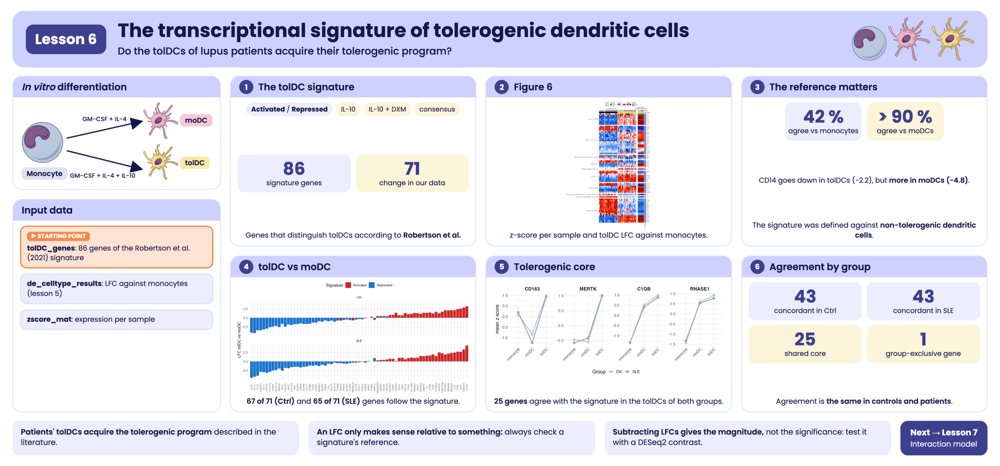

```{r, include = FALSE}
knitr::opts_chunk$set(
  collapse = TRUE,
  comment = "#>",
  message = FALSE,
  warning = FALSE,
  fig.align = "center",
  fig.width = 7,
  fig.height = 4.5
)
```

```{css, echo = FALSE, file = "../lesson.css"}
```

## Welcome

**Tolerogenic dendritic cells (tolDCs)** are a therapeutic promise for lupus: instead of activating the immune system, they calm it down. But to use them in patients, one question must be answered: **do tolDCs obtained from lupus patients acquire the same tolerogenic program as those from healthy people?** In this lesson we evaluate it with a published **transcriptional signature**.

**What you need to know beforehand:** you should have completed the lesson [Differentiation of monocytes into dendritic cells](l5_DEGs_monocytes_diff_en.html).

**By the end you will be able to:**

1. Use a **transcriptional signature** from the literature to evaluate your own samples.
2. Combine in one figure the **expression per sample** (z-score) and the **change per comparison** (LFC).
3. Explain why **the choice of reference** changes the interpretation of an LFC.
4. Calculate the change between two cell types from two comparisons that share the same reference.
5. Reproduce **Figure 6** of the article.
6. Count genes that agree and diverge from a signature and identify their common core.

**Estimated time:** 1 hour.

### Lesson map

```{=html}
<pre class="mermaid">
flowchart LR
  A["tolDC_genes<br/>signature from Robertson et al."] --> C["71 signature genes<br/>that are DEGs"]
  B["de_celltype_results<br/>(lesson 5)"] --> C
  C --> D["z-score per sample<br/>(zscore_mat)"]
  C --> E["LFC tolDC<br/>vs monocyte"]
  D --> F["Figure 6"]
  E --> F
  C --> G["Does the direction match?<br/>Choosing the reference"]
</pre>
<script type="module">
  import mermaid from "https://cdn.jsdelivr.net/npm/mermaid@11/dist/mermaid.esm.min.mjs";
  mermaid.initialize({ startOnLoad: true });
</script>
```

## Glossary

These are the terms we will use. Come back here whenever you need to.

- **Immune tolerance**: the ability of the immune system not to attack the body itself; it is lost in lupus.
- **tolDC**: tolerogenic dendritic cells; they promote immune tolerance.
- **Transcriptional signature**: a set of genes whose expression characterizes a cell type or state.
- **Activated / repressed**: a gene that goes up / down in the cell state of interest relative to a reference.
- **IL-10, dexamethasone (DXM)**: an anti-inflammatory cytokine and a glucocorticoid used to generate tolDCs *in vitro*.
- **Reference**: the cell type against which an LFC is calculated; changing it changes the sign and size of the LFC.

```{r lesson_overview, echo = FALSE, out.width = "100%", fig.cap = "Visual summary of lesson 6."}

```

## 1. Setup

```{r setup}
library(GeneExprLupusMx) # package data
library(tidyverse)       # table manipulation and plots
library(ComplexHeatmap)  # heatmaps
library(circlize)        # color scales for ComplexHeatmap

# Large package objects: downloaded only the first time (see ?download_data)
zscore_mat <- download_data("zscore_mat")
```

Colors and thresholds (the same as in the previous lessons):

```{r colores}
cell_color    <- c(monocyte = "black", moDC = "palevioletred", tolDC = "gold1")
group_color   <- c(Ctrl = "#96d4ccff", SLE = "#b493b4ff")
biotype_color <- c(PCG = "#7570B3", lncRNA = "#E7298A")
zscore_color  <- colorRamp2(c(-2, -1, 0, 1, 2), c("darkblue", "dodgerblue", "white", "red", "darkred"))
lfc_color     <- colorRamp2(c(-5, -1, 0, 1, 5), c("darkblue", "dodgerblue", "white", "red", "darkred"))

lfc_threshold  <- 1
padj_threshold <- 0.05
```

## 2. **Step 1:** the tolDC signature

[Robertson et al. (2021)](https://doi.org/10.3389/fimmu.2021.733231) compared tolDCs generated with different protocols and identified the genes that distinguish tolDCs. The package includes them in `tolDC_genes`:

```{r signature}
head(tolDC_genes)
dplyr::count(tolDC_genes, tolDC_signature)
```

Each category has two parts:

- **Direction:** `Activated` (the gene goes up in tolDCs) or `Repressed` (it goes down).
- **Protocol:** tolDCs generated with IL-10 (`IL10`), with IL-10 and dexamethasone (`IL10+DXM`), or the consensus tolDC signature (`tolDC_signature`). Some genes appear in several protocols.

## 3. **Step 2:** which signature genes change in our data?

We use the results from the previous lesson (`de_celltype_results`): each dendritic cell type compared against monocytes, in controls and patients. We keep the signature genes that are DEGs in **at least one** of the four comparisons:

```{r signature_deg}
deg_genes <- function(comparison) {
  df <- de_celltype_results[[comparison]]
  df$gene[!is.na(df$padj) & df$padj < padj_threshold & abs(df$log2FoldChange) >= lfc_threshold]
}
all_deg <- unique(unlist(lapply(names(de_celltype_results), deg_genes)))

signature_deg <- tolDC_genes %>%
  filter(gene %in% all_deg, gene %in% rownames(zscore_mat))
nrow(signature_deg)
dplyr::count(signature_deg, biotype)
```

**71 of the 86 signature genes change** during the differentiation of our cells. Almost all of them encode proteins (PCG); two are long non-coding RNAs (lncRNA).

## 4. **Step 3:** Figure 6

The figure has two *heatmaps* aligned by gene:

- **Left:** the expression (z-score) of each gene in each monocyte and tolDC sample, from controls and patients.
- **Right:** the LFC of tolDCs relative to monocytes, in controls and in patients.

We prepare the left part with the `zscore_mat` checkpoint:

```{r fig6_zscore}
sample_info <- metadata_cleaned %>%
  filter(Cell_type %in% c("monocyte", "tolDC")) %>%
  mutate(condition = factor(paste(Group, Cell_type, sep = "_"),
                            levels = c("Ctrl_monocyte", "SLE_monocyte", "Ctrl_tolDC", "SLE_tolDC"))) %>%
  arrange(condition)

zscore_sig <- zscore_mat[signature_deg$gene, sample_info$sample_ID]
dim(zscore_sig)
```

And the right part, with the tolDC LFC:

```{r fig6_lfc}
lfc_sig <- sapply(de_celltype_results[c("Ctrl_tolDC", "SLE_tolDC")], function(df)
  df$log2FoldChange[match(signature_deg$gene, df$gene)])
rownames(lfc_sig) <- signature_deg$gene
head(lfc_sig)
```

We fix the **order of the categories and of the genes**. Within each category, the genes are ordered by similarity (*clustering*); here we write that order explicitly so that the figure always looks the same:

```{r fig6_order}
fig6_order <- list(
  "Repressed - IL10+DXM" = c("MAFF", "SOCS1", "APOL4", "CCL17", "LAMP3", "ALOX15", "CH25H", "ACOT7"),
  "Repressed - tolDC_signature" = c("HCAR2", "FCER1A", "NRGN", "VCL", "ISYNA1", "TRIM36", "ESYT1",
                                    "KCTD6", "PEA15", "NCAPH", "BCAR3", "NDRG2", "CD1A", "CD1E",
                                    "CD1B", "CALCRL", "IRF4", "SLC27A3", "C1orf115", "GALNT12"),
  "Repressed - tolDC_signature, Repressed - IL10+DXM" = c("MMP12", "SCRN1", "CD1C"),
  "Repressed - IL10" = c("HCAR3", "MAP4K1", "TIFAB", "FABP4", "ATP1B1"),
  "Activated - IL10+DXM, Activated - IL10" = c("CD163"),
  "Activated - IL10" = c("HIVEP2", "FPR1", "IL7", "IGF2BP3", "FCGR3A", "FAM20A", "C1S", "TGFA"),
  "Activated - IL10+DXM" = c("SLC18B1", "S100A8", "MERTK", "LINC01094", "C1QB", "RNASE1", "ADAMDEC1"),
  "Repressed - tolDC_signature, Repressed - IL10+DXM, Repressed - IL10" = c("CDH1"),
  "Activated - IL10+DXM, Activated - tolDC_signature" = c("CD14"),
  "Activated - tolDC_signature" = c("NCOA4", "CD300LF", "C5AR1", "CD93", "TREM1", "SMPDL3A", "NRIP1",
                                    "NOD2", "NCF1C", "RGS18", "NINJ1", "CEBPB", "MS4A4A", "PAPSS2",
                                    "C1QA", "SEMA6B", "DRAM1"))

# Are they the same 71 genes we selected?
setequal(unlist(fig6_order), signature_deg$gene)

# reorder genes, z-scores, and LFC according to the figure
fig6_genes   <- unlist(fig6_order, use.names = FALSE)
fig6_split   <- factor(rep(names(fig6_order), lengths(fig6_order)), levels = names(fig6_order))
signature_deg <- signature_deg[match(fig6_genes, signature_deg$gene), ]
zscore_sig   <- zscore_sig[fig6_genes, ]
lfc_sig      <- lfc_sig[fig6_genes, ]
```

With everything in order, we draw the two panels:

```{r fig6, fig.width = 13, fig.height = 16}
ht_zscore <- Heatmap(
  zscore_sig, name = "zscore", col = zscore_color,
  cluster_rows = FALSE, cluster_columns = FALSE, # the order comes from fig6_order
  show_row_names = FALSE, show_column_names = FALSE,
  top_annotation = HeatmapAnnotation(
    Group       = as.character(sample_info$Group),
    "Cell type" = as.character(sample_info$Cell_type),
    col = list(Group = group_color, "Cell type" = cell_color),
    show_annotation_name = FALSE),
  column_split = sample_info$condition,
  column_title = c("", "normalized counts", "", ""), column_title_gp = gpar(fontsize = 11),
  row_split = fig6_split, row_title_rot = 0,
  row_title_gp = gpar(fontsize = 9), row_gap = unit(3, "mm"),
  heatmap_legend_param = list(direction = "horizontal"),
  width = unit(12, "cm"))

ht_lfc <- Heatmap(
  lfc_sig, name = "log2FC", col = lfc_color,
  cluster_columns = FALSE, show_column_names = FALSE,
  column_title = "within-group,\ncompared to monocytes", column_title_gp = gpar(fontsize = 11),
  row_names_gp = gpar(fontsize = 8),
  top_annotation = HeatmapAnnotation(
    Group       = c("Ctrl", "SLE"),
    "Cell type" = c("tolDC", "tolDC"),
    col = list(Group = group_color, "Cell type" = cell_color),
    show_legend = FALSE),
  right_annotation = rowAnnotation(Biotype = signature_deg$biotype,
                                   col = list(Biotype = biotype_color)),
  heatmap_legend_param = list(direction = "horizontal"),
  width = unit(2, "cm"))

ht_fig6 <- ht_zscore + ht_lfc

ht_opt$message <- FALSE
draw(ht_fig6, ht_gap = unit(5, "mm"), merge_legends = TRUE,
     heatmap_legend_side = "top", annotation_legend_side = "top")
```

::: {.caption-justify}
**Figure 6.** Transcriptional signatures associated with tolDCs obtained when comparing lupus patients (SLE) and controls. *Heatmaps* showing `r nrow(signature_deg)` DEGs associated with the transcriptional signatures of tolDCs (Robertson et al., 2021): `r sum(lfc_sig[, "Ctrl_tolDC"] > 0 & lfc_sig[, "SLE_tolDC"] > 0)` go up and `r sum(lfc_sig[, "Ctrl_tolDC"] < 0 & lfc_sig[, "SLE_tolDC"] < 0)` go down in the tolDCs of both groups relative to monocytes, and `r sum(sign(lfc_sig[, "Ctrl_tolDC"]) != sign(lfc_sig[, "SLE_tolDC"]))` change in opposite directions depending on the group. Rows represent genes, grouped by signature category, and columns represent monocyte and *in vitro*-differentiated tolDC samples, colored by cell type and group (SLE or Ctrl). Left panel: *heatmap* with normalized gene expression values (z-score). Right panel: *heatmap* with the LFC values of tolDCs relative to monocytes in each group. DEGs were selected with |LFC| ≥ 1 and padj < 0.05 in at least one comparison (moDC or tolDC versus monocytes, in patients or in controls). Biotypes are indicated with colors: purple for protein-coding genes (PCG) and pink for long non-coding RNAs (lncRNA). SLE, systemic lupus erythematosus; Ctrl, healthy control; tolDC, tolerogenic dendritic cells; LFC, log2 fold change.

The original figure can be found in the [article](https://www.frontiersin.org/journals/immunology/articles/10.3389/fimmu.2026.1771959/full).
:::


To save it in high resolution:

```{r save_figure, eval = FALSE}
png("Figure_6.png", width = 13, height = 16, units = "in", res = 300)
draw(ht_fig6, ht_gap = unit(5, "mm"), merge_legends = TRUE,
     heatmap_legend_side = "top", annotation_legend_side = "top")
dev.off()
```


**What do you observe?**

- In the left panel, the patterns of the tolDCs from **controls and patients are very similar**: the genes that switch on or off do so in both groups.
- In the right panel, the LFCs of controls and patients almost always have the same color.
- **The patients' tolDCs acquire the tolerogenic transcriptional program**, just like those of the controls. This is good news for their potential therapeutic use.

::: {.callout-note}
**Challenge 1.** Which signature genes change in **opposite directions** in the tolDCs of controls and patients?

*Hint:* compare the sign of the two columns of `lfc_sig`.
:::

<details class="callout-tip">
<summary>Show solution</summary>

```{r reto1}
lfc_sig[sign(lfc_sig[, "Ctrl_tolDC"]) != sign(lfc_sig[, "SLE_tolDC"]), ]
```

Only two genes, and with small LFCs: the tolerogenic program is practically the same in both groups.

</details>

## 5. **Step 4:** do they change in the direction of the signature? The importance of the reference

The signature says which genes are **activated** or **repressed** in tolDCs. Does it match our LFCs?

```{r agreement_mono}
expected <- ifelse(grepl("^Activated", signature_deg$tolDC_signature), 1, -1)
mean(sign(lfc_sig[, "Ctrl_tolDC"]) == expected)
```

Only 42% match! Are the tolDCs poorly differentiated? No: we are using **a different reference**. Robertson et al. defined the signature by comparing tolDCs against **non-tolerogenic dendritic cells** (like our moDCs), whereas our LFCs compare tolDCs against **monocytes**.

Let us look at `CD14`: it is "activated" in the signature, but goes down in our tolDCs.

```{r cd14}
sapply(de_celltype_results, function(df) round(df$log2FoldChange[df$gene == "CD14"], 2))
```

`CD14` is a monocyte marker: it goes down in tolDCs (−2.2) and goes down even more in moDCs (−4.8). **Compared with the moDC, the tolDC retains more `CD14`**, which is exactly what the signature describes.

### 5.1 From two comparisons to one

We do not need to repeat the analysis to compare tolDCs against moDCs. Since both were compared against the **same monocytes**, in the same model, we can simply subtract:

$$\text{LFC}_{\text{tolDC vs moDC}} = \text{LFC}_{\text{tolDC vs mono}} - \text{LFC}_{\text{moDC vs mono}}$$

```{r tol_vs_modc}
lfc_all <- sapply(de_celltype_results, function(df)
  df$log2FoldChange[match(signature_deg$gene, df$gene)])
rownames(lfc_all) <- signature_deg$gene

tol_vs_modc <- cbind(Ctrl = lfc_all[, "Ctrl_tolDC"] - lfc_all[, "Ctrl_moDC"],
                     SLE  = lfc_all[, "SLE_tolDC"]  - lfc_all[, "SLE_moDC"])

colMeans(sign(tol_vs_modc) == expected) # proportion that matches the signature
```

Now **more than 90% of the genes match** the signature, in controls and in patients. The tolerogenic differentiation worked; it just had to be compared against the right reference.

```{r agreement_plot, fig.width = 9, fig.height = 4.5}
tibble(gene = rownames(tol_vs_modc), signature = ifelse(expected == 1, "Activated", "Repressed"),
       Ctrl = tol_vs_modc[, "Ctrl"], SLE = tol_vs_modc[, "SLE"]) %>%
  pivot_longer(c(Ctrl, SLE), names_to = "Group", values_to = "LFC") %>%
  ggplot(aes(x = reorder(gene, LFC), y = LFC, fill = signature)) +
  geom_col() +
  facet_wrap(~ Group, ncol = 1) +
  scale_fill_manual(values = c(Activated = "firebrick3", Repressed = "dodgerblue3")) +
  labs(x = NULL, y = "LFC tolDC vs moDC", fill = "Signature") +
  theme_minimal(base_size = 11) +
  theme(axis.text.x = element_text(angle = 90, vjust = 0.5, size = 6), legend.position = "top")
```

The "activated" genes (red) are almost all on the right, with positive LFC, and the "repressed" ones (blue) on the left.

::: {.alert .alert-warning}
**Subtracting LFCs gives magnitude, not significance.** The subtraction gives the same LFC that `DESeq2` would estimate, but not its p-value. To statistically test tolDC against moDC, you have to request it from the `DESeq2` object, for example with `results(dds, contrast = c("Cell_type", "tolDC", "moDC"))`.
:::

::: {.callout-note}
**Challenge 2.** Which genes do **not** match the signature even when using the moDC as the reference?
:::

<details class="callout-tip">
<summary>Show solution</summary>

```{r reto2}
tibble(gene = rownames(tol_vs_modc), signature = signature_deg$tolDC_signature,
       Ctrl = round(tol_vs_modc[, "Ctrl"], 2), SLE = round(tol_vs_modc[, "SLE"], 2)) %>%
  filter(sign(Ctrl) != expected | sign(SLE) != expected)
```

There are few genes, most with LFCs close to zero. Protocol differences between studies (cytokines, culture times) readily explain this level of discrepancy.

</details>

### 5.2 How many genes agree and how many diverge?

A common way to summarize the comparison with a signature is to **count**: for each comparison against monocytes, how many signature DEGs change in the expected direction (**concordant**) and how many in the opposite one (**divergent**).

```{r concordance}
concordance_df <- imap_dfr(de_celltype_results, function(df, comparison) {
  df %>%
    filter(!is.na(padj), padj < padj_threshold, abs(log2FoldChange) >= lfc_threshold) %>%
    inner_join(tolDC_genes, by = "gene") %>%
    mutate(comparison = comparison,
           Group      = sub("_.*", "", comparison),
           status     = ifelse(sign(log2FoldChange) == ifelse(grepl("^Activated", tolDC_signature), 1, -1),
                               "Concordant", "Divergent"))
})

# per comparison
concordance_df %>%
  dplyr::count(comparison, status) %>%
  pivot_wider(names_from = status, values_from = n)

# per group (sum of the moDC and tolDC comparisons)
concordance_counts <- concordance_df %>%
  dplyr::count(Group, status) %>%
  pivot_wider(names_from = status, values_from = n)
concordance_counts
```

Adding up both comparisons, in controls `r concordance_counts$Concordant[concordance_counts$Group == "Ctrl"]` genes agree with the signature and `r concordance_counts$Divergent[concordance_counts$Group == "Ctrl"]` diverge; in patients, `r concordance_counts$Concordant[concordance_counts$Group == "SLE"]` agree and `r concordance_counts$Divergent[concordance_counts$Group == "SLE"]` diverge. Note: here each gene can be counted twice (once in moDC and once in tolDC).

Which genes agree with the signature in the tolDCs of **both** groups?

```{r core_genes}
concordant_tolDC <- function(group) {
  concordance_df$gene[concordance_df$comparison == paste0(group, "_tolDC") &
                        concordance_df$status == "Concordant"]
}
core_genes <- sort(intersect(concordant_tolDC("Ctrl"), concordant_tolDC("SLE")))
length(core_genes)
core_genes
```

These `r length(core_genes)` genes form a **tolerogenic core** that the IL-10 protocol reproduces equally in controls and patients; among them are `CD163`, `MERTK`, `C1QA`, `C1QB` and `RNASE1`.

But the counts above use **monocytes** as the reference, and section 5.1 showed that with that reference the direction is misleading. Let us repeat the count with the signature's reference, tolDC against moDC, for the `r nrow(signature_deg)` signature genes that are DEGs:

```{r concordance_modc}
tibble(Group      = colnames(tol_vs_modc),
       Concordant = colSums(sign(tol_vs_modc) == expected),
       Divergent  = colSums(sign(tol_vs_modc) != expected))
```

::: {.alert .alert-info}
**Results**

- **The IL-10 protocol reproduces a core of the tolerogenic signature:** `r length(core_genes)` genes agree with the signature in the tolDCs of both groups.
- **Agreement is the same in both groups:** `r concordance_counts$Concordant[concordance_counts$Group == "Ctrl"]` concordant genes in controls and `r concordance_counts$Concordant[concordance_counts$Group == "SLE"]` in patients.
- **Divergence depends on the reference:** against monocytes many genes seem to go the opposite way, but against moDCs, the signature's reference, almost all agree.
:::

::: {.callout-note}
**Challenge 3.** How many of the `r length(core_genes)` tolerogenic core genes are activated and how many repressed in the signature? Do they still agree with the signature when the reference is the moDC (`tol_vs_modc`)?
:::

<details class="callout-tip">
<summary>Show solution</summary>

```{r reto3_core}
core_expected <- expected[match(core_genes, signature_deg$gene)]
table(ifelse(core_expected == 1, "Activated", "Repressed"))

colSums(sign(tol_vs_modc[core_genes, ]) == core_expected) # concordant genes
```

All `r length(core_genes)` genes also agree with the signature against the moDC, in controls and in patients: they are the most robust core of the tolerogenic program.

</details>

::: {.callout-note}
**Challenge 4.** Which gene agrees with the signature in the controls' tolDCs but not in the patients'? And the other way around?
:::

<details class="callout-tip">
<summary>Show solution</summary>

```{r reto4}
setdiff(concordant_tolDC("Ctrl"), concordant_tolDC("SLE"))
setdiff(concordant_tolDC("SLE"), concordant_tolDC("Ctrl"))
```

Only one gene in each direction: the tolerogenic program of tolDCs is practically the same in both groups.

</details>

## 6. Summary

| Step | Key function | What for? |
|------|--------------|-----------|
| Load a signature | `tolDC_genes` | Use prior knowledge to evaluate your data |
| Select genes | `filter(gene %in% all_deg)` | Keep the signature genes that change |
| Expression per sample | `zscore_mat` | See the variability between samples |
| Change per comparison | LFC from `de_celltype_results` | Summarize the change in each group |
| Count agreement | `imap_dfr()`, `intersect()` | Summarize how many genes follow the signature in each group |
| Change the reference | LFC subtraction | Compare two cell types without repeating the analysis |

### Common beginner mistakes

- **Comparing with a signature without checking its reference**: an LFC only makes sense relative to something.
- **Concluding that something "failed" because the direction does not match**: first check that you are comparing the same thing.
- **Using LFC subtraction as a statistical test**: it gives the magnitude, not the p-value.

## 7. Next steps

The patients' tolDCs acquire the tolerogenic program described in the literature, very similarly to the controls'. However, comparing the LFCs of two separate models does not let us statistically test whether differentiation differs between groups. The lesson [Do patient and control cells differentiate in the same way?](l7_DEGs_between_groups_en.html) answers this question with an interaction model.

To continue, click the **Next lesson: Comparing differentiation between groups** button at the bottom of this page.

```{=html}
<nav class="lesson-nav">
  <a class="lesson-prev" href="l5_DEGs_monocytes_diff_en.html">← Previous lesson: Monocyte differentiation</a>
  <a class="lesson-next" href="l7_DEGs_between_groups_en.html">Next lesson: Comparing differentiation between groups →</a>
</nav>
<a class="back-to-top" href="#top" onclick="window.scrollTo({top: 0, behavior: 'instant'}); return false;" title="Back to the top of the page">↑ Back to top</a>
```

## Session information

```{r}
sessionInfo()
```
