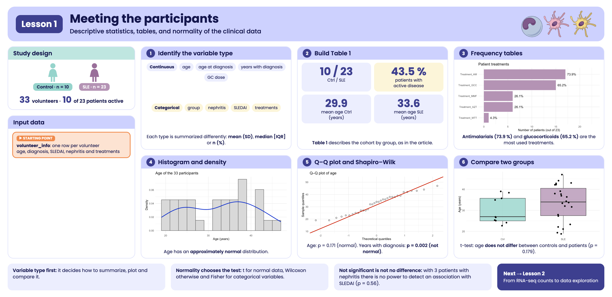

```{r, include = FALSE}
knitr::opts_chunk$set(
  collapse = TRUE,
  comment = "#>",
  message = FALSE,
  warning = FALSE,
  fig.align = "center",
  fig.width = 7,
  fig.height = 4.5
)
```

```{css, echo = FALSE, file = "lesson.css"}
```

## Welcome

Before analyzing the expression of thousands of genes, it is worth getting to know **the people** behind the samples: How old are they? How long have they had the diagnosis? What treatments do they receive? In this lesson we describe the 33 study participants using descriptive statistics, tables, and plots.

**What you need to know beforehand:** the basics of R and of `dplyr`/`ggplot2`. You do not need to know anything about RNA-seq.

**By the end you will be able to:**

1. Distinguish **continuous** and **categorical** variables, and know how to summarize each one.
2. Calculate the mean, median, standard deviation, and interquartile range.
3. Build frequency tables and a **Table 1** that describes the cohort.
4. Assess whether a variable follows a **normal distribution** using histograms, Q–Q plots, and the Shapiro–Wilk test.
5. Choose an appropriate test to compare two groups.

**Estimated time:** 45 to 60 minutes.

### Lesson map

```{=html}
<pre class="mermaid">
flowchart LR
  A["volunteer_info<br/>one row per volunteer"] --> B["Variable<br/>types"]
  B --> C["Numerical<br/>summaries"]
  B --> D["Frequency<br/>tables"]
  C --> E["Table 1"]
  D --> E
  C --> F["Distribution:<br/>histogram and Q–Q"]
  F --> G["Normality:<br/>Shapiro–Wilk"]
  G --> H["Compare<br/>groups"]
  G --> I["Figure S3"]
</pre>
<script type="module">
  import mermaid from "https://cdn.jsdelivr.net/npm/mermaid@11/dist/mermaid.esm.min.mjs";
  mermaid.initialize({ startOnLoad: true });
</script>
```

## Glossary

These are the terms we will use. Come back here whenever you need to.

- **Continuous variable**: can take any numerical value within a range (age, dose).
- **Categorical variable**: classifies observations into groups (group, nephritis yes/no).
- **Mean**: the average. It is sensitive to extreme values.
- **Median**: the middle value when the data are sorted. It is robust to extreme values.
- **Standard deviation (SD)**: how far the data are from the mean, on average.
- **Interquartile range (IQR)**: interval between the 25th percentile (Q1) and the 75th percentile (Q3); it contains the central half of the data.
- **Normal distribution**: a symmetric, bell-shaped distribution.
- **Histogram**: bar chart showing how many data points fall in each interval.
- **Density**: smoothed version of the histogram.
- **Q–Q plot**: compares the quantiles of the data with those of a theoretical normal distribution.
- **Shapiro–Wilk test**: statistical test of normality.
- **p-value**: probability of observing data as extreme as ours if the null hypothesis were true.
- **t-test**: compares the means of two groups; assumes normality.
- **Wilcoxon (Mann–Whitney) test**: compares two groups without assuming normality.
- **Fisher's exact test**: assesses the association between two categorical variables; works well with small samples.

```{r lesson_overview, echo = FALSE, out.width = "100%", fig.cap = "Visual summary of lesson 1."}

```

## 1. Setup

```{r setup}
library(GeneExprLupusMx) # our data
library(tidyverse)       # table manipulation (dplyr) and plots (ggplot2)
library(cowplot)         # combine several plots into a panel
```

We use the same colors for each group in all the lessons:

```{r colores}
group_color <- c(Ctrl = "#96d4ccff", SLE = "#b493b4ff")
```

## 2. The data: `volunteer_info`

`volunteer_info` has **one row per volunteer** (not per sample), with her clinical and recruitment information:

```{r}
dim(volunteer_info)
glimpse(volunteer_info)
```

Many columns only make sense for patients (for example, years with the diagnosis), so they are `NA` in controls. We store the patients in a separate object, because we will use it often:

```{r}
patients <- filter(volunteer_info, Group == "SLE")
nrow(patients)
```

## 3. **Step 1:** identify the type of each variable

The type of variable determines **how to summarize it, how to plot it, and which test to use**:

| Type | Variables in `volunteer_info` | Summarized with | Plotted with |
|------|-------------------------------|-----------------|--------------|
| Continuous | `Age_years`, `Age_at_diagnosis_years`, `Years_with_diagnosis`, `GCC_dose_mg` | mean (SD) or median [IQR] | histogram, boxplot, Q–Q |
| Categorical | `Group`, `Nephritis`, `SLEDAI` (0/1), `GCC_drug` | n (%) | bars |
| Logical (yes/no) | `Treatment_GCC`, `Treatment_AM`, `Treatment_MMF`, `Treatment_AZT`, `Treatment_MTT` | n (%) | bars |
| Date | `Time_of_recruitment` | range, count per month | bars by date |

::: {.alert .alert-info}
`SLEDAI` is stored as a number (0 or 1), but it is **categorical**: 1 indicates active disease (SLEDAI score ≥ 6) and 0 indicates no activity or low activity (0–5 points). Averaging it would not make much sense; it is better to count it.
:::

## 4. **Step 2:** summarize continuous variables

### 4.1 Mean, median, and spread

Let us start with age, comparing controls and patients:

```{r}
volunteer_info %>%
  group_by(Group) %>%
  summarise(n      = n(),
            mean   = mean(Age_years),
            sd     = sd(Age_years),
            median = median(Age_years),
            q1     = quantile(Age_years, 0.25),
            q3     = quantile(Age_years, 0.75),
            min    = min(Age_years),
            max    = max(Age_years))
```

Patients are, on average, about 4 years older than controls. In section 8 we will see whether this difference is larger than what we would expect by chance.

### 4.2 Summarize several variables at once

For the variables that only exist in patients, we convert the table to long format and summarize each variable. `na.rm = TRUE` ignores missing values:

```{r}
continuous_vars <- c("Age_at_diagnosis_years", "Years_with_diagnosis", "GCC_dose_mg")

patients %>%
  pivot_longer(all_of(continuous_vars), names_to = "variable", values_to = "value") %>%
  group_by(variable) %>%
  summarise(n      = sum(!is.na(value)),
            mean   = mean(value, na.rm = TRUE),
            sd     = sd(value, na.rm = TRUE),
            median = median(value, na.rm = TRUE),
            min    = min(value, na.rm = TRUE),
            max    = max(value, na.rm = TRUE))
```

Notice that `GCC_dose_mg` has **n = 13**, even though 15 patients receive glucocorticoids: in two cases the dose was not recorded.

::: {.alert .alert-warning}
**Mean or median?** If the data are symmetric, the mean and median are similar and the mean (with its SD) is a good summary. If there are extreme values or the distribution is skewed, use the median and the IQR. In `Years_with_diagnosis`, the median (4 years) is lower than the mean: a few patients with many years of diagnosis "pull" the mean upward.
:::

## 5. **Step 3:** tables of categorical variables

### 5.1 Frequencies and percentages

How many patients have nephritis?

```{r}
patients %>%
  dplyr::count(Nephritis) %>%
  mutate(percent = round(100 * n / sum(n), 1))
```

### 5.2 Treatments

Each treatment is in its own column (`TRUE`/`FALSE`). To count them all together, we convert them to long format. When summing `TRUE`/`FALSE`, R counts the `TRUE` values:

```{r}
treatments <- patients %>%
  pivot_longer(starts_with("Treatment_"), names_to = "treatment", values_to = "receives") %>%
  group_by(treatment) %>%
  summarise(n = sum(receives), percent = round(100 * mean(receives), 1)) %>%
  arrange(desc(n))

knitr::kable(treatments, col.names = c("Treatment", "n", "%"))
```

`knitr::kable()` turns any R table into a formatted table for documents like this one.

```{r treat_plot, fig.height = 3.5}
ggplot(treatments, aes(x = reorder(treatment, n), y = n)) +
  geom_col(fill = group_color["SLE"]) +
  geom_text(aes(label = paste0(percent, "%")), hjust = -0.2) +
  coord_flip() +
  scale_y_continuous(limits = c(0, 23)) +
  labs(x = NULL, y = "Number of patients (out of 23)", title = "Patient treatments") +
  theme_minimal()
```

Antimalarials (`AM`) and glucocorticoids (`GCC`) are the most frequent treatments.

### 5.3 Contingency tables

A **contingency table** cross-tabulates two categorical variables. Which glucocorticoid and what dose does each patient receive?

```{r}
table(drug = patients$GCC_drug, dose_mg = patients$GCC_dose_mg, useNA = "ifany")
```

`useNA = "ifany"` also shows missing values: 8 patients do not receive glucocorticoids (`<NA>` in both) and 2 receive PDS with no recorded dose.

::: {.callout-note}
**Challenge 1.** How many patients receive 0, 1, 2, or 3 different immunosuppressive treatments other than glucocorticoids (`AM`, `MMF`, `AZT`, `MTT`)?

*Hint:* `rowSums()` adds up columns row by row; `TRUE` values count as 1.
:::

<details class="callout-tip">
<summary>Show solution</summary>

```{r}
patients %>%
  mutate(n_treatments = rowSums(across(c(Treatment_AM, Treatment_MMF,
                                         Treatment_AZT, Treatment_MTT)))) %>%
  dplyr::count(n_treatments)
```

Most patients receive one or two of these treatments; 6 receive none.

</details>

## 6. **Step 4:** Table 1

Almost all clinical articles include a **Table 1** that describes the participants by group. We will build it with three small functions that turn a column into text with the usual format:

```{r}
mean_sd    <- function(x) sprintf("%.1f (%.1f)", mean(x, na.rm = TRUE), sd(x, na.rm = TRUE))
median_iqr <- function(x) sprintf("%.1f [%.1f–%.1f]", median(x, na.rm = TRUE),
                                  quantile(x, 0.25, na.rm = TRUE), quantile(x, 0.75, na.rm = TRUE))
n_pct      <- function(x) sprintf("%d (%.0f%%)", sum(x, na.rm = TRUE), 100 * mean(x, na.rm = TRUE))

mean_sd(volunteer_info$Age_years)
```

Now we apply each function to each group. `summarise()` creates one column per characteristic (with short names) and then we "pivot" the table so that the groups become columns:

```{r}
table1 <- volunteer_info %>%
  group_by(Group) %>%
  summarise(
    n                    = as.character(n()),
    age                  = mean_sd(Age_years),
    age_at_diagnosis     = mean_sd(Age_at_diagnosis_years),
    years_with_diagnosis = median_iqr(Years_with_diagnosis),
    sledai_active        = n_pct(SLEDAI == 1),
    nephritis            = n_pct(Nephritis == "Yes"),
    gcc                  = n_pct(Treatment_GCC),
    am                   = n_pct(Treatment_AM),
    mmf                  = n_pct(Treatment_MMF),
    azt                  = n_pct(Treatment_AZT),
    mtt                  = n_pct(Treatment_MTT)
  ) %>%
  pivot_longer(-Group, names_to = "characteristic") %>%
  pivot_wider(names_from = Group, values_from = value)

table1
```

To present it, we replace the short names with readable labels. Storing them in a separate vector keeps the **data** apart from their **presentation**:

```{r}
table1_labels <- c(
  n                    = "n",
  age                  = "Age, years, mean (SD)",
  age_at_diagnosis     = "Age at diagnosis, mean (SD)",
  years_with_diagnosis = "Years with diagnosis, median [IQR]",
  sledai_active        = "Active SLEDAI (≥ 6), n (%)",
  nephritis            = "Nephritis, n (%)",
  gcc                  = "Glucocorticoids, n (%)",
  am                   = "Antimalarials, n (%)",
  mmf                  = "Mycophenolate, n (%)",
  azt                  = "Azathioprine, n (%)",
  mtt                  = "Methotrexate, n (%)"
)

table1 %>%
  mutate(characteristic = table1_labels[characteristic]) %>%
  knitr::kable(col.names = c("Characteristic", "Ctrl", "SLE"))
```

::: {.caption-justify}
**Table 1.** Sociodemographic and clinical characteristics of the `r nrow(volunteer_info)` volunteers: `r sum(volunteer_info$Group == "Ctrl")` healthy controls (Ctrl) and `r sum(volunteer_info$Group == "SLE")` patients with systemic lupus erythematosus (SLE). Continuous variables are summarized as mean (SD) or median [IQR], and categorical variables as n (%). Active disease was defined as a SLEDAI score ≥ 6. SD, standard deviation; IQR, interquartile range; SLEDAI, SLE Disease Activity Index.

The original table can be found in the [article](https://www.frontiersin.org/journals/immunology/articles/10.3389/fimmu.2026.1771959/full).
:::

In controls, the clinical rows appear as `NA`, `NaN`, or `0 (NaN%)` because those variables do not apply: they have no diagnosis or treatment. In an article we would write them as "—".

::: {.callout-note}
**Challenge 2.** Replace the meaningless values for controls with `"—"`.

*Hint:* `grepl("NA|NaN", Ctrl)` detects those values.
:::

<details class="callout-tip">
<summary>Show solution</summary>

```{r}
table1 %>%
  mutate(Ctrl = ifelse(grepl("NA|NaN", Ctrl), "—", Ctrl),
         characteristic = table1_labels[characteristic]) %>%
  knitr::kable(col.names = c("Characteristic", "Ctrl", "SLE"))
```

</details>

## 7. **Step 5:** do they follow a normal distribution?

Many statistical tests (such as the t-test) assume that the data follow a **normal distribution**. Before using them, we need to check this. We will do it in three complementary ways.

### 7.1 Histogram with density curve

The histogram shows the shape of the data; the density curve smooths it. A normal distribution looks like a symmetric bell.

```{r hist_age, fig.height = 3.5}
ggplot(volunteer_info, aes(x = Age_years)) +
  geom_histogram(aes(y = after_stat(density)), binwidth = 2,
                 fill = "grey85", color = "grey30") +
  geom_density(color = "blue3", linewidth = 1) +
  labs(x = "Age (years)", y = "Density", title = "Age of the 33 participants") +
  theme_minimal()
```

`after_stat(density)` puts the histogram on the same scale as the density curve.

### 7.2 Q–Q plot

The Q–Q plot compares each data point with the value it would have if the distribution were perfectly normal. **If the points follow the red line, the data are approximately normal**; if they curve or move away from the line at the ends, they are not.

```{r qq_age, fig.height = 3.5}
ggplot(volunteer_info, aes(sample = Age_years)) +
  stat_qq(shape = 1, size = 2) +
  stat_qq_line(color = "red3", linewidth = 1) +
  labs(x = "Theoretical quantiles", y = "Sample quantiles", title = "Q–Q plot of age") +
  theme_minimal()
```

The age points follow the line quite well.

### 7.3 Shapiro–Wilk test

The Shapiro–Wilk test puts a number on what we see in the plots:

- **Null hypothesis:** the data come from a normal distribution.
- **p < 0.05:** there is evidence that they are **not** normal.
- **p ≥ 0.05:** there is no evidence against normality.

```{r}
shapiro.test(volunteer_info$Age_years)
```

Let us apply it to all four continuous variables at once:

```{r}
normality <- tibble(variable = c("Age_years", continuous_vars)) %>%
  mutate(
    values  = map(variable, ~ na.omit(volunteer_info[[.x]])),
    n       = map_int(values, length),
    W       = map_dbl(values, ~ shapiro.test(.x)$statistic),
    p_value = map_dbl(values, ~ shapiro.test(.x)$p.value),
    normal  = p_value >= 0.05 # TRUE = compatible with normality
  ) %>%
  dplyr::select(-values)

knitr::kable(normality, digits = 3)
```

Age and age at diagnosis are compatible with a normal distribution; years with diagnosis and glucocorticoid dose are **not**.

::: {.alert .alert-warning}
**Beware of small samples.** With little data (here, n = 13 for the dose) the test has low power: it may fail to detect real deviations. And p ≥ 0.05 does **not prove** normality; it only says there is no evidence against it. That is why the test is always combined with the plots.
:::

## 8. **Step 6:** compare two groups

Normality determines which test to use:

| Data | Test | R function |
|------|------|------------|
| Normal | t-test | `t.test()` |
| Not normal or small n | Wilcoxon (Mann–Whitney) | `wilcox.test()` |
| Two categorical variables | Fisher's exact | `fisher.test()` |

### 8.1 Does age differ between controls and patients?

Age is approximately normal, so we use the t-test:

```{r age_box, fig.height = 3.5}
ggplot(volunteer_info, aes(x = Group, y = Age_years, fill = Group)) +
  geom_boxplot(alpha = 0.8, outlier.shape = NA) +
  geom_jitter(width = 0.15, size = 2) +
  scale_fill_manual(values = group_color) +
  labs(x = NULL, y = "Age (years)") +
  theme_minimal() +
  theme(legend.position = "none")

t.test(Age_years ~ Group, data = volunteer_info)
```

p > 0.05: **there is no evidence that age differs** between controls and patients. This is good news: the groups are comparable in age, so age should not confound the gene expression comparisons.

### 8.2 Is nephritis associated with disease activity?

Both variables are categorical and very few patients have nephritis, so we use Fisher's exact test:

```{r}
table(SLEDAI = patients$SLEDAI, Nephritis = patients$Nephritis)
fisher.test(table(patients$SLEDAI, patients$Nephritis))
```

With only 3 patients with nephritis there is no power to detect an association (p > 0.05). "Not finding a difference" is **not the same** as "proving there is no difference".

::: {.callout-note}
**Challenge 3.** Have patients with active disease (`SLEDAI == 1`) had the diagnosis for more years than those with no or low activity (`SLEDAI == 0`)? Choose the test according to section 7.3.

*Hint:* `Years_with_diagnosis` is **not** normal.
:::

<details class="callout-tip">
<summary>Show solution</summary>

Since `Years_with_diagnosis` is not normal, we use the Wilcoxon test:

```{r}
patients %>%
  group_by(SLEDAI) %>%
  summarise(n = n(), median_years = median(Years_with_diagnosis))

wilcox.test(Years_with_diagnosis ~ SLEDAI, data = patients, exact = FALSE)
```

The medians are almost equal (4 and 4.5 years) and p > 0.05: there is no evidence of a difference. `exact = FALSE` avoids a warning when there are tied values.

</details>

## 9. To finish: the article figure

Let us bring together what we have learned in **Supplementary Figure S3** of the article: for each continuous variable, a histogram with its density curve (top) and its Q–Q plot (bottom). Since we will repeat the same thing four times, we store it in a function:

```{r}
distribution_panel <- function(x, title, binwidth) {
  df <- data.frame(value = na.omit(x))
  p_value <- shapiro.test(df$value)$p.value

  p_hist <- ggplot(df, aes(x = value)) +
    geom_histogram(aes(y = after_stat(density)), binwidth = binwidth,
                   fill = "grey85", color = "grey30") +
    geom_density(color = "blue3", linewidth = 1) +
    labs(x = NULL, y = "Density",
         title = sprintf("%s (Shapiro–Wilk p = %.3f)", title, p_value)) +
    theme_classic(base_size = 12)

  p_qq <- ggplot(df, aes(sample = value)) +
    stat_qq(shape = 1, size = 2) +
    stat_qq_line(color = "red3", linewidth = 1) +
    labs(x = "Theoretical quantiles", y = "Sample quantiles") +
    theme_classic(base_size = 12)

  plot_grid(p_hist, p_qq, ncol = 1, align = "v")
}
```

```{r figura_s3, fig.width = 20, fig.height = 7, out.width = "100%"}
figure_s3 <- plot_grid(
  distribution_panel(volunteer_info$Age_years,        "Age",                  binwidth = 2),
  distribution_panel(patients$Age_at_diagnosis_years, "Age at diagnosis",     binwidth = 2),
  distribution_panel(patients$Years_with_diagnosis,   "Years with diagnosis", binwidth = 2),
  distribution_panel(patients$GCC_dose_mg,            "GC dose, mg",          binwidth = 0.5),
  labels = c("A", "B", "C", "D"), label_size = 18, nrow = 1
)
figure_s3
```

::: {.caption-justify}
**Supplementary Figure S3.** Distribution and normality assessment of the continuous variables. Each panel shows the histogram with the density curve (top) and the Q–Q plot (bottom) of **(A)** the age of all volunteers (n = `r sum(!is.na(volunteer_info$Age_years))`) and, in patients (n = `r nrow(patients)`), **(B)** age at diagnosis, **(C)** time since diagnosis, and **(D)** glucocorticoid (GC) dose. The title of each panel includes the p-value of the Shapiro–Wilk test. In the Q–Q plots, the sample quantiles are compared with the theoretical quantiles of a normal distribution (red line). The figures illustrate the distributional properties of the variables and their deviation from normality, assessed with the Shapiro–Wilk test.

The original supplementary figure can be found in the [supplementary material of the article](https://www.frontiersin.org/journals/immunology/articles/10.3389/fimmu.2026.1771959/full#supplementaryMaterial).
:::

To save it in high resolution:

```{r save_figure, eval = FALSE}
ggsave("Figure_S3_normality.png", figure_s3, width = 20, height = 7, dpi = 300)
```

## 10. Summary

| Step | Key function | What for? |
|------|--------------|-----------|
| Get to know the data | `glimpse()` | See the types and values of each column |
| Summarize continuous variables | `summarise()` with `mean()`, `sd()`, `median()`, `quantile()` | Describe center and spread |
| Count categorical variables | `dplyr::count()`, `table()` | Frequencies and contingency tables |
| Table 1 | `summarise()` + `pivot_wider()` + `knitr::kable()` | Describe the cohort by group |
| Distribution | `geom_histogram()` + `geom_density()` | See the shape of the data |
| Normality | `stat_qq()`, `shapiro.test()` | Decide which test to use |
| Compare groups | `t.test()`, `wilcox.test()`, `fisher.test()` | Assess differences between groups |
| Figure | `cowplot::plot_grid()` | Combine plots into a panel |

### Common beginner mistakes

- **Averaging categorical variables** coded as numbers (such as `SLEDAI` 0/1).
- **Reporting the mean of skewed data**: use the median [IQR].
- **Forgetting the `NA` values**: use `na.rm = TRUE` and report the actual n of each variable.
- **Using the t-test without checking normality**.
- **Interpreting p ≥ 0.05 as "there is no difference"**: with small samples, statistical power may be lacking.

## 11. Next steps

With the cohort characterized, the next step is to analyze the gene expression of these same participants. In the lesson [From RNA-seq counts to data exploration](intro_RNAseq_en.html) you will import and normalize the counts, and explore the structure of the data with *heatmaps* and PCA. What you learned here informs the design of that analysis: for example, age does not differ between groups, so it is not an important source of confounding.

To continue, click the **Next lesson: From RNA-seq counts to data exploration** button at the bottom of this page.

```{=html}
<nav class="lesson-nav">
  <a class="lesson-prev" href="intro_en.html">← Previous lesson: Get started with the package</a>
  <a class="lesson-next" href="intro_RNAseq_en.html">Next lesson: From RNA-seq counts to data exploration →</a>
</nav>
<a class="back-to-top" href="#top" onclick="window.scrollTo({top: 0, behavior: 'instant'}); return false;" title="Back to the top of the page">↑ Back to top</a>
```

## Session information

```{r}
sessionInfo()
```
