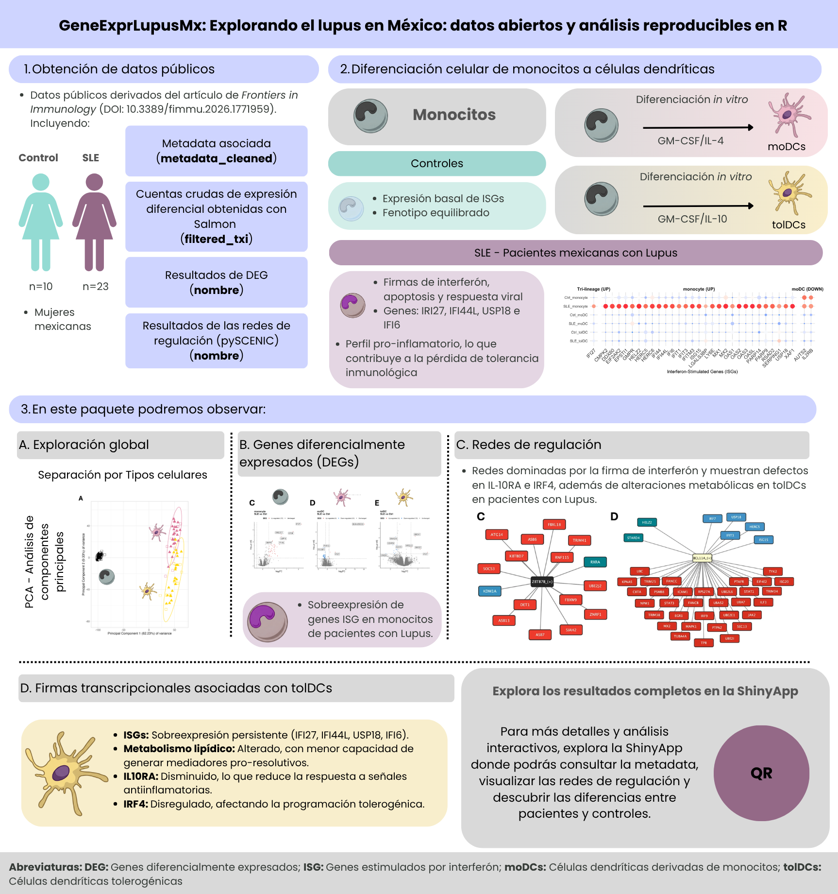

```{r, include = FALSE}
knitr::opts_chunk$set(
  collapse = TRUE,
  comment = "#>",
  message = FALSE,
  warning = FALSE,
  fig.align = "center",
  fig.width = 7,
  fig.height = 4.5
)
```

```{css, echo = FALSE, file = "lesson.css"}
```

## Bienvenida

Esta lección es para ti si **estás comenzando a analizar datos de transcriptómica** (RNA-seq). Usaremos datos reales de mujeres mexicanas con lupus y de controles sanos para recorrer, paso a paso, el camino que va de una tabla de números a una interpretación biológica.

**Lo que necesitas saber antes:** lo básico de R (crear objetos, usar funciones) y, si es posible, un poco de `dplyr` y `ggplot2`. No necesitas saber de RNA-seq: lo explicamos sobre la marcha.

**Al terminar podrás:**

1. Explicar qué son una **matriz de cuentas** y una tabla de **metadatos**.
2. Construir un objeto `DESeqDataSet`, que es la estructura que usa `DESeq2`.
3. Explicar **por qué** hay que normalizar y **cómo** lo hace `DESeq2`.
4. Transformar los datos (VST) y explorarlos con gráficas de genes, *heatmaps* y PCA.
5. Relacionar lo que ves en las gráficas con la biología del lupus.

**Tiempo estimado:** 1 a 1.5 horas.

### Mapa de la lección

```{=html}
<pre class="mermaid">
flowchart TB
  subgraph pre["Ya hecho en el paquete"]
    direction LR
    A["Lecturas (FASTQ)"] -- "Salmon + tximport" --> B["filtered_txi<br/>cuentas"]
    M["metadata_cleaned<br/>una fila por muestra"]
    V["volunteer_info<br/>una fila por voluntaria"]
  end
  subgraph lec["En esta lección"]
    direction LR
    C["DESeqDataSet"] --> D["Filtrado"] --> E["Normalización"] --> F["VST"] --> G["Exploración<br/>genes · heatmap · PCA"]
  end
  pre --> lec
</pre>
<script type="module">
  import mermaid from "https://cdn.jsdelivr.net/npm/mermaid@11/dist/mermaid.esm.min.mjs";
  mermaid.initialize({ startOnLoad: true });
</script>
```

## Glosario

Estos son los términos que usaremos. Vuelve aquí cada vez que lo necesites.

- **Lectura (*read*)**: fragmento de RNA secuenciado.
- **Cuenta**: número de lecturas asignadas a un gen en una muestra.
- **Matriz de cuentas**: tabla de genes (filas) × muestras (columnas).
- **Metadatos**: información que describe a cada muestra.
- **Tamaño de librería**: total de lecturas de una muestra (profundidad de secuenciación).
- **Normalización**: corrección que hace comparables las muestras entre sí.
- **VST**: transformación tipo logaritmo que estabiliza la varianza.
- **z-score**: valor estandarizado de un gen (en desviaciones estándar respecto a su media).
- **PCA**: técnica que resume muchas variables en unos pocos ejes.
- **Efecto de lote (*batch effect*)**: diferencias entre muestras causadas por *cuándo* o *cómo* se procesaron, no por la biología.
- **Columna llave**: columna que comparten dos tablas y que sirve para unirlas (aquí, `Volunteer_ID`).
- **ISG** (*interferon-stimulated genes*): genes que se encienden en respuesta al interferón.
- **SLEDAI** (*SLE Disease Activity Index*): puntaje de actividad del lupus; más alto = enfermedad más activa.

## 1. Contexto biológico: ¿qué estamos estudiando?

El **lupus eritematoso sistémico** (LES, o *SLE* en inglés) es una enfermedad **autoinmune**: el sistema inmune ataca por error los tejidos del propio cuerpo. Afecta sobre todo a mujeres (alrededor de 9 de cada 10 casos). Uno de sus rasgos moleculares más conocidos es la **firma de interferón**: en las pacientes se encienden muchos genes que normalmente responden a infecciones virales, llamados *genes estimulados por interferón* (ISG).

En este estudio se analizaron tres tipos de células del sistema inmune:

- **Monocitos** (`monocyte`): células que circulan en la sangre. Se obtuvieron directamente de cada participante.
- **Células dendríticas derivadas de monocitos** (`moDC`): se obtienen al cultivar los monocitos con GM-CSF e IL-4. Son "activadoras", porque presentan antígenos y encienden la respuesta inmune.
- **Células dendríticas tolerogénicas** (`tolDC`): se obtienen al cultivar los monocitos con GM-CSF e IL-10. Su papel es "calmar" la respuesta inmune y promover la tolerancia.

```{r overview, echo = FALSE, out.width = "100%", fig.cap = "Resumen del estudio y del contenido del paquete."}

```

**Diseño del estudio:** participaron 33 mujeres mexicanas, 10 controles sanas (`Ctrl`) y 23 pacientes con lupus (`SLE`). De cada una se obtuvieron los tres tipos celulares, lo que da **33 × 3 = 99 muestras**. Las voluntarias se reclutaron entre junio de 2022 y febrero de 2023. Los datos provienen del artículo:

> Hernández-Ledesma AL, Coss-Navarrete EL, *et al* (2026) [Gene expression profiling of dendritic cell tolerance dysfunction in women with systemic lupus erythematosus](https://www.frontiersin.org/journals/immunology/articles/10.3389/fimmu.2026.1771959/full). *Front. Immunol.* 17:1771959. [doi: 10.3389/fimmu.2026.1771959](https://doi.org/10.3389/fimmu.2026.1771959).

> **Nuestra pregunta guía:** ¿cambia la expresión de los genes en estas células cuando una persona tiene lupus?

## 2. RNA-seq en dos minutos

1. Se extrae el **RNA** de las células. Cada gen activo produce copias de RNA: cuanto más activo, más copias.
2. El RNA se fragmenta y se **secuencia**. Cada fragmento leído se llama **lectura** (*read*).
3. Un programa (aquí, **Salmon**) identifica a qué gen pertenece cada lectura y las **cuenta**.

El resultado es una tabla: cuántas lecturas tiene cada gen en cada muestra. A esa tabla la llamamos **matriz de cuentas**. Más lecturas significa más expresión, pero solo en términos *relativos*, como veremos en la sección de normalización.

::: {.alert .alert-info}
**Buena noticia:** los pasos más pesados (alinear las lecturas con Salmon e importarlas con `tximport`) ya están hechos. El paquete incluye el resultado listo para analizar.
:::

## 3. Preparación

### Instalación

Instala el paquete desde [GitHub](https://github.com/EveliaCoss/GeneExprLupusMx) y `DESeq2` desde [Bioconductor](https://bioconductor.org/packages/DESeq2). Solo necesitas hacerlo una vez.

```{r install, eval = FALSE}
install.packages(c("remotes", "BiocManager", "tidyverse"))
remotes::install_github("EveliaCoss/GeneExprLupusMx")
BiocManager::install("DESeq2")
```

### Cargar los paquetes

```{r setup}
library(GeneExprLupusMx) # nuestros datos
library(DESeq2)          # normalización y análisis de RNA-seq
library(tidyverse)       # manipulación de tablas (dplyr) y gráficas (ggplot2)
library(ggrepel)         # etiquetas que no se enciman en ggplot2
library(cowplot)         # unir varias gráficas en un panel
```

::: {.alert .alert-warning}
**El orden importa.** `DESeq2` y `dplyr` tienen funciones con el mismo nombre (por ejemplo, `count()` y `select()`). R usa la del último paquete cargado; por eso cargamos `tidyverse` al final. Si tienes dudas, escribe el paquete explícitamente: `dplyr::count()`.
:::

Definimos los colores que usaremos en todas las gráficas, para que cada tipo celular y cada grupo tengan siempre el mismo color:

```{r colores}
cell_color  <- c(monocyte = "black", moDC = "palevioletred", tolDC = "gold1")
group_color <- c(Ctrl = "#96d4ccff", SLE = "#b493b4ff")
```

## 4. **Paso 1:** conocer los datos

Antes de analizar cualquier cosa hay que **mirar los datos**. Este paso evita la mayoría de los errores.

### 4.1 La matriz de cuentas: `filtered_txi`

`filtered_txi` es una lista con varias matrices. La más importante es `counts`:

```{r}
names(filtered_txi)
dim(filtered_txi$counts) # genes x muestras
filtered_txi$counts[1:5, 1:4]
```

- **Filas = genes** (21,718 genes, identificados por su símbolo, por ejemplo `A2M`).
- **Columnas = muestras** (99). El nombre de cada muestra tiene dos partes: `QR011_1` = paciente `QR011`, tipo celular `1` (`_0` = monocito, `_1` = moDC, `_3` = tolDC).

Observa dos detalles:

1. **Hay números con decimales.** Salmon *estima* las cuentas, porque algunas lecturas podrían venir de más de un gen. No hay que redondearlas a mano: `DESeq2` lo hará por nosotros.
2. **Hay muchos ceros.** ¿Qué proporción de la tabla es cero?

```{r}
mean(filtered_txi$counts == 0)
```

Y los valores son muy desiguales. Veamos la primera muestra:

```{r}
summary(filtered_txi$counts[, 1])
```

La mitad de los genes tiene pocas lecturas y unos cuantos tienen cientos de miles. Esta desigualdad será importante más adelante.

### 4.2 Los metadatos: `metadata_cleaned`

Los metadatos describen **quién es cada muestra**: su grupo, tipo celular, edad, tratamiento, actividad de la enfermedad, etc.

```{r}
metadata_cleaned %>%
  dplyr::select(sample_ID, Group, Cell_type, Age, GC, SLEDAI_category) %>%
  head()
```

¿Cuántas muestras hay de cada combinación?

```{r}
metadata_cleaned %>%
  dplyr::count(Group, Cell_type)
```

Las tres muestras de una misma paciente **no son independientes**: comparten su genética, su edad y su historia clínica. Guardemos el identificador de cada voluntaria en una columna `Volunteer_ID`:

```{r}
metadata_cleaned$Volunteer_ID <- factor(sub("_.*", "", metadata_cleaned$sample_ID))
nlevels(metadata_cleaned$Volunteer_ID) # número de participantes
```

### 4.3 ¿Coinciden las cuentas y los metadatos?

Es la comprobación **más importante** de todo el análisis: la columna 1 de la matriz de cuentas debe corresponder a la fila 1 de los metadatos, la 2 a la 2, y así sucesivamente. Si el orden no coincide, todas las conclusiones serán falsas y R **no te avisará**.

```{r}
all(colnames(filtered_txi$counts) == metadata_cleaned$sample_ID)
```

`TRUE`: podemos continuar.

::: {.callout-note}
**Reto 1.** ¿Cuántas pacientes con lupus tienen nefritis (daño renal)? *Pista:* cada paciente aparece tres veces; filtra un solo tipo celular antes de contar.
:::

<details class="callout-tip">
<summary>Ver solución</summary>

```{r}
metadata_cleaned %>%
  filter(Cell_type == "monocyte", Group == "SLE") %>%
  dplyr::count(Nephritis)
```

</details>

### 4.4 La información de cada voluntaria: `volunteer_info`

`metadata_cleaned` tiene **una fila por muestra**. Pero hay datos que pertenecen a la **persona**, no a la muestra: cuándo fue reclutada, cuántos años lleva con el diagnóstico o qué tratamientos recibe. Si los pusiéramos en `metadata_cleaned`, cada dato aparecería repetido tres veces. Por eso viven en otra tabla, `volunteer_info`, con **una fila por voluntaria**. Si hiciste la lección [Conociendo a las participantes](clinical_es.html), ya la conoces:

```{r}
dim(volunteer_info) # 33 voluntarias
head(volunteer_info)
```

Las dos tablas comparten la columna `Volunteer_ID`. Es la **columna llave**: nos permitirá unirlas cuando lo necesitemos (lo harás en el Reto 4).

Con esta tabla, el Reto 1 se resuelve en una línea, porque cada persona aparece una sola vez:

```{r}
volunteer_info %>%
  dplyr::count(Group, Nephritis)
```

¿Cuántas voluntarias se reclutaron cada mes?

```{r}
volunteer_info %>%
  mutate(Recruitment = format(Time_of_recruitment, "%Y-%m")) %>% # "2022-06", "2022-07", ...
  dplyr::count(Recruitment, Group) %>%
  pivot_wider(names_from = Group, values_from = n, values_fill = 0)
```

Fíjate en enero de 2023: se reclutaron 10 pacientes y solo 2 controles. Recuerda este detalle; volveremos a él en el PCA.

## 5. **Paso 2:** crear el objeto `DESeqDataSet`

`DESeq2` guarda todo en un solo objeto, como un **expediente** con tres partes:

| Parte | Qué contiene | Cómo verla |
|-------|--------------|------------|
| Cuentas | La matriz genes × muestras | `counts(dds)` |
| Metadatos | La información de cada muestra | `colData(dds)` |
| Diseño | Qué variables explican las diferencias | `design(dds)` |

Antes de crearlo elegimos los **niveles de referencia**, es decir, contra qué comparamos. Lo natural es comparar contra los controles sanos (`Ctrl`) y contra los monocitos, la célula de origen.

```{r}
metadata_cleaned$Group     <- relevel(metadata_cleaned$Group, ref = "Ctrl")
metadata_cleaned$Cell_type <- relevel(metadata_cleaned$Cell_type, ref = "monocyte")

dds <- DESeqDataSetFromTximport(txi     = filtered_txi,
                                colData = metadata_cleaned,
                                design  = ~ Cell_type + Group)
dds
```

La fórmula `~ Cell_type + Group` se lee: *"la expresión de cada gen depende del tipo celular y del grupo (lupus o control)"*.

::: {.alert .alert-info}
Al usar `DESeqDataSetFromTximport()` aparece el mensaje `using counts and average transcript lengths from tximport`. Significa que `DESeq2` también guardó la **longitud de los transcritos** de cada gen en cada muestra y la usará al normalizar.
:::

## 6. **Paso 3:** filtrar los genes poco expresados

Un gen con 0 o 2 lecturas en casi todas las muestras no aporta información: es ruido. Lo quitamos.

**Regla:** conservamos los genes con **al menos 10 lecturas en al menos 10 muestras**. Elegimos 10 muestras porque es el tamaño del grupo más pequeño (10 controles por tipo celular). Así no descartamos un gen que solo se exprese en ese grupo.

```{r}
keep <- rowSums(counts(dds) >= 10) >= 10
table(keep) # FALSE = se eliminan, TRUE = se conservan
dds <- dds[keep, ]
dim(dds)
```

## 7. **Paso 4:** normalización

### 7.1 ¿Por qué hay que normalizar?

Imagina dos muestras con un mismo gen X:

```{r}
tibble(sample      = c("A", "B"),
       total_reads = c(10e6, 20e6),
       geneX_reads = c(100, 200)) %>%
  mutate(geneX_per_million = geneX_reads / total_reads * 1e6)
```

La muestra B tiene el doble de lecturas del gen X, pero **también se secuenció el doble**. Una vez corregido, el gen X se expresa igual en las dos. Esa corrección es la **normalización**.

¿Varía mucho la profundidad de secuenciación en nuestros datos?

```{r library_size}
tibble(sample_ID = colnames(dds),
       million_reads  = colSums(counts(dds)) / 1e6,
       Cell_type = dds$Cell_type) %>%
  ggplot(aes(x = reorder(sample_ID, million_reads), y = million_reads, fill = Cell_type)) +
  geom_col() +
  scale_fill_manual(values = cell_color) +
  labs(x = "Muestras (ordenadas)", y = "Millones de lecturas", fill = "Tipo celular",
       title = "Tamaño de librería por muestra") +
  theme_minimal() +
  theme(axis.text.x = element_blank())
```

Sí: algunas muestras tienen varias veces más lecturas que otras. **Sin normalizar, compararíamos profundidad de secuenciación, no biología.**

### 7.2 ¿Cómo normaliza DESeq2?

`DESeq2` usa el método de la **mediana de las razones**. En palabras sencillas:

1. Para cada gen calcula una muestra "promedio" de referencia (la media geométrica de todas las muestras).
2. Divide cada muestra entre esa referencia, gen por gen.
3. La **mediana** de esas divisiones es el **factor de normalización** de la muestra. Usar la mediana evita que unos pocos genes muy expresados distorsionen el resultado.

Con datos de `tximport` hay un detalle extra: además de la profundidad, se corrige la **longitud de los transcritos**, que puede variar entre muestras. Por eso, en lugar de un solo número por muestra (`sizeFactors`), `DESeq2` guarda una tabla de factores gen × muestra (`normalizationFactors`).

```{r}
dds <- estimateSizeFactors(dds)
sizeFactors(dds)                    # NULL: con tximport no se usa
normalizationFactors(dds)[1:4, 1:4] # factores gen x muestra
```

Con los factores calculados ya podemos obtener las **cuentas normalizadas**:

```{r}
norm_counts <- counts(dds, normalized = TRUE)
norm_counts[1:4, 1:4]
```

::: {.alert .alert-warning}
**Importante:** las cuentas normalizadas sirven para **comparar y graficar**. Para el análisis de expresión diferencial (`DESeq()`) siempre se usan las **cuentas crudas**, porque `DESeq2` aplica la normalización internamente. Nunca le pases cuentas ya normalizadas.
:::

## 8. **Paso 5:** transformación estabilizadora de la varianza (VST)

### 8.1 ¿Por qué otra transformación?

Las cuentas normalizadas todavía tienen un problema: **los genes muy expresados varían mucho más que los poco expresados**, solo por su escala. Si hiciéramos un PCA o un *heatmap* con ellas, unos cuantos genes muy abundantes dominarían el resultado.

La solución es usar una escala logarítmica. Pero `log2(x + 1)` exagera el ruido de los genes con pocas cuentas. La **VST** (*variance stabilizing transformation*) es un logaritmo "inteligente" que corrige eso.

```{r vsd}
vsd <- vst(dds, blind = FALSE)
assay(vsd)[1:4, 1:4] # valores en escala aproximadamente log2
```

::: {.alert .alert-info}
**¿`blind = TRUE` o `blind = FALSE`?** Con `blind = FALSE`, la transformación conoce el diseño (`~ Cell_type + Group`) y no confunde las diferencias biológicas esperadas con ruido. Es lo recomendado para gráficas y análisis posteriores. Usa `blind = TRUE` si quieres una exploración que no sepa nada del diseño, por ejemplo, para control de calidad.
:::

Comprobémoslo: la gráfica muestra, para cada gen, su expresión media (eje x) contra su desviación estándar (eje y). Lo ideal es una línea **plana**: que la variabilidad no dependa de cuánto se expresa el gen.

```{r mean_sd, fig.height = 4}
mean_vs_sd <- function(mat, label) {
  tibble(mean = rowMeans(mat), sd = apply(mat, 1, sd), scale = label)
}

bind_rows(mean_vs_sd(log2(norm_counts + 1), "log2(cuentas normalizadas + 1)"),
          mean_vs_sd(assay(vsd), "VST")) %>%
  ggplot(aes(x = mean, y = sd)) +
  geom_point(alpha = 0.05, size = 0.4) +
  geom_smooth(color = "red", se = FALSE) +
  facet_wrap(~ scale) +
  labs(x = "Expresión media del gen", y = "Desviación estándar") +
  theme_minimal()
```

Con `log2(x + 1)`, los genes de baja expresión (izquierda) tienen una variabilidad inflada. Con VST la línea roja queda más plana.

### 8.2 ¿Funcionó la normalización?

Si todo salió bien, las distribuciones de todas las muestras deben quedar **alineadas**. Cada caja es una muestra:

```{r norm_check, fig.height = 6.5}
to_long <- function(mat, stage) {
  as.data.frame(mat) %>%
    rownames_to_column("gene") %>%
    pivot_longer(-gene, names_to = "sample_ID", values_to = "value") %>%
    mutate(stage = stage)
}

bind_rows(to_long(log2(counts(dds) + 1), "1. log2(cuentas crudas + 1)"),
          to_long(log2(norm_counts + 1), "2. log2(cuentas normalizadas + 1)"),
          to_long(assay(vsd), "3. VST")) %>%
  left_join(metadata_cleaned, by = "sample_ID") %>%
  ggplot(aes(x = sample_ID, y = value, fill = Cell_type)) +
  geom_boxplot(outlier.shape = NA, linewidth = 0.2, color = "grey50") + # contorno gris: visible sobre el negro
  facet_wrap(~ stage, ncol = 1, scales = "free_y") +
  scale_fill_manual(values = cell_color) +
  labs(x = "Muestras", y = "Expresión", fill = "Tipo celular") +
  theme_minimal() +
  theme(axis.text.x = element_blank())
```

En el panel 1 las cajas suben y bajan de una muestra a otra; en los paneles 2 y 3 quedan a la misma altura. La normalización funcionó.

## 9. **Paso 6:** explorar genes individuales

### 9.1 ¿Tienen sentido biológico los datos?

Antes de buscar algo nuevo, comprueba algo que **ya sabes**. Si los datos son buenos, los genes marcadores de cada tipo celular deben comportarse como se espera:

- **CD14**: marcador clásico de monocitos.
- **CD1A** y **CD209** (DC-SIGN): marcadores de células dendríticas.

Primero preparamos una tabla en formato largo con la expresión VST y los metadatos. Es el formato que prefiere `ggplot2`:

```{r}
expr_long <- to_long(assay(vsd), "VST") %>%
  dplyr::select(gene, sample_ID, expression = value) %>%
  left_join(metadata_cleaned, by = "sample_ID")
head(expr_long)
```

```{r markers}
expr_long %>%
  filter(gene %in% c("CD14", "CD1A", "CD209")) %>%
  ggplot(aes(x = Cell_type, y = expression, fill = Cell_type)) +
  geom_boxplot(outlier.shape = NA, alpha = 0.8, color = "grey50") +
  geom_jitter(width = 0.15, size = 0.8, alpha = 0.6, color = "grey50") +
  facet_wrap(~ gene, scales = "free_y") +
  scale_fill_manual(values = cell_color) +
  labs(x = NULL, y = "Expresión (VST)", title = "Genes marcadores de tipo celular") +
  theme_minimal() +
  theme(legend.position = "none")
```

`CD14` es alto en monocitos y `CD1A` en moDC, tal como esperábamos. Los datos tienen sentido.

### 9.2 La firma de interferón en lupus

Ahora sí, la pregunta del estudio. Veamos cuatro genes estimulados por interferón (ISG) reportados en el artículo: **IFI27, IFI44L, USP18 e IFI6**.

```{r isg_genes, fig.height = 5.5}
isg <- c("IFI27", "IFI44L", "USP18", "IFI6")

expr_long %>%
  filter(gene %in% isg) %>%
  ggplot(aes(x = Cell_type, y = expression, fill = Group)) +
  geom_boxplot(outlier.shape = NA, alpha = 0.8) +
  geom_point(position = position_jitterdodge(jitter.width = 0.15), size = 0.7, alpha = 0.6) +
  facet_wrap(~ gene, scales = "free_y") +
  scale_fill_manual(values = group_color) +
  labs(x = NULL, y = "Expresión (VST)", fill = "Grupo",
       title = "Genes estimulados por interferón") +
  theme_minimal()
```

**¿Qué observas?** En los **monocitos**, las pacientes con lupus (lila) expresan más estos genes que los controles (verde agua). Fíjate también en que los puntos de las pacientes están muy dispersos: algunas pacientes tienen valores muy altos y otras, valores parecidos a los controles. En moDC y tolDC la diferencia es mucho menor: al diferenciarse *in vitro*, lejos del ambiente inflamatorio del cuerpo, las células "olvidan" en parte la señal de interferón.

::: {.alert .alert-warning}
**Esto todavía no es una prueba estadística.** Una gráfica sugiere diferencias; para afirmarlas se necesita un análisis de expresión diferencial (por ejemplo, con `DESeq()`), que toma en cuenta la variabilidad y las comparaciones múltiples.
:::

::: {.callout-note}
**Reto 2.** En el artículo se reporta que en las tolDC de pacientes con lupus disminuye **IL10RA**, el receptor de la señal antiinflamatoria IL-10. Grafica `IL10RA` e `IRF4` por tipo celular y grupo. ¿Ves alguna diferencia?
:::

<details class="callout-tip">
<summary>Ver solución</summary>

```{r}
expr_long %>%
  filter(gene %in% c("IL10RA", "IRF4")) %>%
  ggplot(aes(x = Cell_type, y = expression, fill = Group)) +
  geom_boxplot(outlier.shape = NA) +
  facet_wrap(~ gene, scales = "free_y") +
  scale_fill_manual(values = group_color) +
  theme_minimal()
```

</details>

## 10. **Paso 7:** *heatmap* con z-scores

Un *heatmap* muestra muchos genes y muestras a la vez con colores. Pero cada gen tiene su propia escala (uno puede rondar 6 y otro 15), así que primero los **estandarizamos** con el **z-score**:

$$z = \frac{\text{expresión} - \text{media del gen}}{\text{desviación estándar del gen}}$$

Un z-score de `+2` significa *"este gen está 2 desviaciones estándar por encima de su propio promedio en esta muestra"*. Así todos los genes quedan en la misma escala.

::: {.alert .alert-warning}
Calcula los z-scores sobre los **datos transformados (VST)**, nunca sobre las cuentas crudas. Las cuentas crudas no están corregidas por profundidad de secuenciación, así que el *heatmap* mostraría el tamaño de librería en vez de la biología.
:::

```{r}
vsd_mat <- assay(vsd)
vsd_mat <- vsd_mat[apply(vsd_mat, 1, var) > 0, ] # quitar genes sin variación
zscore_mat <- t(scale(t(vsd_mat)))               # scale() trabaja por columnas: transponemos
dim(zscore_mat)
round(zscore_mat[1:4, 1:4], 2)
```

Dibujamos el *heatmap* de un conjunto de ISG, con las muestras agrupadas por tipo celular y grupo:

```{r heatmap, fig.width = 8, fig.height = 4}
isg_extended <- c("IFI27", "IFI44L", "IFI44", "USP18", "IFI6", "ISG15", "MX1", "RSAD2", "IFIT1", "OAS1")

as.data.frame(zscore_mat[isg_extended, ]) %>%
  rownames_to_column("gene") %>%
  pivot_longer(-gene, names_to = "sample_ID", values_to = "z") %>%
  left_join(metadata_cleaned, by = "sample_ID") %>%
  mutate(z = pmin(pmax(z, -2), 2)) %>% # limitar a [-2, 2] para que los extremos no dominen el color
  ggplot(aes(x = sample_ID, y = gene, fill = z)) +
  geom_tile() +
  facet_grid(~ Cell_type + Group, scales = "free_x", space = "free_x") +
  scale_fill_gradient2(low = "steelblue", mid = "white", high = "firebrick") +
  labs(x = "Muestras", y = NULL, fill = "z-score") +
  theme_minimal() +
  theme(axis.text.x = element_blank(), panel.grid = element_blank(),
        strip.text = element_text(size = 7))
```

Las columnas rojas en `monocyte / SLE` son la **firma de interferón**: los 10 genes suben **juntos** en las mismas pacientes. También se ve que no todas las pacientes la tienen; volveremos a esto en el PCA.

## 11. **Paso 8:** análisis de componentes principales (PCA)

### 11.1 ¿Qué es un PCA?

Cada muestra está descrita por miles de genes, y no podemos graficar miles de dimensiones. El PCA busca las **direcciones en las que las muestras se diferencian más** y las resume en unos pocos ejes:

- **PC1** es el eje que captura la mayor parte de la variación.
- **PC2** captura la mayor parte de la variación que queda, y así sucesivamente.

Es como tomar una foto de un objeto en 3D desde el ángulo que mejor muestra su forma. Si dos muestras quedan cerca en el PCA, sus perfiles de expresión se parecen.

### 11.2 Calcular el PCA

Usamos **todos los genes** que pasaron el filtro. Como vamos a repetir el cálculo, lo guardamos en una función:

```{r}
calc_pca <- function(vsd_obj) {
  pca <- prcomp(t(assay(vsd_obj))) # prcomp() quiere muestras en filas, genes en columnas
  list(
    data     = cbind(as.data.frame(pca$x[, 1:2]), as.data.frame(colData(vsd_obj))),
    variance = round(100 * pca$sdev^2 / sum(pca$sdev^2), 2) # % de varianza por PC
  )
}

pca_all <- calc_pca(vsd)
head(pca_all$variance)
```

¿Cuánta información guarda cada componente? Lo vemos en un *scree plot*:

```{r scree, fig.height = 4}
scree_df <- data.frame(
  component = seq_along(pca_all$variance),
  variance  = pca_all$variance,
  label     = paste0("PC", seq_along(pca_all$variance), ": ", pca_all$variance, "%")
)

ggplot(scree_df, aes(x = component, y = variance)) +
  geom_point(color = "steelblue", size = 3) +
  geom_line(color = "steelblue") +
  geom_text_repel(data = scree_df[1:4, ], aes(label = label), # etiquetas solo en PC1-PC4
                  size = 5, box.padding = unit(0.35, "lines"),
                  point.padding = unit(0.3, "lines"),
                  color = "darkred", fontface = "bold") +
  labs(title = "Scree plot: varianza explicada por PCA",
       x = "Componente principal",
       y = "Porcentaje de varianza explicada") +
  theme_minimal()
```

PC1 y PC2 juntos explican casi tres cuartas partes de la variación; a partir de PC3 cada componente aporta muy poco. Bastará con graficar los dos primeros.

### 11.3 Graficar el PCA

```{r pca_all, fig.height = 5}
ggplot(pca_all$data, aes(x = PC1, y = PC2, color = Cell_type)) +
  stat_ellipse() +
  geom_point(aes(shape = Group), size = 3) +
  scale_color_manual(values = cell_color) +
  scale_shape_manual(values = c(Ctrl = 1, SLE = 17)) +
  labs(x = paste0("PC1 (", pca_all$variance[1], "%)"),
       y = paste0("PC2 (", pca_all$variance[2], "%)"),
       color = "Tipo celular", shape = "Grupo") +
  theme_light()
```

**¿Qué nos dice?**

- **PC1** separa a los monocitos de las células dendríticas: la diferenciación cambia por completo el perfil de expresión.
- **PC2** separa a las moDC de las tolDC.
- Controles y pacientes **se mezclan** dentro de cada tipo celular.

Conclusión: **el tipo celular es, por mucho, la mayor fuente de variación.** El efecto del lupus es más sutil y queda "tapado".

::: {.alert .alert-info}
**¿Todos los genes o solo los más variables?** Muchos tutoriales calculan el PCA solo con los 500 genes más variables. Esa elección cambia el resultado: con 500 genes, PC1 explica alrededor del 80% de la variación; con todos, alrededor del 63%. Aquí usamos todos los genes. **Siempre reporta cuántos genes usaste.**
:::

### 11.4 Mirar dentro de un solo tipo celular

Para ver el efecto del lupus hay que **quitar la variación del tipo celular**. Repitamos el PCA solo con los monocitos, que es donde vimos la firma de interferón:

```{r pca_mono, fig.height = 4.5}
pca_mono <- calc_pca(vsd[, vsd$Cell_type == "monocyte"])

ggplot(pca_mono$data, aes(x = PC1, y = PC2, color = Group)) +
  stat_ellipse() +
  geom_point(size = 3) +
  scale_color_manual(values = group_color) +
  labs(x = paste0("PC1 (", pca_mono$variance[1], "%)"),
       y = paste0("PC2 (", pca_mono$variance[2], "%)"),
       color = "Grupo", title = "PCA: solo monocitos") +
  theme_light()
```

Sorpresa: **aun así, controles y pacientes se mezclan.** ¿Quiere decir que no hay diferencias? No. Recuerda que en la sección 9.2 solo *una parte* de las pacientes tenía la firma de interferón elevada. Comprobémoslo resumiendo los 10 ISG del *heatmap* en un solo número por muestra, la **puntuación de firma de interferón** (el promedio de sus z-scores):

```{r pca_mono_ifn, fig.height = 4.5}
pca_mono$data$ifn_score <- colMeans(zscore_mat[isg_extended, rownames(pca_mono$data)])

ggplot(pca_mono$data, aes(x = PC1, y = PC2, color = ifn_score, shape = Group)) +
  geom_point(size = 3) +
  scale_color_gradient2(low = "steelblue", mid = "grey85", high = "firebrick") +
  scale_shape_manual(values = c(Ctrl = 1, SLE = 17)) +
  labs(x = paste0("PC1 (", pca_mono$variance[1], "%)"),
       y = paste0("PC2 (", pca_mono$variance[2], "%)"),
       color = "Firma de\ninterferón", shape = "Grupo", title = "PCA: solo monocitos") +
  theme_light()
```

¡Ahora sí aparece un patrón! **PC2 se relaciona con la firma de interferón**: las pacientes con la firma más alta (rojo) tienden a quedar en la parte de abajo. Aprendimos tres cosas:

- El PCA muestra las **mayores** fuentes de variación, que no siempre coinciden con los grupos que nos interesan.
- El lupus es **heterogéneo**: algunas pacientes tienen una firma de interferón fuerte y otras se parecen a los controles.
- Que dos grupos no se separen en un PCA **no significa** que no tengan genes diferentes.

### 11.5 Retos: ¿qué otras variables explican la variación?

El PCA sirve para preguntarle a los datos **qué variables se asocian con las diferencias entre muestras**. Colorear los puntos por distintas variables es la forma más rápida de hacerlo. Ahora te toca a ti.

::: {.callout-note}
**Reto 3. Actividad de la enfermedad.** Colorea el PCA de todas las muestras (`pca_all`) por `SLEDAI_category` (actividad del lupus según el índice SLEDAI) y dibuja una elipse para cada tipo celular. ¿Las muestras de pacientes con enfermedad activa se separan de las demás?

*Pistas:*

1. `SLEDAI_category` ya está en `pca_all$data`, porque viene de los metadatos.
2. Colorea los puntos con `aes(color = SLEDAI_category)` y agrega las elipses con `stat_ellipse(aes(color = Cell_type))`.
:::

<details class="callout-tip">
<summary>Ver solución</summary>

```{r reto3, fig.width = 8, fig.height = 6}
# Colores: tipos celulares (elipses) y actividad (puntos)
sledai_colors <- c(
  cell_color,
  "Activity"    = "#FC8D62",
  "No_activity" = "#8DA0CB",
  "Zero"        = "#66C2A5"
)

ggplot(pca_all$data, aes(x = PC1, y = PC2, color = SLEDAI_category)) +
  geom_point(aes(shape = Group), size = 3.5) +
  stat_ellipse(aes(color = Cell_type)) +
  scale_shape_manual(values = c(Ctrl = 0, SLE = 17)) +
  scale_color_manual(values = sledai_colors, breaks = names(sledai_colors)) +
  labs(x = sprintf("PC1 (%.2f%%)", pca_all$variance[1]),
       y = sprintf("PC2 (%.2f%%)", pca_all$variance[2]),
       color = "SLEDAI",
       shape = "Grupo") +
  theme_light() +
  theme(plot.background = element_rect(fill = "white"),
        text = element_text(size = 12),
        axis.title = element_text(size = 12),
        legend.title = element_text(size = 12),
        legend.text = element_text(size = 12),
        legend.key.size = unit(1.5, "lines"))
```

Dentro de cada tipo celular, los colores aparecen mezclados: la actividad de la enfermedad no separa a las muestras tanto como el tipo celular. Observa también que los controles aparecen como `Zero`, porque no tienen lupus.

</details>

::: {.callout-note}
**Reto 4. Fecha de toma de muestra (efecto de lote).** Las voluntarias se reclutaron a lo largo de nueve meses. Si en cada fecha cambió algo técnico (el lote de reactivos, la persona que procesó las células, la corrida de secuenciación), las muestras pueden parecerse **por la fecha en que se tomaron** y no por su biología. A esto se le llama **efecto de lote**.

Colorea el PCA de todas las muestras (`pca_all`) por la fecha de toma de muestra (`Time_of_recruitment`) y dibuja una elipse para cada tipo celular.

*Pistas:*

1. La fecha está en `volunteer_info` (una fila por voluntaria) y el PCA tiene una fila por muestra. Únelos con `left_join()` usando la columna llave `Volunteer_ID`.
2. Colorea los puntos por fecha con `aes(color = ...)` y agrega las elipses con `stat_ellipse(aes(color = Cell_type))`.
:::

<details class="callout-tip">
<summary>Ver solución</summary>

```{r reto4, fig.width = 8, fig.height = 6}
# 1. Fecha de toma de muestra de cada voluntaria, como texto ("June 2022")
recruitment <- volunteer_info %>%
  dplyr::select(Volunteer_ID, Time_of_recruitment) %>%
  mutate(Date_sample = paste(month.name[as.integer(format(Time_of_recruitment, "%m"))],
                             format(Time_of_recruitment, "%Y")))

# 2. Unir la fecha a cada muestra del PCA
pca_all_date <- left_join(pca_all$data, recruitment, by = "Volunteer_ID")

# 3. Colores: tipos celulares (elipses) y fechas (puntos)
date_colors <- c(
  cell_color,
  "June 2022"      = "#66C2A5",
  "July 2022"      = "#8DA0CB",
  "August 2022"    = "#FC8D62",
  "September 2022" = "#E78AC3",
  "October 2022"   = "#A6D854",
  "December 2022"  = "#FFD92F",
  "January 2023"   = "#E5C494",
  "February 2023"  = "#B3B3B3"
)

# 4. Gráfica
p_date <- ggplot(pca_all_date, aes(x = PC1, y = PC2, color = Date_sample)) +
  geom_point(aes(shape = Group), size = 3.5) +
  stat_ellipse(aes(color = Cell_type)) +
  scale_shape_manual(values = c(Ctrl = 0, SLE = 17)) +
  scale_color_manual(values = date_colors, breaks = names(date_colors)) +
  labs(x = sprintf("PC1 (%.2f%%)", pca_all$variance[1]),
       y = sprintf("PC2 (%.2f%%)", pca_all$variance[2]),
       color = "Fecha de muestra",
       shape = "Grupo") +
  theme_light() +
  theme(plot.background = element_rect(fill = "white"),
        text = element_text(size = 12),
        axis.title = element_text(size = 12),
        legend.title = element_text(size = 12),
        legend.text = element_text(size = 12),
        legend.key.size = unit(1.5, "lines"))
p_date
```

**Al planear un estudio**, procura reclutar controles y pacientes en las mismas fechas. Así el lote y el grupo no se confunden.

</details>

### 11.6 Para terminar: la figura del artículo

Juntemos los tres PCA en un solo panel, tal como aparecen en el artículo original. Ya tenemos el de fecha (`p_date`, del Reto 4); construimos los otros dos con el mismo estilo:

- **A.** Tipo celular, el PCA de la sección 11.3.
- **C.** Actividad de la enfermedad. Usamos la columna `SLEDAI` de `volunteer_info`, codificada así: `1` = con actividad (SLEDAI ≥ 6 puntos), `0` = sin actividad o con actividad baja (0–5 puntos) y `NA` = controles.

```{r figura_s2, fig.width = 24, fig.height = 7, out.width = "100%"}
# Estilo común para los paneles
pca_theme <- theme_light() +
  theme(plot.background = element_rect(fill = "white"),
        text = element_text(size = 12),
        axis.title = element_text(size = 12),
        legend.title = element_text(size = 12),
        legend.text = element_text(size = 12),
        legend.key.size = unit(1.5, "lines"))

pca_labels <- labs(x = sprintf("PC1 (%.2f%%)", pca_all$variance[1]),
                   y = sprintf("PC2 (%.2f%%)", pca_all$variance[2]))

# A. Tipo celular
p_cell <- ggplot(pca_all$data, aes(x = PC1, y = PC2, color = Cell_type)) +
  geom_point(aes(shape = Group), size = 3.5) +
  stat_ellipse() +
  scale_shape_manual(values = c(Ctrl = 0, SLE = 17)) +
  scale_color_manual(values = cell_color) +
  pca_labels +
  labs(color = "Tipo celular", shape = "Grupo") +
  pca_theme

# C. Actividad SLEDAI (1 / 0 / NA), unida desde volunteer_info
pca_all_sledai <- pca_all$data %>%
  left_join(dplyr::select(volunteer_info, Volunteer_ID, SLEDAI), by = "Volunteer_ID") %>%
  mutate(SLEDAI = ifelse(is.na(SLEDAI), "NA", as.character(SLEDAI)))

sledai_article_colors <- c(cell_color, "1" = "#FC8D62", "0" = "#8DA0CB", "NA" = "#66C2A5")

p_sledai <- ggplot(pca_all_sledai, aes(x = PC1, y = PC2, color = SLEDAI)) +
  geom_point(aes(shape = Group), size = 3.5) +
  stat_ellipse(aes(color = Cell_type)) +
  scale_shape_manual(values = c(Ctrl = 0, SLE = 17)) +
  scale_color_manual(values = sledai_article_colors, breaks = names(sledai_article_colors)) +
  pca_labels +
  labs(color = "SLEDAI", shape = "Grupo") +
  guides(shape = guide_legend(order = 1)) + # "Grupo" primero, como en A y B
  pca_theme

# Panel A, B, C
figure_s2 <- plot_grid(p_cell, p_date, p_sledai,
                       labels = c("A", "B", "C"), label_size = 18,
                       nrow = 1, align = "h", axis = "tb")
figure_s2
```

::: {.caption-justify}
**Figura suplementaria S2.** Análisis de componentes principales (PCA) de las cuentas de RNA-seq normalizadas. **(A)** PCA coloreado por tipo celular (monocitos, moDC y tolDC) y con forma según el grupo (SLE y Ctrl); muestra una separación clara, impulsada principalmente por la identidad celular. **(B)** PCA con las fechas de toma de muestra, para evaluar posibles efectos de lote entre colectas; no se observa una agrupación importante por fecha. **(C)** PCA coloreado por actividad de la enfermedad (SLEDAI): 1 indica actividad (puntaje SLEDAI ≥ 6), 0 indica sin actividad o actividad baja (0–5 puntos) y los controles se marcan como NA. PC1 y PC2 explican el `r sprintf("%.2f", pca_all$variance[1])`% y el `r sprintf("%.2f", pca_all$variance[2])`% de la varianza total, respectivamente. Cada punto representa una muestra. Abreviaturas: SLE, lupus eritematoso sistémico; Ctrl, control sano; mo, monocitos; moDC, células dendríticas derivadas de monocitos; tolDC, células dendríticas tolerogénicas. Los datos de esta figura se encuentran en la Tabla suplementaria S1 y el Dataset S2.

La figura suplementaria original se encuentra en el archivo *Data Sheet 1.docx* del [material suplementario del artículo](https://www.frontiersin.org/journals/immunology/articles/10.3389/fimmu.2026.1771959/full#supplementaryMaterial).
:::

Para guardar la figura en alta resolución:

```{r save_figure, eval = FALSE}
ggsave("Figura_S2_PCA.png", figure_s2, width = 24, height = 7, dpi = 300)
```

## 12. Guardar tus resultados (opcional)

```{r save, eval = FALSE}
saveRDS(dds, "dds.rds")             # objeto DESeq2 con cuentas filtradas
saveRDS(vsd, "vsd.rds")             # datos transformados (VST)
write.csv(zscore_mat, "zscore.csv") # z-scores para heatmaps en otros programas
```

Para volver a cargarlos: `dds <- readRDS("dds.rds")`.

::: {.alert .alert-info}
**Checkpoint.** No necesitas guardar nada para continuar: el paquete ya incluye los dos objetos principales de esta lección, con los mismos nombres. En las siguientes lecciones bastará con cargar el paquete:

- `dds`: el `DESeqDataSet` filtrado y normalizado (sección 7).
- `zscore_mat`: la matriz de z-scores (sección 10).
:::

## 13. Resumen

| Paso | Función clave | ¿Para qué? |
|------|---------------|------------|
| Conocer los datos | `dim()`, `dplyr::count()` | Entender qué tenemos antes de analizar |
| Verificar el orden | `all(colnames(...) == ...)` | Evitar el error más peligroso |
| Crear el objeto | `DESeqDataSetFromTximport()` | Juntar cuentas, metadatos y diseño |
| Filtrar | `rowSums(counts(dds) >= 10) >= 10` | Quitar genes con poca información |
| Normalizar | `estimateSizeFactors()` | Corregir profundidad y longitud |
| Transformar | `vst()` | Estabilizar la varianza para visualizar |
| Explorar genes | `ggplot()` + `facet_wrap()` | Verificar la biología y generar hipótesis |
| *Heatmap* | `scale()` (z-score) | Ver patrones de muchos genes a la vez |
| PCA | `prcomp()` + `ggplot()` | Ver la estructura global de los datos |
| Panel de figuras | `cowplot::plot_grid()` | Combinar varias gráficas en una figura |
| Unir tablas | `left_join()` | Añadir a cada muestra la información de su voluntaria |
| Revisar lotes | PCA coloreado por fecha (Reto 4) | Detectar variación técnica antes de comparar grupos |

### Errores comunes de principiante

- **No verificar que las muestras coincidan** entre cuentas y metadatos.
- **Pasarle cuentas normalizadas a `DESeq()`**: usa siempre las crudas.
- **Calcular z-scores o PCA con cuentas crudas**: usa VST.
- **Tratar como independientes** las muestras de una misma paciente.
- **Confundir "se ve diferente en la gráfica" con "es significativo"**.
- **No revisar efectos de lote** antes de comparar grupos.

## 14. Próximos pasos

El siguiente paso es el **análisis de expresión diferencial**: identificar, con un modelo estadístico, qué genes cambian entre pacientes y controles dentro de cada tipo celular. Lo abordamos en la lección [Genes diferencialmente expresados entre pacientes y controles](l3_DEGs_es.html) con las funciones `DESeq()` y `results()` de `DESeq2`. Un buen diseño debe considerar el tipo celular, el lote de toma de muestra y el pareo de las muestras de una misma voluntaria.

Para continuar, da clic en el botón **Siguiente lección: Genes diferencialmente expresados** al final de esta página.

Recursos complementarios:

- La [viñeta oficial de DESeq2](https://bioconductor.org/packages/release/bioc/vignettes/DESeq2/inst/doc/DESeq2.html).
- El flujo de trabajo [*RNA-seq workflow*](https://bioconductor.org/packages/release/workflows/vignettes/rnaseqGene/inst/doc/rnaseqGene.html) de Bioconductor.

## Referencias

- Love MI, Huber W, Anders S (2014). Moderated estimation of fold change and dispersion for RNA-seq data with DESeq2. *Genome Biology* 15:550. [doi:10.1186/s13059-014-0550-8](https://doi.org/10.1186/s13059-014-0550-8)
- Soneson C, Love MI, Robinson MD (2015). Differential analyses for RNA-seq: transcript-level estimates improve gene-level inferences. *F1000Research* 4:1521. [doi:10.12688/f1000research.7563.2](https://doi.org/10.12688/f1000research.7563.2)
- Patro R, *et al.* (2017). Salmon provides fast and bias-aware quantification of transcript expression. *Nature Methods* 14:417–419. [doi:10.1038/nmeth.4197](https://doi.org/10.1038/nmeth.4197)
- Hernández-Ledesma AL, Coss-Navarrete EL, *et al* (2026) [Gene expression profiling of dendritic cell tolerance dysfunction in women with systemic lupus erythematosus](https://www.frontiersin.org/journals/immunology/articles/10.3389/fimmu.2026.1771959/full). *Front. Immunol.* 17:1771959. [doi: 10.3389/fimmu.2026.1771959](https://doi.org/10.3389/fimmu.2026.1771959).

```{=html}
<nav class="lesson-nav">
  <a class="lesson-prev" href="clinical_es.html">← Lección anterior: Conociendo a las participantes</a>
  <a class="lesson-next" href="l3_DEGs_es.html">Siguiente lección: Genes diferencialmente expresados →</a>
</nav>
<a class="back-to-top" href="#top" onclick="window.scrollTo({top: 0, behavior: 'instant'}); return false;" title="Volver al inicio de la página">↑ Volver a Inicio</a>
```

## Información de la sesión

```{r}
sessionInfo()
```
