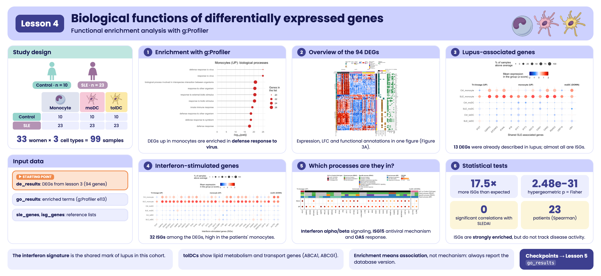

```{r, include = FALSE}
knitr::opts_chunk$set(
  collapse = TRUE,
  comment = "#>",
  message = FALSE,
  warning = FALSE,
  fig.align = "center",
  fig.width = 7,
  fig.height = 4.5
)
```

```{css, echo = FALSE, file = "lesson.css"}
```

## Welcome

In the previous lesson we found **94 differentially expressed genes (DEGs)** between lupus patients and controls. A list of genes, on its own, says little: the question now is **what do these genes do, and do they take part in common biological processes?**

**What you need to know beforehand:** you should have completed the lesson [Differentially expressed genes between patients and controls](l3_DEGs_en.html).

**By the end you will be able to:**

1. Explain what a **functional enrichment analysis** is and what question it answers.
2. Run an enrichment analysis with **g:Profiler** and interpret its results.
3. Recognize the main functional databases (Gene Ontology, Reactome, KEGG...).
4. Identify lupus-associated genes and **interferon-stimulated genes** among the DEGs.
5. Reproduce **Figure 3** of the article.
6. Correlate ISG expression with disease activity (SLEDAI).

**Estimated time:** 1.5 hours.

### Lesson map

```{=html}
<pre class="mermaid">
flowchart LR
  A["de_results<br/>(lesson 3)"] --> B["94 DEGs by cell<br/>type and direction"]
  B --> C["g:Profiler:<br/>enrichment"]
  B --> D["Reference lists:<br/>SLE and ISG"]
  C --> E["3A. DEG heatmaps,<br/>LFC and annotations"]
  D --> F["3B and 3C. Dot plots"]
  C --> G["3D. REAC and BP processes"]
  E --> H["Figure 3"]
  F --> H
  G --> H
  D --> I["ISG vs SLEDAI:<br/>Spearman"]
</pre>
<script type="module">
  import mermaid from "https://cdn.jsdelivr.net/npm/mermaid@11/dist/mermaid.esm.min.mjs";
  mermaid.initialize({ startOnLoad: true });
</script>
```

## Glossary

These are the terms we will use. Come back here whenever you need to.

- **Functional annotation**: information about what a gene does (processes, pathways, localization...).
- **Term**: a functional category, for example "response to virus", with its list of genes.
- **Functional enrichment**: tests whether a term appears in our gene list **more often than expected by chance**.
- **Hypergeometric test**: the statistical test behind enrichment (like drawing marbles from a bag without replacement).
- **Gene Ontology (GO)**: a vocabulary of functions with three branches: biological process (**BP**), cellular component (**CC**), and molecular function (**MF**).
- **Reactome (REAC)**, **KEGG**, **WikiPathways (WP)**: databases of biological pathways.
- **TF**: transcription factor binding sites. **MIRNA**: microRNA targets. **HP**: human phenotypes. **CORUM**: protein complexes.
- **Parent / specific term**: databases are organized in hierarchies; a general (parent) term contains more specific terms.
- **ISG** (*interferon-stimulated genes*): genes that are switched on in response to interferon.
- **SLEDAI** (*SLE Disease Activity Index*): lupus activity score; higher = more active disease.
- **Spearman correlation** (rho): measures whether two variables go up or down together by comparing their ranks; it ranges from −1 to 1.

```{r lesson_overview, echo = FALSE, out.width = "100%", fig.cap = "Visual summary of lesson 4."}

```

## 1. Setup

```{r setup}
library(GeneExprLupusMx) # package data
library(tidyverse)       # table manipulation and plots
library(ComplexHeatmap)  # heatmaps
library(circlize)        # color scales for ComplexHeatmap
library(grid)            # drawing shapes inside the heatmaps
library(cowplot)         # combining plots into a panel
```

Colors and thresholds (the same as in the previous lesson):

```{r colores}
cell_color  <- c(monocyte = "black", moDC = "palevioletred", tolDC = "gold1")
group_color <- c(Ctrl = "#96d4ccff", SLE = "#b493b4ff")

lfc_threshold  <- 1
padj_threshold <- 0.05
```

### Starting point: the DEGs from the previous lesson

The `de_results` checkpoint contains the `DESeq2` results for the three cell types. We gather the DEGs into a single table:

```{r deg_df}
deg_df <- bind_rows(lapply(names(de_results), function(cell) {
  de_results[[cell]] %>%
    filter(!is.na(padj), padj < padj_threshold, abs(log2FoldChange) >= lfc_threshold) %>%
    mutate(Cell_type  = cell,
           Expression = ifelse(log2FoldChange > 0, "Up-regulated", "Down-regulated"),
           query      = paste("SLE", ifelse(log2FoldChange > 0, "UP", "DOWN"), cell, sep = "_"))
}))

dplyr::count(deg_df, query)
```

Each combination of cell type and direction is a **gene list** (`query`). Monocytes have no down-regulated genes, so there are five lists.

The same gene can be a DEG in more than one cell type. For the plots we need **one row per gene** (94 genes) and a label describing its **pattern**: in which cell types it changes.

```{r gene_info}
genes_in <- function(cell, direction) {
  deg_df$gene[deg_df$Cell_type == cell & deg_df$Expression == direction]
}

gene_info <- deg_df %>%
  distinct(gene, .keep_all = TRUE) %>% # one row per gene
  mutate(pattern = case_when(
    gene %in% Reduce(intersect, list(genes_in("monocyte", "Up-regulated"),
                                     genes_in("moDC", "Up-regulated"),
                                     genes_in("tolDC", "Up-regulated"))) ~ "Tri-lineage (UP)",
    gene %in% intersect(genes_in("moDC", "Down-regulated"),
                        genes_in("tolDC", "Down-regulated")) ~ "moDC & tolDC (DOWN)",
    gene %in% genes_in("monocyte", "Up-regulated") ~ "monocyte (UP)",
    gene %in% genes_in("moDC", "Up-regulated")     ~ "moDC (UP)",
    gene %in% genes_in("moDC", "Down-regulated")   ~ "moDC (DOWN)",
    gene %in% genes_in("tolDC", "Up-regulated")    ~ "tolDC (UP)",
    gene %in% genes_in("tolDC", "Down-regulated")  ~ "tolDC (DOWN)"))

dplyr::count(gene_info, pattern)
```

**Tri-lineage (UP)** are the genes that go up in all three cell types (only `IFI27`), and **moDC & tolDC (DOWN)** are those that go down in both dendritic cell types.

## 2. What is an enrichment analysis?

Imagine a bag with 20,000 marbles (all the genes in the genome). 200 of them are red: the genes of a term, for example "response to virus". We draw 37 marbles at random (our monocyte DEGs). We would expect to draw fewer than one red marble. **If we draw 15, something is not down to chance**: our genes are **enriched** in that term.

The **hypergeometric test** calculates how likely it is to draw that many red marbles by chance. Because thousands of terms are tested at once, the p-values are corrected (FDR), just as in differential expression.

::: {.alert .alert-info}
**Enrichment is not causation.** A list being enriched in "response to virus" does not mean there is a virus: it means the genes that change tend to take part together in that function. It is a clue for generating hypotheses.
:::

## 3. **Step 1:** enrichment with g:Profiler

[g:Profiler](https://biit.cs.ut.ee/gprofiler) queries several databases at the same time (GO, Reactome, KEGG, WikiPathways, TF, miRNA, HP, CORUM). In R it is used through the `gost()` function of the `gprofiler2` package:

```{r gost, eval = FALSE}
library(gprofiler2)

deg_lists <- split(deg_df$gene, deg_df$query) # one gene list per query

# Archived version of g:Profiler (June 2025)
set_base_url("https://biit.cs.ut.ee/gprofiler_archive3/e113_eg59_p19")

gost_res <- gost(deg_lists,
                 organism          = "hsapiens", # human
                 correction_method = "fdr",      # multiple-testing correction
                 user_threshold    = 0.05,       # maximum padj
                 evcodes           = TRUE)       # include which genes each term has
```

::: {.alert .alert-warning}
**Databases change.** g:Profiler updates its annotations several times a year, so the same gene list can give somewhat different results over time. To make your analyses reproducible, **pin the version** with `set_base_url()` and report it.
:::

`gost()` needs an internet connection. So that this lesson works offline, the package includes the result as a checkpoint, `go_results`:

```{r go_results}
attr(go_results, "gprofiler_version")
glimpse(go_results)
```

The most important columns are:

| Column | Meaning |
|--------|---------|
| `query` | Gene list (cell type and direction) |
| `source` | Database |
| `term_name` | Term name |
| `term_size` | Genes annotated to the term in the whole genome |
| `intersection_size` | Genes from **our list** annotated to the term |
| `p_value` | Adjusted p-value (FDR) |
| `intersection` | Which genes those are |

How many significant terms are there per list and database?

```{r terms_table}
go_results %>%
  dplyr::count(query, source) %>%
  pivot_wider(names_from = source, values_from = n, values_fill = 0)
```

The lists with the most genes (monocytes UP, moDC DOWN) have more terms, and most come from GO:BP, the largest database.

### 3.1 The most significant terms

Let us look at the 10 most significant biological processes (GO:BP) in monocytes:

```{r top_terms, fig.width = 8, fig.height = 4.5}
go_results %>%
  filter(query == "SLE_UP_monocyte", source == "GO:BP") %>%
  slice_min(p_value, n = 10, with_ties = FALSE) %>%
  ggplot(aes(x = -log10(p_value), y = reorder(term_name, -log10(p_value)))) +
  geom_segment(aes(x = 0, xend = -log10(p_value), yend = term_name), color = "grey60") +
  geom_point(aes(size = intersection_size), color = "firebrick3") +
  labs(x = expression("-log"[10] * "(padj)"), y = NULL, size = "Genes in\nthe list",
       title = "Monocytes (UP): biological processes") +
  theme_minimal()
```

All the terms have to do with the **response to viruses and to interferon**: the interferon signature we saw in the previous lessons, now backed by the enrichment analysis.

::: {.callout-note}
**Challenge 1.** What are the 5 most significant Reactome (`REAC`) terms in tolDCs with up-regulated genes (`SLE_UP_tolDC`)? What kind of processes are they?
:::

<details class="callout-tip">
<summary>Show solution</summary>

```{r reto1}
go_results %>%
  filter(query == "SLE_UP_tolDC", source == "REAC") %>%
  slice_min(p_value, n = 5, with_ties = FALSE) %>%
  dplyr::select(term_name, intersection_size, p_value, intersection)
```

These are processes of **lipid and cholesterol metabolism and transport** (for example, the `ABCA1` pathway), very different from the interferon response seen in monocytes.

</details>

## 4. **Step 2:** overview of the 94 DEGs (Figure 3A)

We will build three *heatmaps* aligned by gene:

1. **Expression (z-score)** of each DEG across all samples.
2. **LFC** of each gene in each DEG list.
3. **Presence of significant annotation** in each database.

### 4.1 Expression heatmap

We order the samples by cell type and group, and take the z-scores of the 94 genes from the `zscore_mat` checkpoint:

```{r fig3a_mat}
sample_order <- metadata_cleaned %>%
  mutate(Cell_type = factor(Cell_type, levels = c("monocyte", "moDC", "tolDC"))) %>%
  arrange(Cell_type, Group)

deg_mat <- zscore_mat[gene_info$gene, sample_order$sample_ID]
dim(deg_mat)
```

We add annotations: on top, the group and cell type of each sample; on the left, the LFC; on the right, the gene biotype (from `biotype_summary`) and its pattern.

```{r fig3a_annotations}
pattern_color <- c("Tri-lineage (UP)" = "#b2182b", "monocyte (UP)" = "black",
                   "moDC (UP)" = "palevioletred", "moDC (DOWN)" = "palevioletred",
                   "tolDC (UP)" = "gold1", "tolDC (DOWN)" = "gold1",
                   "moDC & tolDC (DOWN)" = "blue")
biotype_color <- c("PCG" = "#7570B3", "lncRNA" = "#E7298A")
lfc_color <- colorRamp2(c(-2, -1, 0, 1, 2), c("#8c510a", "#bf812d", "white", "#35978f", "#01665e"))
zscore_color <- colorRamp2(c(-2, -1, 0, 1, 2), c("darkblue", "dodgerblue", "white", "red", "darkred"))

gene_biotype <- biotype_summary$Group_biotype[match(gene_info$gene, biotype_summary$gene)]
table(gene_biotype)

sample_anno <- HeatmapAnnotation(
  Group       = as.character(sample_order$Group),
  "Cell type" = as.character(sample_order$Cell_type),
  col = list(Group = group_color, "Cell type" = cell_color),
  annotation_name_side = "left")

ht_expression <- Heatmap(
  deg_mat, name = "Z-score", col = zscore_color,
  cluster_rows = TRUE, cluster_columns = FALSE, show_row_dend = FALSE,
  show_row_names = FALSE, show_column_names = FALSE,
  top_annotation  = sample_anno,
  left_annotation = rowAnnotation("SLE vs Control\n(LFC)" = gene_info$log2FoldChange,
                                  col = list("SLE vs Control\n(LFC)" = lfc_color)),
  right_annotation = rowAnnotation(Biotype = gene_biotype,
                                   "SLE vs Control\n(Cell type)" = gene_info$pattern,
                                   col = list(Biotype = biotype_color,
                                              "SLE vs Control\n(Cell type)" = pattern_color)),
  column_split = sample_order$Cell_type,
  row_split    = factor(gene_info$Expression, levels = c("Up-regulated", "Down-regulated")),
  heatmap_legend_param = list(direction = "horizontal"))
```

### 4.2 LFC heatmap by list

A matrix with the LFC of each gene in each DEG list (0 if the gene is not a DEG in that list). On top, a *barplot* with the number of DEGs in each list:

```{r fig3a_lfc}
lfc_mat <- deg_df %>%
  mutate(column = str_replace(query, "SLE_(UP|DOWN)_(.*)", "\\2 (\\1)")) %>% # "monocyte (UP)"
  dplyr::select(gene, column, log2FoldChange) %>%
  pivot_wider(names_from = column, values_from = log2FoldChange, values_fill = 0) %>%
  column_to_rownames("gene") %>%
  as.matrix()
lfc_mat <- lfc_mat[gene_info$gene, c("monocyte (UP)", "moDC (UP)", "moDC (DOWN)",
                                     "tolDC (UP)", "tolDC (DOWN)")]
colSums(lfc_mat != 0)

ht_lfc <- Heatmap(
  lfc_mat, name = "SLE vs Control\n(LFC)", col = lfc_color, show_heatmap_legend = FALSE,
  cluster_columns = FALSE, show_row_names = FALSE,
  rect_gp = gpar(col = "#f0f0f0", lwd = 1), border = TRUE,
  top_annotation = HeatmapAnnotation(
    "Cell type"  = c("monocyte", "moDC", "moDC", "tolDC", "tolDC"),
    "DEG Counts" = anno_barplot(colSums(lfc_mat != 0), add_numbers = TRUE, height = unit(1, "cm")),
    col = list("Cell type" = cell_color), show_legend = FALSE),
  width = unit(4, "cm"))
```

### 4.3 Annotation heatmap

In which databases does each gene have at least one significant term? We split the `intersection` column (comma-separated genes) into one row per gene:

```{r fig3a_presence}
gene_source <- go_results %>%
  dplyr::select(source, intersection) %>%
  separate_rows(intersection, sep = ",") %>%
  distinct(gene = intersection, source = str_remove(source, "GO:"))

presence_mat <- gene_source %>%
  mutate(present = "yes") %>%
  pivot_wider(names_from = source, values_from = present, values_fill = "no") %>%
  right_join(tibble(gene = gene_info$gene), by = "gene") %>% # the 94 DEGs
  mutate(across(-gene, ~ replace_na(.x, "no"))) %>%
  column_to_rownames("gene") %>%
  as.matrix()
presence_mat <- presence_mat[gene_info$gene,
                             c("BP", "CC", "MF", "REAC", "HP", "KEGG", "WP", "TF", "CORUM", "MIRNA")]
colSums(presence_mat == "yes")

n_up   <- sum(gene_info$Expression == "Up-regulated")
n_down <- sum(gene_info$Expression == "Down-regulated")

ht_presence <- Heatmap(
  presence_mat, name = "Significant\nannotation presence",
  col = c(yes = "#238b45", no = "#f0f0f0"),
  cluster_columns = FALSE, show_row_names = TRUE, row_names_gp = gpar(fontsize = 7),
  rect_gp = gpar(col = "white", lwd = 1),
  column_title = paste0(nrow(gene_info), " DEG (", n_up, " UP / ", n_down, " DOWN)"),
  width = unit(4, "cm"))
```

### 4.4 All three together

When joining *heatmaps* with `+`, `ComplexHeatmap` applies the row order of the first one to all of them, so each row is the same gene in all three:

```{r fig3a, fig.width = 13, fig.height = 15}
ht_fig3a <- ht_expression + ht_lfc + ht_presence

ht_opt$message <- FALSE
draw(ht_fig3a, ht_gap = unit(5, "mm"), merge_legends = TRUE,
     heatmap_legend_side = "top", annotation_legend_side = "top")
```

**What do you observe?**

- The genes that go **up** (top block) are mostly monocyte genes and have many annotations in almost all databases: they are well-studied immune response genes.
- The genes that go **down** are mostly moDC genes; several have few annotations or none, including the lncRNAs.
- In the expression column, the patients' monocyte block stands out in red for the up-regulated genes: this is the interferon signature.

## 5. **Step 3:** lupus-associated genes and ISGs (Figures 3B and 3C)

We compare the DEGs with two reference lists included in the package:

- `sle_genes`: genes associated with lupus in the literature (four studies).
- `isg_genes`: 423 interferon-stimulated genes (Yu et al., 2025).

```{r reference_lists}
sle_deg <- intersect(unique(sle_genes$Gene_name), gene_info$gene)
isg_deg <- intersect(isg_genes$genes, gene_info$gene)
sle_deg
length(isg_deg)
```

**13 DEGs** were already associated with lupus and **32** are ISGs. We plot them as in the previous lesson: a *dot plot* with the mean expression (z-score) by group and cell type. Since we will do this twice, we save it in a function:

```{r dotplot_fun}
plot_gene_dots <- function(genes, x_label, gene_levels = sort(genes)) {
  dots_df <- as.data.frame(zscore_mat[genes, ]) %>%
    rownames_to_column("gene") %>%
    pivot_longer(-gene, names_to = "sample_ID", values_to = "expression") %>%
    left_join(dplyr::select(metadata_cleaned, sample_ID, Group, Cell_type), by = "sample_ID") %>%
    group_by(Group, Cell_type, gene) %>%
    summarise(mean_expression = mean(expression),
              pct_expressed   = 100 * mean(expression > 0), .groups = "drop") %>%
    left_join(dplyr::select(gene_info, gene, pattern), by = "gene") %>%
    mutate(condition = factor(paste(Group, Cell_type, sep = "_"),
                              levels = c("SLE_tolDC", "Ctrl_tolDC", "SLE_moDC",
                                         "Ctrl_moDC", "SLE_monocyte", "Ctrl_monocyte")),
           pattern = factor(pattern, levels = c("Tri-lineage (UP)", "monocyte (UP)", "moDC (DOWN)")),
           gene    = factor(gene, levels = gene_levels))

  min_val <- min(dots_df$mean_expression)
  max_val <- max(dots_df$mean_expression)

  ggplot(dots_df, aes(x = gene, y = condition, color = mean_expression, size = pct_expressed)) +
    geom_point(alpha = 0.8) +
    scale_color_gradientn(colors = c("darkblue", "dodgerblue", "white", "red", "darkred"),
                          values = scales::rescale(c(-2, min_val, 0, max_val, 2)),
                          limits = c(-2, 2), oob = scales::squish) +
    ggh4x::facet_grid2(~ pattern, scales = "free_x", space = "free_x",
                       strip = ggh4x::strip_vanilla(clip = "off")) +
    labs(x = x_label, y = NULL,
         color = "Mean expression\nin the group (z-score)",
         size = "% of samples\nabove average") +
    theme_minimal(base_size = 12) +
    theme(legend.position = "top", legend.box = "vertical",
          strip.text.x = element_text(face = "bold"),
          axis.text.x = element_text(angle = 45, hjust = 1),
          plot.margin = margin(5.5, 40, 5.5, 5.5)) # margin so the last label is not cut off
}
```

```{r fig3b, fig.width = 8, fig.height = 5}
p_sle <- plot_gene_dots(sle_deg, "Shared SLE-associated genes",
                        gene_levels = c("IFI27", "CMPK2", "EIF2AK2", "IFI44L", "IFI6", "IFIT1",
                                        "IFIT3", "ISG15", "OAS1", "OAS2", "RSAD2", "USP18", "LBH"))
p_sle
```

```{r fig3c, fig.width = 12, fig.height = 5}
p_isg <- plot_gene_dots(isg_deg, "Interferon-stimulated genes (ISGs)")
p_isg
```

Almost all the lupus-associated genes we found are also **ISGs**, and they are highest in the **patients' monocytes** (row `SLE_monocyte`). `IFI27` is the exception that proves the rule: it goes up in all three cell types. In contrast, `LBH`, `AUTS2`, and `IL2RB` are DEGs that go **down** in the patients' moDCs. In the plot they stand out more for their high expression in monocytes, because the z-score compares each sample with all the others, across the three cell types.

### 5.1 Are there more ISGs than expected by chance?

`r length(isg_deg)` of the `r nrow(gene_info)` DEGs are ISGs. Is that a lot? We answer with the **hypergeometric test** from section 2: if we draw `r nrow(gene_info)` marbles (DEGs) from a bag with all the genes in the package, how likely is it that `r length(isg_deg)` or more are red (ISGs)?

We need four numbers:

```{r hyper_numbers}
N <- nrow(de_results$monocyte) # universe: all genes in the package
m <- nrow(isg_genes)           # ISGs in the reference list
k <- nrow(gene_info)           # DEGs
q <- length(isg_deg)           # DEGs that are ISGs

c(N = N, m = m, k = k, q = q)
k * m / N # ISGs expected among the DEGs by chance
```

By chance we would expect fewer than `r ceiling(k * m / N)` ISGs among the DEGs, and we found `r q`: a `r round(q / (k * m / N), 1)`-fold enrichment.

`phyper()` gives the probability of drawing **more than** `q - 1` red marbles, that is, `q` or more. We use `lower.tail = FALSE` because we care about the upper tail (over-representation):

```{r phyper}
p_hyper <- phyper(q - 1, m, N - m, k, lower.tail = FALSE)
p_hyper
```

**Fisher's exact test** asks the same question with a 2 × 2 table. With the one-sided alternative (`"greater"`) it is exactly the same test:

```{r fisher}
isg_table <- matrix(c(q, k - q, m - q, N - m - k + q), nrow = 2,
                    dimnames = list(ISG = c("Yes", "No"), DEG = c("Yes", "No")))
isg_table

isg_fisher <- fisher.test(isg_table, alternative = "greater")
isg_fisher
isg_fisher$p.value
```

When printing the result, R shows `p-value < 2.2e-16`: that is the limit it uses to **display** p-values, not the actual value. The full value is in `isg_fisher$p.value` and matches `phyper()`: `r format(p_hyper, digits = 3)`. Both tests reach the same conclusion: **ISGs are strongly enriched among the DEGs** (odds ratio = `r round(isg_fisher$estimate, 1)`).

::: {.callout-note}
**Challenge 2.** `r m - sum(isg_genes$genes %in% de_results$monocyte$gene)` of the `r m` ISGs in the reference list are not among the `r format(N, big.mark = ",")` genes in the package. Repeat the test using as `m` only the ISGs that are in the universe. Does the conclusion change?
:::

<details class="callout-tip">
<summary>Show solution</summary>

```{r reto2_hyper}
m_universe <- sum(isg_genes$genes %in% de_results$monocyte$gene)
m_universe
phyper(q - 1, m_universe, N - m_universe, k, lower.tail = FALSE)
```

The p-value is even smaller and the conclusion does not change. Using only the genes in the universe is the strictest option: a gene that was not measured cannot come out as a DEG.

</details>

## 6. **Step 4:** which processes do the ISGs take part in? (Figure 3D)

For each ISG we look up its **Reactome (REAC)** and **GO:BP** terms. Since each gene can be in many terms, we summarize with two:

- **Specific process:** the term with the **fewest** genes (minimum `term_size`), the most concrete.
- **Parent process:** the term with the **most** genes (maximum `term_size`), the most general.

```{r process_info}
process_info <- go_results %>%
  filter(source %in% c("REAC", "GO:BP")) %>%
  separate_rows(intersection, sep = ",") %>%
  dplyr::rename(gene = intersection) %>%
  group_by(source, gene) %>%
  summarise(specific_process = term_name[which.min(term_size)],
            parent_process   = term_name[which.max(term_size)],
            .groups = "drop")

process_info %>% filter(gene %in% c("ISG15", "OAS1"))
```

We build a matrix with one row per database (REAC and BP) and one column per ISG. Each cell holds the gene's **differential expression padj** if the gene has an annotation in that database, and is empty if it does not:

```{r fig3d_mat}
isg_order <- gene_info %>%
  filter(gene %in% isg_deg) %>%
  mutate(pattern = factor(pattern, levels = c("Tri-lineage (UP)", "monocyte (UP)", "moDC (DOWN)"))) %>%
  arrange(pattern, gene)

isg_padj <- sapply(c(REAC = "REAC", BP = "GO:BP"), function(src) {
  annotated <- isg_order$gene %in% process_info$gene[process_info$source == src]
  ifelse(annotated, isg_order$padj, NA)
})
isg_padj <- t(isg_padj)
colnames(isg_padj) <- isg_order$gene
isg_padj[, 1:6]
```

The annotations on top show each gene's pattern and its processes. Genes without annotation appear as "No information":

```{r fig3d, fig.width = 16, fig.height = 5}
# process of each gene in a database ("No information" if it has no annotation)
process_of <- function(src, column, genes = isg_order$gene) {
  info <- filter(process_info, source == src)
  value <- info[[column]][match(genes, info$gene)]
  replace_na(value, "No information")
}

# process colors (we will also use them in Figure S4)
reac_specific_color <- c(
  "Interferon alpha/beta signaling" = "#b3de69",
  "Immune System" = "#4daf4a",
  "Complement cascade" = "#80b1d3",
  "Alternative complement activation" = "#8c6bb1",
  "Synthesis of PI" = "#ffff33",
  "Defective ABCA1 causes TGD" = "#a50f15",
  "HDL remodeling" = "#a6bddb",
  "Resolution of Sister Chromatid Cohesion" = "#e7298a",
  "Cholesterol biosynthesis" = "#fd8d3c",
  "TNFR1-mediated ceramide production" = "#fccde5",
  "Establishment of Sister Chromatid Cohesion" = "#ae017e",
  "Maturation of nucleoprotein" = "#1f78b4",
  "RSV-host interactions" = "#e41a1c",
  "Inhibition of PKR" = "#33a02c",
  "Negative regulators of DDX58/IFIH1 signaling" = "#ff7f00",
  "ISG15 antiviral mechanism" = "#6a3d9a",
  "OAS antiviral response" = "#cab2d6",
  "No information" = "gray")
reac_parent_color <- c(
  "Immune System" = "#4daf4a",
  "Synthesis of PI" = "#ffff33",
  "Mitotic Metaphase and Anaphase" = "#377eb8",
  "Metabolism of lipids" = "#984ea3",
  "Transport of small molecules" = "#ff7f00",
  "Respiratory Syncytial Virus Infection Pathway" = "#e41a1c",
  "Nicotinate metabolism" = "#a65628",
  "No information" = "gray")
bp_parent_color <- c(
  "response to stimulus" = "#66c2a4",
  "cellular response to stimulus" = "#7a0177",
  "cell communication" = "#3f007d",
  "positive regulation of biological process" = "#fcc5c0",
  "biological regulation" = "#1f78b4",
  "ketone body catabolic process" = "#e31a1c",
  "multicellular organismal process" = "#ff7f00",
  "No information" = "gray")
padj_color <- colorRamp2(c(0, 0.001, 0.01, 0.05), c("darkred", "red", "#fd8d3c", "#fed976"))

process_anno <- HeatmapAnnotation(
  "SLE vs Control (Cell type)" = as.character(isg_order$pattern),
  "Parent process (REAC)"      = process_of("REAC", "parent_process"),
  "Specific process (REAC)"    = process_of("REAC", "specific_process"),
  "Parent process (BP)"        = process_of("GO:BP", "parent_process"),
  col = list("SLE vs Control (Cell type)" = pattern_color,
             "Parent process (REAC)"      = reac_parent_color,
             "Specific process (REAC)"    = reac_specific_color,
             "Parent process (BP)"        = bp_parent_color))

ht_fig3d <- Heatmap(
  isg_padj, col = padj_color, na_col = "#f0f0f0", border = TRUE,
  cluster_rows = FALSE, cluster_columns = FALSE, row_names_side = "left",
  rect_gp = gpar(type = "none"),
  layer_fun = function(j, i, x, y, w, h, fill) { # one circle per annotated cell
    grid.rect(x = x, y = y, width = w, height = h, gp = gpar(col = "grey", fill = NA))
    grid.circle(x = x, y = y, r = unit(2, "mm"),
                gp = gpar(fill = padj_color(pindex(isg_padj, i, j)), col = NA))
  },
  top_annotation = process_anno,
  column_split = isg_order$pattern,
  heatmap_legend_param = list(title = "FDR-BH\n(padj)", direction = "horizontal",
                              at = c(0, 0.01, 0.03)))

draw(ht_fig3d, merge_legends = TRUE, annotation_legend_side = "top", heatmap_legend_side = "top")
```

The monocyte ISGs are concentrated in the Reactome **immune system**, in specific antiviral processes: interferon alpha/beta signaling, the ISG15 antiviral mechanism, and the OAS antiviral response. **This is the molecular footprint of interferon in lupus.**

::: {.callout-note}
**Challenge 3.** Which monocyte genes take part in the Reactome term "Interferon alpha/beta signaling"?

*Hint:* filter `go_results` by `query`, `source`, and `term_name`, and look at the `intersection` column.
:::

<details class="callout-tip">
<summary>Show solution</summary>

```{r reto2}
go_results %>%
  filter(query == "SLE_UP_monocyte", source == "REAC",
         term_name == "Interferon alpha/beta signaling") %>%
  dplyr::select(term_name, intersection_size, term_size, p_value, intersection)
```

</details>

::: {.callout-note}
**Challenge 4.** In which databases is `ABCA1` (up-regulated in tolDCs) annotated, and what is its specific process in Reactome?

*Hint:* use `gene_source` and `process_info`.
:::

<details class="callout-tip">
<summary>Show solution</summary>

```{r reto3}
gene_source %>% filter(gene == "ABCA1")
process_info %>% filter(gene == "ABCA1")
```

`ABCA1` takes part in cholesterol transport: an example of the **lipid metabolism** alterations in the patients' tolDCs.

</details>

## 7. **Step 5:** processes of all the DEGs (Supplementary Figure S4)

Figure 3D showed only the ISGs. Let us repeat the analysis with **all the DEGs that have an annotation** in Reactome or GO:BP, grouping them by their Reactome parent process:

```{r s4_info}
s4_info <- gene_info %>%
  filter(gene %in% process_info$gene) %>%
  mutate(reac_parent   = factor(process_of("REAC", "parent_process", gene),
                                levels = names(reac_parent_color)),
         reac_specific = process_of("REAC", "specific_process", gene),
         bp_parent     = process_of("GO:BP", "parent_process", gene)) %>%
  arrange(reac_parent, gene)

nrow(s4_info)                   # DEGs with annotation in REAC or GO:BP
dplyr::count(s4_info, reac_parent)
```

As in Figure 3D, each cell holds the gene's differential expression padj if it has an annotation in that database:

```{r s4_mat}
s4_padj <- sapply(c(REAC = "REAC", BP = "GO:BP"), function(src) {
  annotated <- s4_info$gene %in% process_info$gene[process_info$source == src]
  ifelse(annotated, s4_info$padj, NA)
})
rownames(s4_padj) <- s4_info$gene
head(s4_padj)
```

```{r figura_s4, fig.width = 10, fig.height = 17}
ht_s4 <- Heatmap(
  s4_padj, col = padj_color, na_col = "#f0f0f0",
  border = TRUE, rect_gp = gpar(col = "white", lwd = 2),
  cluster_rows = FALSE, cluster_columns = FALSE, row_names_side = "right",
  left_annotation = rowAnnotation(
    "Parent process (REAC)"   = as.character(s4_info$reac_parent),
    "Specific process (REAC)" = s4_info$reac_specific,
    "Parent process (BP)"     = s4_info$bp_parent,
    col = list("Parent process (REAC)"   = reac_parent_color,
               "Specific process (REAC)" = reac_specific_color,
               "Parent process (BP)"     = bp_parent_color)),
  right_annotation = rowAnnotation(
    "SLE vs Control\n(Cell type)" = s4_info$pattern,
    col = list("SLE vs Control\n(Cell type)" = pattern_color),
    annotation_legend_param = list("SLE vs Control\n(Cell type)" = list(nrow = 3))),
  row_split = droplevels(s4_info$reac_parent), row_title_rot = 0,
  heatmap_legend_param = list(title = "FDR-BH\n(padj)", at = c(0, 0.001, 0.01, 0.05)),
  width = unit(2, "cm"))

draw(ht_s4, merge_legends = TRUE)
```

**What do you observe?**

- The largest block is **"Immune System"**: it brings together the monocyte ISGs and also T-cell genes that go down in moDCs (`CD28`, `CD40LG`, `ZAP70`, `CARD11`).
- The **tolDC** genes form their own groups: **lipid metabolism** (`ACAT2`, `MSMO1`, `SMPD3`) and **transport of small molecules** (`ABCA1`, `ABCG1`). This is the lipid alteration we saw in Challenge 1.
- Many genes without information in Reactome do have annotation in GO:BP, mostly as "biological regulation".

::: {.caption-justify}
**Supplementary Figure S4.** Biological processes associated with the DEGs obtained when comparing SLE against Ctrl in each cell type. Processes were classified according to the parent and specific categories of Reactome (REAC) and the parent terms of Gene Ontology Biological Process (GO:BP). The REAC parent processes include the immune system, cell division (*Mitotic Metaphase and Anaphase*), lipid metabolism, and transport of small molecules. The color scale represents the differential expression padj (FDR-BH) of each gene, with a maximum threshold of padj < 0.05; gray cells indicate that the gene has no annotation in that database. DEGs: differentially expressed genes.

The original supplementary figure can be found in the [supplementary material of the article](https://www.frontiersin.org/journals/immunology/articles/10.3389/fimmu.2026.1771959/full#supplementaryMaterial).
:::

## 8. To finish: Figure 3 of the article

We capture the *heatmaps* as graphical objects (as in the previous lesson) and join them with the *dot plots*:

```{r figura_3, fig.width = 16, fig.height = 30, out.width = "100%"}
grab <- function(ht, ...) {
  grid::grid.grabExpr(draw(ht, merge_legends = TRUE, heatmap_legend_side = "top",
                           annotation_legend_side = "top", ...), wrap.grobs = TRUE)
}

figure_3 <- plot_grid(
  grab(ht_fig3a, ht_gap = unit(5, "mm")),
  p_sle,
  p_isg,
  grab(ht_fig3d),
  labels = c("A", "B", "C", "D"), label_size = 20, ncol = 1,
  rel_heights = c(3.2, 0.9, 0.9, 1)
)
figure_3
```

::: {.caption-justify}
**Figure 3.** The functional enrichment analysis reveals cell type-specific perturbations and a shared lupus signature. **(A)** Integrated view of the DEGs and their functional enrichment. Left: *heatmap* of the `r nrow(gene_info)` DEGs (`r n_up` up-regulated and `r n_down` down-regulated) between SLE and Ctrl in the three cell types, selected with |LFC| ≥ 1 and padj < 0.05; the color scale corresponds to z-scores. Center: LFC of SLE versus Ctrl in each DEG list, with a *barplot* of the number of DEGs per list. Right: presence of significant functional terms (g:Profiler; hypergeometric test) in GO (BP, CC, MF), REAC, HP, KEGG, WP, TF, CORUM, and miRNA. **(B, C)** Mean expression (z-score) by group and cell type (rows) of **(B)** the SLE-associated DEGs and **(C)** the differentially expressed ISGs; the dot size indicates the percentage of samples above each gene's average. Genes are grouped by their pattern: "Tri-lineage (UP)" goes up in all three cell types, "monocyte (UP)" goes up in monocytes, and "moDC (DOWN)" goes down in moDCs. **(D)** Biological processes associated with the differentially expressed ISGs, according to the Reactome (REAC) parent and specific terms and the GO:BP parent terms. Circles indicate that the gene has an annotation in that database; their color represents the gene's differential expression padj (FDR-BH).

The original figure can be found in the [article](https://www.frontiersin.org/journals/immunology/articles/10.3389/fimmu.2026.1771959/full).
:::

To save it in high resolution:

```{r save_figure, eval = FALSE}
ggsave("Figure_3.png", figure_3, width = 16, height = 30, dpi = 300)
```

## 9. Going further: are ISGs related to disease activity?

ISG expression clearly separates patients from controls. A natural question is whether, **among patients**, ISGs are higher when the disease is more active. To answer it we correlate the z-score of each of the `r length(isg_deg)` ISGs with the **SLEDAI** score using **Spearman correlation**, which compares ranks and does not assume a linear relationship or normal data.

First we join the ISG z-scores with the SLEDAI of each patient sample. Each patient contributes three samples (monocyte, moDC and tolDC); the patient identifier is the part of `sample_ID` before the underscore:

```{r isg_sledai}
sle_info <- metadata_cleaned %>%
  filter(Group == "SLE") %>%
  mutate(sample_ID = as.character(sample_ID),
         patient   = sub("_.*", "", sample_ID),                # QR011_0 → QR011
         SLEDAI    = as.numeric(as.character(Sledai_score))) %>%
  dplyr::select(sample_ID, patient, Cell_type, SLEDAI)

isg_long <- zscore_mat[isg_deg, ] %>%
  as.data.frame() %>%
  rownames_to_column("gene") %>%
  pivot_longer(-gene, names_to = "sample_ID", values_to = "zscore") %>%
  inner_join(sle_info, by = "sample_ID")

# disease activity, as in Table 1 (lesson 1):
# 1 = active (SLEDAI ≥ 6), 0 = no or low activity (0-5)
sle_activity <- volunteer_info %>% filter(Group == "SLE")
dplyr::count(sle_activity, SLEDAI)
```

Only `r sum(sle_activity$SLEDAI == 1)` of the `r nrow(sle_activity)` patients (`r round(100 * mean(sle_activity$SLEDAI == 1), 1)`%) have active disease; the rest have no or low activity. With few active patients, the power to detect a correlation is limited.

We save the test in a function. Since we test `r length(isg_deg)` genes at once, we correct the p-values for **multiple testing** with FDR, just as `DESeq2` does with `padj`:

```{r spearman_fun}
spearman <- function(df) {
  test <- cor.test(df$zscore, df$SLEDAI, method = "spearman", exact = FALSE)
  tibble(rho = unname(test$estimate), p_value = test$p.value)
}
```

### 9.1 Without separating by cell type

To avoid counting the same patient three times, we average the z-score of the patient's three cell types before correlating:

```{r cor_overall}
cor_overall <- isg_long %>%
  group_by(gene, patient, SLEDAI) %>%
  summarise(zscore = mean(zscore), .groups = "drop") %>%
  group_by(gene) %>%
  group_modify(~ spearman(.x)) %>%
  ungroup() %>%
  mutate(FDR = p.adjust(p_value, method = "fdr")) %>%
  arrange(p_value)

knitr::kable(cor_overall, digits = 3, col.names = c("Gene", "rho", "p", "FDR"))
```

::: {.caption-justify}
**Supplementary Table (a).** Spearman correlation between the normalized expression (z-score) of the `r nrow(cor_overall)` differentially expressed ISGs and disease activity (SLEDAI) in `r dplyr::n_distinct(sle_info$patient)` SLE patients, without separating by cell type (mean z-score of each patient's monocytes, moDCs and tolDCs). The number of genes with p < 0.05 is `r sum(cor_overall$p_value < 0.05)`, and none is significant after correction for multiple testing (minimum FDR = `r sprintf("%.2f", min(cor_overall$FDR))`). rho, Spearman correlation coefficient; FDR, false discovery rate (Benjamini-Hochberg); ISG, interferon-stimulated genes; SLEDAI, SLE Disease Activity Index.
:::

### 9.2 By cell type

Now we repeat the test within each cell type (`r dplyr::n_distinct(sle_info$patient)` samples per type) and correct by FDR within each one:

```{r cor_celltype}
cor_celltype <- isg_long %>%
  group_by(Cell_type, gene) %>%
  group_modify(~ spearman(.x)) %>%
  group_by(Cell_type) %>%
  mutate(FDR = p.adjust(p_value, method = "fdr")) %>%
  ungroup() %>%
  mutate(Cell_type = factor(Cell_type, levels = c("monocyte", "moDC", "tolDC")))

cor_celltype %>%
  pivot_wider(id_cols = gene, names_from = Cell_type, values_from = c(rho, p_value, FDR),
              names_vary = "slowest", names_sort = TRUE) %>%
  arrange(gene) %>%
  knitr::kable(digits = 3,
               col.names = c("Gene", paste(c("rho", "p", "FDR"), rep(levels(cor_celltype$Cell_type), each = 3))))
```

::: {.caption-justify}
**Supplementary Table (b).** Spearman correlation between the normalized expression (z-score) of the `r dplyr::n_distinct(cor_celltype$gene)` differentially expressed ISGs and disease activity (SLEDAI) in each cell type (monocytes, moDCs and tolDCs; `r dplyr::n_distinct(sle_info$patient)` SLE patients per cell type). P-values were FDR-corrected within each cell type. `r sum(cor_celltype$p_value < 0.05)` of the `r nrow(cor_celltype)` tests has p < 0.05 and none is significant after correction (minimum FDR = `r sprintf("%.2f", min(cor_celltype$FDR))`). rho, Spearman correlation coefficient; FDR, false discovery rate (Benjamini-Hochberg); ISG, interferon-stimulated genes; moDC, monocyte-derived dendritic cells; tolDC, tolerogenic dendritic cells; SLEDAI, SLE Disease Activity Index.

The original table (Supplementary Table 8) can be found in the [article's supplementary material](https://www.frontiersin.org/journals/immunology/articles/10.3389/fimmu.2026.1771959/full#supplementaryMaterial).
:::

**What do you notice?**

- Some genes show nominal associations (p < 0.05) in one cell type, but **no correlation survives multiple-testing correction**.
- ISGs separate patients from controls but, in this cohort, no individual ISG tracks disease activity.
- Possible reasons: immunomodulatory treatments, the *in vitro* differentiation dampening the inflammatory signals the cells carried from the patient, and the fact that most patients have low activity.

::: {.alert .alert-warning}
**What can and cannot be concluded?**

- **We can say** that, in this cohort, we did not detect a significant association between ISG expression and SLEDAI, either without separating by cell type or within each cell type.
- **We cannot conclude** that ISGs are unrelated to lupus activity. A non-significant result is **absence of evidence, not evidence of absence**: with `r dplyr::n_distinct(sle_info$patient)` patients, a correlation needs |rho| above ~`r round(qt(0.975, dplyr::n_distinct(sle_info$patient) - 2) / sqrt(dplyr::n_distinct(sle_info$patient) - 2 + qt(0.975, dplyr::n_distinct(sle_info$patient) - 2)^2), 2)` to reach p < 0.05, and even more after FDR correction. Moderate correlations would go unnoticed.
- **Nor can we treat as a finding** a nominal association (uncorrected p < 0.05): with `r nrow(cor_celltype)` tests, we would expect ~`r round(nrow(cor_celltype) * 0.05)` p-values < 0.05 by chance alone.
- **It is consistent** with Challenge 3 of [lesson 2](intro_RNAseq_en.html): in the PCA, samples do not separate by disease activity either.
- **To answer it** would require a larger cohort, with more active patients, and measuring ISGs directly in uncultured cells.
:::

## 10. Summary

| Step | Key function | What for? |
|------|--------------|-----------|
| DEG lists | `filter()`, `split()` | Separate genes by cell type and direction |
| Enrichment | `gprofiler2::gost()` | Find overrepresented functions |
| Reproducibility | `set_base_url()` | Pin the database version |
| Explore terms | `slice_min(p_value)` | See the most significant processes |
| Genes per term | `separate_rows()` | Go from "term → genes" to "gene → terms" |
| Reference lists | `intersect()` | Find SLE genes and ISGs among the DEGs |
| ISG enrichment | `phyper()`, `fisher.test()` | Test whether there are more ISGs than expected by chance |
| Integrate | heatmaps with `+` | See expression, LFC, and annotations together |
| Correlation | `cor.test(method = "spearman")`, `p.adjust()` | Relate expression to disease activity |

### Common beginner mistakes

- **Interpreting enrichment as causation**: it indicates functional association, not mechanism.
- **Not reporting the database version**: results change over time.
- **Using very small lists**: with 4 genes (moDC UP) there is almost no power; the terms that come out may depend on a single gene.
- **Mixing up- and down-regulated genes in a single list**: it can dilute opposing signals.
- **Ignoring term size**: a term with 5,000 genes is very general; one with 20 is more informative.

## 11. Next steps

So far we have compared patients against controls within each cell type. The lesson [Differentiation of monocytes into dendritic cells](l5_DEGs_monocytes_diff_en.html) poses a different question: **what changes when a monocyte differentiates into a dendritic cell?**, and does it happen in the same way in patients and in controls?

To continue, click the **Next lesson: Monocyte differentiation** button at the bottom of this page.

```{=html}
<nav class="lesson-nav">
  <a class="lesson-prev" href="l3_DEGs_en.html">← Previous lesson: Differentially expressed genes</a>
  <a class="lesson-next" href="l5_DEGs_monocytes_diff_en.html">Next lesson: Monocyte differentiation →</a>
</nav>
<a class="back-to-top" href="#top" onclick="window.scrollTo({top: 0, behavior: 'instant'}); return false;" title="Back to the top of the page">↑ Back to top</a>
```

## Session information

```{r}
sessionInfo()
```
